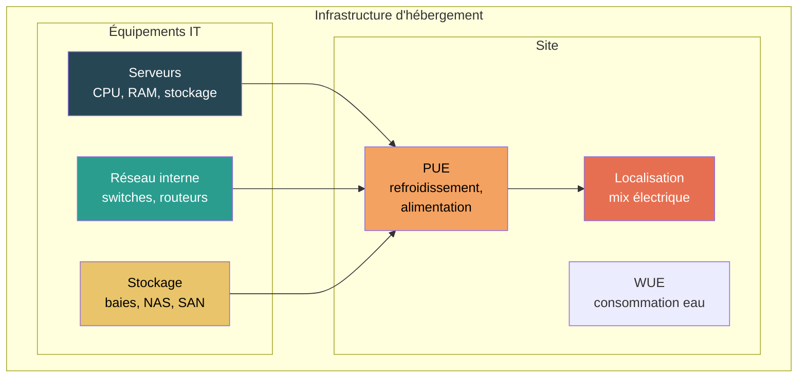

# Infrastructure d'hébergement

## Résumé

Ce chapitre évalue l'empreinte environnementale des infrastructures d'hébergement maîtrisées : salles serveurs on-premise, datacenters privés, environnements hybrides. La méthode relie les ressources techniques réellement utilisées (serveurs, stockage, réseau) à leur empreinte via une décomposition bottom-up par composant, ajustée par les caractéristiques du site (PUE, mix électrique, WUE).

Le cloud public opaque est traité dans le chapitre [Cloud](./cloud).

### Périmètre évalué

## Paramètres d'entrée

| Paramètre | Obligatoire | Source typique |
|---|---|---|
| Inventaire matériel (serveurs, stockage, réseau) | Oui | CMDB, monitoring |
| Localisation du site | Oui | Adresse du datacenter |
| PUE | Recommandé (1,58 par défaut) | Relevé site ou déclaration opérateur |
| Mix électrique | Oui | `digital4better/data/factor/*` (pays, mois) |
| Durée de vie des équipements | Oui | Politique de renouvellement ou [calcul durée de vie réelle](../../regles/temporalite-vieillissement-et-versionnement-des-donnees) |
| WUE | Optionnel | Relevé site (si disponible) |
| REF (part d'énergie renouvelable) | Optionnel | Contrat opérateur |

### Règle d'allocation

L'allocation dépend du niveau d'observation :

| Donnée disponible | Approche | Allocation |
|---|---|---|
| Inventaire physique complet | Bottom-up par composant | Temporelle (durée d'usage / durée de vie) |
| Ressources techniques (vCPU, RAM, stockage) | Par capacité réservée | vCPU, RAM Go, stockage To |
| Seul le service consommé | Approche système | Unité fonctionnelle (Go.an, vCPU.h) |

### Risque de double comptage

- Ne pas compter le datacenter à la fois comme infrastructure **et** comme service cloud ;
- Ne pas additionner serveurs du parc et serveurs de l'infrastructure sans frontière claire ;
- Voir [Double comptabilisation](../../regles/double-comptabilisation).

## Principe de calcul

### Étape 1 : inventaire des ressources

**On-premise** : inventaire physique depuis la CMDB (type, modèle, config CPU/RAM/stockage de chaque serveur).

**Hybride / partiellement observable** : conversion des ressources provisionnées (vCPU, Go RAM, To stockage) en composants équivalents via les modèles paramétriques.

### Étape 2 : impact intrinsèque (bottom-up)

Chaque serveur est décomposé en composants :

$$
\begin{align*}
&I_{emb_{serveur}} = N_{cpu} \times I_{cpu} + I_{ram} + I_{stockage} + I_{structurel}
\end{align*}
$$

Avec les modèles paramétriques détaillés dans [Serveurs](../../materiel/equipements/serveurs) et [Modélisation d'un équipement](../../modelisation/modelisation-d-un-equipement).

### Étape 3 : impact opérationnel (avec PUE)

$$
\begin{align*}
&I_{ope_{i}} = E_{IT} \times PUE \times IF_{i,pays}\htmlClass{unit}{[U_i]}\\
Avec\\
&E_{IT} = \sum_{k} P_k \times D_{usage_k}\htmlClass{unit}{[kWh]}\\
&PUE = \text{Power Usage Effectiveness (1,58 par défaut)}\\
&IF_{i,pays} = \text{Facteur d'impact électrique du pays}\\
\end{align*}
$$

Si le site dispose d'un REF (Renewable Energy Factor), l'impact opérationnel est ajusté :

$$
\begin{align*}
&I_{ope_{i}} = E_{IT} \times PUE \times \left( REF \times IF^{renouv}_{i,pays} + (1 - REF) \times IF_{i,pays} \right)
\end{align*}
$$

### Étape 4 : agrégation

$$
\begin{align*}
&I_{infra_{i}} = \sum_{k=1}^{n} I_{emb_{k,i}} + I_{ope_{i}}\htmlClass{unit}{[U_i]}
\end{align*}
$$

## Application concrète

**Cas : salle serveur d'une ETI (10 serveurs, France, PUE 1,8)**

| Composant | Détail | GWP emb. total | GWP emb./an (5 ans) |
|---|---|---|---|
| 10 serveurs (2 CPU 10nm 400mm², 256 Go DDR5, 4 To SSD) | Bottom-up par composant | 10 × 275 = 2 750 | 550 |
| Réseau (5 switches) | Archétype | 5 × 30 = 150 | 30 |
| **Total intrinsèque** | | | **580 kgCO₂e/an** |

| Opérationnel | Détail | Valeur |
|---|---|---|
| Consommation IT | 10 serveurs × 400 W moyen × 8 766 h | 35 064 kWh/an |
| Consommation totale (× PUE 1,8) | | 63 115 kWh/an |
| GWP opérationnel (France, 35 gCO₂e/kWh) | | **2 209 kgCO₂e/an** |

| **Total annuel** | **2 789 kgCO₂e/an** |
|---|---|
| Part intrinsèque | 21 % |
| Part opérationnelle | 79 % |

:::note[Lecture]
Contrairement au parc bureautique où l'intrinsèque domine, l'infrastructure d'hébergement est dominée par l'**opérationnel** (79 %) car les serveurs fonctionnent 24h/24. En France (mix bas carbone), c'est déjà le cas. Dans un pays à mix carboné (Pologne : 700 gCO₂e/kWh), l'opérationnel représenterait ~97 %. Le PUE de 1,8 (vieillissant) amplifie encore l'opérationnel ; un PUE de 1,2 (moderne) réduirait l'opérationnel de 33 %.
:::

## Hypothèses et limites

- La précision varie fortement entre on-premise (inventaire détaillé possible) et colocation (souvent partiel).
- Le PUE n'est pas toujours disponible au bon niveau géographique ; la valeur mondiale moyenne (1,58) est utilisée par défaut.
- Le WUE est rarement publié et reste optionnel dans cette itération.
- L'inférence de matériel depuis des ressources cloud provisionnées est traitée dans le chapitre [Cloud](./cloud).
- Les équipements réseau du datacenter sont souvent évalués avec des archétypes car leur composition détaillée est rarement connue.

## Données mobilisées

- Inventaire matériel (CMDB, monitoring)
- Modèles paramétriques composants : Green Cloud Computing (UBA 2021)
- `digital4better/data` → `data/cloud/*`, `data/equipment/*`, `data/factor/*`

## Sources

- ISO 14040 / ISO 14044
- Référentiel ADEME / ARCEP (RCP mère)
- Green Cloud Computing, UBA, 2021 (coefficients composants, approche par composant datacenter)
- [Uptime Institute](https://journal.uptimeinstitute.com/global-pues-are-they-going-anywhere/) (PUE mondial)
- [Modélisation d'un équipement](../../modelisation/modelisation-d-un-equipement) (méthode bottom-up)
- [digital4better/data](https://github.com/digital4better/data)
