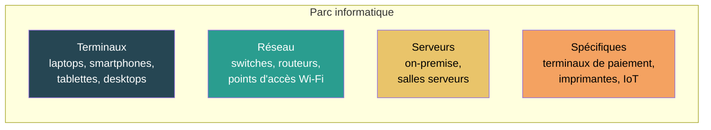

# Parc informatique

## Résumé

Le parc informatique est l'ensemble des équipements numériques détenus ou gérés par une organisation. L'évaluation repose sur un inventaire, une décomposition bottom-up par composant quand elle est possible, et une agrégation des impacts par équipement. C'est le cas d'usage le plus direct de la méthode : chaque équipement est évalué individuellement, puis les résultats sont sommés.

### Périmètre évalué

Exclusions (conformément au RCP Systèmes d'information) : claviers, souris, périphériques de saisie de masse négligeable, chargeurs.

:::note[Machines virtuelles]
Les VM ne sont pas des équipements du parc. Si l'organisation utilise des VM, c'est le **support physique** (serveur) qui est inventorié. Les VM sont une règle d'allocation, pas un objet matériel (voir [Couches logicielles et virtualisation](../../regles/prise-en-compte-des-couches-logicielles-et-de-la-virtualisation)).
:::

## Paramètres d'entrée

| Paramètre | Obligatoire | Source typique |
|---|---|---|
| Inventaire d'équipements | Oui | CMDB, gestion de flotte, listing RH |
| Période d'évaluation | Oui | Année civile, exercice fiscal |
| Type/modèle de chaque équipement | Recommandé | CMDB, fiches techniques |
| Durée de vie nominale ou réelle | Oui | Politique de l'organisation ou [calcul de durée de vie réelle](../../regles/temporalite-vieillissement-et-versionnement-des-donnees) |
| Durée d'utilisation quotidienne | Recommandé | Estimation par profil (bureau 8h, serveur 24h) |
| Pays d'usage | Oui | Localisation des sites |

### Règle d'allocation

L'allocation est **égale à 1** pour un équipement du parc : il est 100 % dédié à l'organisation.

Exceptions documentées :
- équipement en stock pendant une partie de la période → allocation au prorata de la durée d'utilisation effective ;
- équipement partagé entre deux entités → allocation au prorata documenté.

### Risque de double comptage

- Ne pas compter un serveur à la fois dans le parc **et** dans une infrastructure d'hébergement évaluée séparément ;
- Ne pas compter des VM comme des équipements si leur support physique est déjà dans l'inventaire ;
- Voir [Double comptabilisation](../../regles/double-comptabilisation).

## Principe de calcul

### Impact du parc = somme des impacts des équipements

$$
\begin{align*}
&I_{parc_{i}} = \sum_{k=1}^{n} \left( I_{emb_{k,i}} + I_{ope_{k,i}} \right)\htmlClass{unit}{[U_i]}
\end{align*}
$$

Chaque équipement est évalué selon la [modélisation bottom-up](../../modelisation/modelisation-d-un-equipement) :

1. **Si la composition est connue** : reconstruction par composant (CPU + RAM + stockage + écran + batterie + structurel)
2. **Si seule la famille est connue** : archétype paramétrique (config type)
3. **En dernier recours** : facteur forfaitaire par type d'équipement

### Impact intrinsèque annualisé

$$
\begin{align*}
&I_{emb_{k,i}} = \frac{I_{total\_emb_{k,i}}}{RL_k} \times EP\htmlClass{unit}{[U_i]}\\
Avec\\
&I_{total\_emb_{k,i}} = \text{Impact intrinsèque total de l'équipement } k\\
&RL_k = \text{Durée de vie réelle (ou nominale) de l'équipement } k\htmlClass{unit}{[an]}\\
&EP = \text{Durée d'évaluation}\htmlClass{unit}{[an]}\\
\end{align*}
$$

### Impact opérationnel

$$
\begin{align*}
&I_{ope_{k,i}} = P_k \times D_{usage_k} \times EP \times IF_{i,pays}\htmlClass{unit}{[U_i]}\\
Avec\\
&P_k = \text{Puissance moyenne de l'équipement } k\htmlClass{unit}{[kW]}\\
&D_{usage_k} = \text{Durée d'usage quotidienne}\htmlClass{unit}{[h/j]}\\
&IF_{i,pays} = \text{Facteur d'impact électrique du pays}\htmlClass{unit}{[U_i/kWh]}\\
\end{align*}
$$

## Application concrète

**Cas : parc d'une PME de 50 personnes (France)**

| Catégorie | Nombre | Type | GWP emb./an (bottom-up) | GWP opé./an | Total GWP/an |
|---|---|---|---|---|---|
| Laptops | 50 | CPU 7nm, 16 Go, 512 Go SSD, 14" LCD, 56 Wh | 50 × 29,2 = 1 460 | 50 × 0,8 = 40 | 1 500 |
| Écrans externes | 30 | 27" LCD | 30 × 21,5 = 645 | 30 × 0,6 = 18 | 663 |
| Smartphones | 50 | 4nm, 8 Go, 128 Go, OLED 6.5", 18 Wh | 50 × 28,4 = 1 420 | 50 × 0,004 = 0,2 | 1 420 |
| Switch réseau | 3 | Archétype réseau | 3 × 15 = 45 | 3 × 1,5 = 4,5 | 50 |
| Serveur | 2 | 2 CPU 10nm, 512 Go DDR5, 8 To SSD | 2 × 130 = 260 | 2 × 25 = 50 | 310 |
| **Total parc** | | | **3 830** | **113** | **3 943 kgCO₂e/an** |

:::note[Lecture]
L'impact intrinsèque représente **97 %** du total pour ce parc en France (mix bas carbone). Les laptops et smartphones dominent par leur nombre, pas par leur impact unitaire. Les serveurs, bien que seulement 2, pèsent autant que 10 laptops. L'impact opérationnel est marginal grâce au mix nucléaire français.
:::

## Hypothèses et limites

- La qualité du résultat dépend directement de l'exhaustivité et de la précision de l'inventaire.
- Les équipements mutualisés ou virtualisés doivent être traités via leurs supports physiques, pas via les VM.
- Les petits périphériques exclus par convention doivent rester documentés.
- La durée d'utilisation quotidienne est souvent estimée ; elle devrait être ajustée par profil d'usage quand c'est possible.
- Les équipements en stock doivent être traités avec une allocation explicite.

## Données mobilisées

- Inventaire du parc (CMDB, gestion de flotte)
- Modèles paramétriques composants : Green Cloud Computing (UBA 2021), Kelly et al. 2021
- `digital4better/data` → `data/equipment/*`, `data/factor/*`

## Sources

- RCP Systèmes d'information (ADEME/ARCEP)
- Green Cloud Computing, UBA, 2021 (coefficients composants)
- [Modélisation d'un équipement](../../modelisation/modelisation-d-un-equipement) (méthode bottom-up)
- [digital4better/data](https://github.com/digital4better/data)
