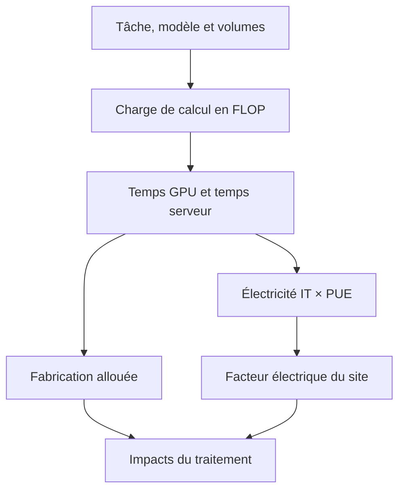

# IA générative

import { MethodIllustration } from '@site/src/components/method-illustrations';

Évaluer un service d’IA demande de relier une tâche à du calcul, puis à des équipements, de l’électricité et des impacts. Cette page couvre entraînement, fine-tuning, génération de texte et de médias, ainsi que l’analyse d’images, de vidéo et la transcription audio. La méthode relie le traitement serveur au cycle de vie complet du service.

## Définir le service étudié

Une requête n’est pas une unité suffisante sans préciser sa fonction : longueur du contexte, volume de sortie, qualité attendue, latence et nombre de tentatives. Un million de jetons, une minute de vidéo et un entraînement constituent des unités différentes.

Le périmètre distingue le traitement serveur, l’infrastructure réservée, le service applicatif, le développement du modèle et le cycle de vie du matériel. Chaque niveau comprend des ressources et des activités à inventorier.

La spécification SCI-AI[^source-4] distingue les responsabilités du fournisseur et du consommateur. Elle aide à fixer la frontière ; le périmètre de chaque étude reste explicite.

## Du service aux impacts

Des mesures représentatives constituent la référence pour l’énergie et la durée lorsqu’elles existent. Le modèle par opérations sert à expliciter un scénario lorsque ces données manquent. Une empreinte complète fournie par une API inclut déjà ses composants ; leur ajout créerait un double compte.

### Jetons, paramètres et opérations

Un [**jeton**](../../references/glossaire.md#jeton) est une unité du tokenizer, pas un mot. Son découpage dépend du modèle, de la langue et du contenu. Le comptage repose sur l’API ou le tokenizer ; une conversion constante mots/jetons reste une approximation.

Les paramètres sont les poids du modèle. Dans un modèle dense, la plupart participent au calcul ; dans un [**Mixture of Experts (MoE)**](../../references/glossaire.md#moe), seule une partie est activée pour chaque jeton. Le calcul utilise les paramètres actifs, mais la mémoire doit accueillir les poids stockés et les états nécessaires. Un [FLOP](../../references/glossaire.md#flop) désigne une opération ; FLOP/s désigne un débit. Ces deux unités décrivent des grandeurs différentes.

| Symbole | Définition | Unité |
|---|---|---|
| $P$, $P_p$ | Paramètres actifs du modèle génératif et du modèle de prompt | Nombre |
| $T$, $T_{in}$, $T_{out}$ | Jetons traités, en entrée et en sortie | Jetons |
| $Q$, $m$ | Débit GPU théorique et [MFU](../../references/glossaire.md#mfu) | FLOP/s ; fraction |
| $n$, $H$ | Nombre de GPU par serveur ; durée de vie matérielle | Nombre ; heures |
| $W_g$, $W_s$ | Puissance d’un GPU ; puissance du serveur hors GPU | Watts |
| $M_g$, $M_s$ | Fabrication d’un GPU ; fabrication du serveur hors GPU | kg CO₂e |

### Texte, entraînement et fine-tuning

Les approximations issues des modèles de calcul des Transformers représentent principalement les opérations proportionnelles aux paramètres (Hoffmann et al.[^source-1]).

| Traitement | Charge approximative | Convention |
|---|---|---|
| Entraînement | $F=6PT$ | Passe avant et rétropropagation |
| Fine-tuning | $F=6PT$ | Proxy d’entraînement complet ; gain LoRA non présumé |
| Traitement du prompt | $F_p=2PT_{in}$ | Avant réutilisation de préfixe |
| Génération de texte | $F_g=2PT_{out}$ | Génération avec cache des états du contexte |

$T$ doit compter **toutes les présentations** des données : un corpus de 10 milliards de jetons parcouru trois fois représente 30 milliards de jetons traités. Une multiplication supplémentaire par batch et étapes créerait un double compte si le compteur les inclut déjà.

**Dans ces formules, $P$ désigne les paramètres actifs par jeton**, y compris les couches partagées d’un MoE. Si le routage varie, le compte repose sur la moyenne des paramètres sollicités sur les jetons traités. Par exemple, Mixtral 8×7B mobilise environ 13 milliards de paramètres par jeton pour 47 milliards au total ; utiliser 47 milliards dans $2PT$ surestimerait cette composante du calcul.[^moe-actifs]

**Un paramètre gelé n’est pas un paramètre inactif.** Il conserve sa valeur pendant l’entraînement, mais intervient encore dans la passe avant. La rétropropagation à travers sa couche reste nécessaire si des paramètres situés en amont sont entraînés. [LoRA](../../references/glossaire.md#lora) réduit les poids mis à jour et leurs états d’optimiseur ; le gain de calcul dépend des opérations réellement conservées.[^gel-parametres]

Le proxy $6PT$ reste ici celui d’un entraînement complet, sans réduction automatique liée au gel des couches. Un calcul spécifique au fine-tuning distingue passe avant, propagation des gradients et mise à jour des poids. Multiplier simplement $P$ par la proportion entraînable ne suffit pas.

Ces approximations ne détaillent pas l’attention, le routage, les communications ni les déplacements mémoire. Précision numérique, quantification et taille des lots influencent les performances sans réduire automatiquement le nombre de paramètres.

### Générer des images, de la vidéo ou de l’audio

Le prompt et le média sont calculés séparément. Certains profils utilisent un encodeur de prompt distinct : $F_p=2P_pT_{in}$. Ces parcours de génération partent d’un **prompt textuel**. Les médias fournis en entrée relèvent des parcours d’analyse présentés dans la section suivante.

Les expressions ci-dessous donnent la charge totale $F$, prompt compris. Pour les profils [DiT/hybrides](../../references/glossaire.md#diffusion), $A(x)=2Px+4Lx^2d$ représente une étape sur $x$ positions : calcul proportionnel aux paramètres et attention. $L$ est le nombre de couches et $d$ leur dimension cachée.[^media-architecture]

| Sortie générée | Charge approximative | Paramètres de volume |
|---|---|---|
| Images, DiT/hybride | $F=F_p+kS\,A(N)$ | $k$ images, $S$ étapes, $N$ positions par image |
| Vidéo, DiT/hybride | $F=F_p+S\,A(N_v)$ | $N_v$ positions spatio-temporelles |
| Audio autorégressif | $F=F_p+2PN_aq$ | $N_a$ positions audio, $q$ codebooks |
| Audio par diffusion | $F=F_p+S\,A(N_a)$ | $N_a$ positions audio, $S$ étapes |

#### Formules des profils image et vidéo {#formules-des-profils-image-et-vidéo}

Pour une image de largeur $w$ et hauteur $h$, les profils retiennent une réduction spatiale de 8 puis des patches de côté $p$ dans l’[espace latent](../../references/glossaire.md#espace-latent) :

$$
N=\left\lceil\frac{\lfloor w/8\rfloor}{p}\right\rceil
  \left\lceil\frac{\lfloor h/8\rfloor}{p}\right\rceil
$$

Pour une vidéo, $k$ est le nombre d’images temporelles. Le profil peut le compléter à un multiple de $b$ avant une compression temporelle de facteur $c$ :

$$
k'=\lceil k/b\rceil b,\qquad
N_v=\left(\left\lfloor\frac{k'-1}{c}\right\rfloor+1\right)N
$$

Une vidéo de 5 secondes à 24 images/s représente ainsi **120 images avant compression**. Une image de 1 024 × 1 024 pixels contient quatre fois plus de positions spatiales qu’une image de 512 × 512 ; le terme d’attention croît davantage.

Les profils **U-Net** utilisent plutôt $F=F_p+kS\,2P\lfloor w/8\rfloor\lfloor h/8\rfloor$ ; en vidéo, $k$ est remplacé par $k'$. Cette approximation ne détaille pas les convolutions ni le décodage VAE.

#### Formules des profils audio {#formules-des-profils-audio}

Pour une durée $t$ en secondes et une fréquence d’échantillonnage $f_s$, le nombre de positions est $N_a=\lceil t f_s/c_t\rceil$, où $c_t$ est la réduction temporelle du profil. Les [codebooks](../../references/glossaire.md#codebook) $q$ sont les ensembles de codes utilisés pour représenter l’audio.

Ces proxies demandent une calibration par architecture et moteur. Le multiplicateur $q$ ne décrit pas à lui seul l’exécution parallèle ou séquentielle des codebooks. MusicGen et Stable Audio Open documentent les architectures, sans valider ces estimations d’énergie. Codecs, décodage et traitements de sortie restent à inventorier.[^media-audio]

### Analyser des médias en entrée

L’analyse additionne encodage du média, traitement de sa représentation avec la consigne et génération de la réponse. Un « jeton image » facturé par une API n’est pas un facteur énergétique universel.

| Entrée | Charge approximative | Profil et frontière |
|---|---|---|
| Images, pages scannées | $F=F_{enc}+2P_{lang}(T_{in,eff}+T_m+T_{out})$ | Qwen2.5-VL 7B ; $T_m$ positions visuelles |
| Vidéo | Même formule, avec $T_m=UN/4$ | Qwen2.5-VL 7B ; $U$ paires d’images, sans piste audio |
| Audio | $F=C(F_{conv}+F_{enc,bloc}+F_{dec,bloc})$ | Whisper base ; $C=\lceil t/30\rceil$ blocs de 30 s |

#### Calcul des entrées visuelles et audio {#calcul-des-entrées-visuelles-et-audio}

**Images et vidéo.** Le profil Qwen2.5-VL utilise des patches de 14 pixels, une fusion spatiale 2 × 2 et un regroupement temporel par deux. Les dimensions traitées $w,h$ sont arrondies au multiple supérieur de 28. Une image fixe est répétée pour former une paire.[^qwen-config]

$$
N=(w/14)(h/14),\qquad T_m=UN/4
$$

$U$ compte les images indépendantes ou les paires vidéo, avec $U=\lceil\lceil t f\rceil/2\rceil$ pour une durée $t$ et $f$ images analysées par seconde. $F_{enc}$ additionne projection des patches, projections linéaires, attention et fusion. L’encodeur comporte 32 couches, dont quatre à attention globale ; les autres utilisent des fenêtres.[^qwen-report]

Le cœur langage compte environ 7,61 milliards de paramètres ($P_{lang}$), séparément de l’encodeur. $T_{in,eff}$ représente la consigne après réutilisation éventuelle du préfixe. Le cache ne retire **ni l’encodage ni les positions du média**. L’attention longue du modèle de langage, les normalisations et les opérations non linéaires ne sont pas détaillées.

Le contexte comprend la consigne complète, les positions du média et la réponse. Au-delà des 128 000 positions retenues pour ce profil, le calcul demande un autre découpage. La résolution décrit l’image déjà redimensionnée ; elle ne reconstitue pas automatiquement le prétraitement réel.

**Audio.** Whisper base utilise six couches d’encodeur et six de décodeur, de dimension $d=512$. Le signal est ramené à 16 kHz puis découpé en fenêtres de 30 s, complétées si nécessaire. Chaque bloc comporte $N=1\,500$ positions après convolution.[^whisper-config][^whisper-audio]

Pour $C>0$, les $T_{out}$ jetons de transcription sont répartis en $u=T_{out}/C$ jetons par bloc. Avec $L_e=L_d=6$ couches et un vocabulaire de $V=51\,865$ unités :

$$
\begin{aligned}
F_{conv}&=2(3000)(80)d(3)+2Nd^2(3)\\
F_{enc,bloc}&=L_e(24Nd^2+4N^2d)\\
F_{dec,bloc}&=L_d\bigl(4Nd^2+28ud^2\\
&\quad+2du(u+1)+4Nud\bigr)+2udV
\end{aligned}
$$

Le décodeur comprend projections de l’attention croisée, génération avec cache KV et projection vers le vocabulaire. Pour $u=0$, son coût est nul dans ce proxy ; une durée audio nulle donne également zéro bloc. Une multiplication suivie d’une addition compte pour deux FLOP.

La limite est de **448 jetons par bloc**. Recherche en faisceau, nouvelles tentatives, détection de silence et découpage adaptatif ne sont pas inclus. Ainsi, 10 et 30 secondes occupent un même bloc dans ce scénario ; ces paliers dépendent du moteur et ne constituent pas une mesure d’énergie. Le [MFU](../../references/glossaire.md#mfu) et la puissance restent à calibrer.

<MethodIllustration kind="input-media" lang="fr" />

#### Combiner les modalités sans double comptage

Le résumé d’une vidéo avec son mobilise la piste visuelle, la transcription et, si nécessaire, le traitement du texte transcrit. Une réponse déjà incluse reste comptée une seule fois. Un PDF scanné passe par ses pages en images ; un PDF avec texte extrait peut suivre le parcours texte.

<MethodIllustration kind="combined-media" lang="fr" />

L’édition d’image et les modèles audio-vidéo natifs demandent également un profil propre à leur architecture. Une architecture conjointe nécessite des mesures du déploiement ou un profil dédié. Décodage, transferts, stockage et traitements applicatifs complètent le périmètre lorsqu’ils sont significatifs.

### Temps GPU et temps serveur

$$
D_{GPU,h}=\frac{F}{Qm\,3600},\qquad D_{serveur,h}=\frac{D_{GPU,h}}{n}
$$

Le [MFU](../../references/glossaire.md#mfu) est la fraction du débit théorique utilisée pour le travail modélisé. La valeur initiale de 0,4 est une hypothèse, pas une constante matérielle. Le débit doit correspondre à la précision et à l’usage des unités de calcul : les 989 TFLOP/s du H100[^ref-7] désignent ici le scénario dense FP16/BF16, pas FP32.

À [MFU](../../references/glossaire.md#mfu) inchangé, la division par $n$ suppose une accélération proportionnelle au nombre de GPU. Le [MFU](../../references/glossaire.md#mfu) doit être recalibré si la configuration change. La durée, le délai de traitement du prompt et le débit calculés ne sont donc pas des benchmarks de service. La faisabilité mémoire se vérifie séparément : poids, cache KV, activations et états d’optimiseur doivent tenir dans les ressources disponibles.

### [MFU](../../references/glossaire.md#mfu) : pourquoi le débit réel est inférieur au maximum {#comprendre-le-mfu}

Le [**MFU (Model FLOPs Utilization)**](../../references/glossaire.md#mfu) rapporte le débit de calcul utile au modèle au débit théorique des accélérateurs. Un [MFU](../../references/glossaire.md#mfu) de 0,4 signifie que 40 % de ce débit théorique contribue au travail compté. Cela ne signifie ni que le GPU est inactif 60 % du temps, ni qu’il consomme 40 % de sa puissance. La définition de PaLM, section 4.1[^ref-8] exclut notamment les opérations supplémentaires de recalcul des activations.

| Ce qui limite le débit | Pourquoi cela compte |
|---|---|
| Accès à la mémoire | Poids, activations et cache KV doivent circuler entre la mémoire du GPU et ses unités de calcul. La bande passante peut limiter le débit avant que les unités de calcul soient saturées. |
| Bus et liaisons entre équipements | PCIe, NVLink et le réseau entre serveurs transportent les données. Les échanges et synchronisations entre GPU peuvent laisser certaines unités en attente. |
| Parallélisme et taille des lots | Des lots trop petits occupent mal le GPU. Répartir le modèle sur davantage de GPU ajoute des communications ; un pipeline peut aussi comporter des périodes d’attente entre étapes. |
| Dépendances et exécution | En génération autorégressive, chaque nouveau jeton dépend des précédents. Les dimensions des matrices, les opérations annexes et l’ordonnancement logiciel influencent aussi le débit. |

Ces limites sont décrites dans les guides NVIDIA sur la performance GPU[^ref-9] et le parallélisme distribué[^ref-10]. Les transferts peuvent être partiellement masqués par du calcul : on ne doit pas additionner mécaniquement tous leurs temps.

**Dans le modèle par opérations**, le [MFU](../../references/glossaire.md#mfu) est un coefficient global, sans simulation séparée des bus ni des communications. Il intervient dans la durée $D=F/(nQm)$. À charge et matériel identiques, passer de 0,4 à 0,2 double la durée estimée, donc l’énergie et la fabrication allouée au temps actif dans ce modèle à puissance constante. Ce n’est pas une loi générale de consommation électrique.

<MethodIllustration kind="mfu" lang="fr" />

#### Choisir et calibrer le [MFU](../../references/glossaire.md#mfu) {#choisir-et-calibrer-le-mfu}

La valeur **0,4 est une hypothèse initiale**, pas une moyenne universelle. En inférence, elle sert de coefficient effectif à calibrer : traitement du prompt et génération n’ont pas les mêmes contraintes. Un [MFU](../../references/glossaire.md#mfu) d’entraînement n’est donc pas directement transposable à une requête isolée.

Pour $n$ GPU identiques, une durée de traitement mesurée $t$ en secondes permet d’estimer $m=F/(nQt)$. Cette estimation dépend de la convention de calcul de $F$, de la précision numérique de $Q$, du batch, du moteur et du matériel. Une valeur supérieure à 1 signale une incohérence de mesure, de périmètre ou de convention.

Une mesure sur la configuration complète produit un [MFU](../../references/glossaire.md#mfu) qui intègre déjà les pertes de parallélisation ; une seconde pénalité les compterait deux fois. Les périodes sans requêtes et l’attente en file restent distinctes de cette calibration. Une durée et une énergie déjà mesurées ne nécessitent pas de correction supplémentaire par le [MFU](../../references/glossaire.md#mfu).

Un calcul paramétrique du [MFU](../../references/glossaire.md#mfu) est prévu dans une prochaine évolution de la méthodologie, pour relier ces contraintes au matériel et à la charge. Il reste à calibrer et à valider sur des mesures ; il ne fait pas encore partie des règles de calcul.

### Électricité et fabrication

$$
E_{site,kWh}=D_{GPU,h}\frac{W_g+W_s/n}{1000}\,PUE
$$

$$
I_{usage}=E_{site,kWh}\,f_{électricité},\qquad
I_{fabrication}=\frac{D_{GPU,h}}{H}(M_g+M_s/n)
$$

Le serveur hors GPU inclut CPU, RAM, stockage et châssis. Le PUE multiplie l’électricité IT, **pas la fabrication**. Il ne faut pas l’appliquer si l’énergie mesurée couvre déjà le site. Les puissances nominales des profils ne remplacent pas une mesure moyenne au niveau du serveur.

$H$ est la durée de vie du matériel en heures : $H=années\times365{,}25\times24$.

Le calcul ci-dessus attribue la fabrication au temps de traitement. Un serveur réservé à un service lui reste toutefois attribué pendant les périodes sans requêtes. Traiter plus vite ne supprime donc pas cette part de fabrication ; elle reste à répartir entre les services qui réservent le matériel.

### Cache : deux mécanismes distincts

  <section>
    <h4>1. Cache KV</h4>
    
<strong>Au sein d’une même génération</strong>

    
Conserve les clés et valeurs d’attention des jetons déjà traités pour les réutiliser aux étapes suivantes.

    
Évite de recalculer les états des jetons précédents. Son usage est supposé dans le calcul de génération.

  </section>
  <section>
    <h4>2. Cache de préfixe</h4>
    
<strong>Entre plusieurs requêtes</strong>

    
Réutilise les états d’un début de prompt commun, par exemple les mêmes consignes ou le même document.

    
Réduit le travail de traitement du préfixe commun, sans réduire la génération de la réponse.

  </section>

#### Effet du cache de préfixe {#dans-le-simulateur--cache-de-préfixe}

La part $r$ du préfixe réutilisée réduit le calcul du prompt :

$$
F_{p,effectif}=F_p\left[(1-r)+\alpha r\right],\qquad
r=\frac{T_{cached}}{T_{in}}
$$

Le coefficient résiduel $\alpha=0{,}1$ est une hypothèse pour le travail conservé. La correction précède le calcul du temps, de l’énergie et de la fabrication allouée au temps actif. Elle ne modifie pas le travail de génération. Le taux réel de réutilisation nécessite une mesure ; mémoire, éviction, durée de conservation et synchronisation du cache peuvent ajouter des coûts.

Ex: 405,87 milliards de paramètres, 100 jetons d’entrée et 400 de sortie donnent $405{,}87\times10^{12}$ FLOP. Avec tout le préfixe réutilisé et 10 % de travail résiduel, la charge devient $332{,}8134\times10^{12}$ FLOP. Il s’agit d’un résultat du proxy, pas d’une économie mesurée.

## Compléter le cycle de vie

Le calcul sur la période étudiée est distingué de la part d’entraînement attribuée au service.[^rcp-app] Elle constitue une contribution distincte de l’inférence.

La répartition d’un entraînement entre usages repose sur un dénominateur documenté : volume réellement servi sur une période, capacité réservée ou scénarios d’usage futur. L’intensité d’entraînement allouée vaut $I_{train}/V_{service}$. Lorsque ce volume est inconnu, plusieurs scénarios rendent cette incertitude visible. Une prévision reste distincte d’une mesure.

Pour une application [RAG](../../references/glossaire.md#rag) ou agentique, l’inventaire couvre chaque étape : indexation, embeddings, recherche, appels de modèles, outils, stockage et nouvelles tentatives. Leurs impacts s’additionnent pour une **tâche achevée**, sans recompter le serveur d’un service déjà évalué. Les pages [Web](./service-web.md), [Cloud](../environnements/cloud.md) et [Hébergement](../environnements/infrastructure-d-hebergement.md) complètent ces postes.

L’eau directe du site demande une définition du WUE et une énergie IT compatible. L’eau associée à l’électricité relève d’un autre facteur. Métaux, ressources et toxicité nécessitent des inventaires caractérisés ; ils ne se déduisent pas d’un résultat carbone par un ratio constant.

<MethodIllustration kind="rag" lang="fr" />

## Mesure, incertitude et choix de méthode

| Approche | Données nécessaires | Usage pertinent |
|---|---|---|
| Mesure du déploiement | Durée, puissance serveur, charge, capacité inactive, allocation | Calibrer un service réel ; publier le périmètre de mesure |
| Proxy FLOP de cette page | Architecture, volumes, matériel, [MFU](../../references/glossaire.md#mfu) et puissances | Explorer les dépendances et expliciter les hypothèses |
| EcoLogits[^ref-12] | Modèle, fournisseur et activités couvertes par ses méthodologies | Évaluer des appels avec son corpus ; vérifier la modalité et la version |

EcoLogits documente désormais des méthodes pour l’inférence LLM et la vidéo. Les périmètres et modèles diffèrent : un classement de résultats sans harmoniser tâche, matériel, repos, cache et mix électrique ne démontre pas la précision d’une méthode.

La calibration de ce modèle repose sur des mesures couvrant plusieurs tailles de prompt et de sortie, batchs et niveaux de charge. L’analyse séparée de la durée et de l’énergie permet d’ajuster le [MFU](../../references/glossaire.md#mfu) ou les puissances. Un jeu de mesures distinct sert à vérifier l’erreur. Un intervalle obtenu en faisant varier les hypothèses est une **analyse de sensibilité**, pas un intervalle de confiance statistique.[^source-3]

Une confrontation à des mesures publiées montre une limite concrète : à nombre total de jetons identique, le proxy à [MFU](../../references/glossaire.md#mfu) constant ne reproduit pas l’écart observé entre prompt long et réponse longue. La taille du batch modifie aussi l’énergie par requête. La calibration doit donc distinguer ces situations ; aucune correction universelle n’est déduite de ces observations.[^phase-mesures]

### Travaux récents et portée de leurs résultats

More than Carbon (2025)[^ref-13] étudie le cycle de vie de l’A100 sur plusieurs catégories d’impact. Life-Cycle Emissions of AI Hardware (2025)[^ref-14] traite la production et l’usage du matériel. Ces travaux justifient de séparer phases et indicateurs ; ils ne valident pas tous les profils matériels de cette méthodologie.

L’étude de recherche Moshi (prépublication, 2026)[^ref-15] inclut expériences, essais échoués et développement. Pour la vidéo, Video Killed the Energy Budget (2025)[^ref-16] étudie les régimes de latence et de puissance de modèles ouverts. Ces résultats motivent une frontière explicite et une calibration par déploiement, pas un facteur universel par jeton ou seconde de média.

Pour appliquer ces choix : [périmètre](../../fondations/perimetre-frontieres-services-tiers-et-unite-d-analyse.md), [allocation](../../regles/allocation-et-partage-des-impacts.md), [qualité des données](../../regles/qualite-des-donnees-et-matrice-de-robustesse.md) et [double comptage](../../regles/double-comptabilisation.md).

#### Relier les études du corpus aux calculs D4B

Le rapport ADEME sur les GPU répartit les impacts sur les heures d’activité utiles de la carte. L’exemple D4B ci-dessus rapporte la fabrication aux heures calendaires de vie, puis à la durée du calcul. Ces dénominateurs diffèrent lorsque le matériel reste au repos ; un facteur par [GPU·h](../../references/glossaire.md#gpu-heure) n’est pas interchangeable sans connaître cette allocation.[^corpus-gpu]

Le rapport porte sur le matériel étudié. Ses exclusions, notamment réseau, terminaux et bâtiment, ne deviennent pas celles d’un service IA complet. La frontière du facteur doit être connue avant d’ajouter le reste du serveur ou l’électricité.[^corpus-gpu]

*How Hungry is AI?* estime l’énergie d’inférence à partir de performances API, de configurations matérielles inférées et d’hypothèses de puissance et de batch. Ses résultats ne sont pas des mesures électriques directes des API. Le modèle exclut le repos des GPU inutilisés dans les nœuds partiellement chargés : cette limite reste visible lors d’un rapprochement avec une infrastructure réservée.[^corpus-inference]

## Hypothèses et limites {#hypotheses-et-limites}

Le modèle par opérations fournit une **estimation du traitement serveur**, fondée sur un compte d’opérations et des profils matériels. Une source sur l’architecture d’un modèle ne valide pas à elle seule son énergie ni son empreinte.

### Hypothèses retenues

| Poste | Hypothèse initiale | Ce qu’il faut adapter |
|---|---|---|
| Calcul et parallélisme | [MFU](../../references/glossaire.md#mfu) 0,4 ; débit théorique selon la précision du profil GPU | Mesurer la durée sur le modèle, le moteur, le batch et le matériel utilisés |
| Électricité | PUE 1,2 ; facteur des États-Unis au démarrage, instantané 2025 | Choisir le lieu et la période ; les facteurs nationaux ne décrivent pas un site à chaque heure |
| Matériel | Puissances et fabrication issues de profils ; durée de vie de 5 ans | Remplacer les proxys par des mesures et un inventaire documenté |
| Allocation | Fabrication répartie au prorata du temps actif ; autres composants partagés par GPU | Compléter la capacité réservée au repos et les règles de partage du serveur |
| Modèle | Architecture et paramètres référencés ou explicitement supposés | Vérifier version, précision, quantification et modalités couvertes |
| Cache | Cache KV supposé ; préfixe réutilisé à 0 % au départ, avec 10 % de calcul résiduel lorsqu’il est réutilisé | Mesurer la réutilisation ; conservation, éviction et transferts ne sont pas détaillés |

Les valeurs retenues pour une étude sont documentées avec leur source et peuvent différer de ces hypothèses initiales. Pour les entrées visuelles, le cache de préfixe réduit le texte seulement ; cette correction ne s’applique pas au profil de transcription audio.

### Limitations connues

- **Périmètre partiel.** Terminaux, réseau externe, stockage applicatif, RAG, capacité inactive et bâtiment restent à compléter. L’entraînement n’est pas automatiquement alloué aux requêtes d’inférence.
- **Faisabilité matérielle non vérifiée.** Les poids, activations et caches peuvent dépasser la mémoire disponible. Les contrôles de contexte des profils d’entrée ne vérifient pas cette capacité. Les profils proposés ne décrivent pas les TPU, FPGA ou autres accélérateurs.
- **Performance simplifiée.** Les formules ne détaillent pas tous les coûts d’attention, de routage, de mémoire ou de communication. La puissance est constante dans le calcul ; un [MFU](../../references/glossaire.md#mfu) identique ne garantit pas la même efficacité pour un autre traitement.
- **Portée des modalités.** La vidéo en entrée exclut sa piste audio ; Whisper utilise des blocs complétés de 30 s. Les profils de génération sont exploratoires. Édition d’image et modèles multimodaux conjoints nécessitent un profil dédié.
- **Données incertaines.** Les caractéristiques des modèles fermés, les facteurs de fabrication et l’activité réelle peuvent être mal connus. Une unité facturée ou un jeton mis en cache n’est pas une mesure physique d’impact.

### Interpréter et consolider le résultat

L’électricité et le climat affichés sont un **sous-total de périmètre**, pas une ACV complète, une latence garantie ou un facteur universel par requête. L’eau, les ressources et la toxicité demandent des données propres ; elles ne se déduisent pas du carbone.

La réutilisation d’un résultat suppose une tâche, une version du modèle, un matériel, un lieu, une période et des exclusions documentés. Sa validation repose sur des mesures de durée et d’énergie ; une variation des hypothèses décrit une sensibilité, pas un intervalle de confiance. Les sections [Compléter le cycle de vie](#compléter-le-cycle-de-vie) et [Mesure, incertitude et choix de méthode](#mesure-incertitude-et-choix-de-méthode) précisent cette démarche.

## Exemple complet : Llama 3.1 405B

Cet exemple historique permet de refaire les opérations. Il utilise 405 milliards de paramètres arrondis, 15 000 milliards de jetons et un facteur électrique de 0,420 kg CO₂e/kWh. Le simulateur utilise les paramètres de son profil et le facteur national versionné sélectionné ; ses valeurs peuvent donc différer.

### Configuration, calcul de l’entraînement et de l’inférence

| Élément | Puissance | Fabrication |
|---|---:|---:|
| 8 GPU H100 | 8 × 700 W | 8 × 250 kg CO₂e |
| 2 CPU | 2 × 350 W | 2 × 113 kg CO₂e |
| RAM, 2 000 Go | 2 000 × 0,392 W | 2 000 × 1,3 kg CO₂e |
| SSD, 30 000 Go | 30 000 × 0,0012 W | 30 000 × 0,16 kg CO₂e |
| Châssis | Non individualisée | 250 kg CO₂e |
| Total hors GPU | 1 520 W | 7 876 kg CO₂e |

Ces facteurs de fabrication sont des hypothèses historiques, pas une ACV certifiée du DGX. Avec [MFU](../../references/glossaire.md#mfu) 0,4, PUE 1,2 et durée de vie de cinq ans :

| Étape | Calcul | Résultat arrondi |
|---|---|---:|
| Charge d’entraînement | $6\times405\times10^9\times15\times10^{12}$ | $3{,}645\times10^{25}$ FLOP |
| Temps GPU cumulé | $F/(989\times10^{12}\times0{,}4\times3600)$ | 25,59 millions GPU·h |
| Électricité du site | $D_{GPU,h}\times(0{,}700+1{,}520/8)\times1{,}2$ | 27,33 millions kWh |
| Usage | $E\times0{,}420$ | 11 480 t CO₂e |
| Fabrication allouée | $D_{GPU,h}(250+7876/8)/(5\times365{,}25\times24)$ | 721 t CO₂e |

La fiche Meta[^ref-11] déclare 30,84 millions de GPU·h pour le 405B. L’écart d’environ 17 % sur le temps ne valide pas le modèle : précision, utilisation, opérations annexes et frontière doivent être rapprochées.

Pour **un million de jetons générés**, hors prompt, le même scénario donne 0,569 GPU·h, 255 g CO₂e d’usage et 16 g de fabrication, soit 271 g. Avec 400 jetons d’entrée et 400 de sortie, sans cache de préfixe, le proxy donne environ 0,217 g CO₂e. Ces résultats n’ont pas valeur de facteur universel par requête.

## Exemple interactif {#simuler-votre-situation}

L’exemple interactif applique le modèle par opérations décrit ci-dessus à un traitement serveur. Sa couverture reste partielle : il ne constitue ni une ACV complète du service ni une implémentation complète de SCI-AI.

| Frontière | Éléments à inventorier | Dans le simulateur |
|---|---|---|
| Traitement serveur | Accélérateurs, CPU, RAM, stockage, durée, énergie et fabrication allouée | Oui, avec des profils simplifiés |
| Infrastructure réservée | Temps actif et inactif, redondance, réseau interne, capacité disponible | Temps actif seulement ; PUE pour l’exploitation du site |
| Service applicatif | Orchestration, RAG, base vectorielle, outils, API tierces, terminaux et réseau | À compléter |
| Développement du modèle | Préparation des données, essais, entraînements abandonnés, évaluations et modèle final | Un traitement à la fois, sans inventaire automatique |
| Cycle de vie matériel | Fabrication, transport, maintenance et fin de vie selon l’ACV utilisée | Fabrication des profils ; autres phases à vérifier |

| Votre besoin | Entrée → sortie | Parcours du simulateur |
|---|---|---|
| Créer une image, une vidéo, de la voix ou de la musique | Texte → média | Générer, puis choisir le média |
| Décrire une photo, lire un document scanné | Images + consigne → texte | Analyser des images |
| Résumer les scènes d’une vidéo | Images échantillonnées + consigne → texte | Analyser une vidéo, piste visuelle |
| Transcrire une conversation | Audio → texte | Transcrire un audio |

Les parcours **Générer**, **Analyser un média** et **Entraîner** décrivent chacun une tâche, un modèle et un volume à traiter. Le serveur, le pays, le PUE, le [MFU](../../references/glossaire.md#mfu) et la durée de vie restent modifiables dans les hypothèses. Les modèles fermés sont signalés lorsque leurs paramètres sont supposés. [Explication du coefficient](#comprendre-le-mfu).

import { AIPlayGround } from '@site/src/components/ai-playground';

<AIPlayGround lang="fr" methodologyHref="#hypotheses-et-limites" />

[^rcp-app]: ADEME, [RCP des applicatifs numériques, juin 2026](https://librairie.ademe.fr/economie-circulaire-et-dechets/9434-referentiel-par-categorie-de-produit-rcp-des-applicatifs-numeriques.html), p. 10, 54. Le RCP couvre les services utilisant de l’IA générative, mais un entraînement antérieur à la période étudiée peut échapper à son périmètre temporel. L’évaluation du cycle de vie du modèle répond à une autre question ; la méthode D4B conserve l’entraînement et son allocation explicite aux usages.

[^source-1]: Calcul des modèles : [Kaplan et al., Scaling Laws for Neural Language Models, 2020](https://arxiv.org/abs/2001.08361), [Hoffmann et al., Training Compute-Optimal Large Language Models, 2022](https://arxiv.org/abs/2203.15556), [Hu et al., LoRA, 2021](https://arxiv.org/abs/2106.09685), [Meta, The Llama 3 Herd of Models, 2024](https://arxiv.org/abs/2407.21783).

[^source-3]: Mesure en production : [Measuring the environmental impact of delivering AI at Google Scale](https://services.google.com/fh/files/misc/measuring_the_environmental_impact_of_delivering_ai_at_google_scale.pdf). Les observations d’un déploiement ne sont pas des coefficients universels.

[^source-4]: Cadre d’allocation : [SCI](https://sci.greensoftware.foundation/) et [SCI-AI](https://github.com/Green-Software-Foundation/sci-ai/blob/main/SPEC.md). Documentation en ligne, version non figée.

[^ref-7]: [H100](https://www.nvidia.com/en-us/data-center/h100/).

[^ref-8]: [PaLM, section 4.1](https://arxiv.org/html/2204.02311v5#S4.SS1).

[^ref-9]: [performance GPU](https://docs.nvidia.com/deeplearning/performance/dl-performance-gpu-background/index.html). Documentation en ligne, version non figée.

[^ref-10]: [parallélisme distribué](https://docs.nvidia.com/nemo/megatron-bridge/latest/parallelisms.html). Documentation en ligne, version non figée.

[^ref-11]: [Meta, Llama 3.1 405B Instruct, 2024](https://huggingface.co/meta-llama/Llama-3.1-405B-Instruct).

[^ref-12]: [EcoLogits](https://ecologits.ai/latest/methodology/). Documentation en ligne, version non figée.

[^ref-13]: [More than Carbon (2025)](https://arxiv.org/abs/2509.00093).

[^ref-14]: [Life-Cycle Emissions of AI Hardware (2025)](https://arxiv.org/abs/2502.01671).

[^ref-15]: [étude de recherche Moshi (prépublication, 2026)](https://arxiv.org/abs/2604.11154).

[^ref-16]: [Video Killed the Energy Budget (2025)](https://arxiv.org/abs/2509.19222).

[^corpus-gpu]: E. Lees-Perasso, D. Ekchajzer, G. Roussilhe et T. De Latour, [Analyses de cycle de vie de GPU pour l’intelligence artificielle](https://librairie.ademe.fr/economie-circulaire-et-dechets/9103-analyse-de-cycle-de-vie-de-gpu-cartes-graphiques-pour-l-intelligence-artificielle.html), ADEME, mars 2026, rapport de 93 pages, § 3.10.5–3.11.1, p. 22–23.

[^corpus-inference]: N. Jegham et al., [How Hungry is AI? Benchmarking Energy, Water, and Carbon Footprint of LLM Inference](https://arxiv.org/abs/2505.09598v6), v6, 24 novembre 2025, § 4.1–4.3, p. 3–5.

[^phase-mesures]: Caravaca, Cuevas et Cuevas, [From Prompts to Power](https://arxiv.org/html/2511.05597v1), novembre 2025, prépublication v1, sections III-B, IV-A et IV-B. Mesures GPU NVML ; le périmètre exclut les autres composants et le PUE.

[^moe-actifs]: Jiang et al., [Mixtral of Experts](https://arxiv.org/abs/2401.04088v1), 2024, abstract, § 2.

[^gel-parametres]: Hu et al., [LoRA](https://arxiv.org/html/2106.09685v2), 2021, § 4.1 ; PyTorch, [Autograd mechanics](https://docs.pytorch.org/docs/2.14/notes/autograd.html#setting-requires-grad), version 2.14, « Setting requires_grad ».

[^media-architecture]: Peebles & Xie, [Scalable Diffusion Models with Transformers](https://arxiv.org/abs/2212.09748), 2022. Source d’architecture ; les expressions ci-dessus sont des proxies D4B à calibrer.

[^media-audio]: Meta, [Simple and Controllable Music Generation](https://arxiv.org/abs/2306.05284), 2023 ; Stability AI, [Stable Audio Open](https://arxiv.org/abs/2407.14358), 2024.

[^qwen-config]: Qwen, [Qwen2.5-VL-7B-Instruct, config.json](https://huggingface.co/Qwen/Qwen2.5-VL-7B-Instruct/blob/cc594898137f460bfe9f0759e9844b3ce807cfb5/config.json), 2025, commit cc594898, vision_config / text_config.

[^qwen-report]: Qwen, [Qwen2.5-VL Technical Report](https://arxiv.org/abs/2502.13923), 2025, § 2.

[^whisper-config]: OpenAI, [Whisper base, config.json](https://huggingface.co/openai/whisper-base/blob/e37978b90ca9030d5170a5c07aadb050351a65bb/config.json), commit e37978b, encoder_layers, decoder_layers, d_model, max_source_positions, max_target_positions.

[^whisper-audio]: OpenAI, [Whisper audio preprocessing](https://github.com/openai/whisper/blob/main/whisper/audio.py), SAMPLE_RATE, CHUNK_LENGTH, N_FRAMES. Code en ligne, version non figée.
