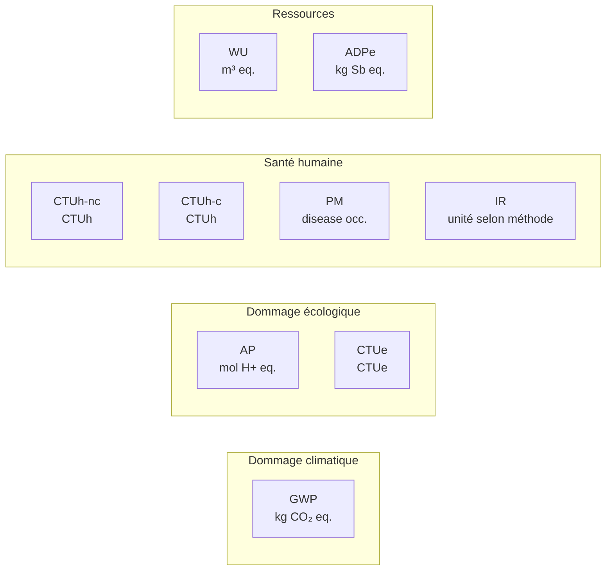

# Indicateurs environnementaux

import { MethodIllustration } from '@site/src/components/method-illustrations';

La méthode retient une lecture multicritère. Les émissions de gaz à effet de serre sont importantes, mais elles ne suffisent pas à décrire à elles seules les impacts du numérique. L'extraction de métaux critiques, la consommation d'eau, la toxicité des procédés de fabrication et l'épuisement des ressources abiotiques sont autant de dimensions que le seul indicateur carbone ne capture pas.

## Indicateurs pris en compte dans l'évaluation {#indicateurs-pris-en-compte-dans-l-evaluation}

Quel que soit l'objet d'étude, la méthode aboutit à une évaluation sous la forme d'indicateurs environnementaux. La sélection de neuf indicateurs est la convention D4B conservée dans cette version.

Les neuf indicateurs [mid-point](../references/glossaire.md#approche-mid-point) retenus sont regroupés en quatre familles de lecture. Ces regroupements éditoriaux ne constituent pas un calcul de dommages [end-point](../references/glossaire.md#approche-end-point) :

Un indicateur de flux supplémentaire vient aider à l'interprétation des résultats : la **consommation d'électricité** (kWh).

### Tableau des indicateurs

| Indicateur mid-point | Abréviation | Unité | Famille de lecture | Définition |
|---|---|---|---|---|
| Changement climatique total | GWP | kg CO₂ eq. | Dommage climatique | Potentiel de changement climatique induit par les émissions de gaz à effet de serre (GES). Les GES absorbent le rayonnement infrarouge émis par la surface de la Terre ; l'augmentation de leur concentration contribue au réchauffement climatique. |
| Acidification | AP | mol H+ eq. | Dommage écologique | Potentiel d'acidification des milieux (sols et eaux de surface) induit par les émissions d'oxydes d'azote, d'oxydes de soufre, d'ammoniac et d'acide chlorhydrique. |
| Ecotoxicité des eaux douces | CTUe | CTUe | Dommage écologique | Potentiel de toxicité apporté aux milieux aquatiques par l'émission de substances toxiques. L'écotoxicité déstabilise les écosystèmes d'eau douce. |
| Toxicité humaine (non-cancérigène) | CTUh-nc | CTUh | Santé humaine | Potentiel de toxicité sur l'homme induit par l'émission de substances susceptibles de créer des dommages de type non cancérigène. |
| Toxicité humaine (cancérigène) | CTUh-c | CTUh | Santé humaine | Effets toxicologiques chroniques sur la santé humaine dus aux émissions de substances cancérigènes. |
| Emissions de particules fines | PM | disease occurrence | Santé humaine | Effets sanitaires liés à l'inhalation de particules fines (diamètre < 10 µm), provoquant des problèmes respiratoires et cardiovasculaires. |
| Emissions de substances ionisantes | IR | kBq U235 eq. pour EF ; vérifier le jeu de données | Santé humaine | Effets des émissions radioactives sur la santé humaine. Les radionucléides libèrent des rayonnements ionisants qui peuvent provoquer des dommages à l'ADN. |
| Utilisation de la ressource en eau | WU | m³ eq. | Ressources | Impact potentiel de privation d'eau après caractérisation, selon la méthode du facteur. À distinguer du volume physique consommé ou prélevé, exprimé en m³ non pondérés. |
| Épuisement des ressources naturelles | ADPe | kg Sb eq. | Ressources | Quantité de ressources minérales et métalliques extraites, exprimée en équivalent antimoine (Sb). |

:::note[Compatibilité des formules]
Les formules d'agrégation sont applicables aux indicateurs disposant de facteurs compatibles. Une valeur absente ne vaut pas zéro. L'indice $i$ dans les équations représente l'indicateur choisi ; l'unité $U_i$ doit être adaptée en conséquence.
:::

### Contrôle des unités et des méthodes

Un libellé commun ne garantit pas la compatibilité : conserver le nom et la version de la méthode de caractérisation avec chaque facteur. Le volume d'eau physique ne s'additionne pas à un indicateur de rareté caractérisé. De même, l'ADP d'un ancien modèle composant ne se confond pas automatiquement avec l'ADPe d'un autre référentiel.[^donnees-modele][^source-4]

Le rayonnement ionisant est exprimé en **kBq U235 eq.** dans EF : une activité équivalente, pas une masse.[^rcp-parent] Certains libellés historiques D4B mentionnent des kg. Ces facteurs ne sont pas agrégés tant que leur inventaire et leur unité ne sont pas vérifiés.

La consommation électrique en kWh est distincte de l'énergie primaire en MJ. Une conversion d'unités (1 kWh = 3,6 MJ) ne transforme pas une consommation finale en demande d'énergie primaire.

## Pourquoi ne pas se limiter au carbone

### Le problème d'une lecture mono-indicateur

Le numérique concentre des enjeux environnementaux qui dépassent largement le seul changement climatique :

| Phase du cycle de vie | Enjeu principal | Indicateur le plus pertinent |
|---|---|---|
| Extraction des matières premières | Épuisement de métaux rares (tantale, cobalt, lithium, indium) | **ADPe** (épuisement des ressources) |
| Fabrication des semi-conducteurs | Consommation massive d'eau ultra-pure et de produits chimiques | **WU** (eau), **CTUe** (écotoxicité) |
| Transport intercontinental | Émissions de polluants atmosphériques | **AP** (acidification), **PM** (particules fines) |
| Phase d'utilisation | Consommation d'électricité, dépendante du mix national | **GWP** (climat), **IR** (ionisant pour le nucléaire) |
| Fin de vie | Toxicité des déchets électroniques | **CTUh-nc**, **CTUh-c** (toxicité humaine) |

### Illustration concrète

Un smartphone fabriqué en Asie du Sud-Est et utilisé en France peut présenter un profil où :

- le **GWP** est dominé par la fabrication (mix électrique carboné en Asie).
- l'**ADPe** est dominé par l'extraction de métaux critiques (cobalt, tantale).
- le **WU** est dominé par la fabrication des puces (litres d'eau ultra-pure par wafer).
- l'**IR** est dominé par la phase d'usage (mix électrique français à forte composante nucléaire).

Ces profils sont des possibilités à vérifier par une ACV, et non des répartitions universelles. Prolonger un équipement ne change pas son extraction passée, mais peut éviter une nouvelle fabrication à service équivalent. Une comparaison doit donc expliciter le scénario de remplacement, la durée et les transferts entre indicateurs.

:::note[Pas de hiérarchie entre indicateurs]
La méthode ne hiérarchise pas les indicateurs entre eux. Le GWP n'est pas « plus important » que l'ADPe. Chaque indicateur éclaire une dimension différente du problème. C'est la lecture conjointe qui permet une analyse informée.
:::

## Du mid-point au single score {#du-mid-point-au-single-score}

### Approche mid-point et end-point

Les indicateurs [**mid-point**](../references/glossaire.md#approche-mid-point) décrivent un problème environnemental, par exemple le changement climatique en kg CO₂ eq. Les indicateurs [**end-point**](../references/glossaire.md#approche-end-point) estiment les dommages associés, par exemple des années de vie en bonne santé perdues.[^mid-end]

La méthode retient les mid-point comme référence pour limiter les hypothèses supplémentaires de modélisation des dommages.

### Score unique (single score)

Le score ci-dessous est une **proposition historique non validée pour cette version**. Ses coefficients, son millésime et leur compatibilité avec les facteurs doivent être établis avant utilisation. Aucun score agrégé n’est calculé dans les illustrations. Les regroupements ne constituent ni un score PEF complet ni un modèle de dommages end-point.[^source-3]

| Sous-score | Indicateurs regroupés | Aire de protection |
|---|---|---|
| **Changement climatique** | GWP | Climat |
| **Biodiversité** | AP, CTUe | Qualité des écosystèmes |
| **Santé environnementale** | CTUh-nc, CTUh-c, PM, IR | Santé humaine |
| **Ressources** | WU, ADPe | Ressources naturelles |

Le détail des coefficients de normalisation et de pondération est présenté dans les [Annexes techniques](../references/annexes-techniques).

:::note[Usage du single score]
La restitution de référence présente les indicateurs individuels, leur couverture et leurs limites. Le regroupement historique « biodiversité » ne mesure pas directement une perte de biodiversité.
:::

## Indicateurs en veille

La méthode peut faire référence à des indicateurs supplémentaires lorsque :

- la pertinence environnementale est forte mais les données ne sont pas encore suffisamment homogènes.
- les référentiels disponibles ne permettent pas encore une intégration stable dans tous les cas d'usage.

L’empreinte biodiversité et l’usage des sols font partie des sujets suivis, sans être calculés systématiquement.

[**AWARE**](../references/glossaire.md#aware), pour *Available WAter REmaining*, est une méthode de caractérisation de l’eau. Elle pondère le volume consommé selon l’eau disponible après les besoins humains et ceux des écosystèmes. Un même m³ consommé peut ainsi avoir un impact potentiel différent selon le bassin et la période.[^aware]

AWARE peut servir à calculer **WU**. Si un facteur existant utilise une autre méthode, ses résultats ne sont pas directement additionnés à ceux d’AWARE. La méthode et sa version restent explicites.

## Couverture des calculs {#couverture-calculs}

Les neuf indicateurs définissent le cadre. Leur présence dans le cadre ne garantit pas un facteur utilisable pour chaque poste.

| Poste ou résultat | Couverture actuelle des illustrations | Interprétation du résultat |
|---|---|---|
| Fabrication paramétrique d’un équipement | GWP partiel ; autres catégories non évaluées au niveau de l’assemblage | Bilan climatique partiel, sans conclusion sur les autres indicateurs |
| Composant CPU | GWP et ADPe historique dans l’exemple dédié | Résultat du composant seul, pas de l’équipement complet |
| Électricité | Facteurs disponibles selon l’indicateur, le pays et le millésime | Somme possible uniquement à méthode et unité compatibles |
| Réseau ou service tiers sans facteur adapté | Activité connue, impact non évalué | Résultat partiel tant que cet impact manque |
| Eau directe | Volume physique séparé | Volume physique, distinct de l’impact de rareté |

Un résultat nul correspond à un zéro justifié. « Non évalué » signifie que les données ou le modèle manquent. Un total complet nécessite la couverture des postes retenus, indicateur par indicateur.

<MethodIllustration kind="missing-data" lang="fr" />

## Correspondance avec le RCP 2026

D4B conserve ses neuf indicateurs et ses conventions de restitution. Le RCP parent de juin 2026 présente seize catégories EF. Ce ne sont donc pas deux listes identiques ; les résultats disponibles doivent préciser les catégories couvertes et les éventuelles exclusions.[^rcp-parent]

Les sept catégories supplémentaires sont les ressources fossiles, l’eutrophisation des eaux douces, marine et terrestre, la formation d’ozone photochimique, l’appauvrissement de l’ozone stratosphérique et l’usage des sols. Leur absence dans un résultat D4B ne signifie pas un impact nul.

Une extension demande des inventaires et facteurs compatibles, pas une conversion du carbone. Elle ferait l’objet d’une évolution méthodologique distincte. Le score agrégé historique reste non validé pour cette version et ne constitue pas un score EF complet.

## Hypothèses et limites

- Tous les cas d'usage ne seront pas couverts avec le même nombre d'indicateurs dans cette itération. Certains facteurs disponibles dans les référentiels publics sont plus robustes pour le GWP que pour les autres catégories.
- Les données d'impact par technologie de production d'électricité restent principalement européennes ; une extrapolation est nécessaire pour un usage mondial (voir [Impacts de la consommation d'énergie](./impacts-de-la-consommation-d-energie)).
- Certains indicateurs (notamment WU) présentent des valeurs négatives pour certains équipements dans la Base Empreinte, liées à l'estimation des impacts de fin de vie.
- Le single score, s'il est utile pour la communication, ne doit pas masquer les transferts d'impact entre catégories.

[^rcp-parent]: ADEME, [RCP services numériques, version 2, juin 2026](https://librairie.ademe.fr/societe-et-politiques-publiques/9418-methodologie-d-evaluation-environnementale-basee-sur-l-analyse-du-cycle-de-vie-acv-pour-un-service-numerique.html), p. 23–25.

[^source-3]: Commission européenne, méthodologie PEF (Product Environmental Footprint) Voir le [corpus documentaire](../references/sources-et-corpus).

[^source-4]: Digital4Better, [digital4better/data](https://github.com/digital4better/data) Catalogue évolutif ; utiliser un commit pour figer les facteurs.

[^donnees-modele]: `digital4better/data` → `data/energy/*`, `data/factor/*`, `data/equipment/*`. Base Empreinte ADEME (facteurs multicritères). [Digital4Better, catalogue de données, instantané 77cae4a](https://github.com/digital4better/data/tree/77cae4a58fadd5deb3b8d4e5577020da08f780d8). Références et portée : [Sources et corpus](../references/sources-et-corpus).

[^aware]: WULCA, [What is AWARE?](https://wulca-waterlca.org/what-is-aware/) et [FAQ](https://wulca-waterlca.org/what-is-aware/faq/). Boulay et al., 2018, modèle AWARE. Documentation consultée le 20 octobre 2026.

[^mid-end]: RIVM, [LCIA: the ReCiPe model](https://www.rivm.nl/en/life-cycle-assessment-lca/recipe), présentation des niveaux midpoint et endpoint, mise à jour du 29 octobre 2024.
