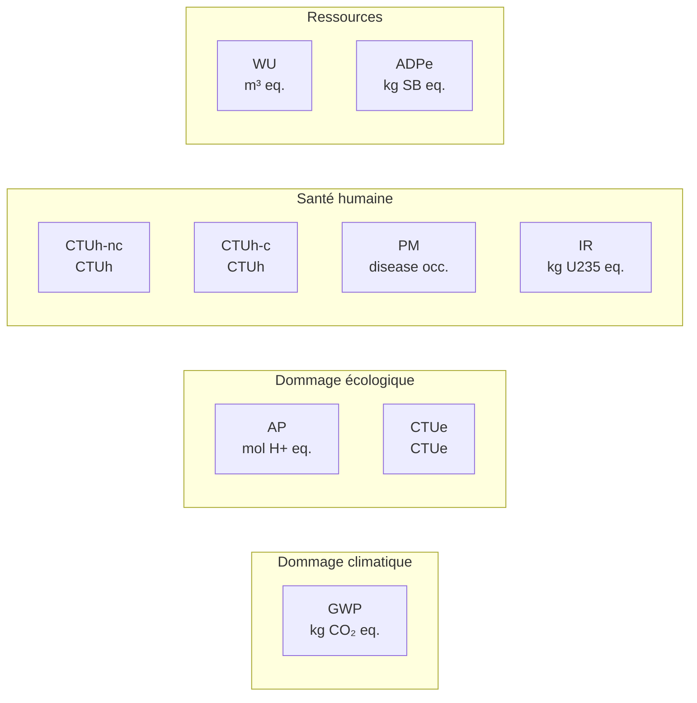

# Indicateurs environnementaux

## En bref

La méthode retient une lecture multicritère. Les émissions de gaz à effet de serre sont importantes, mais elles ne suffisent pas à décrire à elles seules les impacts du numérique. L'extraction de métaux critiques, la consommation d'eau, la toxicité des procédés de fabrication et l'épuisement des ressources abiotiques sont autant de dimensions que le seul indicateur carbone ne capture pas.

## Indicateurs pris en compte dans l'évaluation {#indicateurs-pris-en-compte-dans-l-evaluation}

Quel que soit l'objet d'étude, la méthode aboutit à une évaluation sous la forme d'indicateurs environnementaux. Ces indicateurs ont été choisis conformément aux préconisations du §7 du RCP mère sur les services numériques.

Sont pris en compte à la fois les indicateurs obligatoires et les indicateurs facultatifs. Les 9 indicateurs mid-point retenus se répartissent en 4 catégories de dommages end-point :

Un indicateur de flux supplémentaire vient aider à l'interprétation des résultats : la **consommation d'électricité** (kWh).

### Tableau des indicateurs

| Indicateur mid-point | Abréviation | Unité | Dommage end-point | Définition |
|---|---|---|---|---|
| Changement climatique total | GWP | kg CO₂ eq. | Dommage climatique | Potentiel de changement climatique induit par les émissions de gaz à effet de serre (GES). Les GES absorbent le rayonnement infrarouge émis par la surface de la Terre ; l'augmentation de leur concentration contribue au réchauffement climatique. |
| Acidification | AP | mol H+ eq. | Dommage écologique | Potentiel d'acidification des milieux (sols et eaux de surface) induit par les émissions d'oxydes d'azote, d'oxydes de soufre, d'ammoniac et d'acide chlorhydrique. |
| Ecotoxicité des eaux douces | CTUe | CTUe | Dommage écologique | Potentiel de toxicité apporté aux milieux aquatiques par l'émission de substances toxiques. L'écotoxicité déstabilise les écosystèmes d'eau douce. |
| Toxicité humaine (non-cancérigène) | CTUh-nc | CTUh | Santé humaine | Potentiel de toxicité sur l'homme induit par l'émission de substances susceptibles de créer des dommages de type non cancérigène. |
| Toxicité humaine (cancérigène) | CTUh-c | CTUh | Santé humaine | Effets toxicologiques chroniques sur la santé humaine dus aux émissions de substances cancérigènes. |
| Emissions de particules fines | PM | disease occurrence | Santé humaine | Effets sanitaires liés à l'inhalation de particules fines (diamètre < 10 µm), provoquant des problèmes respiratoires et cardiovasculaires. |
| Emissions de substances ionisantes | IR | kg U235 eq. | Santé humaine | Effets des émissions radioactives sur la santé humaine. Les radionucléides libèrent des rayonnements ionisants qui peuvent provoquer des dommages à l'ADN. |
| Utilisation de la ressource en eau | WU | m³ eq. | Ressources | Quantité totale d'eau consommée. Indicateur de flux exprimé en m³, non pondéré par le stress hydrique local. |
| Épuisement des ressources naturelles | ADPe | kg SB eq. | Ressources | Quantité de ressources minérales et métalliques extraites, exprimée en équivalent antimoine (SB). |

:::note[Compatibilité des formules]
Toutes les formules de calcul présentées dans la méthode sont applicables à chacun des 9 indicateurs. L'indice $i$ dans les équations représente l'indicateur choisi ; l'unité $U_i$ doit être adaptée en conséquence.
:::

## Pourquoi ne pas se limiter au carbone

### Le problème d'une lecture mono-indicateur

Le numérique concentre des enjeux environnementaux qui dépassent largement le seul changement climatique :

| Phase du cycle de vie | Enjeu principal | Indicateur le plus pertinent |
|---|---|---|
| Extraction des matières premières | Épuisement de métaux rares (tantale, cobalt, lithium, indium) | **ADPe** (épuisement des ressources) |
| Fabrication des semi-conducteurs | Consommation massive d'eau ultra-pure et de produits chimiques | **WU** (eau), **CTUe** (écotoxicité) |
| Transport intercontinental | Émissions de polluants atmosphériques | **AP** (acidification), **PM** (particules fines) |
| Phase d'utilisation | Consommation d'électricité, dépendante du mix national | **GWP** (climat), **IR** (ionisant pour le nucléaire) |
| Fin de vie | Toxicité des déchets électroniques | **CTUh-nc**, **CTUh-c** (toxicité humaine) |

### Illustration concrète

Un smartphone fabriqué en Asie du Sud-Est et utilisé en France peut présenter un profil où :

- le **GWP** est dominé par la fabrication (mix électrique carboné en Asie) ;
- l'**ADPe** est dominé par l'extraction de métaux critiques (cobalt, tantale) ;
- le **WU** est dominé par la fabrication des puces (litres d'eau ultra-pure par wafer) ;
- l'**IR** est dominé par la phase d'usage (mix électrique français à forte composante nucléaire).

Une lecture uniquement carbone masquerait les trois dernières dimensions et pourrait conduire à des décisions sous-optimales (par exemple, prolonger un équipement fonctionnel plutôt que le remplacer, ce qui est bon pour le carbone mais neutre pour les ressources déjà extraites).

:::note[Pas de hiérarchie entre indicateurs]
La méthode ne hiérarchise pas les indicateurs entre eux. Le GWP n'est pas « plus important » que l'ADPe. Chaque indicateur éclaire une dimension différente du problème. C'est la lecture conjointe qui permet une analyse informée.
:::

## Du mid-point au single score

### Approche mid-point et end-point

Les indicateurs mid-point quantifient un effet intermédiaire dans la chaîne de causalité (ex. : kg CO₂ eq. pour le changement climatique). Les indicateurs end-point estiment le dommage final (ex. : perte de biodiversité, années de vie ajustées). La méthode retient les indicateurs mid-point comme référence, car ils sont plus reproductibles et moins dépendants de modèles de dommages contestés.

### Score unique (single score)

Pour les utilisateurs qui ont besoin d'une vue synthétique, la méthode propose un score unique basé sur la méthodologie PEF (Product Environmental Footprint) de la Commission européenne. Ce score combine normalisation et pondération des 9 indicateurs en 4 sous-scores :

| Sous-score | Indicateurs regroupés | Aire de protection |
|---|---|---|
| **Changement climatique** | GWP | Climat |
| **Biodiversité** | AP, CTUe | Qualité des écosystèmes |
| **Santé environnementale** | CTUh-nc, CTUh-c, PM, IR | Santé humaine |
| **Ressources** | WU, ADPe | Ressources naturelles |

Le détail des coefficients de normalisation et de pondération est présenté dans les [Annexes techniques](../references/annexes-techniques).

:::note[Usage du single score]
Le score unique est un outil de communication et de comparaison rapide. Il ne remplace pas la lecture des indicateurs individuels pour une analyse approfondie. Toute décision structurante doit s'appuyer sur les résultats mid-point détaillés.
:::

## Indicateurs en veille

La méthode peut faire référence à des indicateurs supplémentaires lorsque :

- la pertinence environnementale est forte mais les données ne sont pas encore suffisamment homogènes ;
- les référentiels disponibles ne permettent pas encore une intégration stable dans tous les cas d'usage.

Ces indicateurs peuvent être cités sans être systématiquement calculés. Exemples : stress hydrique pondéré (AWARE), empreinte biodiversité, empreinte sol (land use).

## Hypothèses et limites

- Tous les cas d'usage ne seront pas couverts avec le même nombre d'indicateurs dans cette itération. Certains facteurs disponibles dans les référentiels publics sont plus robustes pour le GWP que pour les autres catégories.
- Les données d'impact par technologie de production d'électricité restent principalement européennes ; une extrapolation est nécessaire pour un usage mondial (voir [Impacts de la consommation d'énergie](./impacts-de-la-consommation-d-energie)).
- Certains indicateurs (notamment WU) présentent des valeurs négatives pour certains équipements dans la Base Empreinte, liées à l'estimation des impacts de fin de vie.
- Le single score, s'il est utile pour la communication, ne doit pas masquer les transferts d'impact entre catégories.

## Données mobilisées

- `digital4better/data` → `data/energy/*`, `data/factor/*`, `data/equipment/*`
- Base Empreinte ADEME (facteurs multicritères)

## Sources

- ISO 14040 / ISO 14044
- Référentiel ADEME / ARCEP sur les services numériques (RCP mère, §7)
- Commission européenne, méthodologie PEF (Product Environmental Footprint)
- [digital4better/data](https://github.com/digital4better/data)
