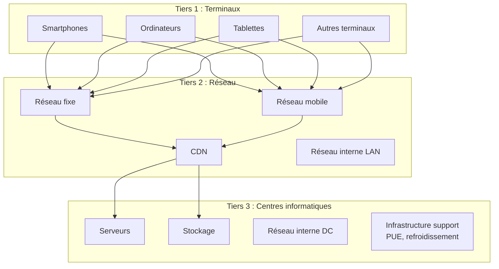
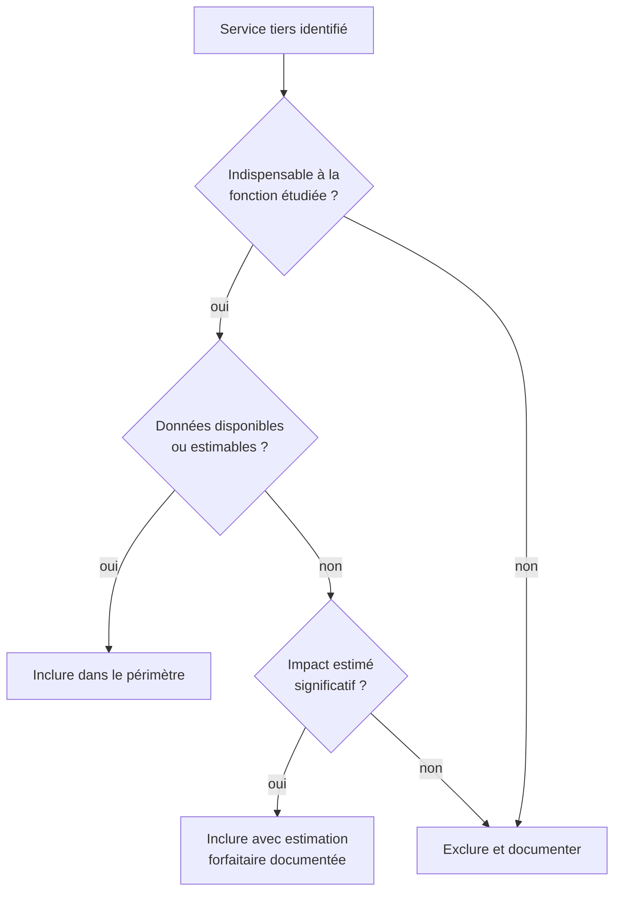

# Périmètre, frontières, services tiers et unité d'analyse

## En bref

La qualité d'une évaluation dépend d'abord de la façon dont l'objet d'étude est défini. Cette page fixe les règles qui permettent de savoir ce qui est inclus, ce qui est exclu, et à quelle unité un résultat peut être rapporté. Une frontière mal définie produit un résultat inutilisable, quelle que soit la précision des calculs.

## Définir l'objet d'étude

L'objet évalué peut se situer à différents niveaux de granularité :

| Niveau | Exemples | Unité d'analyse typique |
|---|---|---|
| **Composant** | Processeur, mémoire vive, SSD | Par composant sur une durée de vie |
| **Équipement** | Smartphone, laptop, serveur | Par équipement sur une période |
| **Infrastructure** | Datacenter, salle serveur, réseau LAN | Par infrastructure sur une année |
| **Environnement** | Parc informatique, cloud, hébergement | Par environnement sur une année |
| **Service numérique** | Site web, messagerie, IA générative | Par page vue, par requête, par utilisateur, par volume |

Chaque niveau appelle une unité d'analyse adaptée et des frontières spécifiques.

## Frontières du système

### Les trois tiers

Conformément au RCP mère sur les services numériques, la méthode structure le périmètre autour de trois tiers :

### Règles de frontière

Le périmètre doit expliciter :

1. **Les équipements directement mobilisés** : terminaux, serveurs, équipements réseau identifiés.
2. **Les infrastructures considérées** : datacenter, réseau WAN/LAN, CDN.
3. **Les services tiers** nécessaires à la délivrance du service (voir section dédiée ci-dessous).
4. **Les exclusions retenues** et leur justification.

:::note[Principe de frontière]
Une frontière trop étroite produit un résultat artificiellement faible. Une frontière trop large rend l'évaluation difficilement interprétable. La méthode cherche un compromis explicite et justifié, documenté dans chaque évaluation.
:::

### Approche équipement vs approche système

Le RCP mère distingue deux approches complémentaires :

| Approche | Principe | Quand l'utiliser | Précision |
|---|---|---|---|
| **Équipement** | Chaque équipement est inventorié et caractérisé individuellement | Périmètre maîtrisé par l'organisation | Élevée |
| **Système** | Un ensemble d'équipements est assimilé à un système fermé avec des facteurs agrégés | Périmètre non maîtrisé (réseau opérateur, cloud externe) | Moyenne |

La méthode privilégie l'approche équipement sur le périmètre maîtrisé et l'approche système sur le périmètre non maîtrisé, conformément aux recommandations du RCP mère.

## Services tiers et APIs

### Quand inclure un service tiers

Les services tiers doivent être inclus lorsqu'ils sont **indispensables à la fonction étudiée** :

- une API critique pour le fonctionnement de l'application ;
- un SaaS intégré au parcours utilisateur ;
- un fournisseur de modèle dans un service d'IA (ex. : API OpenAI dans un service utilisant GPT) ;
- une couche de distribution ou de cache nécessaire à la délivrance du service (CDN, DNS).

### Quand exclure un service tiers

Un service tiers peut être exclu lorsqu'il est :

- hors fonction principale (analytics, publicité, A/B testing) ;
- trop mal défini pour être intégré sans introduire plus d'incertitude que d'information ;
- déjà évalué dans un autre périmètre (voir [Double comptabilisation](../regles/double-comptabilisation)).

:::note[Documentation des exclusions]
Toute exclusion doit être documentée dans la section « Hypothèses et limites » de l'évaluation, avec sa justification et une estimation qualitative de l'impact manquant (négligeable, significatif, inconnu).
:::

### Arbre de décision pour les services tiers

## Unité d'analyse

L'unité d'analyse doit être :

- **compréhensible** par un relecteur non spécialiste ;
- **stable** dans le temps pour permettre des comparaisons ;
- **reliée à la fonction rendue** par le service ou l'équipement ;
- **compatible** avec les données disponibles.

### Exemples par cas d'usage

| Cas d'usage | Unités d'analyse possibles | Unité recommandée |
|---|---|---|
| **Parc informatique** | Par équipement, par collaborateur, par année | Par parc sur une année |
| **Infrastructure d'hébergement** | Par serveur, par rack, par datacenter | Par infrastructure sur une année |
| **Service web** | Par page vue, par session, par visite, par service | Par page vue, agrégé par service |
| **Mail** | Par message envoyé/reçu, par boîte, par année | Par message, agrégé par service |
| **Mobile** | Par écran, par session, par téléchargement | Par écran, agrégé par service |
| **IA générative** | Par entraînement, par inférence, par token | Par requête d'inférence, par entraînement |
| **Cloud** | Par vCPU.h, par Go.mois, par service | Par unité cloud facturée |

La méthode ne suppose pas une unité unique pour tout le corpus. Elle impose en revanche d'**expliciter l'unité retenue** pour chaque évaluation et de vérifier sa cohérence avec les règles d'allocation (voir [Allocation et partage des impacts](../regles/allocation-et-partage-des-impacts)).

## Application concrète

**Cas : définir le périmètre d'un service web d'e-commerce**

| Élément | Inclus ? | Justification |
|---|---|---|
| Terminaux des utilisateurs | Oui | Fonction principale : consultation du site |
| Réseau WAN | Oui | Transport des pages et requêtes |
| CDN | Oui | Distribution des contenus statiques |
| Serveurs d'hébergement (cloud) | Oui | Traitement des requêtes et stockage |
| API de paiement (Stripe) | Oui | Indispensable à la fonction d'achat |
| Analytics (Google Analytics) | Non | Hors fonction principale, impact marginal |
| Réseau interne du datacenter | Oui | Inclus forfaitairement via le facteur datacenter |
| Backoffice ERP | Non | Hors périmètre du service web front-end |

**Unité d'analyse retenue** : la page vue, agrégée au service sur une année d'observation.

## Hypothèses et limites

- Les services tiers sont souvent opaques ; leur prise en compte repose fréquemment sur des estimations ou des forfaits.
- Deux évaluations portant sur des périmètres différents ne doivent pas être comparées sans relecture des frontières.
- L'approche système, si elle est plus praticable pour les périmètres non maîtrisés, introduit une incertitude plus élevée que l'approche équipement.
- Le choix de l'unité d'analyse influence directement l'interprétation. Une page vue très lourde aura un impact unitaire élevé ; un service global sur une année lissera les variations.

## Données mobilisées

- `digital4better/data` → `data/cloud/*`, `data/factor/*`, `data/equipment/*`
- Métadonnées de périmètre de chaque cas d'usage

## Sources

- ISO 14040 / ISO 14044
- Référentiel ADEME / ARCEP sur les services numériques (RCP mère)
- [SCI -- Software Carbon Intensity](https://sci.greensoftware.foundation/)
- Corpus `inputs/md`
