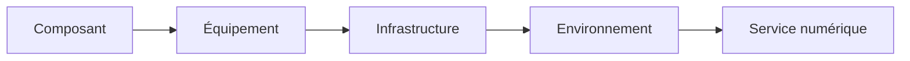
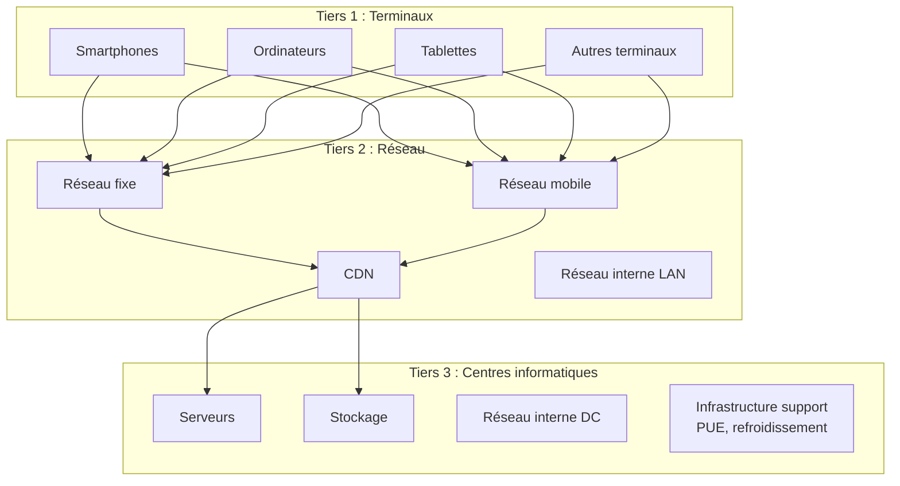
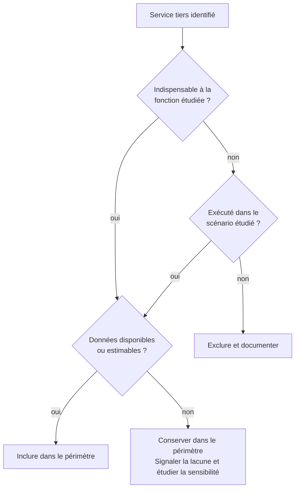

# Périmètre, frontières, services tiers et unité d'analyse

import { MethodIllustration } from '@site/src/components/method-illustrations';

La qualité d'une évaluation dépend d'abord de la façon dont l'objet d'étude est défini. Cette page fixe les règles qui permettent de savoir ce qui est inclus, ce qui est exclu, et à quelle unité un résultat peut être rapporté. Une frontière mal définie produit un résultat inutilisable, quelle que soit la précision des calculs.[^source-3]

## Du calcul unitaire à l’application complète

Une page vue, une session ou une requête décrit une partie de l’activité. L’évaluation de l’application couvre ses **fonctions, utilisateurs et contextes d’usage sur une période définie**.[^rcp-app]

<MethodIllustration kind="application-scope" lang="fr" />

La **version, la période et les exclusions** accompagnent le résultat. Si certains postes restent non évalués, le bilan reste partiel, même présenté à l’échelle de l’application.

## Définir l'objet d'étude

L'objet évalué peut se situer à différents niveaux de granularité :

| Niveau | Exemples | Unité d'analyse typique |
|---|---|---|
| **Composant** | Processeur, mémoire vive, SSD | Par composant sur une durée de vie |
| **Équipement** | Smartphone, laptop, serveur | Par équipement sur une période |
| **Infrastructure** | Datacenter, salle serveur, réseau LAN | Par infrastructure sur une année |
| **Environnement** | Parc informatique, cloud, hébergement | Par environnement sur une année |
| **Service numérique** | Site web, messagerie, IA générative | Par page vue, par requête, par utilisateur, par volume |

Chaque niveau appelle une unité d'analyse adaptée et des frontières spécifiques.

## Frontières du système

### Les trois tiers

Conformément au RCP mère sur les services numériques, la méthode structure le périmètre autour de trois tiers :

### Règles de frontière

Le périmètre doit expliciter[^donnees-modele] :

1. **Les équipements directement mobilisés** : terminaux, serveurs, équipements réseau identifiés.
2. **Les infrastructures considérées** : datacenter, réseau WAN/LAN, CDN.
3. **Les services tiers** nécessaires à la délivrance du service (voir section dédiée ci-dessous).
4. **Les exclusions retenues** et leur justification.

:::note[Principe de frontière]
Une frontière trop étroite produit un résultat artificiellement faible. Une frontière trop large rend l'évaluation difficilement interprétable. La méthode cherche un compromis explicite et justifié, documenté dans chaque évaluation.
:::

### Approche équipement vs approche système

Le RCP mère distingue deux approches complémentaires :

| Approche | Principe | Quand l'utiliser | Précision |
|---|---|---|---|
| **Équipement** | Chaque équipement est inventorié et caractérisé individuellement | Périmètre maîtrisé par l'organisation | Dépend de la représentativité des mesures et facteurs |
| **Système** | Un ensemble d'équipements est assimilé à un système fermé avec des facteurs agrégés | Périmètre non maîtrisé (réseau opérateur, cloud externe) | Dépend de la représentativité du facteur agrégé |

La méthode privilégie l'approche équipement sur le périmètre maîtrisé et l'approche système sur le périmètre non maîtrisé, conformément aux recommandations du RCP mère.

## Services tiers et APIs

### Quand inclure un service tiers

Un service tiers est inclus s’il est **nécessaire à la fonction ou exécuté dans le scénario**, même s’il est externalisé. Son évaluation avec une unité compatible est privilégiée ; à défaut, l’estimation et les données manquantes sont explicitées.

<MethodIllustration kind="third-party-scope" lang="fr" />

### Quand exclure un service tiers

Trois situations sont à distinguer :

<dl className="model-profiles">
  

    <dt>Hors périmètre et sans contribution au scénario</dt>
    <dd>

Le service peut être exclu, avec justification.

    </dd>
  

  

    <dt>Impact impossible à chiffrer</dt>
    <dd>

Le service figure dans l’étude avec la mention **« impact non évalué »**. Le résultat est incomplet ; cet impact n’est pas considéré comme nul.

    </dd>
  

  

    <dt>Déjà compté dans une autre contribution</dt>
    <dd>

Son impact n’est pas ajouté une seconde fois. Voir la [double comptabilisation](../regles/double-comptabilisation.md).

    </dd>
  

</dl>

:::note[Documentation des exclusions]
**Toute exclusion est justifiée** dans les « Hypothèses et limites ». Un poste non évalué y est également signalé, avec son importance estimée : négligeable, significative ou inconnue.
:::

### Arbre de décision pour les services tiers

## Unité d'analyse

L'unité d'analyse doit être :

- **compréhensible** par un relecteur non spécialiste.
- **stable** dans le temps pour permettre des comparaisons.
- **reliée à la fonction rendue** par le service ou l'équipement.
- **compatible** avec les données disponibles.

Le **temps d’usage du terminal**, le **temps serveur** et le **nombre d’utilisateurs uniques** décrivent des grandeurs différentes. Ils ne se substituent pas les uns aux autres.

### Exemples par cas d'usage

| Cas d'usage | Unités d'analyse possibles | Unité recommandée |
|---|---|---|
| [**Parc informatique**](../cas-d-usage/environnements/parc-informatique.md) | Par équipement, par collaborateur, par année | Par parc sur une année |
| [**Infrastructure d'hébergement**](../cas-d-usage/environnements/infrastructure-d-hebergement.md) | Par serveur, par rack, par datacenter | Par infrastructure sur une année |
| [**Service web**](../cas-d-usage/services/service-web.md) | Par page vue, par session, par visite, par service | Par page vue, agrégé par service |
| [**Mail**](../cas-d-usage/services/mail.md) | Par message envoyé/reçu, par boîte, par année | Par message, agrégé par service |
| [**Applications natives**](../cas-d-usage/services/mobile.md) | Par écran, par session, par téléchargement | Par écran, agrégé par service |
| [**IA générative**](../cas-d-usage/services/ia-generative.md) | Par entraînement, par inférence, par token | Par requête d'inférence, par entraînement |
| [**Cloud**](../cas-d-usage/environnements/cloud.md) | Par vCPU.h, par Go.mois, par service | Par unité cloud facturée |

La méthode ne suppose pas une unité unique pour tout le corpus. Elle impose en revanche d'**expliciter l'unité retenue** pour chaque évaluation et de vérifier sa cohérence avec les règles d'allocation (voir [Allocation et partage des impacts](../regles/allocation-et-partage-des-impacts)).

## Application concrète

**Cas : définir le périmètre d'un service web d'e-commerce**

| Élément | Inclus ? | Justification |
|---|---|---|
| Terminaux des utilisateurs | Oui | Fonction principale : consultation du site |
| Réseau WAN | Oui | Transport des pages et requêtes |
| CDN | Oui | Distribution des contenus statiques |
| Serveurs d'hébergement (cloud) | Oui | Traitement des requêtes et stockage |
| API de paiement (Stripe) | Oui | Indispensable à la fonction d'achat |
| Analytics (Google Analytics) | Oui si exécuté | Requêtes, scripts et traitement du parcours réel ; mesurer ou signaler la lacune |
| Réseau interne du datacenter | Oui | Inclus forfaitairement via le facteur datacenter |
| Backoffice ERP | Non | Hors périmètre du service web front-end |

**Unité d'analyse retenue** : la page vue, agrégée au service sur une année d'observation.

## Hypothèses et limites

- Les services tiers sont souvent opaques ; leur prise en compte repose fréquemment sur des estimations ou des forfaits.
- Deux évaluations portant sur des périmètres différents ne doivent pas être comparées sans relecture des frontières.
- L'approche système, si elle est plus praticable pour les périmètres non maîtrisés, peut être moins détaillée ; la qualité dépend de la représentativité du facteur et ne se déduit pas du seul niveau de granularité.
- Le choix de l'unité d'analyse influence directement l'interprétation. Une page vue très lourde aura un impact unitaire élevé ; un service global sur une année lissera les variations.

[^rcp-app]: ADEME, [RCP des applicatifs numériques, juin 2026](https://librairie.ademe.fr/economie-circulaire-et-dechets/9434-referentiel-par-categorie-de-produit-rcp-des-applicatifs-numeriques.html), p. 13–16, 19–21, 38–40. Le RCP prévoit une période d’un an par défaut et un périmètre applicatif incluant les moyens de développement. Une agrégation de parcours ne suffit pas à établir sa couverture complète.

[^source-3]: [SCI -- Software Carbon Intensity](https://sci.greensoftware.foundation/) Documentation en ligne, version non figée.

[^donnees-modele]: `digital4better/data` → `data/cloud/*`, `data/factor/*`, `data/equipment/*`. Métadonnées de périmètre de chaque cas d'usage. [Digital4Better, catalogue de données, instantané 77cae4a](https://github.com/digital4better/data/tree/77cae4a58fadd5deb3b8d4e5577020da08f780d8).
