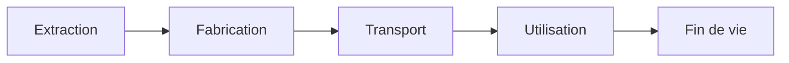

# Principes ACV appliqués au numérique

L’analyse du cycle de vie (ACV) étudie les impacts d’un produit ou d’un service, de l’extraction des matières à la fin de vie. Pour le numérique, elle relie le service rendu aux terminaux, aux réseaux et aux centres de données nécessaires à son fonctionnement.

Cette méthode reprend ce cadre pour construire des évaluations traçables. Les simulateurs de la beta couvrent des périmètres plus restreints, affichés avec chaque résultat ; ils ne constituent pas automatiquement une ACV complète.

## Considérer le cycle de vie

| Contribution | Données nécessaires | Point de contrôle |
|---|---|---|
| Fabrication et autres phases hors usage | Inventaire produit ou facteurs documentés | Vérifier si transport et fin de vie sont inclus |
| Exploitation | Énergie, durée, consommables et eau selon le périmètre | Ne pas limiter l’usage à l’électricité si d’autres flux comptent |

Le terme « impact intrinsèque » désigne ici les phases hors usage couvertes par le facteur. Un facteur de fabrication seul ne devient pas un inventaire complet du cycle de vie. Les [indicateurs environnementaux](./indicateurs-environnementaux) permettent de lire les contributions au climat, aux ressources, à l’eau ou à la toxicité sans les confondre.

## Attribuer des impacts

L’approche principale est **attributionnelle** : elle répartit des impacts entre équipements, organisations ou services. Elle répond à la question « quelle part attribuer à cette activité ? ».

Ex: répartir la fabrication d’un ordinateur de 200 kg CO₂e sur cinq ans attribue 40 kg par an. Ce calcul n’affirme pas que prolonger sa vie d’un an évite immédiatement 40 kg d’émissions. L’effet physique d’une décision dépend notamment du remplacement, de l’usage et de ce qui se serait passé autrement.

Une analyse des conséquences d’une décision demande des hypothèses supplémentaires. Les comparaisons proposées ici portent d’abord sur des scénarios d’allocation cohérents.

## Relier le service au matériel {#approche-multi-composants}

Le référentiel ADEME sur les services numériques[^ref-1] organise les ressources en trois tiers : terminaux, réseaux et centres informatiques. Les logiciels orchestrent ces ressources ; ils ne forment pas une couche matérielle indépendante à additionner.

Les pages [Matériel](../materiel/vue-d-ensemble-du-materiel) décrivent les composants et les équipements. La [modélisation d’un service](../modelisation/modelisation-d-un-service) explique comment les assembler sans compter plusieurs fois le même support physique.

## Couvrir les phases du service

Un service a aussi une histoire : conception, développement, déploiement, exploitation et arrêt. Chacune mobilise du matériel ayant son propre cycle de vie.

| Phase du service | Activités à inventorier |
|---|---|
| Conception et développement | Postes des équipes, outils, tests et environnements de construction |
| Déploiement | CI/CD, registres, installations et mises à jour |
| Exploitation | Terminaux utilisateurs, réseau, serveurs et services tiers |
| Arrêt ou migration | Transferts, archivage, effacement et réaffectation des ressources |

Le caractère négligeable d’une phase demande une justification. Les simulateurs couvrent surtout l’exploitation ; Applications natives inclut aussi les téléchargements de distribution. Les activités supplémentaires peuvent être évaluées avec les mêmes modèles, puis allouées à la fonction étudiée.

## Construire une comparaison

La comparaison repose sur une même fonction rendue, une qualité de service comparable et une période cohérente. Elle conserve les mêmes méthodes de caractérisation et explicite les différences de périmètre. Une baisse du climat peut accompagner une hausse d’un autre indicateur.

La suite du parcours est [Périmètre et unité d’analyse](./perimetre-frontieres-services-tiers-et-unite-d-analyse), puis [Allocation](../regles/allocation-et-partage-des-impacts). Le [positionnement](../introduction/positionnement-par-rapport-aux-referentiels-existants) distingue le cadre ISO 14040/14044, les référentiels sectoriels et les conventions propres à D4B.

## Croiser les deux cycles de vie

Le cycle du service et celui des équipements sont imbriqués. Une année de développement mobilise une part de la fabrication et de l’usage des postes et serveurs ; elle ne crée pas une nouvelle fabrication complète de ces équipements.

import { ServiceLifecycle } from '@site/src/components/service-lifecycle';

<ServiceLifecycle lang="fr" />

### Exemples d’activités par phase

| Phase du service | Fabrication allouée | Exploitation à inventorier |
|---|---|---|
| Développement | Part des postes, serveurs et plateformes de test | Travail des équipes, compilation, tests et jeux de données |
| Déploiement | Part des infrastructures de distribution | Construction des images, transfert et installation |
| Exploitation | Part des terminaux, réseaux et infrastructures | Parcours utilisateurs, traitements, repos et stockage |
| Retrait | Part des ressources de migration et d’archive | Transferts, conservation et effacement |

Les impacts de conception par unité de service dépendent d’un volume de référence et d’une période. Lorsque la durée d’exploitation future est incertaine, l’analyse de sensibilité porte aussi sur ce dénominateur. Une hypothèse d’adoption n’est pas une donnée observée.

L’inventaire s’organise par équipement, puis par composant si les données le justifient. Le calcul d’impacts applique des facteurs caractérisés à des flux compatibles. L’addition d’un résultat produit déjà caractérisé et de ses composants détaillés créerait un double compte. La lecture multicritère vérifie les transferts d’impact entre phases et catégories.

[^ref-1]: [référentiel ADEME sur les services numériques](https://librairie.ademe.fr/produire-autrement/6022-referentiel-methodologique-d-evaluation-environnementale-des-services-numeriques.html).
