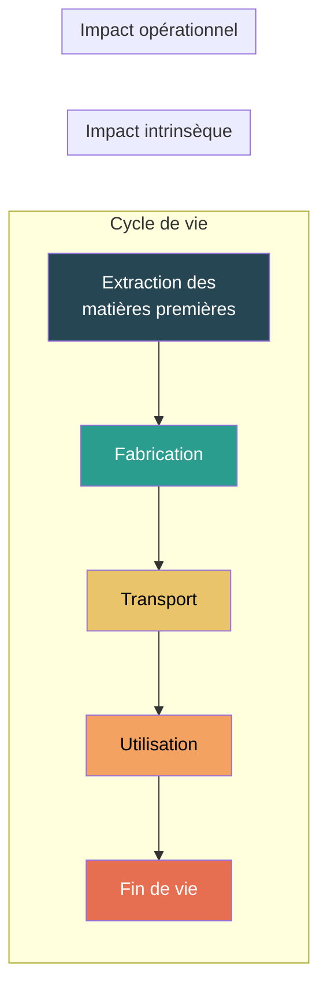
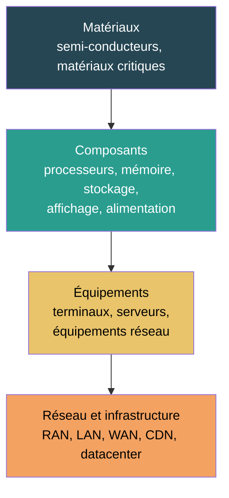
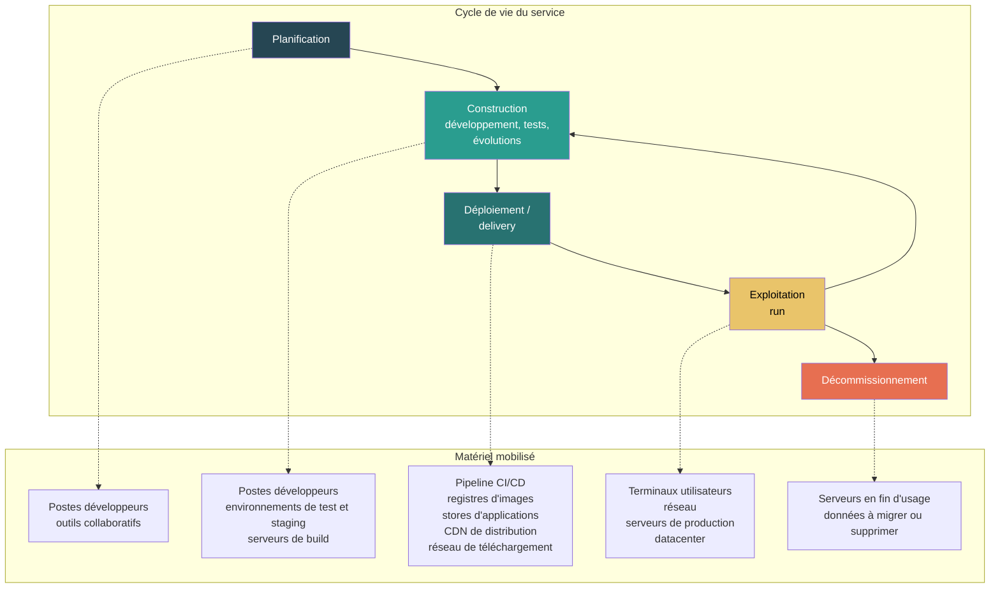

# Principes ACV appliqués au numérique

## En bref

L'analyse du cycle de vie a été retenue comme cadre principal pour évaluer les impacts environnementaux du numérique. La méthode proposée ici en reprend les principes essentiels, en les adaptant aux objets numériques : équipements, réseaux, infrastructures et services. Elle ne réduit jamais un service à son seul logiciel et ne se limite pas au seul indicateur carbone.

## Une approche cycle de vie

L'analyse du cycle de vie (ACV) est une méthodologie normalisée (ISO 14040/14044) permettant l'évaluation des impacts environnementaux de produits, de services ou d'organisations. Elle a été choisie pour cadrer les bases de l'évaluation des impacts du numérique — on parle alors d'« ACV numérique ».

Les principes retenus sont les suivants :

- l'évaluation porte sur **l'ensemble du cycle de vie**, de la fabrication à la fin de vie en passant par l'utilisation ;
- la méthode conserve une **lecture multicritère** à 9 indicateurs et ne se limite pas au seul climat (voir [Indicateurs environnementaux](./indicateurs-environnementaux)) ;
- l'évaluation couvre **les trois tiers** du numérique : terminaux, réseaux de télécommunication et centres informatiques.

## Posture retenue

### Approche attributionnelle

La posture principale de cette méthode est **attributionnelle** :

- elle cherche à **attribuer une part d'impact** à un objet d'étude donné ;
- elle privilégie la **transparence des conventions** de répartition ;
- elle vise une **comparabilité conditionnelle** entre évaluations construites selon les mêmes règles.

| Posture | Principe | Question posée | Usage dans la méthode |
|---|---|---|---|
| **Attributionnelle** | Attribuer une part d'impact | « Quelle est la part de cet objet dans l'impact total ? » | Cadre principal |
| **Conséquentielle** | Estimer l'effet d'un changement | « Que se passe-t-il si on change cet objet ? » | Encadrés ponctuels |

Des lectures conséquentielles peuvent éclairer certaines décisions (ex. : « que se passe-t-il si on remplace un serveur par un autre ? »), mais elles ne constituent pas le cadre principal de cette documentation.

:::note[Comparabilité conditionnelle]
Deux évaluations ne sont comparables que si elles partagent les mêmes règles de périmètre, d'allocation et de qualité des données. La méthode vise cette comparabilité en fixant des conventions explicites — pas une valeur universelle valable en tout contexte.
:::

## Impact intrinsèque et impact opérationnel

L'impact d'une activité numérique est évalué à partir de deux composantes complémentaires :

| Composante | Phases ACV couvertes | Ce qu'elle capture | Données clés |
|---|---|---|---|
| **Impact intrinsèque** ($I_{embodied}$) | Extraction, fabrication, transport, fin de vie | Ressources consommées et pollutions générées pour produire et éliminer le matériel | Facteurs d'impact par équipement, durée de vie |
| **Impact opérationnel** ($I_{operational}$) | Utilisation | Consommation d'électricité nécessaire au fonctionnement | Puissance, durée d'usage, mix électrique |

L'impact global est alors :

$$
\begin{align*}
&I_{global} = I_{operational} + I_{embodied}
\end{align*}
$$

:::note[Poids relatif des deux composantes]
Pour la plupart des équipements numériques (terminaux, serveurs), l'impact intrinsèque domine. La fabrication d'un smartphone représente typiquement 70 à 90 % de son impact GWP total. Pour les infrastructures très sollicitées (datacenters en pays à mix carboné), l'impact opérationnel peut devenir prépondérant. La lecture des deux composantes ensemble est donc essentielle.
:::

## Approche multi-composants {#approche-multi-composants}

La méthode intègre l'ensemble des équipements et infrastructures caractérisés en trois tiers : terminaux, réseaux de télécommunication et centres informatiques. Elle s'appuie sur la définition du RCP [Référentiel méthodologique d'évaluation environnementale des services numériques](https://librairie.ademe.fr/produire-autrement/6022-referentiel-methodologique-d-evaluation-environnementale-des-services-numeriques.html) :

> Un service numérique est une activité se caractérisant par la réalisation d'une prestation ou la mise à disposition d'une information mobilisant un ensemble d'équipements, infrastructures numériques et d'autres services numériques pour capter, faire circuler, traiter, analyser, restituer et stocker des données. Ces équipements et infrastructures étant caractérisés en trois tiers : terminaux, réseaux de télécommunication et centres informatiques ; un ensemble de logiciels étant utilisés à différents niveaux pour orchestrer les équipements physiques et délivrer le service attendu.

Cette logique multicouche explique pourquoi la méthode ne réduit jamais un service à son seul logiciel.

### Lien avec la hiérarchie Matériel

La section [Matériel](../materiel/vue-d-ensemble-du-materiel) de la méthode détaille cette décomposition en couches emboîtées :

Cette hiérarchie permet de construire les évaluations du plus granulaire (composant) au plus agrégé (service), en traçant à chaque étape les données, les hypothèses et les règles d'allocation mobilisées.

## Cycle de vie d'un service numérique

### Deux cycles de vie imbriqués

Un service numérique possède son propre cycle de vie, distinct de celui du matériel mais indissociable de lui. À chaque phase du cycle de vie du service, du matériel est mobilisé — et c'est l'ACV de ce matériel qui porte l'impact environnemental.

:::note[Boucle agile]
Dans un contexte agile, la distinction classique entre « développement initial » et « maintenance » disparaît : chaque sprint produit du code, qu'il s'agisse de nouvelles fonctionnalités, de corrections ou d'évolutions. La phase de **construction** couvre l'ensemble de ces activités. La boucle exploitation → construction → déploiement représente le flux continu de livraison.
:::

### Phases du cycle de vie d'un service

| Phase | Équivalent ACV produit | Description | Matériel impliqué | Impact dominant |
|---|---|---|---|---|
| **Planification** | Conception | Cadrage fonctionnel et technique, choix d'architecture, dimensionnement | Postes de travail des équipes projet, outils collaboratifs | Faible (peu d'équipements, courte durée) |
| **Construction** | Fabrication | Développement, tests, intégration, corrections, évolutions fonctionnelles — en flux continu dans un contexte agile | Postes développeurs, environnements de test et de staging, serveurs de build | Modéré (environnements souvent mutualisés, mais nombreux cycles de build/test ; s'accumule sur la durée de vie du service) |
| **Déploiement / delivery** | Transport / distribution | Publication, distribution et installation du logiciel auprès des utilisateurs ou des environnements cibles | Pipeline CI/CD, registres d'images (Docker, OCI), stores d'applications (App Store, Play Store), CDN de distribution, réseau de téléchargement | Variable — peut être significatif pour les applications mobiles largement distribuées |
| **Exploitation (run)** | Utilisation | Service en production, accessible aux utilisateurs | Terminaux utilisateurs, réseau (WAN, CDN), serveurs de production, datacenter | **Dominant** — c'est la phase la plus longue et la plus consommatrice |
| **Décommissionnement** | Fin de vie | Arrêt du service, migration ou suppression des données, libération des ressources | Serveurs en fin d'usage, transfert/effacement de données | Faible (ponctuel, mais peut libérer ou réaffecter du matériel) |

### Lecture ACV croisée

Pour chaque phase du cycle de vie du service, l'impact environnemental est porté par le matériel mobilisé. Ce matériel a lui-même son propre cycle de vie (extraction, fabrication, transport, utilisation, fin de vie). La lecture croisée est donc :

$$
\begin{align*}
&I_{service} = \sum_{p \in phases} \sum_{e \in équipements_p} \left( I_{emb_{e,p}} + I_{ope_{e,p}} \right)
\end{align*}
$$

Où $I_{emb_{e,p}}$ est la part d'impact intrinsèque de l'équipement $e$ allouée à la phase $p$, et $I_{ope_{e,p}}$ est l'impact opérationnel de cet équipement pendant la phase $p$.

:::note[Périmètre couvert par la méthode]
Dans cette itération, la méthode se concentre sur la **phase d'exploitation** (run), qui représente la majorité de l'impact pour la plupart des services. Les phases de développement et de maintenance ne sont pas encore modélisées en détail, mais leur matériel peut être évalué avec les mêmes formules que le reste du corpus (allocation temporelle des postes développeurs, impact des serveurs CI/CD, etc.).
:::

### Implications pratiques

- **Construction** : l'impact des postes développeurs, des environnements de test et des serveurs de build s'accumule tout au long de la vie du service. Dans un contexte agile, chaque sprint est un micro-cycle de construction qui mobilise ces ressources. L'impact se mesure comme un parc informatique dédié sur la durée du projet.
- **Déploiement / delivery** : l'équivalent du transport dans l'ACV produit. Pour un service web, c'est la pipeline CI/CD et le push vers les serveurs. Pour une application mobile, c'est la publication sur un store et le téléchargement par les utilisateurs — une app de 200 Mo téléchargée 10 millions de fois génère 2 Po de trafic réseau. Pour un conteneur Docker, c'est le push vers un registre et le pull par les nœuds de production. Chaque itération déclenche un nouveau cycle de déploiement.
- **Exploitation** : c'est le périmètre principal de la méthode. Les cas d'usage (service web, mail, mobile, IA) couvrent cette phase.
- **Décommissionnement** : la fin de vie d'un service ne fait pas disparaître l'impact du matériel. Si les serveurs sont réaffectés, leur impact est transféré à un autre périmètre. S'ils sont mis au rebut, leur impact de fin de vie doit être comptabilisé.

## Ce que cela implique pour la méthode

Cette base ACV implique que :

1. Un service numérique doit être **relié aux composants, équipements et infrastructures** qui le rendent possible — pas seulement à son code.
2. Les impacts de fabrication et d'usage doivent être **lus ensemble** pour éviter les transferts d'impact masqués.
3. Les **règles d'allocation**, de frontière et de qualité des données sont aussi importantes que les formules elles-mêmes (voir [Règles](../regles/allocation-et-partage-des-impacts)).
4. Les cas d'usage ne sont que des **assemblages** de composants, d'équipements et de règles plus générales — la méthode est conçue pour être modulaire.
5. Le cycle de vie du service **ne se réduit pas à sa phase d'exploitation** : planification, construction, déploiement et décommissionnement mobilisent aussi du matériel dont l'impact doit être documenté, même s'il est souvent secondaire.

## Hypothèses et limites

- Toutes les phases du cycle de vie ne sont pas connues avec le même niveau de détail selon les objets étudiés. La phase de fabrication est généralement la mieux documentée pour les équipements ; la fin de vie reste la moins connue.
- Certaines couches amont, notamment dans la section `Matériaux`, sont d'abord traitées à un niveau explicatif et non comme un modèle complet.
- La posture attributionnelle retenue ne résout pas à elle seule tous les débats méthodologiques ; elle fournit surtout un cadre cohérent et traçable.
- Les phases de planification, construction et déploiement du service ne sont pas encore modélisées en détail dans cette itération. Le matériel impliqué peut néanmoins être évalué avec les formules existantes du corpus.

## Données mobilisées

- `digital4better/data`
- Corpus bibliographique de référence sur l'ACV du numérique

## Sources

- ISO 14040 / ISO 14044
- Référentiel ADEME / ARCEP sur les services numériques (RCP mère)
- [Boavizta Explanations](https://doc.api.boavizta.org/)
- [digital4better/data](https://github.com/digital4better/data)
