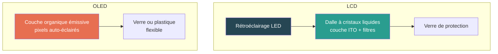

# Affichage

## Résumé

L'écran est un composant souvent sous-estimé dans les évaluations, alors qu'il peut représenter 20 à 40 % de l'impact intrinsèque d'un terminal et la majorité de sa consommation opérationnelle. Son impact dépend principalement de la **surface** (qui croît avec le carré de la diagonale), de la **technologie** (LCD, OLED, E-ink) et des **matériaux critiques** qu'il mobilise (indium pour le LCD, composés organiques pour l'OLED).

## D'où vient l'impact

### Structure d'un écran

| Élément | LCD | OLED | Impact principal |
|---|---|---|---|
| **Substrat verre** | Oui (2 plaques) | Oui (1 plaque ou plastique) | GWP (énergie de fusion) |
| **ITO (oxyde d'indium-étain)** | Oui (couche conductrice) | Oui | ADPe (indium = métal critique) |
| **Rétroéclairage** | Oui (LEDs) | Non (pixels auto-émissifs) | Consommation opérationnelle |
| **Couche organique** | Non | Oui (composés organiques) | Procédés chimiques, CTUe |
| **Polariseurs, filtres** | Oui | Oui | GWP, chimie |

## Modèle paramétrique

### Formule d'impact intrinsèque

L'impact est proportionnel à la surface d'écran, avec un coefficient par technologie :

$$
\begin{aligned}
&I_{emb} = S_{ecran} \times C_{techno} + C_{base} \\
\text{avec} \\
&S_{ecran} = d^2 \times 2{,}896 \htmlClass{unit}{[cm²]} \text{ (pour un ratio 16:9)} \\
&d = \text{Diagonale de l'écran} \htmlClass{unit}{[pouces]} \\
&C_{techno} = \text{Coefficient par cm² selon la technologie} \\
&C_{base} = \text{Base fixe (driver, connecteurs, cadre)}
\end{aligned}
$$

:::note[Surface vs diagonale]
La surface d'un écran 16:9 est $S = d^2 \times \frac{16 \times 9}{16^2 + 9^2} \times 2{,}54^2 \approx d^2 \times 2{,}896$ cm². Un écran de 27" a une surface 7 fois plus grande qu'un écran de 6,5" — et un impact intrinsèque proportionnel.
:::

### Coefficients par technologie

| Technologie | $C_{techno}$ (kgCO₂e/cm²) | $C_{base}$ (kgCO₂e) | Puissance typique (W/cm²) | Sources |
|---|---|---|---|---|
| **LCD / IPS** | 0,07 | 3,0 | 0,003 | Base Empreinte, données constructeurs Dell/HP[^1] |
| **OLED / AMOLED** | 0,12 | 2,5 | 0,002 | Estimations industrielles, packaging plus complexe[^2] |
| **E-ink** | 0,03 | 1,5 | ~0 en statique | Procédé plus simple, pas de rétroéclairage |

[^1]: Estimations dérivées de la décomposition des rapports PCF constructeurs (Dell Latitude, HP EliteBook) via Resilio/Aguaro (`inputs/md/les-impacts-environnementaux-des-equipements-informatiques.md`).
[^2]: L'OLED a un impact de fabrication plus élevé (dépôt sous vide de couches organiques) mais consomme moins à l'usage car les pixels noirs n'émettent rien.

### Ordres de grandeur

| Écran | Diagonale | Surface | GWP fabrication | Puissance (LCD) |
|---|---|---|---|---|
| Smartphone | 6,5" | 122 cm² | ~12 kg CO₂ eq. | 0,4 W |
| Tablette | 11" | 350 cm² | ~27 kg CO₂ eq. | 1,1 W |
| Laptop | 14" | 567 cm² | ~43 kg CO₂ eq. | 1,7 W |
| Moniteur bureau | 27" | 2 112 cm² | ~151 kg CO₂ eq. | 6,3 W |

:::note[Le moniteur, un poste majeur]
Un moniteur 27" a un impact de fabrication comparable à celui d'un laptop complet. Pour un poste fixe multi-écrans, les écrans peuvent représenter plus de 50 % de l'impact intrinsèque total.
:::

## Impact opérationnel

### Consommation électrique

$$
\begin{aligned}
&P_{ecran} = S_{ecran} \times p_{techno} \\
\text{avec} \\
&p_{LCD} = 0{,}003 \text{ W/cm²} \\
&p_{OLED} = 0{,}002 \text{ W/cm² (moyenne, dépend du contenu affiché)} \\
&p_{E\text{-}ink} \approx 0 \text{ en affichage statique}
\end{aligned}
$$

La consommation d'un écran OLED dépend fortement du contenu affiché (les pixels noirs ne consomment rien). Un mode sombre peut réduire la consommation de 30 à 60 % sur OLED, mais pas sur LCD (le rétroéclairage reste allumé).

## Couverture des indicateurs

| Indicateur | Pertinence pour l'affichage | Couverture actuelle |
|---|---|---|
| **GWP** | Forte — énergie de fabrication des dalles (fusion du verre, dépôt sous vide OLED) | Modélisé (coefficient par cm² par techno) |
| **ADPe** | Forte — indium (ITO) dans les deux technologies, composés organiques rares (OLED) | Non encore modélisé au niveau composant ; couvert via les facteurs d'équipement D4B |
| **WU** | Modérée — procédés de nettoyage et de fabrication | Couvert via les facteurs d'équipement D4B |
| **AP, PM** | Modérée — procédés chimiques de fabrication | Couvert via les facteurs d'équipement D4B |
| **IR** | Faible à ce niveau | Couvert via les facteurs pays (phase d'usage) |
| **CTUe, CTUh** | Pertinent (solvants, résines photosensibles) mais peu documenté au niveau dalle | Couvert via les facteurs d'équipement D4B |

## Simulateur

import { DisplayPlayGround } from '@site/src/components/display-playground';

<DisplayPlayGround lang="fr" />

## Hypothèses et limites

- Le modèle par surface est une simplification. En réalité, la résolution, la densité de pixels et la technologie de rétroéclairage (LED edge, full array, mini-LED) influencent aussi l'impact.
- Les coefficients OLED sont des estimations ; les données constructeurs détaillées sur les dalles OLED sont encore rares.
- L'indium (ITO) est un matériau critique présent dans les deux technologies ; son impact sur l'ADPe n'est pas encore capturé par un coefficient dédié dans ce modèle.
- La consommation OLED est très variable selon le contenu affiché ; la valeur par cm² est une moyenne.

## Données mobilisées

- `digital4better/data` → `data/equipment/*` (facteurs par type de terminal incluant l'écran)
- Décompositions constructeurs (Dell, HP, Apple) via rapports PCF

## Sources

- Base Empreinte ADEME (facteurs écran)
- `inputs/md/les-impacts-environnementaux-des-equipements-informatiques.md` (Resilio/Aguaro)
- Rapports PCF constructeurs (Dell, HP, Apple)
- [Boavizta Documentation](https://doc.api.boavizta.org/)
- [digital4better/data](https://github.com/digital4better/data)
