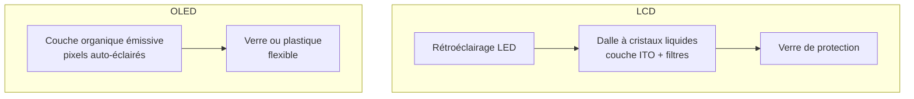

# Affichage

L'écran peut être un contributeur important à la fabrication et à la consommation d'un terminal ; sa part dépend de la configuration et de l'usage. Son impact dépend principalement de la **surface** (qui croît avec le carré de la diagonale), de la **technologie** (LCD, OLED, E-ink) et des **matériaux critiques** qu'il mobilise (indium pour le LCD, composés organiques pour l'OLED).

## D'où vient l'impact

### Structure d'un écran

| Élément | LCD | OLED | Impact principal |
|---|---|---|---|
| **Substrat verre** | Oui (2 plaques) | Oui (1 plaque ou plastique) | GWP (énergie de fusion) |
| **ITO (oxyde d'indium-étain)** | Oui (couche conductrice) | Oui | ADPe (indium = métal critique) |
| **Rétroéclairage** | Oui (LEDs) | Non (pixels auto-émissifs) | Consommation opérationnelle |
| **Couche organique** | Non | Oui (composés organiques) | Procédés chimiques, CTUe |
| **Polariseurs, filtres** | Oui | Oui | GWP, chimie |

## Modèle paramétrique

:::caution[Scénario à calibrer]
Les coefficients par technologie ci-dessous sont des hypothèses pédagogiques conservées pour explorer la sensibilité à la taille. Leur rattachement à un rapport constructeur précis et à un périmètre de dalle n’est pas établi. Ils ne sont pas des facteurs ADEME ou Boavizta validés. Privilégier un PCF de produit ou un facteur d’écran traçable pour un résultat de reporting.[^context-1]
:::

### Formule d'impact intrinsèque

L'impact est proportionnel à la surface d'écran, avec un coefficient par technologie :

$$
\begin{aligned}
&I_{emb} = S_{ecran} \times C_{techno} + C_{base} \\
\text{avec} \\
&S_{ecran} = d^2 \times 2{,}7569 \htmlClass{unit}{[\mathrm{cm}^2]} \text{ (pour un ratio 16:9)} \\
&d = \text{Diagonale de l'écran} \htmlClass{unit}{[pouces]} \\
&C_{techno} = \text{Coefficient par }\mathrm{cm}^2\text{ selon la technologie} \\
&C_{base} = \text{Base fixe (driver, connecteurs, cadre)}
\end{aligned}
$$

:::note[Surface vs diagonale]
La surface d'un écran 16:9 est $S = d^2 \times \frac{16 \times 9}{16^2 + 9^2} \times 2{,}54^2 \approx d^2 \times 2{,}7569$ cm². Un écran de 27" a une surface 17,25 fois plus grande qu'un écran de 6,5" ; la partie variable du modèle suit ce rapport, contrairement à sa base fixe.
:::

### Coefficients par technologie

| Technologie | $C_{techno}$ (kgCO₂e/cm²) | $C_{base}$ (kgCO₂e) | Puissance supposée (W/cm²) | Statut |
|---|---|---|---|---|
| **LCD / IPS** | 0,07 | 3,0 | 0,003 | Hypothèse D4B, calibration à établir[^1] |
| **OLED / AMOLED** | 0,12 | 2,5 | 0,002 | Hypothèse D4B, dépend du contenu[^2] |
| **E-ink** | 0,03 | 1,5 | ~0 en statique | Hypothèse de maintien statique, hors électronique et éclairage |

### Ordres de grandeur

| Écran | Diagonale | Surface | GWP fabrication | Puissance (LCD) |
|---|---|---|---|---|
| Smartphone | 6,5" | 116 cm² | ~11 kg CO₂ eq. | 0,4 W |
| Tablette | 11" | 334 cm² | ~26 kg CO₂ eq. | 1,0 W |
| Laptop | 14" | 540 cm² | ~41 kg CO₂ eq. | 1,6 W |
| Moniteur bureau | 27" | 2 010 cm² | ~144 kg CO₂ eq. | 6,0 W |

:::note[Le moniteur, un poste majeur]
Le scénario donne environ 144 kg CO₂ eq. pour la dalle modélisée à 27 pouces ; ce n'est pas une ACV de moniteur complet ni la preuve d'une équivalence avec un laptop. Les puissances surfaciques excluent potentiellement l'électronique et les pertes ; ne pas les assimiler à une mesure à la prise.
:::

## Impact opérationnel

### Consommation électrique

$$
\begin{aligned}
&P_{ecran} = S_{ecran} \times p_{techno} \\
\text{avec} \\
&p_{LCD} = 0{,}003 \text{ W/}\mathrm{cm}^2 \\
&p_{OLED} = 0{,}002 \text{ W/}\mathrm{cm}^2\text{ (moyenne, dépend du contenu affiché)} \\
&p_{E\text{-}ink} \approx 0 \text{ en affichage statique}
\end{aligned}
$$

La consommation d'un écran OLED dépend fortement du contenu affiché (les pixels noirs réduisent la composante émissive, sans supprimer toute consommation). Le gain d’un mode sombre dépend de la luminosité et du contenu ; il ne s’applique pas uniformément au terminal complet. Sur LCD, le rétroéclairage reste un déterminant distinct.

## Couverture des indicateurs

Les facteurs d’équipement et les rapports constructeurs peuvent renseigner le terminal complet, sans toujours isoler la dalle.[^donnees-modele][^source-5]

| Indicateur | Pertinence pour l'affichage | Couverture actuelle |
|---|---|---|
| **GWP** | Forte ; énergie de fabrication des dalles (fusion du verre, dépôt sous vide OLED) | Scénario exploratoire, non calibré |
| **ADPe** | Forte ; indium (ITO) dans les deux technologies, autres matériaux du panneau selon sa composition | Non encore modélisé au niveau composant ; couvert via les facteurs d'équipement D4B |
| **WU** | Modérée ; procédés de nettoyage et de fabrication | Des facteurs équipement peuvent les inclure, sans isoler la dalle |
| **AP, PM** | Modérée ; procédés chimiques de fabrication | Des facteurs équipement peuvent les inclure, sans isoler la dalle |
| **IR** | Inventaire compatible requis pour fabrication et usage ; ne pas déduire une faible contribution de l’absence de données | Unité LCIA à vérifier |
| **CTUe, CTUh** | Pertinent (solvants, résines photosensibles) mais peu documenté au niveau dalle | Des facteurs équipement peuvent les inclure, sans isoler la dalle |

## Hypothèses et limites

- Le modèle par surface est une simplification. En réalité, la résolution, la densité de pixels et la technologie de rétroéclairage (LED edge, full array, mini-LED) influencent aussi l'impact.
- Les coefficients OLED sont des estimations ; les données constructeurs détaillées sur les dalles OLED sont encore rares.
- L'indium (ITO) est un matériau critique présent dans les deux technologies ; son impact sur l'ADPe n'est pas encore capturé par un coefficient dédié dans ce modèle.
- La consommation OLED est très variable selon le contenu affiché ; la valeur par cm² est une moyenne.

## Exemple interactif {#simulateur}

import { DisplayPlayGround } from '@site/src/components/display-playground';

<DisplayPlayGround lang="fr" />

[^1]: Resilio / Aguaro, [Les impacts environnementaux des équipements informatiques](https://alliancegreenit.org/media/ressource-projet-greenit/resilio-aguaro-whitepaper-rdb-vs-pcf-fr-20241025-web.pdf), octobre 2024. Le corpus de contexte contient des décompositions de rapports constructeurs, mais ne justifie pas ici les coefficients numériques par technologie.

[^2]: La fabrication et l'usage dépendent du panneau, des rendements et du contenu. L'extinction des pixels noirs ne rend pas l'électronique du panneau ni le terminal entièrement sans consommation.

[^source-5]: Digital4Better, [digital4better/data](https://github.com/digital4better/data) Catalogue évolutif ; utiliser un commit pour figer les facteurs.

[^context-1]: Base Empreinte ADEME (facteurs écran) Voir le [corpus documentaire](../../references/sources-et-corpus). [Boavizta Documentation](https://doc.api.boavizta.org/) Documentation en ligne, version non figée. Resilio / Aguaro, [Les impacts environnementaux des équipements informatiques](https://alliancegreenit.org/media/ressource-projet-greenit/resilio-aguaro-whitepaper-rdb-vs-pcf-fr-20241025-web.pdf), octobre 2024. (Resilio/Aguaro) Voir le [corpus documentaire](../../references/sources-et-corpus). Rapports PCF constructeurs (Dell, HP, Apple) Voir le [corpus documentaire](../../references/sources-et-corpus).

[^donnees-modele]: `digital4better/data` → `data/equipment/*` (facteurs par type de terminal incluant l'écran). Décompositions constructeurs (Dell, HP, Apple) via rapports PCF. [Digital4Better, catalogue de données, instantané 77cae4a](https://github.com/digital4better/data/tree/77cae4a58fadd5deb3b8d4e5577020da08f780d8). Références et portée : [Sources et corpus](../../references/sources-et-corpus).
