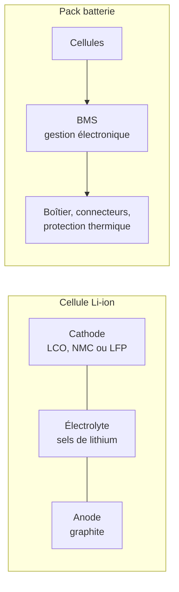

# Alimentation et batterie

La batterie mobilise des **matériaux critiques** : lithium, graphite et, selon sa chimie, cobalt ou nickel. Sa contribution dépend de la capacité, de la chimie, des procédés, du pays de fabrication et du périmètre cellule ou pack. Une ACV de batterie automobile ne se transpose pas directement à une batterie de smartphone.[^context-1]

## D'où vient l'impact

### Structure d'une batterie Li-ion

| Composant | Matériaux clés | Indicateur le plus impacté |
|---|---|---|
| **Cathode** | Cobalt (LCO), nickel + manganèse (NMC), fer + phosphate (LFP) | ADPe, CTUe, GWP |
| **Anode** | Graphite (naturel ou synthétique) | GWP (graphitisation énergivore) |
| **Électrolyte** | Sels de lithium (LiPF₆) | WU (extraction du lithium) |
| **Collecteurs de courant** | Cuivre (anode), aluminium (cathode) | ADPe |
| **BMS + boîtier** | Électronique, plastique, aluminium | GWP |

## Modèle paramétrique

### Formule d'impact intrinsèque

L'impact est proportionnel à la capacité, avec un coefficient qui dépend de la chimie :

$$
\begin{aligned}
&I_{emb} = \frac{C_{batterie}}{1000} \times F_{chimie} \\
\text{avec} \\
&C_{batterie} = \text{Capacité de la batterie} \htmlClass{unit}{[Wh]} \\
&F_{chimie} = \text{Facteur d'impact par kWh selon la chimie}
\end{aligned}
$$

### Scénarios du simulateur

| Chimie | Facteur GWP exploratoire (kg CO₂e/kWh de capacité) | Statut |
|---|---:|---|
| LCO | 75 | Hypothèse pédagogique D4B |
| NMC 622 | 65 | Hypothèse pédagogique D4B |
| NMC 811 | 60 | Hypothèse pédagogique D4B |
| LFP | 50 | Hypothèse pédagogique D4B |

Ces valeurs ne sont **ni des médianes de méta-analyses établies, ni des facteurs validés par les articles cités**. Elles permettent d'explorer la proportionnalité à la capacité. Une évaluation publiable doit leur substituer un facteur documentant chimie, usine, année, rendement et périmètre cellule/pack. Les anciens coefficients ADPe et eau, insuffisamment traçables, sont retirés des résultats et conservés dans les archives de refonte.

### Matériaux critiques par chimie

| Chimie | Cobalt (g/kWh) | Lithium (g/kWh) | Nickel (g/kWh) | Statut |
|---|---|---|---|---|
| **LCO** | ~600 | ~110 | 0 | Hypothèse de composition D4B |
| **NMC 622** | ~200 | ~90 | ~350 | Hypothèse de composition D4B |
| **NMC 811** | ~60 | ~80 | ~470 | Hypothèse de composition D4B |
| **LFP** | 0 | ~80 | 0 | Pas de cobalt ni nickel |

:::note[L'enjeu du cobalt]
La criticité d'un matériau dépend des risques d'approvisionnement et du contexte étudié ; elle ne se réduit pas à son indicateur ADPe. La tendance industrielle est à la réduction du cobalt (passage de NMC 111 → 622 → 811) et au LFP pour les applications où la densité énergétique n'est pas critique. Chaque changement de chimie modifie le profil d'impact multicritère.
:::

### Exemple reproductible

Ex: pour une batterie de 20 Wh et le scénario LCO à 75 kg CO₂e/kWh, l'impact de fabrication calculé vaut `20 / 1000 × 75 = 1,5 kg CO₂e`. Ce résultat ne renseigne pas sa part dans un téléphone complet sans disposer de l'ACV de ce téléphone. Un remplacement ajoute une nouvelle batterie ; il ne doit pas être inclus deux fois dans un facteur équipement couvrant déjà les réparations.

## Alimentation (PSU / chargeur)

Le bloc d'alimentation (PSU) possède ses propres impacts de fabrication et influence la consommation via son **rendement de conversion** ; sa contribution relative à la batterie dépend du système :

$$
\begin{aligned}
&E_{réelle} = \frac{E_{utile}}{\eta} \\
\text{avec} \\
&\eta = \text{Rendement de conversion (typiquement 80 à 95 \%)}
\end{aligned}
$$

| Rendement supposé | Énergie à la prise pour 100 Wh utiles | Surconsommation par rapport à l'énergie utile |
|---:|---:|---:|
| 80 % | 125 Wh | 25 % |
| 90 % | 111,11 Wh | 11,11 % |
| 95 % | 105,26 Wh | 5,26 % |

:::note[Frontière de mesure]
Appliquer le rendement uniquement à une énergie mesurée ou estimée **en sortie** du chargeur ou de l'alimentation. Une mesure à la prise inclut déjà ces pertes. Au datacenter, préciser si la mesure IT est en entrée AC des équipements : dans ce cas, ne pas ajouter à nouveau leur rendement avant d'appliquer le PUE. Les pertes de l'infrastructure électrique du site sont déjà dans le PUE.
:::

## Couverture des indicateurs

| Indicateur | Traitement |
|---|---|
| GWP | Scénario pédagogique ; remplacer le facteur par une ACV compatible pour une étude |
| ADPe, AP, PM, CTUe, CTUh | Pertinents pour extraction, raffinage et fabrication ; aucun facteur isolé validé dans ce simulateur |
| WU | Distinguer prélèvement, consommation d'eau douce, saumure et impact de rareté ; pas de somme de grandeurs incompatibles |
| IR | Peut contribuer via l'électricité de fabrication et de recharge ; vérifier méthode et unité |

Un facteur d'équipement complet peut couvrir la batterie sans permettre d'en isoler les contributions. Il ne s'ajoute donc pas au modèle de batterie.[^donnees-modele][^source-6]

## Hypothèses et limites

- Les facteurs et masses du simulateur sont des hypothèses exploratoires ; aucune plage de confiance statistique ne leur est attribuée.
- Le modèle ne distingue pas encore cellule et pack (BMS, boîtier, refroidissement). Le périmètre du facteur choisi doit le préciser ; le simulateur ne prouve pas une couverture du pack complet.
- Les facteurs ADPe et WU ne sont pas établis pour les scénarios de ce simulateur ; une comparaison de qualité entre indicateurs exige l’examen des inventaires et méthodes effectivement utilisés.
- Le rendement du PSU n'est pas toujours documenté ; les valeurs sont des scénarios à remplacer par une mesure à la charge pertinente.
- Le remplacement de la batterie en cours de vie de l'équipement (fréquent pour les smartphones) doit être traité comme hypothèse explicite.

## Exemple interactif {#simulateur}

import { BatteryPlayGround } from '@site/src/components/battery-playground';

<BatteryPlayGround lang="fr" />

Voir aussi [Matériaux critiques](../materiaux/materiaux-critiques) pour le contexte cobalt, lithium, terres rares.

[^source-6]: Digital4Better, [digital4better/data](https://github.com/digital4better/data) Catalogue évolutif ; utiliser un commit pour figer les facteurs.

[^context-1]: Kelly et al., 2021. [Energy, greenhouse gas, and water life cycle analysis of lithium carbonate and lithium hydroxide monohydrate](https://doi.org/10.1016/j.resconrec.2021.105762), Resources, Conservation and Recycling, 174, 105762. Étude de procédés lithium, pas validation des quatre coefficients du simulateur. Ellingsen et al., 2014. [LCA of a Li-Ion Battery Vehicle Pack](https://doi.org/10.1111/jiec.12072). Journal of Industrial Ecology. Peters et al., 2017. [Environmental impact of Li-Ion batteries](https://doi.org/10.1016/j.rser.2016.08.039). RSER. Olivetti et al., 2017. [Li-Ion Battery Supply Chain](https://doi.org/10.1016/j.joule.2017.08.019). Joule. Resilio / Aguaro, [Les impacts environnementaux des équipements informatiques](https://alliancegreenit.org/media/ressource-projet-greenit/resilio-aguaro-whitepaper-rdb-vs-pcf-fr-20241025-web.pdf), octobre 2024. Voir le [corpus documentaire](../../references/sources-et-corpus).

[^donnees-modele]: Scénarios D4B distincts des publications de contexte (Kelly, Ellingsen, Peters, Olivetti). `digital4better/data` → `data/equipment/*`. Données constructeurs (Apple Environmental Reports, Dell PCF). [Digital4Better, catalogue de données, instantané 77cae4a](https://github.com/digital4better/data/tree/77cae4a58fadd5deb3b8d4e5577020da08f780d8). Références et portée : [Sources et corpus](../../references/sources-et-corpus).
