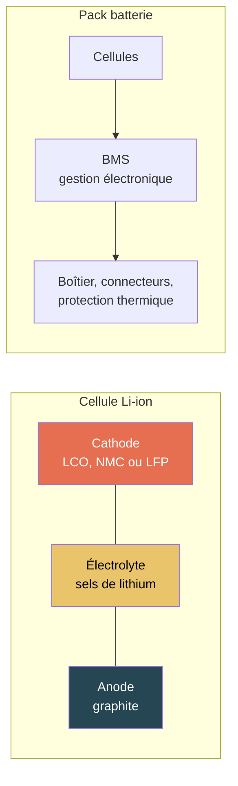

# Alimentation et batterie

## Résumé

La batterie est le composant dont l'impact environnemental est le plus directement lié aux **matériaux critiques** : cobalt, lithium, nickel, graphite. Pour un smartphone, la batterie peut représenter 10 à 20 % de l'impact GWP et une part bien plus élevée des indicateurs ADPe et WU. La chimie de la cathode (LCO, NMC, LFP) est le premier déterminant de l'impact.

## D'où vient l'impact

### Structure d'une batterie Li-ion

| Composant | Matériaux clés | Indicateur le plus impacté |
|---|---|---|
| **Cathode** | Cobalt (LCO), nickel + manganèse (NMC), fer + phosphate (LFP) | ADPe, CTUe, GWP |
| **Anode** | Graphite (naturel ou synthétique) | GWP (graphitisation énergivore) |
| **Électrolyte** | Sels de lithium (LiPF₆) | WU (extraction du lithium) |
| **Collecteurs de courant** | Cuivre (anode), aluminium (cathode) | ADPe |
| **BMS + boîtier** | Électronique, plastique, aluminium | GWP |

## Modèle paramétrique

### Formule d'impact intrinsèque

L'impact est proportionnel à la capacité, avec un coefficient qui dépend de la chimie :

$$
\begin{aligned}
&I_{emb} = \frac{C_{batterie}}{1000} \times F_{chimie} \\
\text{avec} \\
&C_{batterie} = \text{Capacité de la batterie} \htmlClass{unit}{[Wh]} \\
&F_{chimie} = \text{Facteur d'impact par kWh selon la chimie}
\end{aligned}
$$

### Facteurs par chimie et par indicateur

| Chimie | Usage typique | GWP (kgCO₂e/kWh) | ADPe (kgSbeq/kWh) | WU (m³/kWh) | Source |
|---|---|---|---|---|---|
| **LCO** | Smartphone, montre | 75 | 0,005 | 3,0 | Kelly et al. 2021[^1], Peters et al. 2017[^2] |
| **NMC 622** | Laptop, tablette, VE | 65 | 0,003 | 2,5 | Kelly et al. 2021[^1], Ellingsen et al. 2014[^3] |
| **NMC 811** | VE dernière génération | 60 | 0,0025 | 2,2 | Estimations industrie |
| **LFP** | Serveurs UPS, stockage stationnaire | 50 | 0,001 | 2,0 | Kelly et al. 2021[^1] |

[^1]: Kelly et al., 2021. Energy, greenhouse gas, and water life cycle analysis of lithium carbonate and lithium hydroxide monohydrate. Resources, Conservation and Recycling, 175.
[^2]: Peters et al., 2017. The environmental impact of Li-Ion batteries and the role of key parameters. Renewable and Sustainable Energy Reviews, 67.
[^3]: Ellingsen et al., 2014. Life Cycle Assessment of a Lithium-Ion Battery Vehicle Pack. Journal of Industrial Ecology, 18(1).

:::note[Variabilité des facteurs]
Les facteurs GWP par kWh varient fortement dans la littérature (de 40 à 120 kgCO₂e/kWh selon les études). Cette variabilité vient des hypothèses sur le mix électrique des usines, les rendements de fabrication, le périmètre ACV (cellule seule vs pack complet) et la chimie exacte. Les valeurs retenues ici sont des médianes de méta-analyses récentes.
:::

### Matériaux critiques par chimie

| Chimie | Cobalt (g/kWh) | Lithium (g/kWh) | Nickel (g/kWh) | Source |
|---|---|---|---|---|
| **LCO** | ~600 | ~110 | 0 | UNEP 2013, données constructeurs |
| **NMC 622** | ~200 | ~90 | ~350 | Olivetti et al. 2017[^4] |
| **NMC 811** | ~60 | ~80 | ~470 | Estimations industrie |
| **LFP** | 0 | ~80 | 0 | Pas de cobalt ni nickel |

[^4]: Olivetti et al., 2017. Lithium-Ion Battery Supply Chain Considerations: Analysis of Potential Bottlenecks in Critical Metals. Joule, 1(2).

:::note[L'enjeu du cobalt]
Le cobalt est le matériau le plus critique pour les batteries numériques. 70 % de la production mondiale vient de la RDC. La tendance industrielle est à la réduction du cobalt (passage de NMC 111 → 622 → 811) et au LFP pour les applications où la densité énergétique n'est pas critique. Chaque changement de chimie modifie le profil d'impact multicritère.
:::

### Ordres de grandeur par équipement

| Équipement | Capacité typique | Chimie | GWP fabrication batterie | Part dans le GWP total |
|---|---|---|---|---|
| Smartphone | 15-20 Wh | LCO | ~1,3 kg CO₂ eq. | ~10-15 % |
| Laptop | 50-60 Wh | NMC | ~3,6 kg CO₂ eq. | ~5-10 % |
| Tablette | 25-35 Wh | NMC | ~2,0 kg CO₂ eq. | ~8-12 % |
| UPS serveur | 500-2000 Wh | LFP | ~50 kg CO₂ eq. | Variable |

## Alimentation (PSU / chargeur)

Le bloc d'alimentation (PSU) ne contribue pas autant en fabrication que la batterie, mais il influence l'impact opérationnel via son **rendement de conversion** :

$$
\begin{aligned}
&E_{réelle} = \frac{E_{utile}}{\eta} \\
\text{avec} \\
&\eta = \text{Rendement de conversion (typiquement 80 à 95 \%)}
\end{aligned}
$$

| Type de PSU | Rendement typique | Impact sur l'opérationnel |
|---|---|---|
| Chargeur smartphone | 80-85 % | +15-20 % d'énergie soutirée |
| PSU laptop | 85-90 % | +10-15 % |
| PSU serveur (80+ Gold) | 90-94 % | +6-10 % |
| PSU serveur (80+ Titanium) | 94-96 % | +4-6 % |

:::note[Pertes de conversion]
Les pertes de conversion sont souvent omises dans les évaluations, mais elles représentent 5 à 20 % d'énergie supplémentaire. Pour un datacenter, cette perte s'ajoute au PUE et à la charge IT.
:::

## Couverture des indicateurs

| Indicateur | Pertinence pour la batterie | Couverture actuelle |
|---|---|---|
| **GWP** | Forte — énergie de fabrication des cellules et du pack | Modélisé (coefficient par kWh par chimie) |
| **ADPe** | Très forte — cobalt, lithium, nickel = premiers contributeurs ADPe du numérique | Modélisé (coefficient par kWh par chimie) |
| **WU** | Très forte — extraction du lithium par évaporation de saumures (~2 000 m³/t) | Modélisé (coefficient par kWh par chimie) |
| **AP** | Forte — procédés de raffinage du nickel et du cobalt | Couvert via les facteurs d'équipement D4B |
| **PM** | Modérée — extraction minière et transport | Couvert via les facteurs d'équipement D4B |
| **CTUe, CTUh** | Forte — résidus miniers (cobalt, nickel), procédés chimiques | Pertinent mais pas encore isolé au niveau composant ; couvert via D4B |
| **IR** | Faible à ce niveau — la batterie ne consomme pas d'électricité directement | Non pertinent pour le composant (pertinent pour la recharge) |

## Simulateur

import { BatteryPlayGround } from '@site/src/components/battery-playground';

<BatteryPlayGround lang="fr" />

## Hypothèses et limites

- Les facteurs GWP par kWh sont des médianes de méta-analyses. La variabilité réelle est importante (±30 à 50 %).
- Le modèle ne distingue pas encore cellule et pack (BMS, boîtier, refroidissement). Le facteur inclut le pack complet.
- Les facteurs ADPe et WU sont moins stabilisés que le GWP dans la littérature batterie.
- Le rendement du PSU n'est pas toujours documenté ; les valeurs retenues sont des moyennes par gamme.
- Le remplacement de la batterie en cours de vie de l'équipement (fréquent pour les smartphones) doit être traité comme hypothèse explicite.

## Données mobilisées

- Coefficients par chimie issus de la littérature (Kelly, Ellingsen, Peters, Olivetti)
- `digital4better/data` → `data/equipment/*`
- Données constructeurs (Apple Environmental Reports, Dell PCF)

## Sources

- Kelly et al., 2021. Energy, greenhouse gas, and water LCA of lithium carbonate and hydroxide.
- Ellingsen et al., 2014. [LCA of a Li-Ion Battery Vehicle Pack](https://doi.org/10.1111/jiec.12072). Journal of Industrial Ecology.
- Peters et al., 2017. [Environmental impact of Li-Ion batteries](https://doi.org/10.1016/j.rser.2016.08.039). RSER.
- Olivetti et al., 2017. [Li-Ion Battery Supply Chain](https://doi.org/10.1016/j.joule.2017.08.019). Joule.
- `inputs/md/les-impacts-environnementaux-des-equipements-informatiques.md`
- [digital4better/data](https://github.com/digital4better/data)
- Voir aussi [Matériaux critiques](../materiaux/materiaux-critiques) pour le contexte cobalt, lithium, terres rares.
