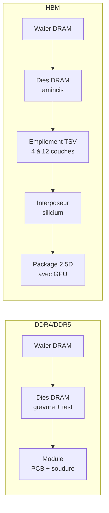

# Mémoire vive

La mémoire vive (RAM) est un composant dont l'impact intrinsèque dépend principalement de la surface de silicium nécessaire pour atteindre la capacité installée. Dans le modèle historique et avec une densité supposée de 0,625 Go/cm², un module de 32 Go donne 117,86 kg CO₂ eq. ; 5,22 kg est uniquement le terme fixe. Les multiplicateurs HBM du simulateur sont des hypothèses, pas un ratio universel validé.

## D'où vient l'impact

La fabrication d'une puce mémoire DRAM suit les mêmes procédés que les semi-conducteurs (voir [Semi-conducteurs](../materiaux/semi-conducteurs)) : salle blanche, photolithographie, gravure, métallisation. La capacité dépend de la densité de cellules, de la surface, du nombre de dies et de l'organisation du module. Ne pas confondre l'empilement de dies HBM avec les couches de cellules d'une NAND 3D.

Pour la mémoire HBM (High Bandwidth Memory), des dies DRAM sont empilés verticalement avec des interconnexions TSV (Through-Silicon Via) sur un interposeur en silicium, ce qui ajoute des procédés dont l'impact doit être inventorié, sans multiplicateur universel.

## Modèle paramétrique

### Formule d'impact intrinsèque

Le modèle repose sur la surface de die DRAM nécessaire, qui dépend de la capacité et de la densité[^donnees-modele] :

$$
\begin{aligned}
&I_{emb} = \left(\frac{C}{D} \times C_{die} + C_{base}\right) \times F_{pkg} \times N_{modules} \\
\text{avec} \\
&C = \text{Capacité par module} \htmlClass{unit}{[Go]} \\
&D = \text{Densité DRAM} \htmlClass{unit}{[\mathrm{Go}/\mathrm{cm}^2]} \\
&C_{die} = \text{Coefficient par }\mathrm{cm}^2\text{ de die} \\
&C_{base} = \text{Base fixe par module (PCB, connecteurs)} \\
&F_{pkg} = \text{Facteur de packaging} \\
&N_{modules} = \text{Nombre de modules}
\end{aligned}
$$

### Coefficients

| Indicateur | $C_{die}$ (par cm²) | $C_{base}$ (par module) | Unité | Source |
|---|---|---|---|---|
| **GWP** | 2,20 | 5,22 | kgCO₂ eq. | Green Cloud Computing (UBA 2021)[^1] [^source-2][^1]|
| **ADPe** | 6,30E-05 | 1,69E-03 | kg Sb eq. | Green Cloud Computing (UBA 2021)[^1] |
| **PE** | 27,30 | 74,00 | MJ | Green Cloud Computing (UBA 2021)[^1] |

### Familles de mémoire

La mémoire se décline en plusieurs familles avec des procédés et des impacts très différents :

| Famille | Usage | Capacités typiques | Spécificité procédé |
|---|---|---|---|
| **DDR4 / LPDDR4** | RAM système (serveur, laptop, smartphone) | 4 à 128 Go par module | Module DIMM standard, wire bonding |
| **DDR5 / LPDDR5** | RAM système (dernière génération) | 8 à 128 Go par module | Process plus dense, on-die ECC |
| **GDDR6 / GDDR6X** | Mémoire graphique (GPU consumer et pro) | 4 à 24 Go par GPU | Bande passante élevée, soudée sur le PCB du GPU |
| **HBM2e** | Mémoire GPU datacenter (ex. A100) | 16 à 80 Go par GPU | Empilement TSV 4-8 couches + interposeur silicium [^source-4][^source-5]|
| **HBM3 / HBM3e** | Mémoire GPU datacenter (HBM3 : H100 ; HBM3e : H200/B200) | 96 à 288 Go par GPU | TSV haute densité, 8-12 couches |

### Densité et packaging par type

Les valeurs suivantes sont des **hypothèses D4B exploratoires**, pas des densités garanties par génération ni des facteurs de packaging validés. Vérifier le nombre de dies, leur surface, la capacité réellement comptée et la frontière interposeur/GPU.

| Type | Densité $D$ (Go/cm²) | Facteur packaging $F_{pkg}$ | Justification |
|---|---|---|---|
| **DDR4 / LPDDR4** | 0,625 | 1,0 | Module standard, wire bonding |
| **DDR5 / LPDDR5** | 1,0 | 1,1 | Process plus dense, légère surcharge |
| **GDDR6** | 0,8 | 1,3 | Soudée sur PCB GPU, bande passante élevée |
| **HBM2e** | 0,5 | 3,0 | Empilement TSV + interposeur silicium |
| **HBM3** | 0,8 | 3,5 | TSV haute densité, plus de couches |

:::note[GDDR vs DDR]
La GDDR (Graphics DDR) est optimisée pour la bande passante plutôt que la latence. Elle est soudée directement sur le PCB du GPU, ce qui simplifie le packaging mais rend la mémoire non remplaçable. Cette intégration ne permet pas à elle seule de déduire un impact par Go supérieur à la DDR. Une comparaison nécessite des inventaires compatibles.
:::

### Ordres de grandeur

| Configuration | GWP intrinsèque | ADPe | Contexte |
|---|---|---|---|
| 1 module DDR4 32 Go | **~118 kg CO₂ eq.** | 5,0E-03 kg Sb eq. | Serveur standard |
| 16 modules DDR5 32 Go (512 Go) | **1 330,91 kg CO₂ eq.** | 6,52E-02 kg Sb eq. | Serveur 2U |
| 6× HBM2e 16 Go (96 Go) | **1 361,16 kg CO₂ eq.** | ; | Scénario HBM2e, pas une configuration H100 |

:::note[Poids de la RAM dans un serveur]
Ces résultats reproduisent les coefficients et hypothèses du tableau : DDR5 $(32/1\times2{,}2+5{,}22)\times1{,}1\times16$ ; HBM2e $(16/0{,}5\times2{,}2+5{,}22)\times3\times6$. Ils ne valident ni ces multiplicateurs ni une part universelle de la RAM dans un serveur.
:::

## Impact opérationnel

### Consommation électrique

Le modèle simplifié représente la puissance par un coefficient de capacité constant ; la réalité dépend aussi de la technologie, de la fréquence, des accès et des états de puissance :

$$
\begin{aligned}
&P_{ram} = C_{totale} \times p \\
\text{avec} \\
&p = 0{,}392 \text{ W/Go (Cloud Jewels / Cloud Carbon Footprint)} \\
&\text{ou } p = 0{,}284 \text{ W/Go (Green Cloud Computing, UBA 2021)}
\end{aligned}
$$

| Configuration | Puissance (Cloud Jewels) | Puissance (Boavizta) |
|---|---|---|
| 16 Go (laptop) | 6,3 W | 4,5 W |
| 128 Go (serveur 1U) | 50 W | 36 W |
| 512 Go (serveur 2U) | 201 W | 145 W |
| 2 048 Go (DGX) | 803 W | 582 W |

:::note[Profil de charge]
Le rafraîchissement et le maintien des données consomment de l'énergie, mais les accès et états de puissance contribuent également. Un coefficient W/Go constant ne représente pas une mesure de sensibilité à la charge ni une loi universelle pour DDR, LPDDR et HBM.
:::

## Couverture des indicateurs

| Indicateur | Pertinence pour la RAM | Couverture actuelle |
|---|---|---|
| **GWP** | Forte ; énergie de fabrication des puces DRAM | Modélisé (coefficient par cm² de die) |
| **ADPe** | Modérée ; matériaux de la puce et du module | Modélisé (coefficient par cm² de die) |
| **PE** | Modérée ; énergie primaire cumulée | Modélisé (coefficient par cm² de die) |
| **WU** | Forte ; eau ultrapure pour la fabrication DRAM | Aucun facteur WU caractérisé validé ici ; résultat retiré du simulateur, eau physique non interchangeable |
| **AP, PM** | Modérée ; procédés de gravure et gaz acides | Couvert via les facteurs d'équipement `digital4better/data` [^source-6]|
| **IR** | Inventaire compatible requis pour fabrication et usage ; ne pas déduire une faible contribution de l’absence de données | Unité LCIA à vérifier |
| **CTUe, CTUh** | Pertinent (chimie de procédé DRAM) mais peu stabilisé | Couvert dans les facteurs d'équipement D4B, pas au niveau composant |

## Hypothèses et limites

- La capacité est la variable la plus robuste. Le type de mémoire affine le calcul quand il est connu.
- Les facteurs HBM sont des estimations basées sur la complexité du packaging TSV ; ils seront affinés quand des données constructeurs plus détaillées seront disponibles.
- La frontière entre mémoire embarquée dans un accélérateur et mémoire système n'est pas toujours triviale.
- Le coefficient de puissance retenu (0,392 W/Go) est une valeur moyenne ; la consommation réelle varie selon la technologie et la fréquence.[^source-3]

## Exemple interactif {#simulateur}

import { RamPlayGround } from '@site/src/components/ram-playground';

<RamPlayGround lang="fr" />

[^1]: Green Cloud Computing, UBA, 2021 ; coefficients par cm² de die DRAM. Implémentés dans [Boavizta RAM methodology](https://doc.api.boavizta.org/Explanations/components/ram/).

[^source-2]: UBA, [Green Cloud Computing](https://www.umweltbundesamt.de/publikationen/green-cloud-computing), 2021 Voir le [corpus documentaire](../../references/sources-et-corpus).

[^source-3]: [Cloud Carbon Footprint ; Methodology](https://www.cloudcarbonfootprint.org/docs/methodology/) Documentation en ligne, version non figée.

[^source-4]: Resilio / Aguaro, [Les impacts environnementaux des équipements informatiques](https://alliancegreenit.org/media/ressource-projet-greenit/resilio-aguaro-whitepaper-rdb-vs-pcf-fr-20241025-web.pdf), octobre 2024. (Resilio/Aguaro, décomposition par composant) Voir le [corpus documentaire](../../references/sources-et-corpus).

[^source-5]: Falk et al., [More than Carbon](https://arxiv.org/abs/2509.00093), 2025. (données HBM) Voir le [corpus documentaire](../../references/sources-et-corpus).

[^source-6]: Digital4Better, [digital4better/data](https://github.com/digital4better/data) Catalogue évolutif ; utiliser un commit pour figer les facteurs.

[^donnees-modele]: `digital4better/data` → `data/cloud/cpus.*`, `data/cloud/accelerators.*`. Coefficients Boavizta (GWP, ADPe, PE par cm² de die DRAM). [Digital4Better, catalogue de données, instantané 77cae4a](https://github.com/digital4better/data/tree/77cae4a58fadd5deb3b8d4e5577020da08f780d8). Références et portée : [Sources et corpus](../../references/sources-et-corpus).
