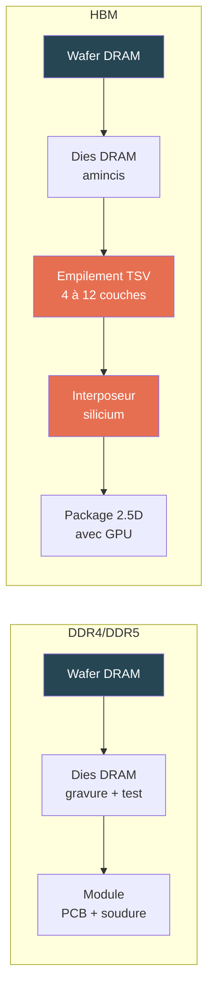

# Mémoire vive

## Résumé

La mémoire vive (RAM) est un composant dont l'impact intrinsèque dépend principalement de la surface de silicium nécessaire pour atteindre la capacité installée. Un module DDR4 de 32 Go représente environ 5,2 kg CO₂ eq. de fabrication. La mémoire HBM, utilisée dans les accélérateurs IA, a un impact 3 à 4 fois plus élevé par Go en raison de son packaging TSV avancé.

## D'où vient l'impact

La fabrication d'une puce mémoire DRAM suit les mêmes procédés que les semi-conducteurs (voir [Semi-conducteurs](../materiaux/semi-conducteurs)) : salle blanche, photolithographie, gravure, métallisation. La capacité totale dépend du nombre de couches DRAM empilées et de la densité par couche.

Pour la mémoire HBM (High Bandwidth Memory), des dies DRAM sont empilés verticalement avec des interconnexions TSV (Through-Silicon Via) sur un interposeur en silicium, ce qui multiplie les étapes de fabrication et l'impact.

## Modèle paramétrique

### Formule d'impact intrinsèque

Le modèle repose sur la surface de die DRAM nécessaire, qui dépend de la capacité et de la densité :

$$
\begin{aligned}
&I_{emb} = \left(\frac{C}{D} \times C_{die} + C_{base}\right) \times F_{pkg} \times N_{modules} \\
\text{avec} \\
&C = \text{Capacité par module} \htmlClass{unit}{[Go]} \\
&D = \text{Densité DRAM} \htmlClass{unit}{[Go/cm²]} \\
&C_{die} = \text{Coefficient par cm² de die} \\
&C_{base} = \text{Base fixe par module (PCB, connecteurs)} \\
&F_{pkg} = \text{Facteur de packaging} \\
&N_{modules} = \text{Nombre de modules}
\end{aligned}
$$

### Coefficients

| Indicateur | $C_{die}$ (par cm²) | $C_{base}$ (par module) | Unité | Source |
|---|---|---|---|---|
| **GWP** | 2,20 | 5,22 | kgCO₂ eq. | Green Cloud Computing (UBA 2021)[^1] |
| **ADPe** | 6,30E-05 | 1,69E-03 | kg Sb eq. | Green Cloud Computing (UBA 2021)[^1] |
| **PE** | 27,30 | 74,00 | MJ | Green Cloud Computing (UBA 2021)[^1] |
| **AP** | 1,40E-03 | — | mol H+ eq. | Reconstruction LCI Green Cloud Computing (UBA 2021) + EF 3.1[^2] |
| **WU** | 1,32E-01 | — | m³ eq. | Reconstruction LCI Green Cloud Computing (eau process + électricité)[^2] |
| **PM** | 2,54E-05 | — | disease occ. | Reconstruction LCI Green Cloud Computing[^2] |

[^2]: Les procédés DRAM partagent les mêmes caractéristiques fondamentales que la fabrication logique (même type de salle blanche, mêmes utilités). Les coefficients par cm² de die sont dérivés de l'inventaire Intel 14nm publié dans Green Cloud Computing (UBA 2021, Tables 23-25), avec facteurs de caractérisation EF 3.1.

[^1]: Green Cloud Computing, UBA, 2021 — coefficients par cm² de die DRAM. Implémentés dans [Boavizta RAM methodology](https://doc.api.boavizta.org/Explanations/components/ram/).

### Familles de mémoire

La mémoire se décline en plusieurs familles avec des procédés et des impacts très différents :

| Famille | Usage | Capacités typiques | Spécificité procédé |
|---|---|---|---|
| **DDR4 / LPDDR4** | RAM système (serveur, laptop, smartphone) | 4 à 128 Go par module | Module DIMM standard, wire bonding |
| **DDR5 / LPDDR5** | RAM système (dernière génération) | 8 à 128 Go par module | Process plus dense, on-die ECC |
| **GDDR6 / GDDR6X** | Mémoire graphique (GPU consumer et pro) | 4 à 24 Go par GPU | Bande passante élevée, soudée sur le PCB du GPU |
| **HBM2e** | Mémoire GPU datacenter (H100, A100) | 16 à 80 Go par GPU | Empilement TSV 4-8 couches + interposeur silicium |
| **HBM3 / HBM3e** | Mémoire GPU datacenter (H200, B200) | 96 à 288 Go par GPU | TSV haute densité, 8-12 couches |

### Densité et packaging par type

| Type | Densité $D$ (Go/cm²) | Facteur packaging $F_{pkg}$ | Justification |
|---|---|---|---|
| **DDR4 / LPDDR4** | 0,625 | 1,0 | Module standard, wire bonding |
| **DDR5 / LPDDR5** | 1,0 | 1,1 | Process plus dense, légère surcharge |
| **GDDR6** | 0,8 | 1,3 | Soudée sur PCB GPU, bande passante élevée |
| **HBM2e** | 0,5 | 3,0 | Empilement TSV + interposeur silicium |
| **HBM3** | 0,8 | 3,5 | TSV haute densité, plus de couches |

:::note[GDDR vs DDR]
La GDDR (Graphics DDR) est optimisée pour la bande passante plutôt que la latence. Elle est soudée directement sur le PCB du GPU, ce qui simplifie le packaging mais rend la mémoire non remplaçable. Son impact par Go est légèrement supérieur à la DDR standard en raison de procédés de fabrication plus exigeants.
:::

### Ordres de grandeur

| Configuration | GWP intrinsèque | ADPe | Contexte |
|---|---|---|---|
| 1 module DDR4 32 Go | **~118 kg CO₂ eq.** | 5,0E-03 kg Sb eq. | Serveur standard |
| 16 modules DDR5 32 Go (512 Go) | **~1 290 kg CO₂ eq.** | 5,5E-02 kg Sb eq. | Serveur 2U |
| 6× HBM2e 16 Go (96 Go) | **~600 kg CO₂ eq.** | — | GPU H100 (mémoire seule) |

:::note[Poids de la RAM dans un serveur]
Pour un serveur 2U avec 512 Go de DDR5, la RAM peut représenter 30 à 50 % de l'impact intrinsèque total du serveur. C'est souvent le premier poste devant le CPU.
:::

## Impact opérationnel

### Consommation électrique

La consommation de la mémoire est quasi proportionnelle à la capacité installée, avec une faible sensibilité à la charge :

$$
\begin{aligned}
&P_{ram} = C_{totale} \times p \\
\text{avec} \\
&p = 0{,}392 \text{ W/Go (Cloud Jewels / Cloud Carbon Footprint)} \\
&\text{ou } p = 0{,}284 \text{ W/Go (Green Cloud Computing, UBA 2021)}
\end{aligned}
$$

| Configuration | Puissance (Cloud Jewels) | Puissance (Boavizta) |
|---|---|---|
| 16 Go (laptop) | 6,3 W | 4,5 W |
| 128 Go (serveur 1U) | 50 W | 36 W |
| 512 Go (serveur 2U) | 201 W | 145 W |
| 2 048 Go (DGX) | 803 W | 582 W |

:::note[Profil de charge]
Contrairement au CPU, la consommation de la RAM est peu sensible à la charge de travail. Une grande partie de l'énergie est consommée par le simple maintien des données en mémoire (refresh DRAM), même au repos.
:::

## Couverture des indicateurs

| Indicateur | Pertinence pour la RAM | Couverture actuelle |
|---|---|---|
| **GWP** | Forte — énergie de fabrication des puces DRAM | Modélisé (coefficient par cm² de die) |
| **ADPe** | Modérée — matériaux de la puce et du module | Modélisé (coefficient par cm² de die) |
| **PE** | Modérée — énergie primaire cumulée | Modélisé (coefficient par cm² de die) |
| **WU** | Forte — eau ultrapure pour la fabrication DRAM | Estimable (via les données semi-conducteurs : ~8 L/cm²) |
| **AP, PM** | Modérée — procédés de gravure et gaz acides | Couvert via les facteurs d'équipement `digital4better/data` |
| **IR** | Faible à ce niveau — dominé par le mix électrique d'usage | Couvert via les facteurs pays |
| **CTUe, CTUh** | Pertinent (chimie de procédé DRAM) mais peu stabilisé | Couvert dans les facteurs d'équipement D4B, pas au niveau composant |

## Simulateur

import { RamPlayGround } from '@site/src/components/ram-playground';

<RamPlayGround lang="fr" />

## Hypothèses et limites

- La capacité est la variable la plus robuste. Le type de mémoire affine le calcul quand il est connu.
- Les facteurs HBM sont des estimations basées sur la complexité du packaging TSV ; ils seront affinés quand des données constructeurs plus détaillées seront disponibles.
- La frontière entre mémoire embarquée dans un accélérateur et mémoire système n'est pas toujours triviale.
- Le coefficient de puissance retenu (0,392 W/Go) est une valeur moyenne ; la consommation réelle varie selon la technologie et la fréquence.

## Données mobilisées

- `digital4better/data` → `data/cloud/cpus.*`, `data/cloud/accelerators.*`
- Coefficients Boavizta (GWP, ADPe, PE par cm² de die DRAM)

## Sources

- [Boavizta RAM methodology](https://doc.api.boavizta.org/Explanations/components/ram/)
- Green Cloud Computing, UBA, 2021 (`inputs/md/green-cloud-computing-uba-2021.md`)
- [Cloud Carbon Footprint — Methodology](https://www.cloudcarbonfootprint.org/docs/methodology/)
- `inputs/md/les-impacts-environnementaux-des-equipements-informatiques.md` (Resilio/Aguaro, décomposition par composant)
- `inputs/md/more-than-carbon-cradle-to-grave-environmental-impacts-of-genai-training-on-the-nvidia-a100-gpu.md` (données HBM)
- [digital4better/data](https://github.com/digital4better/data)
