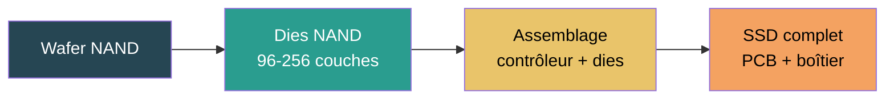

# Stockage

## Résumé

Le stockage est l'un des composants où la technologie change le plus radicalement l'impact. Un SSD de 1 To représente environ 160 kg CO₂ eq. de fabrication, contre ~31 kg CO₂ eq. pour un HDD, soit un facteur 5. En revanche, le HDD consomme environ 2 fois moins d'énergie en fonctionnement mais occupe plus de volume et offre moins de performance.

## D'où vient l'impact

### SSD (Solid State Drive)

Un SSD est composé de puces mémoire NAND Flash. L'impact de fabrication vient des mêmes procédés que les semi-conducteurs : salle blanche, photolithographie multi-couches, gravure. La capacité dépend du nombre de couches NAND empilées (96 à 256+ couches pour les générations actuelles) et de la densité par couche.

### HDD (Hard Disk Drive)

Un HDD est un dispositif mécanique : plateaux magnétiques en rotation, têtes de lecture. L'impact de fabrication vient principalement des matériaux (aluminium, verre, métaux de précision) et de l'assemblage mécanique, pas des procédés semi-conducteurs. C'est pourquoi l'impact est quasi fixe par unité, peu dépendant de la capacité.

## Modèle paramétrique

### SSD — modèle par surface de die NAND

$$
\begin{aligned}
&I_{emb}^{SSD} = \left(\frac{C}{D_{NAND}} \times C_{die} + C_{base}\right) \times N_{drives} \\
\text{avec} \\
&C = \text{Capacité par drive} \htmlClass{unit}{[Go]} \\
&D_{NAND} = \text{Densité NAND} \htmlClass{unit}{[Go/cm²]} \approx 48{,}5 \\
&C_{die} = \text{Coefficient par cm² de die NAND} \\
&C_{base} = \text{Base fixe (contrôleur, PCB, boîtier)} \\
&N_{drives} = \text{Nombre de drives}
\end{aligned}
$$

### Coefficients SSD

| Indicateur | $C_{die}$ (par cm²) | $C_{base}$ (par drive) | Unité | Source |
|---|---|---|---|---|
| **GWP** | 2,20 | 6,34 | kgCO₂ eq. | Green Cloud Computing (UBA 2021)[^1] |
| **ADPe** | 6,30E-05 | 5,63E-04 | kg Sb eq. | Green Cloud Computing (UBA 2021)[^1] |
| **PE** | 27,30 | 73,98 | MJ | Green Cloud Computing (UBA 2021)[^1] |
| **AP** | 1,40E-03 | — | mol H+ eq. | Reconstruction LCI Green Cloud Computing (UBA 2021) + EF 3.1 |
| **WU** | 1,32E-01 | — | m³ eq. | Reconstruction LCI Green Cloud Computing (eau process + électricité) |
| **PM** | 2,54E-05 | — | disease occ. | Reconstruction LCI Green Cloud Computing |

[^1]: Green Cloud Computing, UBA, 2021 — mêmes coefficients de die que la DRAM (NAND et DRAM partagent des procédés semi-conducteurs proches). Implémentés dans [Boavizta SSD](https://doc.api.boavizta.org/Explanations/components/ssd/) et [Boavizta HDD](https://doc.api.boavizta.org/Explanations/components/hdd/).

:::note[Densité NAND]
La densité de 48,5 Go/cm² est une moyenne pour des NAND 96-128 couches TLC. Les générations plus récentes (176-256 couches) ont une densité plus élevée, ce qui réduit l'impact par Go. Ce paramètre est ajustable dans le simulateur.
:::

### HDD — modèle forfaitaire

Le HDD est modélisé avec un impact forfaitaire par unité, indépendant de la capacité :

| Indicateur | Valeur par drive | Unité | Source |
|---|---|---|---|
| **GWP** | 31,11 | kgCO₂ eq. | Green Cloud Computing (UBA 2021)[^1] |
| **ADPe** | 2,50E-04 | kg Sb eq. | Green Cloud Computing (UBA 2021)[^1] |
| **PE** | 276,00 | MJ | Green Cloud Computing (UBA 2021)[^1] |
| **AP** | 0,185 | mol H+ eq. | Green Cloud Computing (UBA 2021), via l'énergie de fabrication mécanique |
| **PM** | 1,03E-06 | disease occ. | Green Cloud Computing (UBA 2021), via l'énergie de fabrication |

Impact quasi fixe par unité car dominé par les composants mécaniques (plateaux, moteur, tête de lecture), pas par la surface de silicium.

### Storage Embodied Factor (SEF)

Tannu & Nair (2023) ont analysé 94 rapports ACV constructeurs (Apple, Dell, HP, Seagate, Fujitsu) et proposent le concept de **Storage Embodied Factor** (SEF) — le ratio entre l'empreinte carbone et la capacité[^3] :

| Technologie | SEF moyen | Unité | Source |
|---|---|---|---|
| **SSD** | 0,16 | kg CO₂ eq. / Go | Tannu & Nair 2023 (94 LCA reports) |
| **HDD** | ~0,02 | kg CO₂ eq. / Go | Tannu & Nair 2023 (24 LCA reports) |

[^3]: Tannu & Nair, 2023. [The Dirty Secret of SSDs: Embodied Carbon](https://arxiv.org/abs/2207.10793).

### Comparaison SSD vs HDD sur 5 ans

Données issues de Tannu & Nair 2023, Table 1, pour 1 To (facteur d'émission US : 0,7 kgCO₂/kWh) :

| Paramètre | SSD 1 To | HDD 1 To | Ratio SSD/HDD |
|---|---|---|---|
| **CAPEX (fabrication)** | 160 kg CO₂ eq. | 20 kg CO₂ eq. | ×8 |
| **Énergie sur 5 ans** | 56,9 kWh | 183,9 kWh | ×0,3 |
| **OPEX (usage, 5 ans)** | 24,6 kg CO₂ eq. | 79,6 kg CO₂ eq. | ×0,3 |
| **Total 5 ans** | **184 kg CO₂ eq.** | **99,6 kg CO₂ eq.** | ×1,8 |
| **Puissance moyenne** | 1,3 W | 4,2 W | ×0,3 |

:::note[Le paradoxe du SSD]
Le SSD est plus performant et moins énergivore que le HDD en fonctionnement, mais son impact de fabrication est **8 fois plus élevé**. Sur 5 ans avec un mix US carboné, le total SSD reste **1,8 fois plus élevé** que le HDD. En France (mix bas carbone), cet écart se creuse encore car l'avantage opérationnel du SSD pèse moins.
:::

## Impact opérationnel

### Consommation électrique

$$
\begin{aligned}
&P_{storage} = \begin{cases}
1{,}2 \times 10^{-3} \times V_{storage} & \text{si SSD} \\
0{,}65 \times 10^{-3} \times V_{storage} & \text{si HDD}
\end{cases} \htmlClass{unit}{[kW]}
\end{aligned}
$$

Où $V_{storage}$ est le volume de stockage en To. Source : Cloud Jewels / Cloud Carbon Footprint.

| Configuration | Puissance SSD | Puissance HDD |
|---|---|---|
| 1 To | 1,2 W | 0,65 W |
| 4 To | 4,8 W | 2,6 W |
| 16 To | 19,2 W | 10,4 W |

### Facteurs d'ajustement

- **Redondance** : un stockage RAID-1 double l'impact intrinsèque et opérationnel. Un RAID-5 sur N disques ajoute ~1/N d'overhead.
- **Réplication** : le stockage cloud répliqué 3 fois multiplie l'impact par 3.
- **PUE** : en datacenter, multiplier la consommation par le PUE du site.

## Couverture des indicateurs

| Indicateur | SSD | HDD | Note |
|---|---|---|---|
| **GWP** | Forte (fabrication NAND énergivore) | Modérée (assemblage mécanique) | Le SSD a un GWP/Go **8x** plus élevé que le HDD (Tannu & Nair 2023) |
| **ADPe** | Modérée (matériaux de la puce) | Faible | Couvert par les coefficients par composant |
| **PE** | Forte (énergie primaire cumulée de fabrication) | Modérée | Coefficient documenté |
| **WU** | Forte (eau ultrapure pour la fabrication NAND) | Faible | Estimable via les données semi-conducteurs |
| **AP, PM** | Modéré (procédés de gravure) | Faible | Couvert via les facteurs d'équipement D4B |
| **IR** | Faible à ce niveau | Faible | Dominé par le mix électrique d'usage |
| **CTUe, CTUh** | Pertinent (chimie de procédé) mais peu stabilisé | Faible | Couvert dans les facteurs d'équipement D4B |

## Simulateur

import { StoragePlayGround } from '@site/src/components/storage-playground';

<StoragePlayGround lang="fr" />

## Hypothèses et limites

- Le modèle SSD Boavizta utilise les mêmes coefficients de die que la DRAM, car NAND Flash et DRAM partagent des procédés semi-conducteurs proches. Les différences de couches et de packaging sont captées par la densité.
- Le modèle HDD est forfaitaire par unité. Un HDD de 1 To et un HDD de 16 To ont le même impact intrinsèque, ce qui est une simplification (le nombre de plateaux varie).
- Les stratégies de redondance et réplication peuvent multiplier l'impact réel par 2 à 3 ; elles doivent être documentées dans les évaluations.
- La densité NAND évolue rapidement ; le paramètre doit être mis à jour régulièrement.

## Données mobilisées

- Coefficients Boavizta (SSD die model, HDD flat)
- `digital4better/data` → `data/equipment/*`

## Sources

- Green Cloud Computing, UBA, 2021 (coefficients par cm² de die, modèle forfaitaire HDD)
- Tannu & Nair, 2023. [The Dirty Secret of SSDs: Embodied Carbon](https://arxiv.org/abs/2207.10793) (SEF : 0,16 kgCO₂e/Go SSD, analyse de 94 LCA)
- [Cloud Carbon Footprint — Methodology](https://www.cloudcarbonfootprint.org/docs/methodology/) (coefficients de puissance par To)
- [Boavizta Documentation](https://doc.api.boavizta.org/) (implémentation des coefficients Green Cloud Computing)
- [digital4better/data](https://github.com/digital4better/data)
