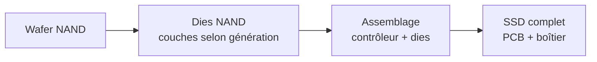

# Stockage

Le stockage combine des technologies et profils de charge différents. Le modèle historique Boavizta donne 51,70 kg CO₂ eq. pour un SSD de 1 To à la densité supposée de 48,5 Go/cm², contre un forfait HDD de 31,11 kg. Ces valeurs ne se confondent pas avec les moyennes par capacité de Tannu et Nair. Le choix d'un support doit aussi tenir compte des performances, de la durée de vie et de la consommation mesurée.[^source-4][^source-2]

## D'où vient l'impact

### SSD (Solid State Drive)

Un SSD est composé de puces mémoire NAND Flash. L'impact de fabrication vient des mêmes procédés que les semi-conducteurs : salle blanche, photolithographie multi-couches, gravure. La capacité dépend du nombre de couches NAND empilées (nombre de couches dépendant de la génération) et de la densité par couche.

### HDD (Hard Disk Drive)

Un HDD est un dispositif mécanique : plateaux magnétiques en rotation, têtes de lecture. L'impact de fabrication vient principalement des matériaux (aluminium, verre, métaux de précision) et de l'assemblage mécanique, pas des procédés semi-conducteurs. Le modèle historique utilise un forfait par unité ; cela ne prouve pas que la fabrication réelle est indépendante de la capacité, du nombre de plateaux ou de l'électronique.

## Modèle paramétrique

### SSD ; modèle par surface de die NAND

$$
\begin{aligned}
&I_{emb}^{SSD} = \left(\frac{C}{D_{NAND}} \times C_{die} + C_{base}\right) \times N_{drives} \\
\text{avec} \\
&C = \text{Capacité par drive} \htmlClass{unit}{[Go]} \\
&D_{NAND} = \text{Densité NAND} \htmlClass{unit}{[\mathrm{Go}/\mathrm{cm}^2]} \approx 48{,}5 \\
&C_{die} = \text{Coefficient par }\mathrm{cm}^2\text{ de die NAND} \\
&C_{base} = \text{Base fixe (contrôleur, PCB, boîtier)} \\
&N_{drives} = \text{Nombre de drives}
\end{aligned}
$$

### Coefficients SSD

| Indicateur | $C_{die}$ (par cm²) | $C_{base}$ (par drive) | Unité | Source |
|---|---|---|---|---|
| **GWP** | 2,20 | 6,34 | kgCO₂ eq. | Green Cloud Computing (UBA 2021)[^1] [^source-1]|
| **ADPe** | 6,30E-05 | 5,63E-04 | kg Sb eq. | Green Cloud Computing (UBA 2021)[^1] |
| **PE** | 27,30 | 73,98 | MJ | Green Cloud Computing (UBA 2021)[^1] |

:::note[Densité NAND]
La densité de 48,5 Go/cm² est une hypothèse du modèle historique, pas une moyenne démontrée pour toute une génération. La densité peut réduire la surface par Go tandis que les procédés évoluent aussi ; elle ne suffit pas à prédire le bilan final. Le simulateur utilise des densités de scénario selon le type choisi.
:::

### HDD ; modèle forfaitaire

Le HDD est modélisé avec un impact forfaitaire par unité, indépendant de la capacité[^donnees-modele][^source-5] :

| Indicateur | Valeur par drive | Unité | Source |
|---|---|---|---|
| **GWP** | 31,11 | kgCO₂ eq. | Green Cloud Computing (UBA 2021)[^1] |
| **ADPe** | 2,50E-04 | kg Sb eq. | Green Cloud Computing (UBA 2021)[^1] |
| **PE** | 276,00 | MJ | Green Cloud Computing (UBA 2021)[^1] |

Impact quasi fixe par unité car dominé par les composants mécaniques (plateaux, moteur, tête de lecture), pas par la surface de silicium.

### Storage Embodied Factor (SEF)

Tannu & Nair (2023) ont analysé 94 rapports ACV constructeurs (Apple, Dell, HP, Seagate, Fujitsu) et proposent le concept de **Storage Embodied Factor** (SEF) ; le ratio entre l'empreinte carbone et la capacité[^source-2] :

| Technologie | SEF moyen | Unité | Source |
|---|---|---|---|
| **SSD** | 0,16 | kg CO₂ eq. / Go | Tannu & Nair 2023 (94 LCA reports) |
| **HDD** | ~0,02 | kg CO₂ eq. / Go | Tannu & Nair 2023 (24 LCA reports) |

### Comparaison SSD vs HDD sur 5 ans

La table 1 de Tannu et Nair (version 2023) indique 56,9/183,9 kWh, 24,6/79,6 kg opérationnels et 160/20 kg de fabrication (SSD/HDD). **Incohérence à signaler :** ces émissions opérationnelles correspondent à environ 0,433 kg/kWh, pas aux 0,7 kg/kWh annoncés dans le texte. Ne pas reproduire simultanément ces deux hypothèses comme un calcul cohérent.

Pour illustrer une comparaison reproductible avec les mêmes énergies mais un facteur explicitement choisi de 0,7 kg/kWh :

| Paramètre | SSD 1 To | HDD 1 To |
|---|---|---|
| Fabrication, hypothèse SEF de l'étude | 160 kg CO₂ eq. | 20 kg CO₂ eq. |
| Énergie sur 5 ans, scénario | 56,9 kWh | 183,9 kWh |
| Usage recalculé à 0,7 kg/kWh | 39,83 kg CO₂ eq. | 128,73 kg CO₂ eq. |
| Total recalculé | **199,83 kg CO₂ eq.** | **148,73 kg CO₂ eq.** |

Le ratio vaut ici 1,34, pas 1,8. Ce scénario ne démontre pas une supériorité universelle du HDD : les performances et effets sur le reste du système doivent être comparables. Les coefficients de puissance par To ci-dessous sont un **autre modèle**, et ne doivent pas être mélangés aux puissances moyennes de l'étude.

## Impact opérationnel

### Consommation électrique

$$
\begin{aligned}
&P_{storage} = \begin{cases}
1{,}2 \times 10^{-3} \times V_{storage} & \text{si SSD} \\
0{,}65 \times 10^{-3} \times V_{storage} & \text{si HDD}
\end{cases} \htmlClass{unit}{[kW]}
\end{aligned}
$$

Où $V_{storage}$ est le volume de stockage en To. Source : Cloud Jewels / Cloud Carbon Footprint.[^source-3]

| Configuration | Puissance SSD | Puissance HDD |
|---|---|---|
| 1 To | 1,2 W | 0,65 W |
| 4 To | 4,8 W | 2,6 W |
| 16 To | 19,2 W | 10,4 W |

### Facteurs d'ajustement

- **Redondance** : RAID-1 nécessite deux copies physiques pour une capacité utile donnée. Pour N disques identiques en RAID-5, la fraction brute dédiée à la parité est $1/N$, mais le surcoût par rapport à la capacité utile est $1/(N-1)$ et le multiplicateur brut/utile $N/(N-1)$. Ne pas appliquer à nouveau ces ratios à un inventaire déjà physique.
- **Réplication** : trois copies peuvent tripler la capacité physique nécessaire si la donnée initiale est logique ; vérifier déduplication, compression, erasure coding et ce que couvre déjà le facteur fournisseur.
- **PUE** : en datacenter, multiplier la consommation par le PUE du site.

## Couverture des indicateurs

| Indicateur | SSD | HDD | Note |
|---|---|---|---|
| **GWP** | Forte (fabrication NAND énergivore) | Modérée (assemblage mécanique) | Ratio observé dans le jeu étudié, pas une loi par technologie |
| **ADPe** | Modérée (matériaux de la puce) | Faible | Couvert par les coefficients par composant |
| **PE** | Forte (énergie primaire cumulée de fabrication) | Modérée | Coefficient documenté |
| **WU** | Forte (eau ultrapure pour la fabrication NAND) | Faible | Inventaire caractérisé compatible requis ; pas de facteur universel par surface |
| **AP, PM** | Modéré (procédés de gravure) | Faible | Couvert via les facteurs d'équipement D4B |
| **IR** | Inventaire compatible requis | Inventaire compatible requis | Fabrication et usage ; unité LCIA à vérifier |
| **CTUe, CTUh** | Pertinent (chimie de procédé) mais peu stabilisé | Faible | Couvert dans les facteurs d'équipement D4B |

## Hypothèses et limites

- Le modèle SSD Boavizta utilise les mêmes coefficients de die que la DRAM, car NAND Flash et DRAM partagent des procédés semi-conducteurs proches. La densité ne capture pas à elle seule les différences de procédés, rendements et packaging.
- Le modèle HDD est forfaitaire par unité. Un HDD de 1 To et un HDD de 16 To ont le même impact intrinsèque, ce qui est une simplification (le nombre de plateaux varie).
- Les stratégies de redondance et réplication peuvent multiplier l'impact réel par 2 à 3 ; elles doivent être documentées dans les évaluations.
- La densité NAND évolue rapidement ; le paramètre doit être mis à jour régulièrement.

## Exemple interactif {#simulateur}

import { StoragePlayGround } from '@site/src/components/storage-playground';

<StoragePlayGround lang="fr" />

[^1]: Green Cloud Computing, UBA, 2021 ; mêmes coefficients de die que la DRAM (NAND et DRAM partagent des procédés semi-conducteurs proches). Implémentés dans [Boavizta SSD](https://doc.api.boavizta.org/Explanations/components/ssd/) et [Boavizta HDD](https://doc.api.boavizta.org/Explanations/components/hdd/).

[^source-1]: UBA, [Green Cloud Computing](https://www.umweltbundesamt.de/publikationen/green-cloud-computing), 2021 (coefficients par cm² de die, modèle forfaitaire HDD) Voir le [corpus documentaire](../../references/sources-et-corpus).

[^source-2]: Tannu & Nair, 2023. [The Dirty Secret of SSDs: Embodied Carbon](https://arxiv.org/abs/2207.10793) (SEF : 0,16 kgCO₂e/Go SSD, analyse de 94 LCA)

[^source-3]: [Cloud Carbon Footprint ; Methodology](https://www.cloudcarbonfootprint.org/docs/methodology/) (coefficients de puissance par To) Documentation en ligne, version non figée.

[^source-4]: [Boavizta Documentation](https://doc.api.boavizta.org/) (implémentation des coefficients Green Cloud Computing) Documentation en ligne, version non figée.

[^source-5]: Digital4Better, [digital4better/data](https://github.com/digital4better/data) Catalogue évolutif ; utiliser un commit pour figer les facteurs.

[^donnees-modele]: Coefficients Boavizta (SSD die model, HDD flat). `digital4better/data` → `data/equipment/*`. [Digital4Better, catalogue de données, instantané 77cae4a](https://github.com/digital4better/data/tree/77cae4a58fadd5deb3b8d4e5577020da08f780d8). Références et portée : [Sources et corpus](../../references/sources-et-corpus).
