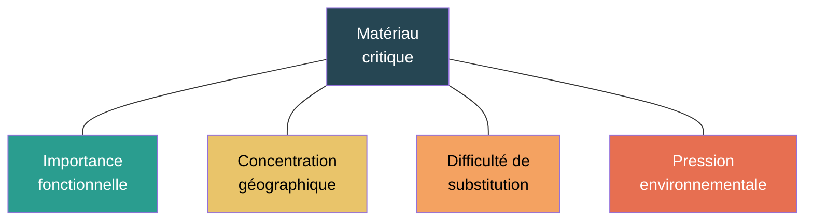

# Matériaux critiques

## En bref

Un smartphone contient plus de 50 métaux différents, dont plusieurs sont considérés comme critiques par l'Union européenne. Ces matériaux sont présents en très faibles quantités — quelques milligrammes à quelques grammes — mais leur extraction et leur raffinage concentrent des impacts environnementaux disproportionnés par rapport à leur masse. Cette section rend visible ce que les facteurs agrégés d'équipements masquent souvent : la réalité physique et géopolitique des chaînes d'approvisionnement du numérique.

## Ce qu'il y a vraiment dans un équipement numérique

### Composition type d'un smartphone (~180 g)

| Matériau | Quantité typique | Fonction | Indicateur le plus impacté |
|---|---|---|---|
| **Cuivre** | ~15 g | Circuits imprimés, connecteurs, câblage | ADPe, CTUe |
| **Aluminium** | ~25 g | Boîtier, dissipation thermique | GWP (énergie de fusion) |
| **Fer / acier** | ~10 g | Structure, composants magnétiques | GWP |
| **Cobalt** | ~8 g | Cathode batterie (LiCoO₂) | ADPe, CTUe, CTUh |
| **Lithium** | ~1 g | Batterie | WU, ADPe |
| **Or** | ~0,03 g | Connecteurs, bonding | ADPe (très fort par kg) |
| **Argent** | ~0,3 g | Contacts, soudures | ADPe |
| **Tantale** | ~0,04 g | Condensateurs | ADPe |
| **Indium** | ~0,01 g | Écran tactile (ITO) | ADPe |
| **Gallium** | traces | Semi-conducteurs (GaN, GaAs) | ADPe |
| **Terres rares** | ~1 g | Aimants, vibreur, haut-parleur | ADPe, CTUe |
| **Silicium** | ~1 g | Puces (via procédés semi-conducteurs) | GWP, WU (via fabrication) |
| **Plastiques** | ~40 g | Boîtier, isolation, connecteurs | GWP |
| **Verre** | ~30 g | Écran | GWP |

Sources : UNEP 2013[^1], Nuss & Eckelman 2014[^2], estimations industrielles.

[^1]: UNEP, 2013. Metal Recycling: Opportunities, Limits, Infrastructure.
[^2]: Nuss & Eckelman, 2014. [Life Cycle Assessment of Metals: A Scientific Synthesis](https://doi.org/10.1371/journal.pone.0101298). PLOS ONE.

:::note[Le paradoxe de la masse]
Les métaux critiques représentent moins de 5 % de la masse d'un smartphone mais peuvent concentrer plus de 50 % de l'indicateur ADPe (épuisement des ressources). C'est pourquoi une lecture purement massique des impacts est trompeuse.
:::

## Pourquoi ces matériaux sont « critiques »

La criticité combine quatre dimensions :

| Dimension | Exemples concrets |
|---|---|
| **Importance fonctionnelle** | Le cobalt est indispensable aux batteries Li-ion actuelles ; le tantale aux condensateurs miniaturisés |
| **Concentration géographique** | 70 % du cobalt mondial vient de la RDC ; 60 % des terres rares sont raffinées en Chine ; 90 % du gallium est produit en Chine |
| **Difficulté de substitution** | L'indium dans les écrans tactiles ITO n'a pas de substitut direct à coût comparable |
| **Pression environnementale** | L'extraction du lithium dans le triangle ABC (Argentine, Bolivie, Chili) consomme ~2 000 m³ d'eau par tonne |

## Impacts environnementaux par famille de matériau

### Facteurs d'impact des métaux (GWP)

| Métal | GWP (kg CO₂ eq. / kg) | Ordre de grandeur | Source |
|---|---|---|---|
| **Or** | 16 000 – 19 000 | Très élevé (extraction et raffinage très énergivores) | Nuss & Eckelman 2014[^2] |
| **Tantale** | 150 – 200 | Élevé | Nuss & Eckelman 2014[^2] |
| **Cobalt** | 8 – 10 | Modéré à élevé | Nuss & Eckelman 2014[^2] |
| **Cuivre** | 3 – 5 | Modéré | Ecoinvent 3.x |
| **Aluminium** | 8 – 12 | Modéré à élevé (électrolyse) | Ecoinvent 3.x |
| **Lithium** (carbonate) | 5 – 15 | Variable selon la source (saumure vs roche) | Kelly et al. 2021[^3] |
| **Terres rares** (oxydes) | 30 – 50 | Élevé (procédés chimiques intensifs) | Zaimes et al. 2015[^4] |
| **Indium** | 150 – 300 | Élevé (sous-produit du zinc, faible concentration) | Nuss & Eckelman 2014[^2] |

[^3]: Kelly et al., 2021. Energy, greenhouse gas, and water life cycle analysis of lithium carbonate and lithium hydroxide monohydrate. Resources, Conservation and Recycling, 175.
[^4]: Zaimes et al., 2015. Environmental Life Cycle Perspective on Rare Earth Oxide Production. ACS Sustainable Chemistry & Engineering.

### Facteurs de caractérisation ADPe

L'indicateur ADPe (épuisement des ressources abiotiques) est particulièrement sensible aux métaux rares. Les facteurs de caractérisation varient fortement selon la méthode LCIA utilisée :

| Matière | ADPe (CML historique) | ADPe (EF v2.0) | Unité | Lecture |
|---|---|---|---|---|
| **Indium** | 5,55E+02 | 6,89E-03 | kg Sb eq. / kg | Très sensible à la méthode |
| **Or** | 3,60E+01 | 5,20E+01 | kg Sb eq. / kg | Fort impact quelle que soit la méthode |
| **Argent** | 8,42E+00 | 1,18E+00 | kg Sb eq. / kg | Important dans les cartes électroniques |
| **Tantale** | 1,15E+01 | 4,06E-05 | kg Sb eq. / kg | Écart majeur entre méthodes |
| **Cobalt** | 2,56E-02 | 1,57E-05 | kg Sb eq. / kg | Pertinent pour les batteries |
| **Lithium** | 1,33E-02 | 1,15E-05 | kg Sb eq. / kg | À lire avec la chaîne batterie |
| **Cuivre** | 2,50E-03 | 1,37E-03 | kg Sb eq. / kg | Structurant par les volumes |

Source : Green Cloud Computing (UBA, 2021), facteurs ILCD/CML et EF v2.0.

:::note[Prudence sur l'ADPe]
L'écart entre les deux colonnes ADPe montre que le choix de la méthode LCIA change radicalement les résultats pour certains métaux (facteur 1 000 pour le tantale !). C'est pourquoi la méthode D4B documente toujours la méthode LCIA utilisée.
:::

## Lecture par indicateur

| Indicateur | Ce que les matériaux critiques éclairent |
|---|---|
| **ADPe** | Pourquoi de très faibles masses (mg de tantale, d'indium, d'or) pèsent fortement dans l'épuisement des ressources |
| **WU** | Les tensions eau liées à l'extraction du lithium (évaporation de saumures), du cuivre (mines à ciel ouvert) et des terres rares (procédés chimiques) |
| **CTUe, CTUh** | La toxicité des procédés d'extraction et de raffinage (acides, solvants, rejets miniers) |
| **GWP** | L'énergie intensive de l'extraction de l'or, de l'aluminium (électrolyse) et du raffinage des terres rares |

## Fin de vie et recyclage

La fin de vie des matériaux critiques pose des questions spécifiques :

| Question | Réponse typique |
|---|---|
| Le matériau est-il récupéré ? | Très variable : &gt;90 % pour le cuivre et l'or, &lt;5 % pour le gallium, l'indium et les terres rares |
| Avec quel rendement réel ? | Souvent bien inférieur au taux théorique de collecte |
| Dans quelle qualité ? | Le « downcycling » est fréquent (alliage dégradé plutôt que métal pur) |
| Reste-t-il une dépendance aux approvisionnements primaires ? | Oui pour la grande majorité des métaux critiques du numérique |

## Rôle dans les impacts aval

Les matériaux critiques n'ont pas d'impact opérationnel autonome, mais ils éclairent :

- pourquoi certains composants (batteries, écrans, cartes électroniques) ont des impacts non intuitifs au regard de leur masse ;
- pourquoi les résultats multicritères peuvent diverger fortement d'une lecture purement carbone ;
- pourquoi le numérique ne peut pas être compris uniquement à travers sa consommation électrique.

Cette section sert de clé d'interprétation pour [Alimentation et batterie](../composants/alimentation-et-batterie), [Affichage](../composants/affichage) et [Éléments structurels](../composants/elements-structurels).

## Hypothèses et limites

- Cette section est explicative, pas un modèle de calcul détaillé matière par matière. Les facteurs d'impact sont des repères, pas des valeurs canoniques D4B.
- Les facteurs ADPe varient fortement selon la méthode LCIA retenue (CML, EF v2.0, etc.).
- Les compositions d'équipements sont des ordres de grandeur typiques ; la variabilité entre modèles est importante.
- Les listes officielles de matières critiques évoluent (la liste UE est révisée tous les 3 ans).

## Données mobilisées

- `digital4better/data` → `data/hardware/*`, `data/equipment/*` (facteurs agrégés incluant les matériaux)
- Littérature sur les facteurs d'impact des métaux

## Sources

- UNEP, 2013. Metal Recycling: Opportunities, Limits, Infrastructure.
- Nuss & Eckelman, 2014. [Life Cycle Assessment of Metals](https://doi.org/10.1371/journal.pone.0101298). PLOS ONE.
- Kelly et al., 2021. Energy, greenhouse gas, and water life cycle analysis of lithium carbonate and lithium hydroxide monohydrate.
- Zaimes et al., 2015. Environmental Life Cycle Perspective on Rare Earth Oxide Production.
- Green Cloud Computing, UBA, 2021 (facteurs de caractérisation ADPe).
- [EU Critical Raw Materials Act 2024](https://single-market-economy.ec.europa.eu/sectors/raw-materials/areas-specific-interest/critical-raw-materials_en)
- [IEA, 2025. Global Critical Minerals Outlook](https://www.iea.org/reports/global-critical-minerals-outlook-2025)
