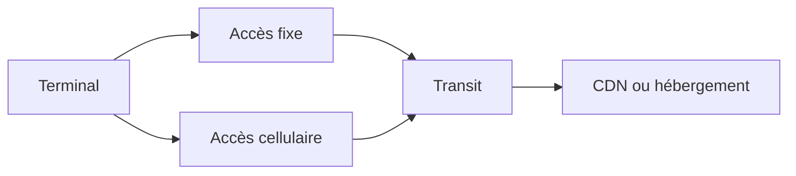

# Réseau

import { MethodIllustration } from '@site/src/components/method-illustrations';

Le réseau transporte les données entre terminaux, centres de données et services tiers. Son impact dépend des équipements et de leur fonctionnement. Le volume transféré peut servir à répartir cet impact ; il ne décrit pas, à lui seul, une consommation électrique marginale.

## Définir les segments

Les accès fixe et cellulaire sont des chemins alternatifs. Un réseau local, un transit inter-datacenters et un accès mobile n’ont pas le même périmètre. Le choix du facteur dépend des flux inventoriés.

| Situation | Donnée à utiliser | Contrôle |
|---|---|---|
| Réseau maîtrisé | Inventaire et consommation des équipements | Allocation à la période et au service |
| Réseau opaque | Facteur de système compatible | Technologie, géographie, année et phases couvertes |
| CDN | Flux vers l’utilisateur, flux origine et ressources du cache | Ne pas supprimer le trajet utilisateur lors d’un hit |

## Pourquoi tenir compte de la distance ?

Le choix D4B repose sur l’idée qu’à technologie comparable, **plus les données parcourent de distance, plus leur acheminement mobilise d’équipements réseau** : équipements de transmission et relais intermédiaires. Ces équipements consomment de l’électricité et portent des impacts de fabrication. La distance sert à représenter cette infrastructure mobilisée lorsque son inventaire détaillé n’est pas disponible.[^modele-distance]

Le facteur par Go·km associe donc le volume transporté à la longueur estimée du trajet. Il permet de différencier un transfert local d’un transfert lointain. La proportionnalité est une approximation moyenne : deux trajets de même longueur peuvent mobiliser des équipements, des capacités et des taux de charge différents. Elle ne signifie pas qu’un octet supplémentaire déclenche une consommation proportionnelle.

## Appliquer l’unité du facteur

Le modèle réseau Digital4Better utilise des facteurs par volume et par distance. Cette convention est toujours en usage. Pour chaque segment $s$, la fabrication et l’électricité d’usage sont calculées séparément :[^modele-distance]

$$
I_{emb,i}=\sum_s V_s L_s F_{emb,i,s}
\qquad
E=\sum_s V_s L_s F_{elec,s}
$$

$V_s$ est le volume en Go, $L_s$ la distance en km, $F_{emb,i,s}$ un facteur en unité d’impact/(Go·km) et $F_{elec,s}$ un facteur en kWh/(Go·km). L’électricité est ensuite convertie en impacts avec le mix retenu pour chaque segment. Les données exprimées par octet·km se convertissent par $10^9$ pour un Go décimal.

| Segment du modèle | Distance retenue | Électricité d’usage |
|---|---|---|
| Pays de l’utilisateur | Distance interne estimée du pays | Facteur du pays utilisateur |
| Interpays | Distance estimée entre pays de départ et d’arrivée | Facteur continental ou mondial selon le trajet |
| Pays d’hébergement | Distance interne estimée du pays d’arrivée | Facteur du pays d’hébergement |

Cette segmentation est une convention de calcul, pas un relevé du routage. Le segment d’hébergement n’est pas ajouté une seconde fois lorsque départ et arrivée sont dans le même pays. Le cache navigateur réduit les volumes en amont ; le CDN réduit les échanges vers l’origine sur les segments interpays et hébergement, en conservant le segment utilisateur.[^modele-distance]

Les illustrations Web, Mail et Applications natives utilisent $I=V F_{trajet}$ avec un facteur en kg CO₂e/Go qui inclut déjà la distance. Ce facteur dérivé ne remplace pas le modèle D4B par Go·km ; il représente un trajet et un périmètre définis.

<MethodIllustration kind="network-factor" lang="fr" />

import { NetworkDistanceFigure, CdnTrafficFigure } from '@site/src/components/network-illustrations';

La distance interpays est la distance orthodromique, soit le plus court chemin sur la sphère, entre les points de référence des pays, appelés [barycentres](../../references/glossaire#barycentre) dans la méthode. La distance interne est estimée par le [rayon équivalent](../../references/glossaire#rayon-equivalent) $r=\sqrt{S/\pi}$, où $S$ est la surface du pays en km².[^distances-carte]

Pour Espagne → Allemagne, les valeurs arrondies sont 401 km, 1 615 km et 337 km. La France traversée dans l’illustration n’ajoute pas une étape au calcul. Les cercles matérialisent les rayons équivalents, pas les frontières ni une couverture réseau.[^distances-carte]

<NetworkDistanceFigure lang="fr" />

### Origine et limites des facteurs par Go·km {#statut-des-facteurs-historiques}

La normalisation D4B divise les facteurs réseau de référence par une distance conventionnelle pour obtenir des coefficients par volume·km. Il s’agit d’une transformation méthodologique D4B, pas de facteurs ADEME publiés directement par kilomètre. La provenance, la version des données et la représentativité de cette normalisation restent à documenter ; ce besoin de qualification ne signifie pas que le modèle a été abandonné.[^modele-distance]

Le coefficient CCF de 0,001 kWh/Go vise un périmètre inter-datacenters. Il ne constitue pas un facteur complet de réseau local ou d’accès utilisateur. La méthode CCF[^ref-1] précise les hypothèses de conversion.

Les facteurs IR historiques ont une unité à réconcilier. La fabrication du LAN ne dispose pas ici d’un facteur de système suffisamment établi. Ces lacunes restent visibles dans le [registre](../../references/registre-des-hypotheses-et-valeurs-par-defaut).

## Gérer plusieurs accès et le cache

Chaque volume, fixe ou cellulaire, reçoit le facteur correspondant. Les volumes mesurés après cache incluent déjà son effet ; une nouvelle déduction du hit ratio le compterait deux fois. Un cache peut réduire les échanges avec l’origine tout en conservant le trajet vers l’utilisateur et ses propres coûts de stockage et de calcul.

Une évolution du trafic ne démontre pas une évolution proportionnelle de l’énergie d’un réseau partagé. Le résultat reste une allocation selon le facteur choisi.

<CdnTrafficFigure lang="fr" />

## Appliquer à un service

Les simulateurs [Web](../../cas-d-usage/services/service-web), [Mail](../../cas-d-usage/services/mail) et [Applications natives](../../cas-d-usage/services/mobile) calculent les transferts. Leurs facteurs réseau restent à renseigner : un champ vide signifie « non évalué ». Pour un réseau connu, l’inventaire du [Parc](../../cas-d-usage/environnements/parc-informatique) ou de l’[Hébergement](../../cas-d-usage/environnements/infrastructure-d-hebergement) fournit la base d’une [allocation](../../regles/allocation-et-partage-des-impacts) documentée.

Chaque facteur est décrit par sa source, sa version, son unité et les segments couverts. Un facteur de système inclut déjà les équipements de sa frontière ; leur ajout créerait un double compte.

## Détailler les segments du trajet

| Segment | Équipements et activités | Données à rechercher |
|---|---|---|
| LAN | Wi-Fi, switches, câblage, réseau interne du site | Inventaire, énergie, ports et durée d’usage |
| Accès fixe | Box, terminaison optique et réseau opérateur | Frontière du facteur, technologie et période |
| Accès cellulaire | Antennes, radio et cœur de réseau | Génération, couverture, charge et mutualisation |
| Transit WAN | Routage, transport et interconnexion | Segments inclus, volumes et allocation |
| CDN | Cache, stockage, serveurs et réseau jusqu’au client | Taux de cache et localisation des ressources |

Un trajet peut traverser plusieurs de ces segments. Un facteur agrégé couvrant déjà accès et transit remplace les postes correspondants ; il ne s’ajoute pas à eux. La fabrication des équipements actifs et passifs peut être incluse ou absente selon la source.

### Allocation d’un réseau local et interprétation des distances

Pour un LAN inventorié, l’énergie et la fabrication sont réparties entre services selon une clé documentée : capacité réservée, temps de port, trafic ou combinaison adaptée. La clé volumique répartit un inventaire ; elle ne prouve pas que l’énergie varie proportionnellement à chaque octet.

Une distance géographique ne décrit pas le chemin physique, les relais ni les équipements effectivement traversés. Dans le modèle D4B par Go·km, elle constitue une estimation conventionnelle explicitement utilisée dans le calcul. Le pays du facteur électrique d’un réseau distribué ne se déduit pas automatiquement du pays du terminal.

Un CDN peut réduire le trafic vers le serveur d’origine, mais conserve la livraison vers le lecteur. Une baisse globale dépend aussi du stockage, des requêtes et des transferts restants.

## Différence avec l’allocation réseau des RCP

Le modèle D4B conserve son allocation par volume·distance ; les illustrations utilisent un facteur de trajet par Go. Le RCP FAI sépare une part variable liée au trafic et une part fixe liée à l’abonnement. Le RCP applicatif répartit ensuite cette part fixe entre usages : une réduction des octets ne réduit donc pas tous les impacts alloués dans les mêmes proportions.[^rcp-fai][^rcp-app]

### Lire la part fixe sans changer de modèle en cours de calcul

Le RCP applicatif combine une contribution par Go avec une contribution annuelle par abonnement, ajustée par le nombre d’abonnements par utilisateur et la part du temps d’usage réseau. Ses coefficients annexés décrivent la France. Un abonnement annuel ne s’ajoute pas intégralement à chaque session.

Cette différence est documentée sans substituer les conventions RCP au modèle D4B par Go·km. L’ajout d’une part fixe suppose que le facteur ne la couvre pas déjà. Son absence d’évaluation constitue une limite explicite. Le RCP applicatif permet de l’écarter si sa contribution est démontrée inférieure à 5 % de l’impact total de l’application, pas par défaut.

La notation du RCP applicatif emploie des descriptions différentes pour les utilisateurs et les sessions (p. 26–27). Une implémentation nécessite quatre grandeurs distinctes : utilisateurs uniques, sessions, trafic total et trafic par utilisateur. Pour le LAN, le RCP utilise une allocation par utilisateurs, distincte du modèle Internet. Enfin, un smartphone en Wi-Fi ne constitue pas un accès cellulaire.

[^rcp-fai]: ADEME, [RCP de la fourniture d’accès Internet, rapport de 71 pages diffusé par l’ADEME (fiche publiée en 2023)](https://librairie.ademe.fr/industrie-et-production-durable/6008-referentiel-par-categorie-de-produit-rcp-de-la-fourniture-d-acces-internet-fai.html), p. 7, 17, 31–32.

[^rcp-app]: ADEME, [RCP des applicatifs numériques, juin 2026](https://librairie.ademe.fr/economie-circulaire-et-dechets/9434-referentiel-par-categorie-de-produit-rcp-des-applicatifs-numeriques.html), p. 24–27, 58.

[^ref-1]: [méthode CCF](https://www.cloudcarbonfootprint.org/docs/methodology/). Documentation en ligne, version non figée.

Le [réseau local (LAN)](../../references/glossaire#lan) se décrit aussi par ses switches, points d’accès, câbles et équipements de support, avec disponibilité et redondance. Le RCP LAN apporte un cadre pour cet inventaire et les services de téléphonie ; il ne fournit pas un facteur universel par Go. L’absence d’un facteur global LAN ne justifie pas l’exclusion d’un inventaire local disponible.[^rcp-lan]

[^rcp-lan]: ADEME, [RCP réseau LAN et services de téléphonie d’entreprise](https://librairie.ademe.fr/economie-circulaire-et-dechets/6020-referentiel-par-categorie-de-produit-rcp-d-un-reseau-lan-et-des-services-de-telephonie-d-entreprise.html), 2023, p. 9–15, sections 2.1 (unités fonctionnelles) et 3 (frontières).

[^modele-distance]: Digital4Better, [modélisation des réseaux](https://github.com/digital4better/methodology/blob/4e40ae8e5e792b676c55d5586f59e6fb3c7181b4/docs/general.md), révision `4e40ae8`, sections « Cas d’un réseau externe, type WAN » et facteurs par octet/km ; [application au Web](https://github.com/digital4better/methodology/blob/4e40ae8e5e792b676c55d5586f59e6fb3c7181b4/docs/methodology/web.md), section « Impact du réseau ». Convention D4B toujours utilisée, avec des distances estimées et des coefficients dont la représentativité doit être qualifiée.

[^distances-carte]: Digital4Better Open Data, révision `77cae4a` : [coordonnées et surfaces des pays](https://github.com/digital4better/data/blob/77cae4a58fadd5deb3b8d4e5577020da08f780d8/data/country/regions.json), [distance ESDE de 1 615,380 km](https://github.com/digital4better/data/blob/77cae4a58fadd5deb3b8d4e5577020da08f780d8/data/country/region-to-region-distances.json) et [distances internes ES = 401,311 km et DE = 337,254 km](https://github.com/digital4better/data/blob/77cae4a58fadd5deb3b8d4e5577020da08f780d8/data/country/user-to-datacenter-distances.json). [Calcul](https://github.com/digital4better/data/blob/77cae4a58fadd5deb3b8d4e5577020da08f780d8/index.ts), fonctions `computeDistance` (rayon terrestre de 6 371 km) et `generateCountries`. Fond cartographique : Natural Earth, limites des pays au 1:110 millions, [domaine public](https://www.naturalearthdata.com/about/terms-of-use/). Le tracé réseau est illustratif, non mesuré.
