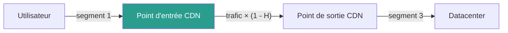

# Réseau

## En bref

Le réseau est la couche qui transporte les données entre les terminaux et les centres de données. Il est fortement mutualisé et généralement opaque : on ne connaît pas les équipements traversés, seulement le volume de données transférées, la distance parcourue et le type de connexion. La méthode utilise donc une **approche système** avec des facteurs par octet et par kilomètre.

## D'où vient l'impact

Le réseau mobilise des équipements physiques à chaque étape du transport :

| Segment | Couverture | Facteur d'allocation | Approche |
|---|---|---|---|
| **LAN** | Réseau local (bâtiment, site) | Volume transféré | Inventaire ou système |
| **RAN** | Accès mobile (2G → 5G) | Volume transféré | Système |
| **WAN** | Transit, backbone, international | Volume × distance | Système |
| **CDN** | Cache et distribution de contenu | Volume transféré × hit ratio | Système |

## Formule générale

Pour tous les segments réseau, l'impact suit la même logique :

$$
\begin{align*}
&I_{segment_{i}} = V \times L \times CF_{i}\htmlClass{unit}{[U_i]}\\
Avec \\
&V = \text{Volume de données transférées}\htmlClass{unit}{[o]}\\
&L = \text{Longueur du segment}\htmlClass{unit}{[km]}\\
&CF_{i} = \text{Facteur de conversion pour l'indicateur}\textit{ i }\htmlClass{unit}{[U_i/o/km]}\\
\end{align*}
$$

Pour le LAN et le RAN, la distance $L$ est fixée à 1 (facteur directement en $U_i$/o).

L'impact total du réseau est la somme des segments :

$$
\begin{align*}
&I_{réseau_{i}} = \sum_{k=1}^{n} \left( I_{emb_{k,i}} + I_{ope_{k,i}} \right)\htmlClass{unit}{[U_i]}
\end{align*}
$$

## Facteurs réseau (approche système)

### Facteurs par octet et par km

Les facteurs ci-dessous sont dérivés de la Base Empreinte ADEME, ajustés pour intégrer une dimension kilométrique et la contribution d'une box pour le réseau fixe :

| Indicateur | Fixe + Box | Mobile | Unité |
|---|---|---|---|
| **Énergie** | 2,30E-13 | 5,28E-13 | kWh/o/km |
| **GWP** | 1,60E-14 | 1,78E-14 | kg CO₂ eq./o/km |
| **ADPe** | 3,82E-19 | 2,41E-18 | kg Sb eq./o/km |
| **AP** | 7,58E-17 | 4,51E-17 | mol H+ eq./o/km |
| **IR** | 6,18E-14 | 7,66E-14 | kg U235 eq./o/km |
| **PM** | 6,07E-22 | 6,20E-22 | disease occ./o/km |
| **WU** | -2,52E-13 | -9,93E-13 | m³ eq./o/km |
| **CTUe** | -7,08E-14 | -4,58E-13 | CTUe/o/km |

Source : Base Empreinte ADEME (décembre 2023), ajustée par division par le rayon estimé de la France pour obtenir des facteurs par km. Box intégrée à 220 Go/mois.

:::note[Valeurs négatives]
Les valeurs négatives sur WU et CTUe proviennent des conventions de fin de vie de la Base Empreinte (crédits de recyclage). Elles doivent être documentées mais pas ignorées.
:::

### Réseau mixte (fixe + mobile)

Quand les usagers combinent connexions fixes et mobiles, le facteur réseau est une moyenne pondérée :

$$
\begin{align*}
&CF_{i} = \sum_{e \in \{mobile, desktop\}} P_e \times \left( \sum_{n \in \{fixed, cellular\}} P_{e,n} \times CF_{e,n,i} \right)\\
\end{align*}
$$

Où $P_e$ est la part d'usage par type de terminal et $P_{e,n}$ la part de réseau par type de connexion.

Pour un réseau fixe pur : $P_{mobile} = 0$, $P_{desktop} = 1$, $P_{desktop, cellular} = 0$.

## LAN (réseau local)

### Approche inventaire

Quand le réseau local est connu et maîtrisé, l'impact est la somme des équipements réseau actifs (switches, routeurs, points d'accès Wi-Fi), chacun évalué conformément à [Modélisation d'un équipement](../../modelisation/modelisation-d-un-equipement#impacts-equipement).

### Approche système

Quand le réseau local n'est pas directement observable :

$$
\begin{align*}
&E_{elec}^{LAN} = V \times CF_{elec}^{LAN}\htmlClass{unit}{[kWh]}
\end{align*}
$$

Avec $CF_{elec}^{LAN}$ = 0,001 kWh/Gb (Cloud Carbon Footprint).

:::note[Limitation LAN]
Nous ne disposons pas de facteur d'impact intrinsèque fiable pour le LAN en approche système. L'impact intrinsèque du réseau local est donc actuellement exclu des évaluations en approche système. Cette exclusion doit être documentée.
:::

## RAN (réseau d'accès mobile)

Le RAN couvre la partie radio (antennes, stations de base) qui relie les terminaux mobiles au réseau de transit. Il est modélisé par approche système avec les facteurs réseau mobile du tableau ci-dessus.

Le réseau mobile a un impact environ **2 à 6 fois plus élevé** que le réseau fixe par octet transféré (selon l'indicateur), en raison de l'infrastructure de stations de base nécessaire à la couverture territoriale.

| Génération | Tendance énergie par bit | Note |
|---|---|---|
| 2G / 3G | Référence (en déclin) | Très inefficace par bit |
| 4G | ~5-10× plus efficace que la 3G | Génération dominante actuelle |
| 5G | ~2-3× plus efficace que la 4G | En déploiement, mais densification du réseau |

## WAN (réseau de transit)

Le WAN couvre le backbone et les câbles de transit (y compris sous-marins) entre pays et continents. C'est le segment où la **distance** est le plus structurant.

### Calcul des distances

| Type de segment | Calcul de la distance | Source |
|---|---|---|
| **Segment interne** | Rayon estimé du pays : $r = \sqrt{A / \pi}$ | Wikipedia (surfaces pays) |
| **Segment interpays** | Route orthodromique entre barycentres : $AB = \arccos[\sin(l_A) \sin(l_B) + \cos(l_A) \cos(l_B) \cos(L_B - L_A)]$ | Google Maps API (barycentres) |

Les facteurs de distance par pays sont disponibles dans [`digital4better/data/country`](https://github.com/digital4better/data/tree/main/data/country).

## CDN et caches

Un CDN réduit le trafic entre le point d'entrée et le datacenter grâce à la mise en cache :

$$
\begin{align*}
&I_{CDN_{i}} = I_{segment1_{i}} + (1 - H) \times (I_{segment2_{i}} + I_{segment3_{i}}) + I_{cache_{i}}\\
\end{align*}
$$

Où $H$ est le **hit ratio** (taux de cache), typiquement entre 70 et 90 %.

L'impact intrinsèque des serveurs CDN ($I_{cache}$) doit être ajouté quand il est significatif. Le CDN est d'autant plus bénéfique que la distance utilisateur-datacenter est grande.

## Ordres de grandeur

| Scénario | Volume | Distance | GWP réseau |
|---|---|---|---|
| 1 page web (2 Mo), utilisateur FR, DC FR | 2 Mo | ~300 km | ~0,01 g CO₂ eq. |
| 1 page web (2 Mo), utilisateur FR, DC US | 2 Mo | ~7 000 km | ~0,2 g CO₂ eq. |
| 1 heure de visio (1 Go) | 1 Go | ~500 km | ~8 g CO₂ eq. |
| 1 mise à jour app mobile (200 Mo) × 10M téléchargements | 2 Po | ~500 km | ~16 t CO₂ eq. |

:::note[Le réseau pèse peu... sauf à grande échelle]
Pour un usage individuel, le réseau représente souvent moins de 5 % de l'impact total d'un service. Mais à l'échelle d'un service avec des millions d'utilisateurs, le trafic réseau cumulé devient un poste significatif — surtout pour le mobile et les transferts internationaux.
:::

## Hypothèses et limites

- Le réseau est modélisé par approche système (facteurs par Go/km), pas par inventaire d'équipements. Cette approche est la seule praticable pour les périmètres non maîtrisés.
- Les facteurs Base Empreinte sont estimés pour la France ; ils sont ajustés par distance pour les autres pays.
- Le facteur d'impact intrinsèque du LAN en approche système reste une lacune connue.
- Les facteurs réseau mobile ne distinguent pas encore finement les générations (2G à 5G) ; un mix moyen est utilisé.
- Le hit ratio CDN (70-90 %) est une hypothèse ; il varie selon le type de contenu et la configuration du CDN.

## Données mobilisées

- `digital4better/data` → `data/country/*` (distances par pays)
- `digital4better/data` → `data/equipment/embodied.csv` (facteurs réseau fixe et mobile)
- Base Empreinte ADEME (facteurs réseau par Go, décembre 2023)

## Sources

- Base Empreinte ADEME (services numériques, lignes 42-43)
- [Cloud Carbon Footprint](https://www.cloudcarbonfootprint.org/docs/methodology/) (facteur LAN)
- `inputs/md/green-cloud-computing-uba-2021.md`
- [digital4better/data](https://github.com/digital4better/data)
- Rapport ICT 2020, ADEME/ARCEP 2022 (volumétrie box)
