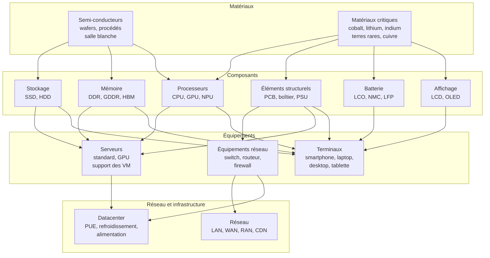

# Vue d'ensemble du matériel

Cette section décrit les matériaux, composants et équipements qui alimentent les calculs. La lecture peut partir d’un équipement ou d’un cas d’usage. Les pages consacrées aux matériaux éclairent l’effet de leur composition et de leurs procédés sur les résultats.

## Approche bottom-up

Une approche bottom-up reconstruit l'impact d'un équipement **à partir de ses composants**, pour expliciter les effets de configuration. Elle ne prime pas automatiquement sur une ACV produit plus représentative ; les scénarios paramétriques et les inventaires validés doivent rester distingués. L'impact d'un équipement est la somme de ses composants[^donnees-modele] :

$$
\begin{align*}
&I_{equipement} = I_{cpu} + I_{ram} + I_{stockage} + I_{ecran} + I_{batterie} + I_{structurel}
\end{align*}
$$

Les facteurs forfaitaires (Base Empreinte, NegaOctet) sont utilisables lorsque leur périmètre et leur qualité sont plus adaptés aux données disponibles. Voir [Modélisation d'un équipement](../modelisation/modelisation-d-un-equipement) pour le détail.

## De la mine au service

## Des composants au service {#ordres-de-grandeur}

Les anciens forfaits Open Data d’équipements et de VM sont obsolètes pour la méthode cible. Les ordres de grandeur proviennent désormais d’une configuration explicite, évaluée par les modèles de composants.

| Niveau | Rôle dans le calcul |
|---|---|
| Composant | Caractéristiques et modèle d’impact avec unités, frontière et provenance |
| Équipement | Assemblage des composants et complément structurel sans recouvrement |
| Ressource virtuelle | Part allouée de l’équipement physique et de ses moyens communs |
| Service | Somme des contributions allouées, selon l’unité fonctionnelle |

Les exemples des pages [Terminaux](equipements/terminaux) et [Serveurs](equipements/serveurs) utilisent cette chaîne. Le détail du calcul ne garantit pas la qualité des coefficients : les hypothèses exploratoires restent identifiées dans le [registre](../references/registre-des-hypotheses-et-valeurs-par-defaut).

:::note[Impact intrinsèque vs opérationnel]
La fabrication peut dominer pour les terminaux à faible consommation, selon la durée de vie, l'intensité d'usage et le mix électrique ; aucun pourcentage universel n'est retenu. Pour les serveurs en datacenter, la part opérationnelle peut devenir significative voire dominante selon le mix électrique du pays d'hébergement (voir [Impacts de la consommation d'énergie](../fondations/impacts-de-la-consommation-d-energie)).
:::

## Organisation de la section

| Couche | Pages | Ce qu'elle explique |
|---|---|---|
| **[Matériaux](materiaux/semi-conducteurs)** | Semi-conducteurs, Matériaux critiques | D'où viennent les impacts : procédés de fabrication des puces, métaux critiques, chaînes d'approvisionnement [^source-6][^source-7]|
| **[Composants](composants/processeurs-et-accelerateurs)** | CPU/GPU, RAM, Stockage, Affichage, Batterie, Éléments structurels | Comment calculer l'impact de chaque composant avec des modèles paramétriques sourcés |
| **[Équipements](equipements/terminaux)** | Terminaux, Serveurs, Équipements réseau | Comment assembler les composants en équipements avec des simulateurs interactifs |
| **[Réseau et infrastructure](reseau-et-infrastructure/reseau)** | Réseau (LAN/WAN/RAN/CDN), Datacenter | Comment évaluer les couches partagées par approche système |

## Modèles paramétriques

Les composants disposent de modèles exploratoires ; la provenance et la validité diffèrent selon les coefficients. Les multiplicateurs de nœud, facteurs d'écran et de batterie sont des hypothèses D4B, et non des coefficients validés par les publications de contexte ci-dessous.

| Composant | Paramètres clés | Formule | Source principale |
|---|---|---|---|
| **CPU (puce)** | Die size (mm2), noeud techno (nm) | $I = (die \times 0{,}0197 + 9{,}14) \times F_{node}$ | Green Cloud Computing (UBA 2021) [^source-1]|
| **RAM** | Capacité (Go), type (DDR/HBM) | $I = (cap / densité) \times 2{,}20 + 5{,}22$ | Green Cloud Computing (UBA 2021) |
| **SSD** | Capacité (Go) | $I = (cap / densité_{NAND}) \times 2{,}20 + 6{,}34$ | Green Cloud Computing (UBA 2021), Tannu and Nair 2023 [^source-3]|
| **HDD** | Par unité (forfaitaire) | $I = 31{,}11$ kgCO2e | Green Cloud Computing (UBA 2021) |
| **Écran** | Diagonale (pouces), techno | $I = surface \times C_{techno} + base$ | Base Empreinte, rapports PCF constructeurs |
| **Batterie** | Capacité (Wh), chimie | $I = cap_{Wh}/1000 \times F_{chimie}$ | Kelly et al. 2021, Ellingsen et al. 2014 [^source-4][^source-5]|
| **Réseau** | Volume (octets), distance (km) | $I = V \times L \times CF$ | Base Empreinte ADEME [^source-2]|

## Couverture des 9 indicateurs

| Indicateur | Couverture composant | Composants les plus contributeurs | Statut |
|---|---|---|---|
| **GWP** | Modèles historiques et scénarios | Configuration, procédés et électricité | Disponible, avec hypothèses explicites |
| **ADPe** | Partielle | CPU, RAM, SSD avec facteurs historiques | Compatibilité LCIA à vérifier ; batterie non quantifiée |
| **WU** | Insuffisante au niveau composant | Procédés et électricité | Eau physique et eau caractérisée non interchangeables ; retiré des simulateurs CPU/RAM |
| **AP, PM** | Inventaires agrégés disponibles | Fabrication et usage | Ne prouvent pas la ventilation par composant |
| **PE** | Modèles historiques partiels | Énergie primaire | Ne pas confondre avec les kWh électriques |
| **IR** | Unité historique non résolue | Électricité et procédés du cycle de vie | Résultat équipement suspendu jusqu'à réconciliation kg/kBq |
| **CTUe, CTUh-nc, CTUh-c** | Données agrégées, qualité variable | Procédés et extraction | Inventaires et méthodes compatibles requis |

:::note[Couverture réelle]
Les neuf indicateurs de la méthode ne sont pas tous calculés dans chaque simulateur. Une absence de résultat est une lacune de données, pas un impact nul. PE est une information complémentaire, distincte des neuf indicateurs sélectionnés. Les regroupements éditoriaux ne sont pas des dommages end-point.
:::

## Hypothèses et limites

- Le niveau Matériaux reste une couche d'interprétation, pas encore un modèle de calcul autonome par matière.
- Les modèles paramétriques composants sont dérivés de Green Cloud Computing (UBA 2021) et de la littérature scientifique ; ils seront affinés au fur et à mesure de l'enrichissement du référentiel.
- La couverture des 9 indicateurs est inégale : GWP et certains facteurs historiques ADPe sont disponibles, avec les limites décrites dans chaque page ; les indicateurs de toxicité et de particules sont portés par les facteurs agrégés d'équipement.
- Le réseau reste une couche fortement mutualisée, modélisée par approche système.

[^source-1]: UBA, [Green Cloud Computing](https://www.umweltbundesamt.de/publikationen/green-cloud-computing), 2021 Voir le [corpus documentaire](../references/sources-et-corpus).

[^source-2]: Base Empreinte ADEME Voir le [corpus documentaire](../references/sources-et-corpus).

[^source-3]: Tannu and Nair, 2023. The Dirty Secret of SSDs: Embodied Carbon Voir le [corpus documentaire](../references/sources-et-corpus).

[^source-4]: Kelly et al., 2021. LCA of lithium carbonate and hydroxide Voir le [corpus documentaire](../references/sources-et-corpus).

[^source-5]: Ellingsen et al., 2014. LCA of a Li-Ion Battery Vehicle Pack Voir le [corpus documentaire](../references/sources-et-corpus).

[^source-6]: Wang et al., 2023. Environmental data and facts in the semiconductor manufacturing industry Voir le [corpus documentaire](../references/sources-et-corpus).

[^source-7]: Kuo et al., 2022. Assessing environmental impacts of nanoscale semi-conductor manufacturing Voir le [corpus documentaire](../references/sources-et-corpus).

[^donnees-modele]: `digital4better/data` : `data/equipment/*`, `data/cloud/*`, `data/country/*`, `data/factor/*`. [Digital4Better, catalogue de données, instantané 77cae4a](https://github.com/digital4better/data/tree/77cae4a58fadd5deb3b8d4e5577020da08f780d8).
