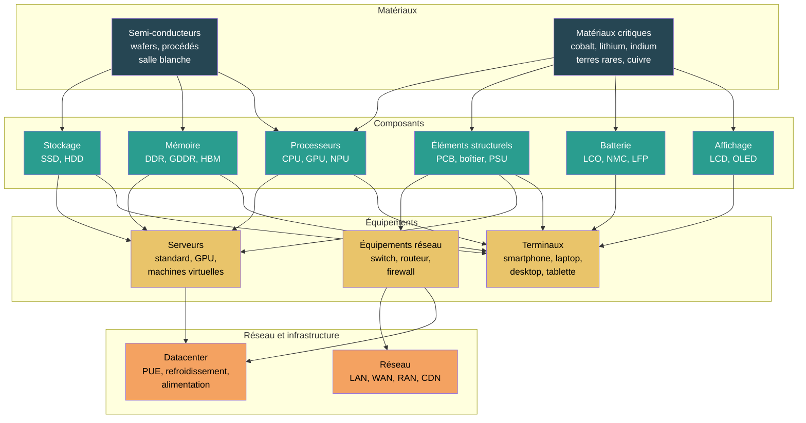

# Vue d'ensemble du matériel

## En bref

Le numérique semble immatériel, mais il repose sur une chaîne physique très concrète : des mines de cobalt en RDC aux salles blanches de Taïwan, des usines d'assemblage en Chine aux datacenters en Irlande, chaque service numérique mobilise des ressources physiques réparties sur toute la planète. Cette section rend cette réalité visible et calculable.

## Approche bottom-up

La méthode reconstruit l'impact d'un équipement **à partir de ses composants**, chacun calculé avec un modèle paramétrique sourcé. Cette approche bottom-up est préférée aux facteurs forfaitaires par type d'équipement car elle est transparente, paramétrique et modulaire. L'impact d'un équipement est la somme de ses composants :

$$
\begin{align*}
&I_{equipement} = I_{cpu} + I_{ram} + I_{stockage} + I_{ecran} + I_{batterie} + I_{structurel}
\end{align*}
$$

Les facteurs forfaitaires (Base Empreinte, NegaOctet) ne sont utilisés qu'en dernier recours quand aucune information sur la composition n'est disponible. Voir [Modélisation d'un équipement](../modelisation/modelisation-d-un-equipement) pour le détail.

## De la mine au service

## Ordres de grandeur

Le tableau ci-dessous donne une vue comparée des impacts intrinsèques annualisés des principaux équipements, issus du référentiel `digital4better/data` :

| Équipement | GWP (kgCO2e/an) | WU (m3/an) | ADPe (mgSbeq/an) | Puissance (W) |
|---|---|---|---|---|
| **Smartphone** | 32 | 53 | 1,1 | 1 |
| **Tablette** | 28 | 57 | 1,5 | 7,5 |
| **Laptop** | 37 | 167 | 1,9 | 75 |
| **Desktop (sans écran)** | 45 | 360 | 3,7 | 175 |
| **Écran** | 12 | 123 | 2,0 | 55 |
| **VM petite** (1 vCPU, 4 Go) | 4 | 16 | 0,1 | 4 |
| **VM moyenne** (8 vCPU, 32 Go) | 30 | 123 | 0,7 | 31 |
| **VM grande** (48 vCPU, 192 Go) | 180 | 742 | 4,2 | 186 |

Source : `digital4better/data/equipment/embodied.csv`, facteurs par seconde annualisés.

:::note[Impact intrinsèque vs opérationnel]
Pour les terminaux mobiles, l'impact intrinsèque (fabrication) domine à plus de 95 %. Pour les serveurs en datacenter, la part opérationnelle peut devenir significative voire dominante selon le mix électrique du pays d'hébergement (voir [Impacts de la consommation d'énergie](../fondations/impacts-de-la-consommation-d-energie)).
:::

## Organisation de la section

| Couche | Pages | Ce qu'elle explique |
|---|---|---|
| **[Matériaux](materiaux/semi-conducteurs)** | Semi-conducteurs, Matériaux critiques | D'où viennent les impacts : procédés de fabrication des puces, métaux critiques, chaînes d'approvisionnement |
| **[Composants](composants/processeurs-et-accelerateurs)** | CPU/GPU, RAM, Stockage, Affichage, Batterie, Éléments structurels | Comment calculer l'impact de chaque composant avec des modèles paramétriques sourcés |
| **[Équipements](equipements/terminaux)** | Terminaux, Serveurs, Équipements réseau | Comment assembler les composants en équipements avec des simulateurs interactifs |
| **[Réseau et infrastructure](reseau-et-infrastructure/reseau)** | Réseau (LAN/WAN/RAN/CDN), Datacenter | Comment évaluer les couches partagées par approche système |

## Modèles paramétriques

Chaque composant dispose d'un modèle paramétrique documenté et d'un simulateur interactif :

| Composant | Paramètres clés | Formule | Source principale |
|---|---|---|---|
| **CPU/GPU** | Die size (mm2), noeud techno (nm) | $I = (die \times 0{,}0197 + 9{,}14) \times F_{node}$ | Green Cloud Computing (UBA 2021) |
| **RAM** | Capacité (Go), type (DDR/HBM) | $I = (cap / densité) \times 2{,}20 + 5{,}22$ | Green Cloud Computing (UBA 2021) |
| **SSD** | Capacité (Go) | $I = (cap / densité_{NAND}) \times 2{,}20 + 6{,}34$ | Green Cloud Computing (UBA 2021), Tannu and Nair 2023 |
| **HDD** | Par unité (forfaitaire) | $I = 31{,}11$ kgCO2e | Green Cloud Computing (UBA 2021) |
| **Écran** | Diagonale (pouces), techno | $I = surface \times C_{techno} + base$ | Base Empreinte, rapports PCF constructeurs |
| **Batterie** | Capacité (Wh), chimie | $I = cap \times F_{chimie}$ | Kelly et al. 2021, Ellingsen et al. 2014 |
| **Réseau** | Volume (octets), distance (km) | $I = V \times L \times CF$ | Base Empreinte ADEME |

## Couverture des 9 indicateurs

| Indicateur | Couverture composant | Composants les plus contributeurs | Statut |
|---|---|---|---|
| **GWP** | Forte | Tous (énergie de fabrication + usage) | Modélisé dans tous les simulateurs |
| **ADPe** | Forte | Matériaux critiques (cobalt, indium, or) via batteries, écrans, PCB | Modélisé pour CPU, RAM, SSD, batterie |
| **WU** | Forte | Semi-conducteurs (eau ultrapure) via CPU, RAM, GPU | Modélisé pour CPU, RAM |
| **AP** | Modérée | Fabrication (gaz acides) + usage (mix électrique) | Couvert via les facteurs d'équipement D4B |
| **PE** | Modérée | Énergie cumulée de fabrication | Coefficients documentés par composant |
| **IR** | Modérée | Dominé par le mix électrique (nucléaire en France) | Couvert via les facteurs pays |
| **PM** | Modérée | Fabrication et transport de composants | Couvert via les facteurs d'équipement D4B |
| **CTUe** | Faible | Chimie de procédé semi-conducteur, extraction minière | Facteurs D4B disponibles mais données moins stabilisées |
| **CTUh-nc, CTUh-c** | Faible | Extraction et raffinage de métaux, chimie de procédé | Facteurs D4B disponibles mais données moins stabilisées |

:::note[Indicateurs à renforcer]
Les indicateurs de toxicité (CTUe, CTUh) sont méthodologiquement pertinents pour les semi-conducteurs et l'extraction minière, mais les données par composant restent moins stabilisées que pour le GWP et l'ADPe. Les études récentes (Kuo et al. 2022, Wang et al. 2023) confirment leur pertinence sans encore fournir des facteurs universels simples. Ils sont néanmoins couverts dans les facteurs agrégés d'équipement du référentiel D4B.
:::

## Hypothèses et limites

- Le niveau Matériaux reste une couche d'interprétation, pas encore un modèle de calcul autonome par matière.
- Les modèles paramétriques composants sont dérivés de Green Cloud Computing (UBA 2021) et de la littérature scientifique ; ils seront affinés au fur et à mesure de l'enrichissement du référentiel.
- La couverture des 9 indicateurs est inégale : GWP et ADPe sont bien modélisés au niveau composant ; les indicateurs de toxicité et de particules sont portés par les facteurs agrégés d'équipement.
- Le réseau reste une couche fortement mutualisée, modélisée par approche système.

## Données mobilisées

- `digital4better/data` : `data/equipment/*`, `data/cloud/*`, `data/country/*`, `data/factor/*`

## Sources

- Green Cloud Computing, UBA, 2021
- Base Empreinte ADEME
- Tannu and Nair, 2023. The Dirty Secret of SSDs: Embodied Carbon
- Kelly et al., 2021. LCA of lithium carbonate and hydroxide
- Ellingsen et al., 2014. LCA of a Li-Ion Battery Vehicle Pack
- Wang et al., 2023. Environmental data and facts in the semiconductor manufacturing industry
- Kuo et al., 2022. Assessing environmental impacts of nanoscale semi-conductor manufacturing
- [digital4better/data](https://github.com/digital4better/data)
