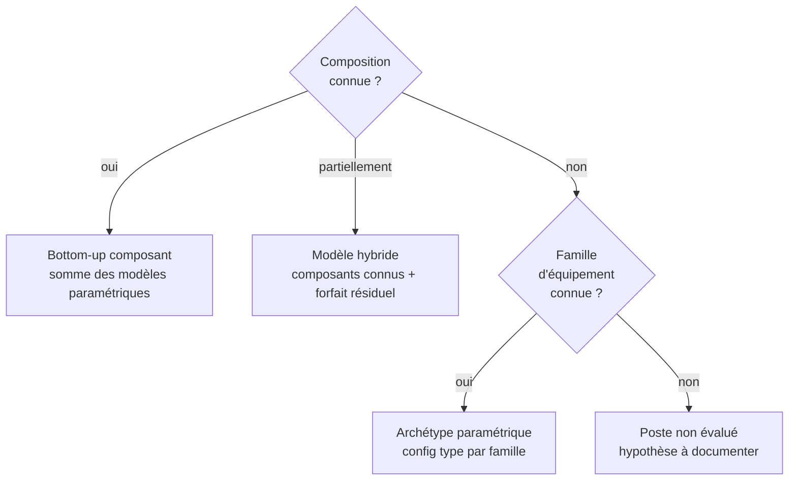
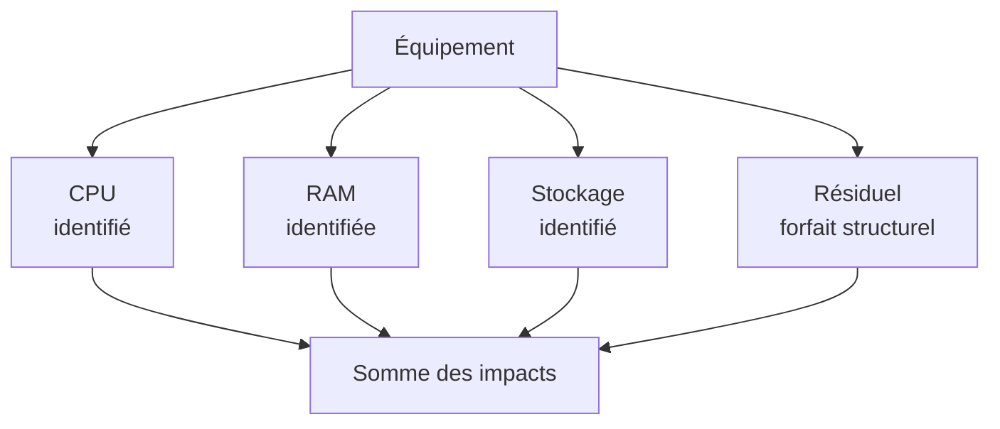
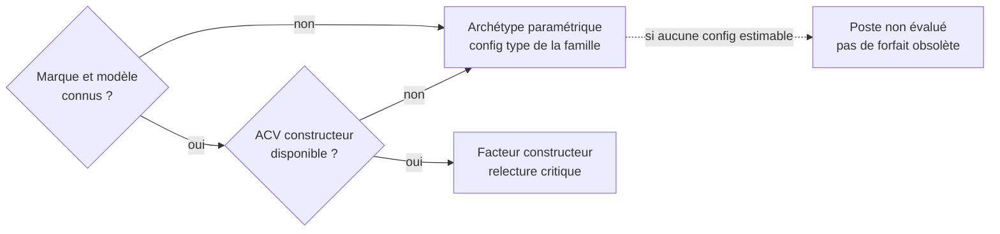

# Modélisation d'un équipement

import { MethodIllustration } from '@site/src/components/method-illustrations';

La méthode cible reconstruit un équipement à partir de ses composants, puis alloue ses impacts aux usages. Les anciens forfaits d’équipements Open Data sont obsolètes pour ce calcul. Une ACV produit représentative reste utile pour calibrer ou vérifier le modèle, ou fournir un inventaire spécifique compatible.

## Principe : bottom-up par composant

### Philosophie

Un équipement numérique est un assemblage physique. Son impact environnemental provient de ses composants ; processeur, mémoire, stockage, écran, batterie, éléments structurels. La composition réelle ou une configuration type documentée détermine les composants comptés :

$$
\begin{align*}
&I_{equipement_{i}} = I_{cpu_{i}} + I_{ram_{i}} + I_{stockage_{i}} + I_{ecran_{i}} + I_{batterie_{i}} + I_{structurel_{i}}
\end{align*}
$$

Cette approche est :

<dl className="model-profiles">
  

    <dt>Transparente</dt>
    <dd>

Chaque composant est traçable avec sa source.

    </dd>
  

  

    <dt>Paramétrique</dt>
    <dd>

L'impact varie avec les caractéristiques réelles de l'équipement.

    </dd>
  

  

    <dt>Modulaire</dt>
    <dd>

On peut affiner un composant sans recalculer tout le modèle.

    </dd>
  

  

    <dt>Comparable sous conditions</dt>
    <dd>

Périmètres, méthodes, unités et qualité doivent être harmonisés avant toute comparaison.

    </dd>
  

</dl>

### Hiérarchie des approches

| Niveau | Quand l'utiliser | Niveau de description | Traçabilité |
|---|---|---|---|
| **Bottom-up composant** | Composition connue ou reconstruisable | Détaillé, sans garantie automatique d’exactitude | Chaque composant sourcé |
| **Modèle hybride** | Composition partielle | Partiel avec résiduel | Composants connus + résiduel documenté |
| **Archétype paramétrique** | Famille connue, pas la config exacte | Configuration représentative | Config type documentée |
| **Inventaire produit spécifique** | ACV représentative et compatible | Équipement complet | Source, configuration et frontières identifiées |

### Statut du référentiel par composants {#referentiel-composants}

Le catalogue cible `equipment` regroupe CPU, accélérateurs, mémoire, stockage, affichage, batterie et structure. Les CPU et accélérateurs sont encore publiés sous `cloud` dans l’instantané actuel ; leur déplacement est une migration à venir, pas un chemin déjà disponible.[^catalogue-composants]

Les caractéristiques décrivent le matériel. Les facteurs et modèles décrivent ses impacts avec leurs unités, phases, sources et versions. Une configuration assemble ces éléments. Le catalogue cloud conserve les offres et leur correspondance avec le matériel.

Une carte accélératrice distingue puce, mémoire et éléments auxiliaires. Un inventaire de carte complète remplace ces éléments lorsqu’il les couvre ; il ne s’y ajoute pas. Le proxy de puce utilisé dans certaines illustrations reste un sous-total.

<MethodIllustration kind="accelerator" lang="fr" />

[^catalogue-composants]: Digital4Better, [catalogue de données, instantané 77cae4a](https://github.com/digital4better/data/tree/77cae4a58fadd5deb3b8d4e5577020da08f780d8), chemins actuels `data/cloud/cpus.*` et `data/cloud/accelerators.*`. L’organisation cible relève de la convention D4B.

## Évaluation des impacts {#impacts-equipement}

### Modèles paramétriques par composant {#modèles-paramétriques-par-composant}

Les modèles ci-dessous n'ont pas tous le même niveau de preuve. Les coefficients historiques CPU/RAM/SSD sont repris de modèles documentés par Boavizta ; les multiplicateurs de nœud, d'écran, de chimie et les résiduels du simulateur restent des scénarios D4B. Une source de contexte ne valide pas un coefficient numérique.[^donnees-modele][^source-6]

| Composant | Formule (GWP) | Paramètres | Statut / provenance |
|---|---|---|---|
| **CPU (puce)** | $(die_{mm^2} \times 0{,}0197 + 9{,}14) \times F_{node} \times F_{pkg}$ | Die size (mm²), noeud techno, packaging | Modèle historique documenté par Boavizta ; multiplicateurs CPU hypothétiques |
| **RAM** | $((cap_{Go} / densité) \times 2{,}20 + 5{,}22) F_{pkg}$ par module | Capacité, type (DDR4/5, HBM) | Modèle historique Boavizta ; densité et technologie à justifier |
| **SSD** | $(cap_{Go} / densité_{NAND}) \times 2{,}20 + 6{,}34$ par drive | Capacité, densité NAND | Modèle historique Boavizta ; densité NAND à justifier [^source-2]|
| **HDD** | $31{,}11$ par drive (forfaitaire) | Nombre de drives | Forfait historique à vérifier pour le modèle retenu |
| **Écran** | $surface_{cm^2} \times C_{techno} + base$ | Diagonale, techno (LCD/OLED) | Scénario D4B, non calibré ici sur une ACV produit |
| **Batterie** | $cap_{kWh} \times F_{chimie}$ | Capacité (Wh), chimie (LCO/NMC/LFP) | Scénario D4B ; ces études ne valident pas la table de chimies [^source-3][^source-4]|
| **Structurel** | Forfait par type d'équipement | Type (smartphone, laptop, serveur) | Hypothèse D4B à calibrer |

Le détail de chaque modèle est dans les pages [Composants](../materiel/composants/processeurs-et-accelerateurs).

## Impact intrinsèque {#impact-intrinseque-d-un-equipement}

### Formule générale

L'impact intrinsèque annualisé d'un équipement est :

$$
\begin{align*}
&I_{emb_{i}} = \frac{\sum_{c} I_{c,emb_{i}} + I_{structurel_{i}}}{RL}\htmlClass{unit}{[U_i/an]}\\
Avec\\
&I_{c,emb_{i}} = \text{Impact intrinsèque du composant } c \text{ pour l'indicateur } i\\
&I_{structurel_{i}} = \text{Impact des éléments structurels}\\
&RL = \text{Durée de vie réelle de l'équipement}\htmlClass{unit}{[an]}\\
\end{align*}
$$

### Pays de fabrication

Les inventaires de fabrication dépendent notamment des procédés et de leur approvisionnement électrique. Un produit peut traverser plusieurs pays : fabrication des wafers, assemblage, mémoire, carte, écran et batterie. Une part de marché ne permet pas d'identifier cette chaîne pour un produit donné.

La géographie est précisée par étape lorsqu’elle est connue. Sinon, celle du facteur choisi est conservée et la lacune signalée. Les pays préremplis dans les scénarios exploratoires ne sont pas des localisations observées. Le facteur électrique du pays d’usage ne remplace pas l’inventaire de fabrication.

:::note[Distinction fabrication et usage]
Le pays d'usage détermine le facteur de l'électricité consommée à l'usage. Modifier ce pays dans un simulateur ne relocalise pas la fabrication. Une adaptation géographique de fabrication nécessite l'inventaire des consommations et procédés concernés.
:::

### Correction durée de vie

Quand un facteur composant est fourni pour une durée de vie théorique $TL$ différente de la durée réelle $RL$, la correction $TL/RL$ s'applique uniquement au facteur déjà normalisé par unité de temps, pas au total de fabrication (voir [Temporalité et vieillissement](../regles/temporalite-vieillissement-et-versionnement-des-donnees)).

## Impact opérationnel {#impact-operationnel-d-un-equipement}

L'impact opérationnel est la somme des consommations des composants :

$$
\begin{align*}
&P_{total} = P_{cpu} + P_{ram} + P_{stockage} + P_{ecran} + P_{autres}\\
&E_{elec} = P_{total} \times D_{usage}\htmlClass{unit}{[kWh]}\\
\end{align*}
$$

Les puissances sont en kW et les durées en heures. Les pertes d’alimentation et les composants absents complètent le bilan seulement s’ils ne sont pas déjà inclus dans une mesure à la prise. Une mesure complète ne s’additionne pas à ses sous-composants.

La conversion en impact opérationnel se fait via [Impacts de la consommation d'énergie](../fondations/impacts-de-la-consommation-d-energie#conversion-consommation-electricite-impact-operationnel).

## Application concrète : reconstruction bottom-up d'un laptop

**Exemple fictif, paramètres de scénario : laptop 14", CPU 7nm 150mm², 16 Go DDR5, 512 Go SSD, écran LCD, batterie NMC 56 Wh**

| Composant | Modèle appliqué | GWP fabrication (kgCO₂e) | Part |
|---|---|---|---|
| CPU | $(150 \times 0{,}0197 + 9{,}14) \times 1{,}8$ | 21,8 | 14,7 % |
| RAM | $((16 / 1{,}0) \times 2{,}20 + 5{,}22) \times 1{,}1$ | 44,5 | 30,0 % |
| SSD 512 Go | $(512 / 48{,}5) \times 2{,}20 + 6{,}34$ | 29,6 | 19,9 % |
| Écran 14" LCD | $540{,}36 \times 0{,}07 + 3{,}0$ | 40,8 | 27,5 % |
| Batterie 56 Wh NMC | $0{,}056 \times 65$ | 3,6 | 2,5 % |
| Structurel | Forfait laptop | 8,0 | 5,4 % |
| **Total** | | **148,3** | **100 %** |
| **Annualisé (5 ans)** | | **29,7 kgCO₂e/an** | |

:::note[Lecture]
La somme utilise une surface 16:9 de $14^2 \times 2{,}54^2 \times 144/337 \approx 540{,}36$ cm². Les résultats sont arrondis ; le total non arrondi vaut environ 148,3 kg. Le multiplicateur CPU 1,8, la densité RAM 1 Go/cm², le packaging DDR5 1,1, les facteurs écran/batterie et le résiduel sont des hypothèses de scénario. Les parts obtenues ne démontrent pas une hiérarchie universelle des leviers ni la performance environnementale d'un laptop commercial.
:::

## Validation croisée avec les facteurs d'équipement

Une validation exige la même configuration, la même durée de vie, les mêmes phases, la même méthode LCIA et la même unité. Un écart avec une moyenne de famille ne suffit pas à valider un modèle ni à expliquer la différence par une génération matérielle.

Chaque comparaison précise la référence exacte de l’ACV produit, sa version, la configuration, les frontières et les écarts résiduels. Les anciennes comparaisons numériques non reproductibles sont conservées dans les archives de refonte ; elles ne servent plus de preuve de validation. Une campagne de calibration indépendante reste à réaliser.

### Modèle hybride : composants connus + résiduel {#modèle-hybride--composants-connus--résiduel}

Quand seuls certains composants sont identifiés :

Le forfait résiduel couvre les éléments non décomposés (carte mère, boîtier, alimentation, câblage, assemblage) ; voir [Éléments structurels](../materiel/composants/elements-structurels).

## Choix du facteur quand le modèle bottom-up n'est pas applicable

## Gestion des données manquantes

Une information absente reste signalée comme telle. Une référence comparable peut fournir une estimation, avec sa source et sa justification. Ce remplacement est un choix de modélisation, pas une détection automatique du matériel. Les données connues restent prioritaires.

Une configuration type documentée, appelée [archétype](../references/glossaire#archetype), peut compléter les caractéristiques manquantes ou représenter l’équipement entier lorsque le détail est insuffisant.

| Situation | Recommandation |
|---|---|
| Composant inconnu mais type connu | Utiliser un archétype du même type |
| Composant inconnu et type inconnu | Inclure dans le forfait résiduel |
| Puissance électrique inconnue | Utiliser une valeur de référence pour la famille |
| Durée de vie réelle inconnue | Utiliser la durée nominale, documenter l'hypothèse |
| Aucune donnée sur l'équipement | Configuration type justifiable ou poste non évalué ; pas de retour aux forfaits obsolètes|

## Hypothèses et limites

- Une description détaillée n’est utile que si elle est représentative. Une configuration type documente les inconnues ; une ACV produit compatible permet de vérifier le modèle.
- Les coefficients composants (die GWP/mm², RAM GWP/cm², etc.) proviennent principalement de Green Cloud Computing (UBA 2021). Ils seront mis à jour quand des données plus récentes seront disponibles.[^source-1]
- Aucune validation statistique des scénarios D4B n’est revendiquée. Les facteurs de fabrication non climatiques nécessitent des inventaires compatibles ; une donnée absente ne vaut pas zéro.
- Les éléments structurels restent forfaitaires. Leur enrichissement est une perspective d'amélioration.

[^source-1]: UBA, [Green Cloud Computing](https://www.umweltbundesamt.de/publikationen/green-cloud-computing), 2021 (modèles historiques ; vérifier les unités propres à chaque composant, notamment mm² pour le CPU) Voir le [corpus documentaire](../references/sources-et-corpus).

[^source-2]: Tannu & Nair, 2023. [The Dirty Secret of SSDs: Embodied Carbon](https://arxiv.org/abs/2207.10793)

[^source-3]: Kelly et al., 2021. LCA of lithium carbonate and hydroxide (contexte batterie, pas validation des coefficients du simulateur) Voir le [corpus documentaire](../references/sources-et-corpus).

[^source-4]: Ellingsen et al., 2014. [LCA of a Li-Ion Battery Vehicle Pack](https://doi.org/10.1111/jiec.12072)

[^source-6]: Digital4Better, [digital4better/data](https://github.com/digital4better/data) Catalogue évolutif ; utiliser un commit pour figer les facteurs.

[^donnees-modele]: Coefficients composants : Green Cloud Computing (UBA 2021), Kelly et al. 2021, Ellingsen et al. 2014, Tannu & Nair 2023. `digital4better/data` → `data/cloud/cpus.*`, `data/cloud/accelerators.*`. Rapports PCF constructeurs (Dell, HP, Apple) pour validation croisée. [Digital4Better, catalogue de données, instantané 77cae4a](https://github.com/digital4better/data/tree/77cae4a58fadd5deb3b8d4e5577020da08f780d8). Références et portée : [Sources et corpus](../references/sources-et-corpus).
