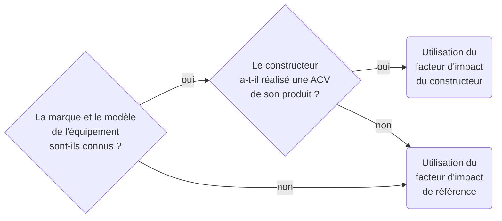
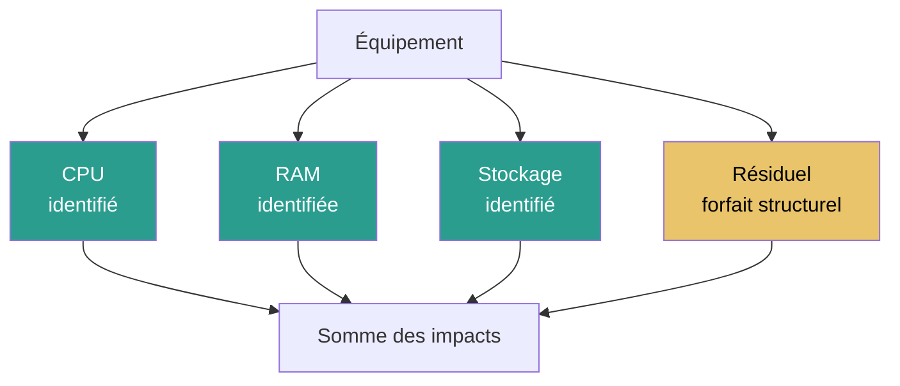

# Modélisation d'un équipement

## Résumé

Modéliser un équipement consiste à décrire sa composition avec un niveau de détail proportionné au besoin : composants explicites quand ils sont connus, éléments structurels et forfaits quand ils ne le sont pas.

Cette page explique comment choisir entre composition détaillée, archétype et facteur forfaitaire, comment calculer l'impact intrinsèque et opérationnel, et comment gérer les données manquantes sans perdre la traçabilité.

## Principe

Un équipement peut être modélisé à quatre niveaux de détail :

| Niveau | Principe | Données nécessaires | Quand l'utiliser |
|---|---|---|---|
| **Composition détaillée** | Chaque composant est identifié et caractérisé | Marque, modèle, specs de chaque composant | Équipement critique, données disponibles |
| **Modèle hybride** | Composants connus + forfait résiduel | Composants principaux + estimation du reste | Composition partiellement connue |
| **Archétype** | Profil type représentatif d'une famille | Famille d'équipement, quelques caractéristiques | Parc volumineux, équipements standards |
| **Facteur forfaitaire** | Facteur unique par type d'équipement | Type d'équipement uniquement | Données minimales, impact secondaire |

Le bon niveau dépend de : la disponibilité des données, le poids de l'équipement dans le résultat, et la capacité à conserver un modèle lisible et vérifiable.

## Paramètres d'entrée

| Paramètre | Obligatoire | Source typique |
|---|---|---|
| Type d'équipement | Oui | Inventaire |
| Marque / modèle | Recommandé | Inventaire, CMDB |
| Durée de vie (réelle ou nominale) | Oui | Inventaire ou hypothèse |
| Composants principaux (CPU, RAM, stockage, écran) | Selon la stratégie | Fiche technique, constructeur |
| Puissance électrique ou consommation annuelle | Oui pour l'opérationnel | Mesure, fiche technique, forfait |
| Durée d'usage attribuable à l'objet étudié | Oui | Données d'usage, hypothèse |

## Évaluation des impacts {#impacts-equipement}

## Choix du facteur d'impact

Le facteur à prendre en compte est déterminé par l'arbre de décision suivant, qui privilégie les facteurs les plus proches du contexte :

:::note
Cette arborescence vaut autant pour les facteurs d'impact intrinsèques que pour les consommations électriques. Les données constructeurs, bien que peu comparables entre elles, fournissent généralement une estimation plus proche du périmètre réel qu'un facteur générique. Voir [Qualité des données](../regles/qualite-des-donnees-et-matrice-de-robustesse) pour l'évaluation de la robustesse des sources.
:::

## Calcul de l'impact intrinsèque {#impact-intrinseque-d-un-equipement}

L'impact intrinsèque d'un équipement s'exprime à partir d'un facteur ramené à une durée d'usage :

$$
\begin{align*}
&I_{embodied_{i}} = D_{usage} \times IF_{embodied_{i}}\htmlClass{unit}{[U_i]}\\
Avec\\
&I_{embodied_{i}} = \text{Impact intrinsèque de l'équipement pour l'indicateur}\textit{ i }\htmlClass{unit}{[U_i]}\\
&D_{usage} = \text{Durée d'usage dédiée à l'utilisation étudiée}\htmlClass{unit}{[s]}\\
&IF_{embodied_{i}} = \text{Facteur d'impact intrinsèque pour l'indicateur}\textit{ i }\htmlClass{unit}{[U_i/s]}\\
\end{align*}
$$

### Correction durée de vie théorique / réelle

Certains facteurs sont fournis pour une durée de vie théorique $TL$ qui peut différer de la durée de vie réelle $RL$ :

$$
\begin{align*}
&IF_{embodied_{i}} = TIF_{embodied_{i}} \times \frac{TL}{RL}\htmlClass{unit}{[U_i/s]}\\
Avec\\
&TIF_{embodied_{i}} = \text{Facteur d'impact intrinsèque théorique}\htmlClass{unit}{[U_i/s]}\\
&TL = \text{Durée de vie théorique du référentiel}\htmlClass{unit}{[s]}\\
&RL = \text{Durée de vie réelle de l'équipement}\htmlClass{unit}{[s]}\\
\end{align*}
$$

Voir [Temporalité et vieillissement](../regles/temporalite-vieillissement-et-versionnement-des-donnees) pour le calcul de la durée de vie réelle.

### Cas bottom-up composant

Quand la composition est connue, l'impact intrinsèque est la somme des impacts de chaque composant :

$$
\begin{align*}
&I_{embodied_{i}} = \sum_{c \in composants} I_{c,embodied_{i}} + I_{structural_{i}}\htmlClass{unit}{[U_i]}
\end{align*}
$$

Où $I_{structural_{i}}$ représente l'impact des [Éléments structurels](../materiel/composants/elements-structurels) (carte mère, boîtier, assemblage, pièces résiduelles).

## Calcul de l'impact opérationnel {#impact-operationnel-d-un-equipement}

$$
\begin{align*}
&E_{elec} = D_{usage} \times P_{elec}\htmlClass{unit}{[kWh]}\\
Avec\\
&E_{elec} = \text{Consommation d'électricité de l'équipement}\htmlClass{unit}{[kWh]}\\
&D_{usage} = \text{Durée d'usage}\htmlClass{unit}{[h]}\\
&P_{elec} = \text{Puissance moyenne sur la durée d'utilisation}\htmlClass{unit}{[kW]}\\
\end{align*}
$$

La conversion en impact opérationnel se fait via [Impacts de la consommation d'énergie](../fondations/impacts-de-la-consommation-d-energie#conversion-consommation-electricite-impact-operationnel).

## Application concrète

**Cas : modéliser un serveur Dell PowerEdge R750 dans un datacenter**

| Composant | Données disponibles | Source | Impact GWP (kg CO₂ eq. / an) |
|---|---|---|---|
| 2× CPU Intel Xeon Gold 6330 | TDP 205 W chacun | Fiche technique Intel | Inclus dans le facteur constructeur |
| 512 Go RAM DDR4 | 16 barrettes × 32 Go | Fiche technique | Inclus dans le facteur constructeur |
| 2× SSD 960 Go | NVMe | Fiche technique | Inclus dans le facteur constructeur |
| **Facteur intrinsèque total** | ACV constructeur Dell | Dell Product Carbon Footprint Report 2023 | **~320 kg CO₂ eq. / 5 ans = 64 /an** |
| **Consommation électrique** | ~800 W moyen (mesuré) | Monitoring datacenter | — |
| **Impact opérationnel** | 800 W × 8 760 h × PUE 1,3 × 60 g/kWh (France) | d4b/data | **~547 kWh/an → 33 kg CO₂ eq. /an** |
| **Impact total annuel (GWP)** | | | **~97 kg CO₂ eq. /an** |

:::note[Lecture du résultat]
Dans cet exemple en France (mix bas carbone), l'impact intrinsèque domine (66 %). Dans un pays à mix carboné (ex. Pologne, ~700 g/kWh), l'impact opérationnel serait de ~490 kg CO₂ eq./an et dominerait largement. Le contexte géographique change fondamentalement la lecture.
:::

## Modèle hybride : composants connus + résiduel

Quand seuls certains composants sont identifiés :

Le forfait résiduel couvre les éléments non décomposés (carte mère, boîtier, alimentation, câblage, assemblage). Il doit être explicite et documenté — voir [Éléments structurels](../materiel/composants/elements-structurels).

## Gestion des données manquantes

| Situation | Recommandation |
|---|---|
| Composant inconnu mais type connu | Utiliser un archétype du même type |
| Composant inconnu et type inconnu | Inclure dans le forfait résiduel |
| Puissance électrique inconnue | Utiliser une valeur de référence pour la famille |
| Durée de vie réelle inconnue | Utiliser la durée nominale, documenter l'hypothèse |
| Aucune donnée sur l'équipement | Utiliser un facteur forfaitaire Base Empreinte |

:::note[Principe directeur]
Il vaut mieux conserver les composants connus et documenter les trous que remplacer tout le modèle par une valeur unique sans le signaler.
:::

## Hypothèses et limites

- La décomposition d'un équipement reste souvent partielle ; un archétype robuste vaut mieux qu'une composition fictive.
- Le niveau de détail optimal dépend du poids de l'équipement dans le résultat global.
- Les facteurs constructeurs restent hétérogènes et doivent toujours être relus de manière critique (voir [Qualité des données](../regles/qualite-des-donnees-et-matrice-de-robustesse)).
- Les éléments structurels doivent être explicités quand ils servent de complétion.

## Données mobilisées

- `digital4better/data` → `data/hardware/*`, `data/equipment/*`
- Données constructeurs quand elles sont critiquées et contextualisées
- Base Empreinte ADEME (facteurs par famille)

## Sources

- ISO 14040 / ISO 14044
- [digital4better/data](https://github.com/digital4better/data)
- Corpus `inputs/md`
