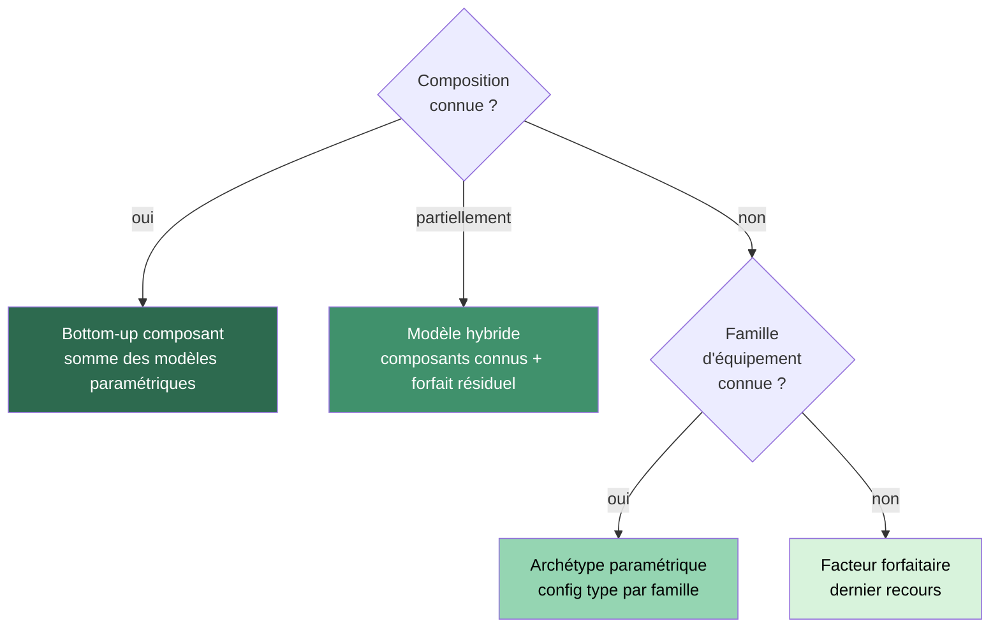
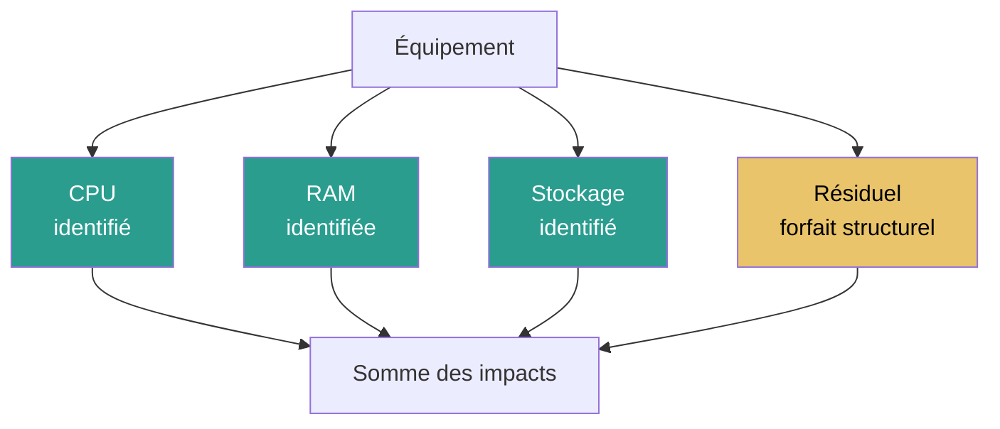
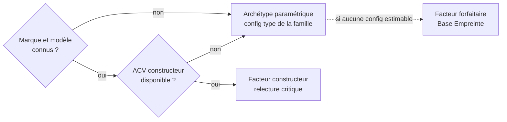

# Modélisation d'un équipement

## Résumé

Modéliser un équipement consiste à reconstruire son impact environnemental à partir de ses composants. La méthode privilégie une **approche bottom-up** : l'impact de l'équipement est la somme des impacts de ses composants, chacun calculé avec un modèle paramétrique sourcé. Les facteurs forfaitaires par type d'équipement ne sont utilisés qu'en dernier recours.

## Principe : bottom-up par composant

### Philosophie

Un équipement numérique est un assemblage physique. Son impact environnemental provient de ses composants — processeur, mémoire, stockage, écran, batterie, éléments structurels. Plutôt que d'utiliser un facteur forfaitaire opaque par type d'équipement, la méthode reconstruit l'impact à partir de la composition réelle ou estimée :

$$
\begin{align*}
&I_{equipement_{i}} = I_{cpu_{i}} + I_{ram_{i}} + I_{stockage_{i}} + I_{ecran_{i}} + I_{batterie_{i}} + I_{structurel_{i}}
\end{align*}
$$

Cette approche est :
- **transparente** : chaque composant est traçable avec sa source ;
- **paramétrique** : l'impact varie avec les caractéristiques réelles de l'équipement ;
- **modulaire** : on peut affiner un composant sans recalculer tout le modèle ;
- **comparable** : deux équipements différents peuvent être comparés composant par composant.

### Hiérarchie des approches

| Niveau | Quand l'utiliser | Précision | Traçabilité |
|---|---|---|---|
| **Bottom-up composant** | Composition connue ou reconstruisable | Élevée | Chaque composant sourcé |
| **Modèle hybride** | Composition partielle | Moyenne à élevée | Composants connus + résiduel documenté |
| **Archétype paramétrique** | Famille connue, pas la config exacte | Moyenne | Config type documentée |
| **Facteur forfaitaire** | Aucune information sur la composition | Faible | Facteur agrégé, source unique |

## Évaluation des impacts {#impacts-equipement}

## Modèles paramétriques par composant

Chaque composant dispose d'un modèle paramétrique dont les coefficients proviennent de sources primaires documentées :

| Composant | Formule (GWP) | Paramètres | Source primaire |
|---|---|---|---|
| **CPU/GPU** | $(die_{mm^2} \times 0{,}0197 + 9{,}14) \times F_{node} \times F_{pkg}$ | Die size (mm²), noeud techno, packaging | Green Cloud Computing (UBA 2021) |
| **RAM** | $(cap_{Go} / densité) \times 2{,}20 + 5{,}22$ par module | Capacité, type (DDR4/5, HBM) | Green Cloud Computing (UBA 2021) |
| **SSD** | $(cap_{Go} / densité_{NAND}) \times 2{,}20 + 6{,}34$ par drive | Capacité, densité NAND | Green Cloud Computing (UBA 2021), Tannu & Nair 2023 |
| **HDD** | $31{,}11$ par drive (forfaitaire) | Nombre de drives | Green Cloud Computing (UBA 2021) |
| **Écran** | $surface_{cm^2} \times C_{techno} + base$ | Diagonale, techno (LCD/OLED) | Base Empreinte, rapports PCF constructeurs |
| **Batterie** | $cap_{kWh} \times F_{chimie}$ | Capacité (Wh), chimie (LCO/NMC/LFP) | Kelly et al. 2021, Ellingsen et al. 2014 |
| **Structurel** | Forfait par type d'équipement | Type (smartphone, laptop, serveur) | PCF constructeurs, estimations |

Le détail de chaque modèle est dans les pages [Composants](../materiel/composants/processeurs-et-accelerateurs).

## Impact intrinsèque {#impact-intrinseque-d-un-equipement}

### Formule générale

L'impact intrinsèque annualisé d'un équipement est :

$$
\begin{align*}
&I_{emb_{i}} = \frac{\sum_{c} I_{c,emb_{i}} + I_{structurel_{i}}}{RL}\htmlClass{unit}{[U_i/an]}\\
Avec\\
&I_{c,emb_{i}} = \text{Impact intrinsèque du composant } c \text{ pour l'indicateur } i\\
&I_{structurel_{i}} = \text{Impact des éléments structurels}\\
&RL = \text{Durée de vie réelle de l'équipement}\htmlClass{unit}{[an]}\\
\end{align*}
$$

### Pays de fabrication

Plusieurs indicateurs d'impact intrinsèque (en particulier IR, mais aussi GWP, AP et PM) dépendent du mix électrique du pays de fabrication du composant. Quand ce pays est connu, il doit être utilisé. Quand il ne l'est pas, la méthode applique les hypothèses suivantes :

| Composant | Pays de fabrication par défaut | Justification |
|---|---|---|
| CPU/GPU (front-end) | Taïwan | TSMC fabrique la majorité des puces logiques avancées |
| CPU/GPU (back-end) | Chine | Assemblage et test majoritairement en Asie |
| RAM (DRAM/HBM) | Corée du Sud | Samsung et SK Hynix dominent |
| SSD (NAND) | Corée du Sud | Samsung, SK Hynix, Kioxia |
| Écran (LCD/OLED) | Chine | BOE est le premier producteur mondial |
| Batterie | Chine | CATL, BYD dominent la production mondiale |
| PCB / structurel | Chine | Assemblage final quasi exclusivement chinois |
| HDD | Thaïlande | Seagate, Western Digital |

:::note[Distinction fabrication vs usage]
Le pays de fabrication détermine l'impact intrinsèque (via le mix électrique des usines). Le pays d'usage détermine l'impact opérationnel (via le mix électrique local). Ce sont deux paramètres distincts dans le modèle.
:::

### Correction durée de vie

Quand un facteur composant est fourni pour une durée de vie théorique $TL$ différente de la durée réelle $RL$, la correction $TL/RL$ s'applique (voir [Temporalité et vieillissement](../regles/temporalite-vieillissement-et-versionnement-des-donnees)).

## Impact opérationnel {#impact-operationnel-d-un-equipement}

L'impact opérationnel est la somme des consommations des composants :

$$
\begin{align*}
&P_{total} = P_{cpu} + P_{ram} + P_{stockage} + P_{ecran} + P_{autres}\\
&E_{elec} = P_{total} \times D_{usage}\htmlClass{unit}{[kWh]}\\
\end{align*}
$$

La conversion en impact opérationnel se fait via [Impacts de la consommation d'énergie](../fondations/impacts-de-la-consommation-d-energie#conversion-consommation-electricite-impact-operationnel).

## Application concrète : reconstruction bottom-up d'un laptop

**Config : laptop 14", CPU 7nm 150mm², 16 Go DDR5, 512 Go SSD, écran LCD, batterie NMC 56 Wh**

| Composant | Modèle appliqué | GWP fabrication (kgCO₂e) | Part |
|---|---|---|---|
| CPU | $(150 \times 0{,}0197 + 9{,}14) \times 1{,}8$ | 21,8 | 15 % |
| RAM | $(16 / 1{,}0) \times 2{,}20 + 5{,}22$ | 40,4 | 28 % |
| SSD 512 Go | $(512 / 48{,}5) \times 2{,}20 + 6{,}34$ | 29,6 | 20 % |
| Écran 14" LCD | $567 \times 0{,}07 + 3{,}0$ | 42,7 | 29 % |
| Batterie 56 Wh NMC | $0{,}056 \times 65$ | 3,6 | 3 % |
| Structurel | Forfait laptop | 8,0 | 5 % |
| **Total** | | **146,1** | **100 %** |
| **Annualisé (5 ans)** | | **29,2 kgCO₂e/an** | |

:::note[Lecture]
La RAM et l'écran sont les premiers contributeurs (28 % et 29 %). Le CPU ne représente que 15 % malgré son procédé de fabrication complexe, car sa surface de die (150 mm²) reste modeste. La batterie est marginale (3 %). Cette décomposition permet d'identifier les leviers : un écran plus petit ou une capacité RAM moindre aurait plus d'effet qu'un changement de processeur.
:::

## Validation croisée avec les facteurs forfaitaires

Le tableau ci-dessous compare les résultats bottom-up avec les facteurs forfaitaires historiques pour vérifier la cohérence :

| Équipement | Config bottom-up | GWP bottom-up (kgCO₂e/an) | GWP forfaitaire D4B (kgCO₂e/an) | Écart |
|---|---|---|---|---|
| **Smartphone** | CPU 4nm 100mm², 8 Go DDR5, 128 Go SSD, OLED 6.5", LCO 18 Wh | 28,4 | 31,9 | -11 % |
| **Tablette** | CPU 4nm 100mm², 8 Go DDR5, 256 Go SSD, LCD 11", NMC 30 Wh | 25,8 | 28,1 | -8 % |
| **Laptop** | CPU 7nm 150mm², 16 Go DDR5, 512 Go SSD, LCD 14", NMC 56 Wh | 29,2 | 37,2 | -22 % |
| **Desktop (sans écran)** | CPU 10nm 200mm², 32 Go DDR4, 1 To SSD | 33,3 | 44,8 | -26 % |

:::note[Interprétation des écarts]
Les écarts de -8 % à -26 % sont cohérents : les facteurs forfaitaires historiques (Base Empreinte / NegaOctet ~2020) sont calibrés sur des configs moyennes de l'époque, qui incluent parfois des composants additionnels (GPU dédié pour le desktop, configs plus lourdes). L'approche bottom-up permet de s'adapter à la configuration réelle plutôt qu'à un archétype fixe.
:::

## Modèle hybride : composants connus + résiduel

Quand seuls certains composants sont identifiés :

Le forfait résiduel couvre les éléments non décomposés (carte mère, boîtier, alimentation, câblage, assemblage) — voir [Éléments structurels](../materiel/composants/elements-structurels).

## Choix du facteur quand le modèle bottom-up n'est pas applicable

## Gestion des données manquantes

| Situation | Recommandation |
|---|---|
| Composant inconnu mais type connu | Utiliser un archétype du même type |
| Composant inconnu et type inconnu | Inclure dans le forfait résiduel |
| Puissance électrique inconnue | Utiliser une valeur de référence pour la famille |
| Durée de vie réelle inconnue | Utiliser la durée nominale, documenter l'hypothèse |
| Aucune donnée sur l'équipement | Utiliser un facteur forfaitaire Base Empreinte (dernier recours) |

## Hypothèses et limites

- L'approche bottom-up est plus transparente mais suppose de connaître au minimum la famille de composants. Quand aucune information n'est disponible, le facteur forfaitaire reste acceptable en dernier recours.
- Les coefficients composants (die GWP/mm², RAM GWP/cm², etc.) proviennent principalement de Green Cloud Computing (UBA 2021). Ils seront mis à jour quand des données plus récentes seront disponibles.
- La validation croisée montre des écarts de -8 % à -26 % avec les facteurs forfaitaires historiques, ce qui est cohérent et acceptable.
- Les éléments structurels restent forfaitaires. Leur enrichissement est une perspective d'amélioration.

## Données mobilisées

- Coefficients composants : Green Cloud Computing (UBA 2021), Kelly et al. 2021, Ellingsen et al. 2014, Tannu & Nair 2023
- `digital4better/data` → `data/cloud/cpus.*`, `data/cloud/accelerators.*`
- Rapports PCF constructeurs (Dell, HP, Apple) pour validation croisée

## Sources

- Green Cloud Computing, UBA, 2021 (coefficients par cm² de die pour CPU, RAM, SSD)
- Tannu & Nair, 2023. [The Dirty Secret of SSDs: Embodied Carbon](https://arxiv.org/abs/2207.10793)
- Kelly et al., 2021. LCA of lithium carbonate and hydroxide (coefficients batterie)
- Ellingsen et al., 2014. [LCA of a Li-Ion Battery Vehicle Pack](https://doi.org/10.1111/jiec.12072)
- Base Empreinte ADEME (facteurs forfaitaires, fallback)
- [digital4better/data](https://github.com/digital4better/data)
