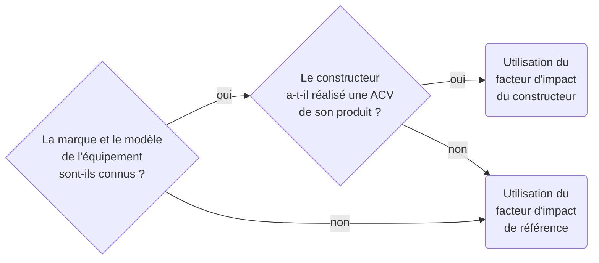

# Modélisation d’un équipement

## Résumé

Modéliser un équipement consiste à décrire sa composition avec un niveau de détail proportionné au besoin : composants explicites quand ils sont connus, éléments structurels et forfaits quand ils ne le sont pas.

Cette page explique :

- comment choisir entre composition détaillée, archétype et facteur forfaitaire ;
- comment calculer l'impact intrinsèque et l'impact opérationnel d'un équipement ;
- comment gérer les données manquantes sans perdre la traçabilité des hypothèses.

## Principe

Un équipement peut être modélisé :

- à partir de ses composants identifiés ;
- à partir d'un archétype ;
- à partir d'un facteur forfaitaire documenté ;
- avec un modèle hybride combinant composants connus et résiduels.

Le bon niveau de détail dépend de trois critères :

- la disponibilité réelle des données de composition ;
- le poids de l'équipement dans le résultat final ;
- la capacité à conserver un modèle lisible et vérifiable.

## Paramètres d’entrée

Les paramètres les plus structurants sont :

- le type d'équipement ;
- sa marque et son modèle, quand ils sont connus ;
- sa durée de vie réelle ou supposée ;
- ses principaux composants ou caractéristiques structurantes ;
- sa puissance électrique ou sa consommation annuelle de référence ;
- la durée d'usage réellement attribuable à l'objet étudié.

## Évaluation des impacts

## Impacts environnementaux d’un équipement {#impacts-equipement}

### Choix du facteur d’impact environnemental

Le facteur à prendre en compte est déterminé par l'arbre de décision suivant, qui privilégie les facteurs les plus discriminants :

:::note
Cette arborescence vaut autant pour les facteurs d'impact intrinsèques que pour les consommations électriques.
:::

Les données constructeurs ne sont pas toujours fiables, et surtout peu comparables. Les périmètres pris en compte diffèrent, les résultats ne sont pas tous certifiés et les méthodologies ne sont pas toujours partagées. Toutefois, lorsqu'elles sont relues de manière critique, elles peuvent fournir une estimation plus proche du périmètre étudié qu'un facteur générique.

### Impact intrinsèque d’un équipement {#impact-intrinseque-d-un-equipement}

L'impact intrinsèque d'un équipement s'exprime à partir d'un facteur ramené à une durée d'usage :

$$
\begin{align*}
&I_{embodied_{i}} = D_{usage} \times IF_{embodied_{i}}\htmlClass{unit}{[U_i]}\\
Avec\\
&I_{embodied_{i}} = \text{Impact intrinsèque de l'équipement pour l’indicateur environnemental}\textit{ i }\htmlClass{unit}{[U_i]}\\
&D_{usage} = \text{Durée d’usage de l’équipement dédiée à l’utilisation étudiée}\htmlClass{unit}{[s]}\\
&IF_{embodied_{i}} = \text{Facteur d’impact intrinsèque pour l’indicateur environnemental}\textit{ i }\htmlClass{unit}{[U_i/s]}\\
\end{align*}
$$

:::note
La formule est donnée dans les unités standards avec des temps en seconde. Selon le procédé évalué, il conviendra d'utiliser la même formule avec des unités de temps autres que la seconde, par exemple le mois ou l'année.
:::

Certains facteurs sont fournis pour une quantité de référence et en tenant compte d'une durée de vie théorique. Celle-ci peut différer de la durée de vie réelle de l'équipement étudié. Une règle de proportionnalité peut alors être appliquée :

$$
\begin{align*}
&IF_{embodied_{i}} = TIF_{embodied_{i}} \times \frac{TL}{RL}\htmlClass{unit}{[U_i/s]}\\
Avec\\
&TIF_{embodied_{i}} = \text{Facteur d’impact intrinsèque théorique}\htmlClass{unit}{[U_i/s]}\\
&TL = \text{Durée de vie théorique de l'équipement fournie par le référentiel}\htmlClass{unit}{[s]}\\
&RL = \text{Durée de vie réelle de l'équipement}\htmlClass{unit}{[s]}\\
\end{align*}
$$

### Impact opérationnel d’un équipement {#impact-operationnel-d-un-equipement}

L'impact opérationnel s'évalue à partir de la consommation électrique de l'équipement :

$$
\begin{align*}
&E_{elec} = D_{usage} \times P_{elec}\htmlClass{unit}{[kWh]}\\
Avec\\
&E_{elec} = \text{Consommation d'électricité de l'équipement}\htmlClass{unit}{[kWh]}\\
&D_{usage} = \text{Durée d’usage de l'équipement}\htmlClass{unit}{[h]}\\
&P_{elec} = \text{Puissance moyenne de l'équipement sur la durée d'utilisation}\htmlClass{unit}{[kW]}\\
\end{align*}
$$

La conversion de cette consommation électrique en impact opérationnel se fait ensuite via [Impacts de la consommation d’énergie](../fondations/impacts-de-la-consommation-d-energie).

### Place des éléments structurels

Certains impacts sont peu détaillés dans les données disponibles mais ne peuvent pas être ignorés :

- carte mère ;
- boîtier ;
- cartes auxiliaires ;
- assemblage ;
- pièces résiduelles non décomposées.

Ces impacts peuvent être regroupés dans la section [Éléments structurels](../materiel/composants/elements-structurels) tant que la convention retenue est explicite.

### Gestion des données manquantes

Quand une composition est incomplète, la méthode recommande :

- de conserver les composants connus ;
- de documenter les trous ;
- d'utiliser des forfaits résiduels là où ils sont justifiés ;
- d'éviter de remplacer tout le modèle par une valeur unique sans le signaler.

## Application

Cette page est mobilisée directement dans :

- [Terminaux](../materiel/equipements/terminaux) ;
- [Serveurs](../materiel/equipements/serveurs) ;
- [Équipements réseau actifs](../materiel/equipements/equipements-reseau-actifs) ;
- [Parc informatique](../cas-d-usage/environnements/parc-informatique) ;
- [Infrastructure d’hébergement](../cas-d-usage/environnements/infrastructure-d-hebergement).

## Hypothèses & limites

### Hypothèses retenues

- la décomposition d'un équipement doit rester proportionnée à la qualité des données disponibles ;
- un archétype robuste vaut mieux qu'une composition fictive ;
- les éléments structurels doivent être explicités quand ils servent de complétion.

### Limitations connues

- la décomposition d'un équipement reste souvent partielle ;
- le niveau de détail optimal dépend du poids de l'équipement dans le résultat global et de la qualité des données disponibles ;
- les facteurs constructeurs restent hétérogènes et doivent toujours être relus de manière critique.

### Perspectives

- relier plus explicitement les arbres de décision aux archétypes D4B ;
- enrichir les conventions de complétion pour les équipements partiellement connus ;
- proposer à terme un simulateur d'équipement quand les paramètres d'entrée les plus utiles seront stabilisés.

## Références

### Données mobilisées

- `digital4better/data/data/hardware/*`
- `digital4better/data/data/equipment/*`
- données constructeurs quand elles sont critiquées et contextualisées

### Sources

- corpus `inputs/md`
- [digital4better/data](https://github.com/digital4better/data)
