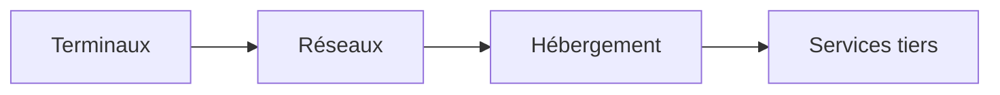

# Modéliser un service

Un service mobilise des terminaux, des réseaux, un hébergement et parfois des services tiers. Le modèle relie les activités observées à ces ressources, puis additionne leurs impacts dans une unité commune.

La fonction rendue constitue le point de départ : consulter un compte, envoyer un message ou générer une image. Une requête technique peut servir d’unité de calcul, mais ne garantit pas à elle seule l’équivalence de deux services.

## Couvrir les étapes du logiciel

La décomposition terminal, réseau, hébergement et tiers s’applique aussi aux ressources utilisées pour concevoir, tester, déployer, maintenir et retirer le service. Le RCP applicatif décrit ces étapes ; le RCP parent demande de considérer les travaux de développement spécifiques, dont l’entraînement d’un modèle.[^rcp-app][^rcp-parent]

| Activité | Ressources à rechercher | Vigilance |
|---|---|---|
| Conception, développement et tests | Postes de travail, CI, environnements de test, jeux de données | Répartir les moyens communs entre projets |
| Exploitation et maintenance | Production, supervision, sauvegardes, support technique | Inclure les tâches en arrière-plan et la capacité réservée |
| Retrait du service | Migration, archivage, suppression | Distinguer retrait du logiciel et fin de vie des équipements |

Ces activités complètent l’inventaire dans les mêmes quatre contributions ; elles ne créent pas un cinquième poste à additionner si les ressources sont déjà comptées. Les moyens humains sont recommandés dans le RCP applicatif, avec un périmètre à préciser. Les exemples interactifs restent centrés sur l’usage décrit et n’inventorient pas automatiquement ces étapes.

## Décomposer le périmètre

| Couche | Donnée d’activité | Choix à documenter |
|---|---|---|
| Terminal | Temps actif et profil matériel | Allocation entre usages simultanés |
| Réseau | Octets réellement transférés | Segments et frontière du facteur |
| Hébergement | Ressources réservées, énergie | Capacité partagée, repos et PUE |
| Services tiers | Activité ou contribution allouée | Inclusion dans les mesures existantes |

Un service peut utiliser plusieurs réseaux ou sites. Le schéma décrit des contributions, pas un trajet physique imposé.

## Assembler les contributions

Pour chaque indicateur, le résultat est la somme des contributions compatibles :

$$
I_{service}=I_{terminal}+I_{reseau}+I_{hebergement}+I_{tiers}
$$

Chaque terme peut contenir de la fabrication allouée et des impacts d’exploitation. L’addition suppose des phases couvertes compatibles. Un facteur de service complet ne s’ajoute pas aux mêmes équipements déjà inventoriés.

Un facteur réseau en kg CO₂e/Go s’applique au volume en Go. Le modèle réseau D4B utilise des facteurs par Go·km : le volume est alors multiplié par la distance estimée de chaque segment. Un facteur déjà ramené au trajet par Go ne reçoit pas ce multiplicateur une seconde fois. Une absence de données reste une contribution non évaluée.

## Exemple reproductible

Dans [Service web](../cas-d-usage/services/service-web), le mode « Paramètres personnalisés » permet de représenter le scénario suivant : 100 000 vues de 60 secondes, terminal à 40 W, fabrication de 200 kg CO₂e sur cinq ans, 100 kWh IT alloués, PUE 1,2 et 20 kg de fabrication d’hébergement déjà allouée. Le pays d’usage et celui du site sont la France.

| Poste | Calcul | Résultat |
|---|---|---:|
| Temps terminal | 100 000 × 60 / 3 600 | 1 666,67 h |
| Fabrication terminal | 200 × (100 000 × 60 / 3 600) / (5 × 8 760) | 7,61035 kg CO₂e |
| Énergie terminal | (100 000 × 60 / 3 600) × 40 / 1 000 | 66,6667 kWh |
| Énergie hébergement | 100 × 1,2 | 120 kWh |
| Émissions électriques | (66,6667 + 120) × 0,0319271 | 5,95973 kg CO₂e |
| Fabrication hébergement | Entrée allouée | 20 kg CO₂e |
| **Sous-total** | Calcul avec valeurs non arrondies | **33,57008 kg CO₂e** |

Les paramètres matériels sont supposés pour l’exercice. Le facteur électrique provient de l’instantané D4B France 2025[^ref-1]. Le réseau et les tiers restent non évalués : ce sous-total n’est pas l’empreinte complète du service.

## Appliquer les règles utiles

1. La [frontière et l’unité](../fondations/perimetre-frontieres-services-tiers-et-unite-d-analyse) définissent ce qui est évalué.
2. La [stratégie](./strategies-de-modelisation) dépend des données disponibles.
3. La répartition des ressources relève de l’[allocation](../regles/allocation-et-partage-des-impacts).
4. L’interprétation repose sur l’absence de [doubles comptes](../regles/double-comptabilisation) et sur la [qualité des données](../regles/qualite-des-donnees-et-matrice-de-robustesse).

Les cas [Mail](../cas-d-usage/services/mail), [Applications natives](../cas-d-usage/services/mobile) et [IA](../cas-d-usage/services/ia-generative) adaptent cette chaîne à leurs activités. [Cloud](../cas-d-usage/environnements/cloud) et [Hébergement](../cas-d-usage/environnements/infrastructure-d-hebergement) détaillent la couche serveur. Le [Parc](../cas-d-usage/environnements/parc-informatique) évalue l’inventaire physique ; ses résultats ne s’ajoutent pas directement aux usages qui consomment ce même parc.

[^rcp-app]: ADEME, [RCP des applicatifs numériques, juin 2026](https://librairie.ademe.fr/economie-circulaire-et-dechets/9434-referentiel-par-categorie-de-produit-rcp-des-applicatifs-numeriques.html), p. 14–15, 38–40.

[^rcp-parent]: ADEME, [RCP services numériques, version 2, juin 2026](https://librairie.ademe.fr/societe-et-politiques-publiques/9418-methodologie-d-evaluation-environnementale-basee-sur-l-analyse-du-cycle-de-vie-acv-pour-un-service-numerique.html), p. 13–15.

[^ref-1]: Digital4Better, [instantané D4B France 2025](https://github.com/digital4better/data/blob/77cae4a58fadd5deb3b8d4e5577020da08f780d8/data/factor/country-yearly.csv). Instantané 77cae4a, données 2025 ; revue du 16 octobre 2026.
