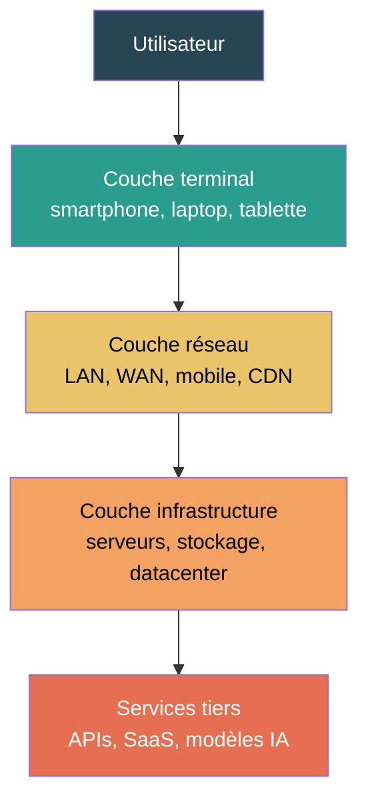
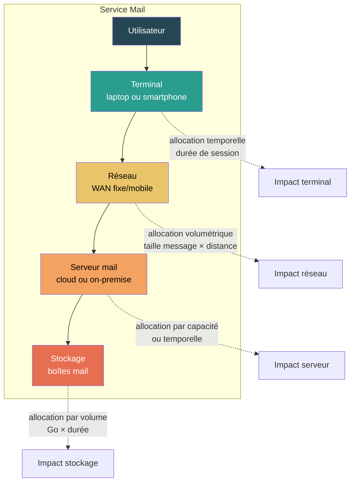

# Modélisation d'un service

## Résumé

Modéliser un service numérique consiste à le décomposer en couches fonctionnelles et techniques, puis à rattacher chaque couche aux composants, équipements et infrastructures qui rendent effectivement le service.

Cette page sert de charnière entre le socle `Matériel` et les `Cas d'usage`. Elle explique comment passer d'un service observé à un modèle calculable.

## Principe

Un service n'est pas évalué comme une entité abstraite isolée. Il est évalué à partir des équipements et infrastructures qu'il mobilise et de la façon dont l'usage est réparti entre eux.

La décomposition doit répondre à trois questions :

1. **Quelle fonction** rend le service ?
2. **Quelles couches** sont nécessaires à cette fonction ?
3. **Comment l'usage** du service est-il alloué à ces couches ?

## Décomposition en couches

### Architecture type

### Détail des couches

| Couche | Ce qu'elle couvre | Stratégie de modélisation typique | Règle d'allocation typique |
|---|---|---|---|
| **Terminal** | Équipements utilisateurs (smartphone, laptop, desktop, tablette) | Facteur d'équipement ou archétype | Temporelle ($D_{usage}$ / durée de vie) |
| **Réseau** | LAN, WAN, mobile (RAN), CDN, transit | Approche système (facteur par Go/km) | Volumétrique (octets transférés × distance) |
| **Infrastructure** | Serveurs, stockage, datacenter, cloud | Bottom-up composant, inférence depuis l'usage, ou approche système | Par capacité réservée (vCPU, RAM, stockage) ou temporelle |
| **Services tiers** | APIs, SaaS, modèles IA externes | Approche système ou forfait documenté | Selon l'unité la plus proche (requêtes, tokens, Go) |

Chaque couche mobilise une [stratégie de modélisation](./strategies-de-modelisation) et une [règle d'allocation](../regles/allocation-et-partage-des-impacts) qui doivent être explicites.

## Paramètres d'entrée

| Paramètre | Rôle | Exemples |
|---|---|---|
| **Unité d'analyse** | Rapporter le résultat à une grandeur compréhensible | Page vue, message, requête, token, session, utilisateur/an |
| **Données d'usage** | Quantifier la sollicitation du service | Nombre de vues, sessions, messages, tokens générés, volume transféré |
| **Hypothèses terminaux** | Caractériser le mix d'équipements utilisateurs | % mobile / desktop, archétypes retenus, durée de session |
| **Hypothèses réseau** | Caractériser les flux de données | Volume par page/requête, distances, part fixe/mobile, taux de cache CDN |
| **Hypothèses infrastructure** | Caractériser les ressources serveur | Nombre de VM, vCPU, RAM, stockage, PUE, localisation, provider |
| **Dépendances tierces** | Identifier les services externes | APIs critiques, SaaS intégrés, modèles IA, CDN |

## Formule d'agrégation

L'impact d'un service est la somme des impacts alloués à chaque couche :

$$
\begin{align*}
&I_{service_i} = I_{terminal_i} + I_{reseau_i} + I_{infrastructure_i} + I_{tiers_i}\htmlClass{unit}{[U_i]}\\
Avec \\
&I_{terminal_i} = \text{Impact alloué à la couche terminal}\htmlClass{unit}{[U_i]}\\
&I_{reseau_i} = \text{Impact alloué à la couche réseau}\htmlClass{unit}{[U_i]}\\
&I_{infrastructure_i} = \text{Impact alloué à la couche infrastructure}\htmlClass{unit}{[U_i]}\\
&I_{tiers_i} = \text{Impact alloué aux services tiers}\htmlClass{unit}{[U_i]}\\
\end{align*}
$$

Chaque terme se décompose en impact intrinsèque + impact opérationnel :

$$
\begin{align*}
&I_{couche_i} = I_{emb_{couche_i}} + I_{ope_{couche_i}}
\end{align*}
$$

:::note[Pas toutes les couches à chaque fois]
Cette écriture n'impose pas que toutes les couches soient présentes dans tous les cas d'usage. Elle sert à rendre explicite ce qui est inclus, exclu ou estimé. Une couche absente doit être documentée comme exclusion (voir [Double comptabilisation](../regles/double-comptabilisation)).
:::

## Application concrète

**Cas : modéliser un service de messagerie (mail)**

| Couche | Unité d'entrée | Stratégie | Allocation | Impact par message (GWP, ordre de grandeur) |
|---|---|---|---|---|
| **Terminal** | 2 min de session | Facteur d'équipement (archétype smartphone) | Temporelle | ~0,1 g CO₂ eq. |
| **Réseau** | 0,5 Mo transféré, 500 km | Approche système (facteur réseau mixte) | Volumétrique | ~0,01 g CO₂ eq. |
| **Serveur** | 1 vCPU × 2 s de traitement | Inférence depuis l'usage | Par capacité | ~0,05 g CO₂ eq. |
| **Stockage** | 0,5 Mo × 1 an | Approche système | Par volume × durée | ~0,02 g CO₂ eq. |
| **Total** | | | | **~0,2 g CO₂ eq. / message** |

:::note[Ordres de grandeur]
Ces valeurs sont des ordres de grandeur illustratifs. Les résultats réels dépendent du contexte (mix électrique, PUE, archétype terminal, durée de stockage). Le détail des calculs pour le mail est dans [Mail](../cas-d-usage/services/mail).
:::

## Protocole de modélisation d'un service

1. **Définir l'unité d'analyse** : page vue, message, requête, token, etc.
2. **Identifier les couches** mobilisées par le service.
3. **Choisir la stratégie de modélisation** pour chaque couche (voir [Stratégies](./strategies-de-modelisation)).
4. **Choisir la règle d'allocation** pour chaque couche (voir [Allocation](../regles/allocation-et-partage-des-impacts)).
5. **Identifier les services tiers** et décider de leur inclusion ou exclusion (voir [Périmètre](../fondations/perimetre-frontieres-services-tiers-et-unite-d-analyse)).
6. **Calculer l'impact** couche par couche, puis agréger.
7. **Vérifier le double comptage** si d'autres évaluations portent sur les mêmes ressources.
8. **Documenter** les hypothèses, les exclusions et le niveau de confiance.

## Cas d'usage couverts par la méthode

Cette page structure directement la logique des cas d'usage suivants :

| Cas d'usage | Couches principales | Spécificité |
|---|---|---|
| [Service web](../cas-d-usage/services/service-web) | Terminal + réseau + hébergement | Unité = page vue, agrégation par service |
| [Mail](../cas-d-usage/services/mail) | Terminal + réseau + serveur + stockage | Unité = message, stockage longue durée |
| [Mobile](../cas-d-usage/services/mobile) | Terminal mobile + réseau mobile + hébergement | Unité = écran, réseau dominé par le mobile |
| [IA générative](../cas-d-usage/services/ia-generative) | GPU/serveur + réseau + terminal | Unité = requête ou token, infrastructure GPU intensive |
| [Cloud](../cas-d-usage/environnements/cloud) | Infrastructure cloud | Unité = vCPU.h, Go.mois, requêtes |

## Hypothèses et limites

- Une décomposition par couches rend le service plus lisible et plus traçable, mais toutes les couches ne sont pas observables avec le même niveau de précision.
- Une décomposition trop fine peut devenir spéculative si les données d'usage manquent ; une décomposition trop grossière masque les zones d'incertitude et les leviers d'action.
- Les services tiers restent souvent la partie la plus opaque du périmètre.
- Il vaut mieux expliciter une exclusion ou une approximation que laisser une dépendance implicite.

## Données mobilisées

- Données d'usage du service
- Données réseau ou infrastructure
- `digital4better/data` → `data/cloud/*`, `data/factor/*`, `data/equipment/*`

## Sources

- ISO 14040 / ISO 14044
- Référentiel ADEME / ARCEP (RCP mère)
- Corpus `inputs/md`
- [digital4better/data](https://github.com/digital4better/data)
