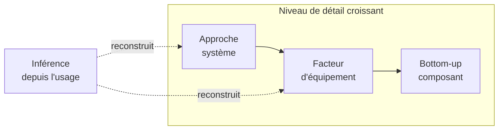
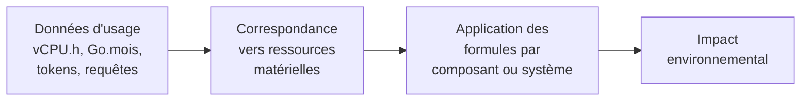
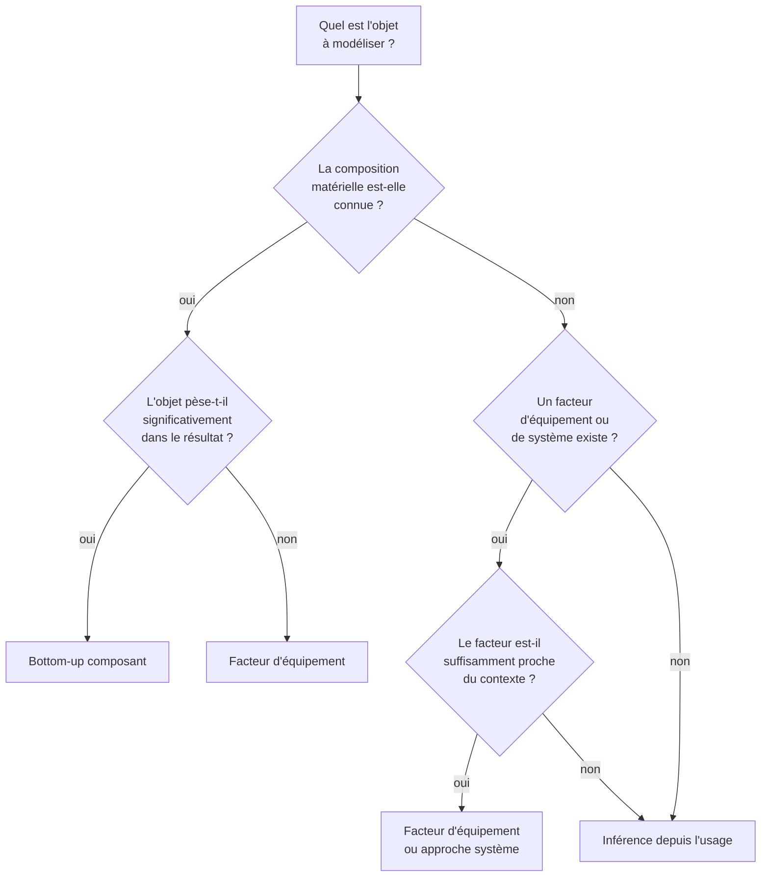
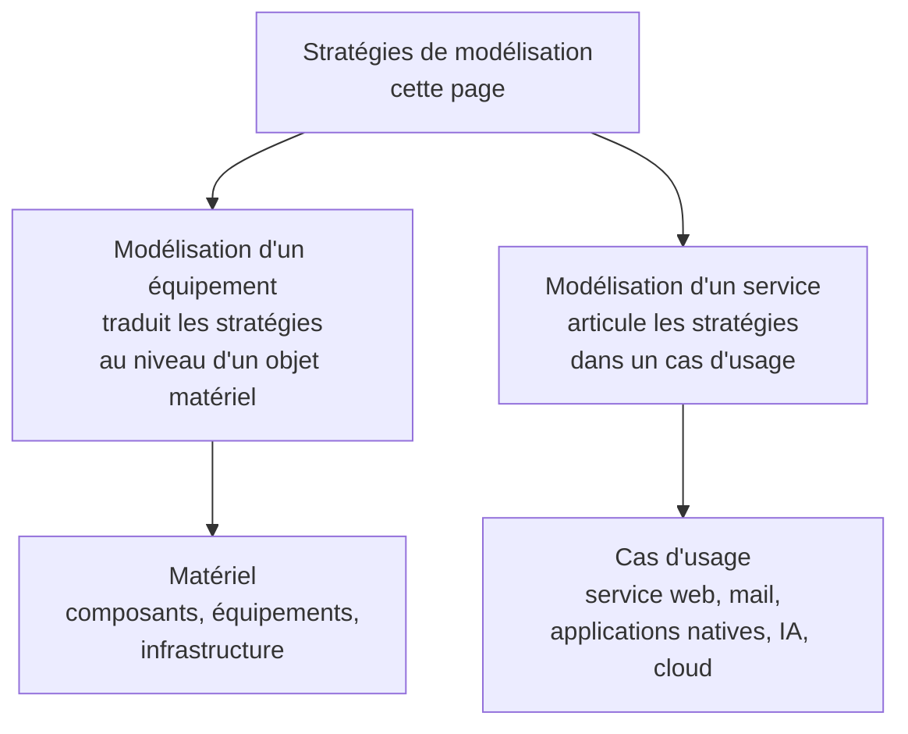

# Stratégies de modélisation

Tous les objets du numérique ne se modélisent pas de la même façon. Cette page explique quand choisir une approche fine par composants, quand préférer un facteur d'équipement, quand basculer vers une approche système et quand reconstruire un équivalent matériel à partir de données d'usage.

L'objectif n'est pas d'appliquer partout la méthode la plus détaillée possible, mais de choisir le niveau de modélisation le plus robuste au regard des données disponibles, du poids de l'objet dans le résultat et du risque de pseudo-précision.

## Principe

Le RCP mère distingue deux grandes approches :

<dl className="model-profiles">
  

    <dt>Approche équipement</dt>
    <dd>

Chaque équipement utilisé par le service constitue une donnée primaire ou secondaire ; le service est une somme d'usages de chaque équipement, chacun défini par une règle d'allocation.

    </dd>
  

  

    <dt>Approche système</dt>
    <dd>

Un ensemble d'équipements est regroupé en un système (physique ou virtuel) au niveau duquel les impacts ont été déterminés.

    </dd>
  

</dl>

Dans la pratique, la méthodologie Digital4Better utilise **quatre stratégies complémentaires** qui affinent cette distinction :

## Les quatre stratégies

### Vue d'ensemble

### Comparaison des stratégies

| Stratégie | Données nécessaires | Pouvoir de description | Complexité | Cas d'usage typique |
|---|---|---|---|---|
| **Bottom-up composant** | Composition matérielle détaillée (CPU, RAM, stockage, écran...) | Configuration détaillée, exactitude dépendante des données | Élevée | Serveurs connus, GPU pour IA, terminaux critiques |
| **Facteur d'équipement** | Type d'équipement, marque/modèle ou famille | Représentativité du modèle ou de la famille | Faible | Parc informatique, terminaux standards |
| **Approche système** | Facteur agrégé par unité fonctionnelle (Go.an, vCPU.h) | Moyenne du système et de son périmètre | Faible | Réseau WAN, réseau mobile, datacenter opaque |
| **Inférence depuis l'usage** | Données d'usage, de facturation ou de télémétrie | Variable | Moyenne | Cloud, service web, applications natives, IA (FLOPs, GPUh, tokens) |

### Bottom-up composant

L'équipement est décomposé en ses composants physiques. L'impact total est la somme des impacts de chaque composant :

$$
\begin{align*}
&I_{equipement_i} = \sum_{c \in composants} I_{c,i}\htmlClass{unit}{[U_i]}
\end{align*}
$$

Cette stratégie est pertinente quand :
- la composition matérielle est connue ou reconstruisable.
- l'objet évalué est critique dans le résultat.
- la granularité apporte une vraie valeur d'interprétation (identifier quel composant pèse le plus).

Exemples : [Processeurs et accélérateurs](../materiel/composants/processeurs-et-accelerateurs), [Serveurs](../materiel/equipements/serveurs), cas d'[IA générative](../cas-d-usage/services/ia-generative) (décomposition GPU + CPU + RAM + stockage).

### Facteur d'équipement

L'équipement est modélisé comme un tout, via un facteur d'impact par unité de temps ou par quantité de référence :

$$
\begin{align*}
&I_{embodied_{i}} = D_{usage} \times IF_{embodied_{i}}\htmlClass{unit}{[U_i]}
\end{align*}
$$

Cette stratégie est pertinente quand :
- l'objet est connu au niveau équipement mais pas au niveau composant.
- des facteurs suffisamment robustes existent (Base Empreinte, constructeur).
- l'objectif est de rester lisible à coût méthodologique raisonnable.

Exemples : [Terminaux](../materiel/equipements/terminaux), [Équipements réseau actifs](../materiel/equipements/equipements-reseau-actifs), [Parc informatique](../cas-d-usage/environnements/parc-informatique).

### Approche système

Le périmètre est assimilé à un périmètre de système défini avec un facteur d'impact agrégé par unité fonctionnelle (1 Go transféré, 1 Go stocké pendant 1 an, etc.) :

$$
\begin{align*}
&I_{systeme_{i}} = Q \times CF_{i}\htmlClass{unit}{[U_i]}
\end{align*}
$$

Où $Q$ est la quantité d'usage (volume, durée, nombre de requêtes) et $CF_i$ le facteur de conversion du système.

Cette stratégie est pertinente quand :
- le périmètre support est partagé ou opaque.
- les ressources individuelles ne sont pas observables.
- un facteur de système est plus fiable qu'une décomposition spéculative.

Exemples : [Réseau](../materiel/reseau-et-infrastructure/reseau) (LAN, WAN, RAN, CDN), certains [Datacenter](../materiel/reseau-et-infrastructure/datacenter).

### Inférence depuis l'usage

On part de données d'usage (facturation cloud, télémétrie, analytics) pour reconstruire un équivalent matériel calculable :

Cette stratégie est pertinente quand :
- l'infrastructure physique sous-jacente n'est pas directement connue.
- il faut reconstruire un équivalent matériel calculable.
- les données d'usage sont la meilleure information disponible.

Exemples : [Cloud](../cas-d-usage/environnements/cloud), [Service web](../cas-d-usage/services/service-web), [IA générative](../cas-d-usage/services/ia-generative) (FLOPs → GPUh → impact).

## Arbre de décision

## Application concrète

**Cas : évaluer l'infrastructure d'un service web**

Le service web tourne sur 3 VM dans un cloud public, utilise un CDN et sert des utilisateurs via terminaux fixes et mobiles.

| Couche | Données disponibles | Stratégie retenue | Justification |
|---|---|---|---|
| **Terminaux** | Mix d'équipements (60 % mobile, 40 % desktop) | Facteur d'équipement | Archétypes standards suffisants |
| **Réseau WAN** | Volume transféré (Go), pays d'origine | Approche système | Facteur compatible avec le segment ; distance seulement si son unité la requiert |
| **CDN** | Volume transféré, taux de cache | Approche système | Séparer trajet origine-CDN, trajet CDN-utilisateur et calcul/stockage CDN ; le cache ne réduit pas tous les flux |
| **Serveurs (VM cloud)** | 3 VM : 4 vCPU, 16 Go RAM, 100 Go SSD chacune | Inférence depuis l'usage | Correspondance vCPU/RAM/stockage → composants |
| **Base de données** | Service managé, 8 vCPU, 32 Go RAM | Inférence depuis l'usage | Correspondance vers ressources équivalentes |

Résultat : trois stratégies coexistent dans la même évaluation, chacune au niveau le plus robuste pour sa couche.

## Cohérence entre stratégies

Quand plusieurs stratégies coexistent dans une même évaluation[^donnees-modele] :

1. **Documenter** le choix de stratégie pour chaque couche ou composant.
2. **Vérifier** que les frontières ne se chevauchent pas (voir [Double comptabilisation](../regles/double-comptabilisation)).
3. **Vérifier** que les règles d'allocation restent cohérentes (voir [Allocation et partage des impacts](../regles/allocation-et-partage-des-impacts)).
4. **Signaler** les changements de granularité qui pourraient affecter l'interprétation.

## Articulation avec les autres pages

## Hypothèses et limites

- Une méthode plus fine n'est pas toujours plus juste ; une méthode plus forfaitaire n'est pas forcément moins crédible si elle est mieux documentée.
- Plusieurs stratégies peuvent coexister dans une même évaluation, à condition de garder une traçabilité claire.
- La frontière entre approche équipement et approche système n'est pas toujours nette ; certains objets changent de stratégie selon la qualité des données disponibles.
- Cette page donne un cadre de choix mais ne remplace pas les règles détaillées des chapitres spécialisés.

Contexte documentaire pour les données, sans validation des valeurs par défaut.[^source-3]

[^source-3]: [Boavizta Documentation](https://doc.api.boavizta.org/) Documentation en ligne, version non figée.

[^donnees-modele]: `digital4better/data` → `data/equipment/*`, `data/cloud/*`, `data/factor/*`. [Digital4Better, catalogue de données, instantané 77cae4a](https://github.com/digital4better/data/tree/77cae4a58fadd5deb3b8d4e5577020da08f780d8).
