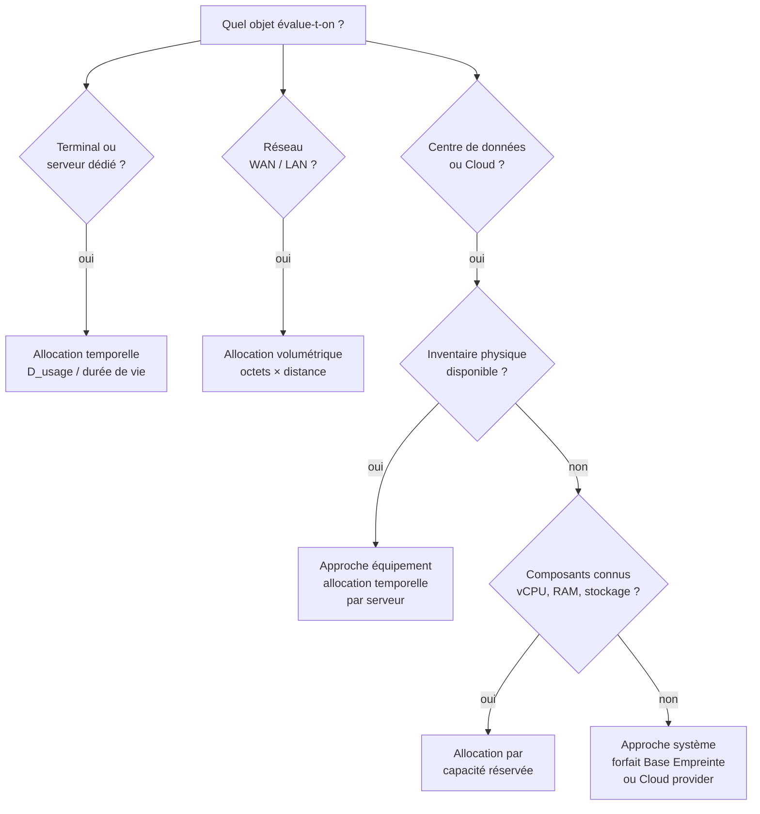

# Allocation et partage des impacts

## En bref

Un équipement, une infrastructure ou un service supporte souvent plusieurs usages, utilisateurs ou services en même temps. L'allocation sert à définir quelle part d'impact peut être attribuée à l'objet évalué. C'est un choix méthodologique structurant : il influe directement sur le résultat et doit donc être explicite, justifié et stable au sein d'une même famille d'évaluations.

## Pourquoi l'allocation est structurante

L'allocation n'est pas un paramètre secondaire. Un même serveur physique partagé entre trois services peut voir son impact attribué à parts égales, au prorata du temps d'usage ou au prorata des ressources réservées -- et le résultat par service peut varier d'un facteur 2 à 5 selon la règle choisie. Ce choix doit donc être :

- **explicite** : la règle d'allocation est documentée dans chaque évaluation ;
- **justifié** : le critère retenu est relié à la fonction rendue ou à la ressource sollicitée ;
- **stable** : au sein d'une même campagne d'évaluation, la même règle est appliquée à des objets comparables ;
- **calculable** : les données nécessaires sont disponibles ou estimables de manière traçable.

:::note[Posture méthodologique]
La méthodologie privilégie des allocations simples et traçables plutôt qu'une pseudo-précision non reproductible. Lorsqu'un choix est arbitraire, il vaut mieux le documenter que le masquer dans un calcul complexe.
:::

## Principales familles d'allocation

Le tableau ci-dessous résume les familles d'allocation mobilisées dans la méthode, le contexte où elles s'appliquent et leur base physique :

| Famille | Base d'allocation | Contexte d'usage principal | Variable clé |
|---|---|---|---|
| **Temporelle** | Durée d'usage | Terminaux, serveurs dédiés | $D_{usage}$ |
| **Volumétrique** | Volume de données transférées | Réseau (WAN, LAN, CDN) | $V$ (en octets) |
| **Par capacité réservée** | Ressources provisionnées (vCPU, RAM, stockage) | Centres de données, Cloud, VM | $N_{vcpu}$, $N_{ram}$, $V_{storage}$ |
| **Par nombre d'utilisateurs** | Utilisateurs actifs ou déclarés | Services partagés, SaaS | $N_{users}$ |
| **Forfaitaire documentée** | Part fixe conventionnelle | Cas où aucune donnée d'usage n'est disponible | Part documentée |

## Mécanismes d'allocation

### Allocation temporelle

L'allocation temporelle est la règle par défaut pour les équipements dont l'usage est caractérisé par une durée. Elle s'applique notamment aux terminaux et aux serveurs dédiés.

**Impact intrinsèque** -- la part d'impact de fabrication allouée à un usage est proportionnelle à la durée d'usage rapportée à la durée de vie totale de l'équipement :

$$
\begin{aligned}
&I_{emb_{i}} = D_{usage} \times IF_{emb_{i}} \\
\text{avec} \\
&I_{emb_{i}} = \text{Impact intrinsèque alloué pour l'indicateur } i \htmlClass{unit}{[U_i]} \\
&D_{usage} = \text{Durée d'usage dédiée au service évalué} \htmlClass{unit}{[s]} \\
&IF_{emb_{i}} = \text{Facteur d'impact intrinsèque pour l'indicateur } i \htmlClass{unit}{[U_i/s]}
\end{aligned}
$$

Lorsque le facteur d'impact est fourni pour une durée de vie théorique $TL$ qui diffère de la durée de vie réelle $RL$ de l'équipement, une correction proportionnelle est appliquée :

$$
\begin{aligned}
&IF_{emb_{i}} = TIF_{emb_{i}} \times \frac{TL}{RL} \\
\text{avec} \\
&TIF_{emb_{i}} = \text{Facteur d'impact théorique} \htmlClass{unit}{[U_i/s]} \\
&TL = \text{Durée de vie théorique du référentiel} \htmlClass{unit}{[s]} \\
&RL = \text{Durée de vie réelle observée} \htmlClass{unit}{[s]}
\end{aligned}
$$

:::note[Unités de temps]
Les formules sont données en secondes par convention. En pratique, on travaille souvent en heures ou en années selon le contexte. Voir [Temporalité, vieillissement et versionnement](./temporalite-vieillissement-et-versionnement-des-donnees) pour le détail du calcul des durées de vie réelles.
:::

**Impact opérationnel** -- l'énergie consommée est directement proportionnelle à la durée d'usage :

$$
\begin{aligned}
&E_{elec} = D_{usage} \times P_{elec} \\
\text{avec} \\
&E_{elec} = \text{Consommation électrique} \htmlClass{unit}{[kWh]} \\
&D_{usage} = \text{Durée d'usage} \htmlClass{unit}{[h]} \\
&P_{elec} = \text{Puissance moyenne de l'équipement} \htmlClass{unit}{[kW]}
\end{aligned}
$$

### Allocation volumétrique

L'allocation volumétrique est la règle de référence pour les réseaux, où la ressource consommée est proportionnelle au volume de données transférées.

L'impact d'un segment réseau est calculé par :

$$
\begin{aligned}
&SI_{emb_{i}} = V \times L \times CF_{emb_{i}} \\
\text{avec} \\
&V = \text{Volume de données transférées} \htmlClass{unit}{[o]} \\
&L = \text{Longueur du segment réseau} \htmlClass{unit}{[km]} \\
&CF_{emb_{i}} = \text{Facteur de conversion pour l'indicateur } i \htmlClass{unit}{[U_i/o/km]}
\end{aligned}
$$

Cette approche suppose que l'impact d'un réseau est proportionnel à la quantité de données transportées et à la distance parcourue, ce qui est cohérent avec une infrastructure partagée dont la capacité est dimensionnée pour un trafic agrégé.

### Allocation par capacité réservée

Lorsque l'inventaire physique d'un centre de données n'est pas accessible mais que les ressources provisionnées sont connues (vCPU, RAM, stockage), l'allocation repose sur les composants :

$$
\begin{aligned}
&E_{components} = D_{usage} \times (P_{cpu} + P_{gpu} + P_{ram} + P_{storage}) \\
\text{avec} \\
&P_{cpu} = N_{vcpu} \times \left(P_{cpu_{min}} + \tfrac{1}{2}(P_{cpu_{max}} - P_{cpu_{min}})\right) \\
&P_{ram} = N_{ram} \times 0{,}000392 \htmlClass{unit}{[kW]} \\
&P_{storage} = \begin{cases}
1{,}2 \times 10^{-3} \times V_{storage} & \text{si SSD} \\
0{,}65 \times 10^{-3} \times V_{storage} & \text{si HDD}
\end{cases}
\end{aligned}
$$

:::note[vCPU et hyperthreading]
On considère un vCPU comme un thread d'un processeur physique. Par exemple, 8 vCPU correspondent à un processeur 4 cœurs hyperthreadés.
:::

Pour l'impact intrinsèque, les ressources provisionnées sont rapprochées de configurations de référence (machines virtuelles petite, moyenne, grande de la Base Empreinte ou base Cloud Carbon Footprint).

## Arbre de décision

Le choix de la règle d'allocation dépend de la couche évaluée et des données disponibles :

## Application concrète

**Cas : un service web hébergé sur un serveur partagé**

Un serveur physique est partagé entre deux services A et B. On connaît les éléments suivants :

| Paramètre | Valeur |
|---|---|
| Impact intrinsèque total du serveur (GWP) | 1 200 kg CO₂ eq. sur 5 ans |
| Durée d'utilisation du serveur | 5 ans |
| Service A : durée d'usage annuelle | 4 380 h/an (50 % du temps) |
| Service B : durée d'usage annuelle | 2 190 h/an (25 % du temps) |
| Serveur inactif | 2 190 h/an (25 % du temps) |

Avec une **allocation temporelle au prorata du temps actif** :

| | Service A | Service B |
|---|---|---|
| Part du temps actif | 50 / 75 = 66,7 % | 25 / 75 = 33,3 % |
| Impact intrinsèque annuel (GWP) | 240 × 0,667 = **160 kg CO₂ eq.** | 240 × 0,333 = **80 kg CO₂ eq.** |

:::note[Temps inactif]
Dans cet exemple, les 25 % de temps inactif du serveur ne sont attribués à aucun des deux services. C'est un choix cohérent avec une posture attributionnelle : on alloue l'impact proportionnellement à l'usage effectif. Si l'on souhaitait répartir la totalité de l'impact, y compris le temps d'inactivité, il faudrait le documenter explicitement.
:::

## Principes de choix

Une bonne règle d'allocation doit :

1. être **reliée à la fonction rendue** par l'équipement ou le service ;
2. rester **compréhensible** pour un relecteur non spécialiste ;
3. être **calculable** avec les données effectivement disponibles ;
4. **limiter les effets arbitraires** -- une allocation simple est souvent préférable à une pseudo-précision non traçable ;
5. être **cohérente** avec les allocations utilisées dans les autres couches de la même évaluation.

## Hypothèses et limites

- Les allocations mixtes sont parfois nécessaires, notamment pour les services qui combinent temps d'usage, stockage et flux réseau. Dans ce cas, chaque couche peut avoir sa propre règle d'allocation, à condition que l'ensemble reste documenté.
- L'allocation par capacité réservée suppose que les ressources provisionnées reflètent l'usage réel. En cas de surprovisionnement important, le résultat peut surestimer l'impact d'un service sous-utilisé.
- Les facteurs génériques de la Base Empreinte (3 tailles de VM) offrent une granularité limitée. Des travaux sont en cours pour enrichir ce référentiel.
- L'allocation forfaitaire ne doit être utilisée qu'en dernier recours, lorsque aucune donnée d'usage n'est disponible.

## Données mobilisées

- Facteurs d'impact intrinsèques : `digital4better/data` → `data/equipment/*`, `data/factor/*`
- Facteurs réseau : Base Empreinte ADEME (services numériques, lignes réseau fixe et mobile)
- Coefficients de puissance composants : Cloud Jewels, Cloud Carbon Footprint
- Durées de vie : `digital4better/data` → `data/hardware/*`
- Données d'usage mesurées quand elles existent ; à défaut, hypothèses documentées dans le [Registre des hypothèses et valeurs par défaut](../references/registre-des-hypotheses-et-valeurs-par-defaut)

## Sources

- ISO 14040 / ISO 14044
- Référentiel ADEME / ARCEP sur les services numériques (RCP mère)
- [Cloud Carbon Footprint -- Methodology](https://www.cloudcarbonfootprint.org/docs/methodology/)
- Corpus `inputs/md` : Pathfinder Framework, BASF Product Carbon Footprint Methodology
- [digital4better/data](https://github.com/digital4better/data)
