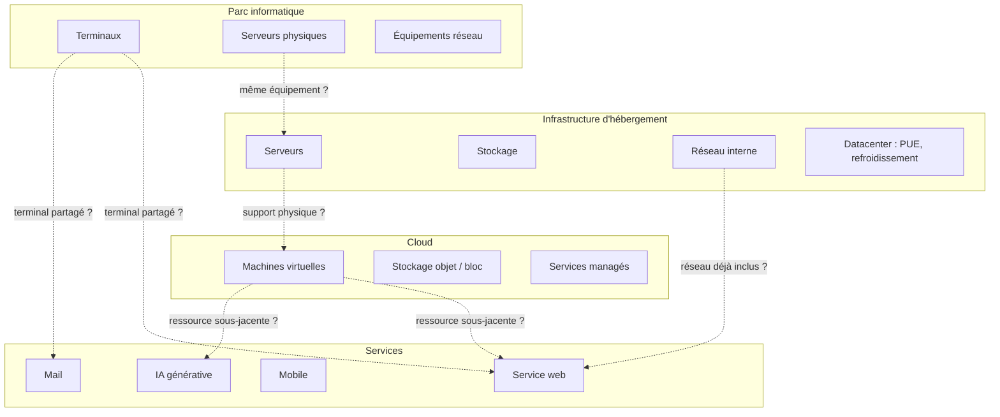

# Double comptabilisation

## En bref

Le numérique se compose de couches qui se recouvrent : un serveur physique appartient à un parc, héberge une infrastructure, fait tourner un service web et peut aussi être facturé comme ressource cloud. Sans règles explicites de frontière, le même impact peut être compté deux, trois ou quatre fois selon les périmètres d'évaluation activés en parallèle.

## Pourquoi la double comptabilisation est un risque réel

La double comptabilisation ne produit pas de message d'erreur. Elle gonfle silencieusement les résultats et rend les évaluations incomparables. Elle survient dès que deux périmètres d'analyse se superposent sans que leurs frontières respectives soient documentées.

Dans une ACV numérique, ce risque est structurel, car la méthode multicouche (terminaux, réseau, centres de données) croise naturellement la logique par cas d'usage (parc, infrastructure, cloud, service).

## Situations à risque

### Recouvrement entre cas d'usage

Le diagramme ci-dessous illustre les zones de recouvrement entre les principaux cas d'usage de la méthode :

### Cas les plus fréquents

| Situation | Ce qui risque d'être compté deux fois | Comment l'éviter |
|---|---|---|
| Un serveur est dans le parc **et** dans l'infrastructure | Impact intrinsèque + opérationnel du serveur | Choisir un seul périmètre propriétaire ; l'autre le référence sans le compter |
| Un service web consomme du cloud déjà évalué | Ressources VM, stockage, réseau | Le service ne compte que sa part d'usage ; le cloud ne recompte pas les mêmes ressources |
| Un CDN est compté dans le réseau **et** dans l'hébergement | Impact intrinsèque des serveurs CDN | Attribuer le CDN à une seule couche (réseau ou hébergement), documenter le choix |
| Des machines virtuelles sont comptées comme des équipements dans le parc | Impact intrinsèque du support physique | Les VM ne sont pas des équipements ; elles sont une règle d'allocation sur un serveur physique |
| Un terminal est utilisé par plusieurs services | Impact du terminal compté N fois | Appliquer une allocation temporelle proportionnelle au temps d'usage de chaque service |

## Règle générale

**Chaque impact physique doit être attribué une seule fois, au niveau d'analyse le plus proche de la ressource réelle.**

Cela implique de distinguer clairement, pour chaque évaluation :

1. **Ce qui est compté directement** : les ressources dont l'impact est calculé dans ce périmètre.
2. **Ce qui est supposé compté ailleurs** : les couches support dont l'impact est porté par un autre cas d'usage.
3. **Ce qui est hors périmètre** : les dépendances explicitement exclues.
4. **Les zones de recouvrement potentielles** : les intersections avec d'autres évaluations qui doivent être vérifiées.

## Matrice de frontière

Pour chaque paire de cas d'usage, la matrice ci-dessous indique qui porte l'impact de la ressource partagée :

| Ressource partagée | Parc | Infrastructure | Cloud | Service |
|---|---|---|---|---|
| **Terminaux utilisateur** | Propriétaire | -- | -- | Allocation temporelle |
| **Serveur physique** | Si inventorié | Si dédié à l'infra | -- | Référence sans compter |
| **VM / conteneur** | -- | Support physique | Unité pivot | Allocation par usage |
| **Réseau interne (LAN)** | Si inventorié | Inclus dans le DC | -- | Référence sans compter |
| **Réseau externe (WAN)** | -- | -- | Transféré en Go | Allocation volumétrique |
| **CDN** | -- | -- | Si facturé séparément | Allocation volumétrique |
| **Stockage** | Si inventorié | Si dédié | Unité pivot (Go.mois) | Référence sans compter |
| **PUE / refroidissement** | -- | Inclus | Inclus via provider | Référence sans compter |

:::note[Comment lire cette matrice]
Chaque ligne représente une ressource physique ou logique. Les colonnes indiquent quel cas d'usage est responsable du calcul d'impact. « -- » signifie que ce cas d'usage ne compte pas cette ressource. « Référence sans compter » signifie que le cas d'usage documente la dépendance mais ne calcule pas l'impact.
:::

## Application concrète

**Cas : un service web hébergé sur le cloud, évalué en même temps qu'un audit infrastructure**

Une organisation évalue en parallèle :
- son **infrastructure d'hébergement** (audit datacenter) ;
- son **service web** principal (ACV service).

Le service web tourne sur 4 VM dans un cloud public. Le datacenter de l'organisation héberge d'autres applications mais pas ce service.

| Composant | Infrastructure d'hébergement | Service web |
|---|---|---|
| Serveurs physiques du DC | **Compté** (approche équipement) | Non compté (pas dans ce DC) |
| VM cloud du service web | Non compté (cloud externe) | **Compté** (approche composant cloud) |
| Terminaux des utilisateurs | Non compté | **Compté** (allocation temporelle) |
| Réseau WAN | Non compté | **Compté** (allocation volumétrique) |
| Réseau LAN du DC | **Compté** (forfait LAN) | Non compté |

Résultat : aucun recouvrement, car les deux périmètres n'ont pas de ressources physiques en commun.

**Contre-exemple** : si le service web était hébergé dans le datacenter de l'organisation, les serveurs apparaîtraient dans les deux périmètres. Il faudrait alors choisir : soit l'infrastructure porte l'impact des serveurs et le service ne compte que sa part d'usage (allocation temporelle), soit le service calcule son propre impact serveur et l'infrastructure exclut ces machines.

## Protocole de vérification

Pour toute évaluation impliquant plusieurs cas d'usage, vérifier :

1. Lister toutes les ressources physiques mobilisées par chaque cas d'usage.
2. Identifier les ressources qui apparaissent dans plus d'un périmètre.
3. Pour chaque doublon, attribuer la responsabilité du calcul à un seul cas d'usage.
4. Documenter les exclusions et les dépendances dans la section « Risque de double comptage » de chaque page.

## Hypothèses et limites

- La prévention du double comptage dépend autant de la structure documentaire que du calcul lui-même. Une bonne documentation des périmètres est la première ligne de défense.
- Les interfaces entre `Cloud`, `Infrastructure d'hébergement`, `Parc informatique` et les services (`Service web`, `Mail`, `Mobile`, `IA générative`) demandent une vigilance particulière.
- Dans les environnements hybrides (cloud + on-premise), la frontière peut être floue. Le principe directeur reste : **une ressource physique, un seul propriétaire d'impact**.
- Les services managés (bases de données cloud, fonctions serverless) rendent l'identification des ressources physiques plus difficile. La méthode recommande de documenter la correspondance utilisée.

## Données mobilisées

- Métadonnées de périmètre de chaque cas d'usage
- Hypothèses d'allocation documentées dans [Allocation et partage des impacts](./allocation-et-partage-des-impacts)
- Documentation des cas d'usage du corpus

## Sources

- ISO 14040 / ISO 14044
- Référentiel ADEME / ARCEP sur les services numériques
- Pathfinder Framework (PACT) -- règles de périmètre et d'attribution
- Retour d'expérience du corpus numérique
