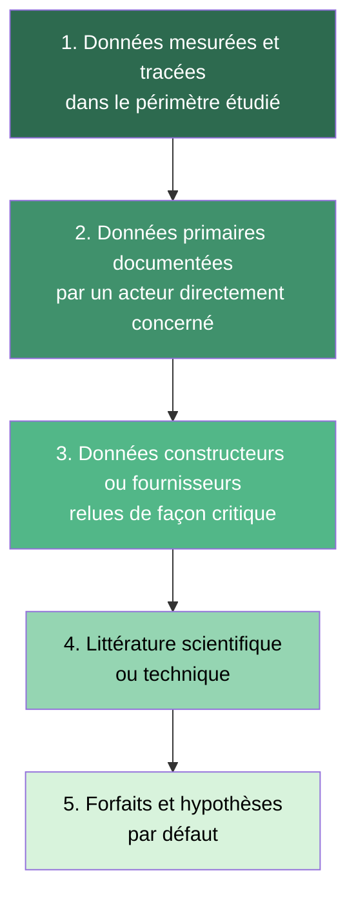
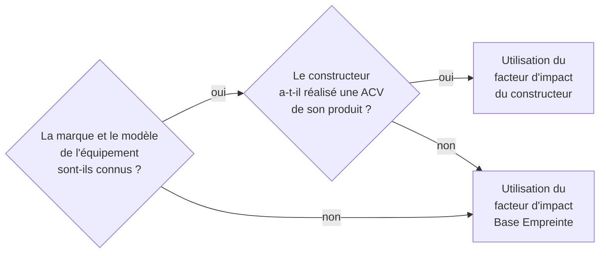

# Hypothèses, valeurs par défaut et hiérarchie des sources

## En bref

Une évaluation du numérique repose toujours sur un mélange de mesures, de déclarations, de littérature et de valeurs par défaut. Cette page fixe l'ordre de priorité entre ces sources, les conditions d'usage des substitutions et les règles de traçabilité des hypothèses.

## Pourquoi cette hiérarchie est nécessaire

Sans hiérarchie explicite, deux évaluateurs confrontés au même objet peuvent mobiliser des sources différentes et obtenir des résultats divergents -- non pas parce que la méthode est défaillante, mais parce que le choix des données d'entrée n'est pas normé. Cette page vise à réduire cette variabilité en établissant un ordre de préférence documenté et des règles de substitution claires.

## Hiérarchie des sources

La méthode distingue cinq niveaux de sources, du plus fiable au moins fiable :

| Niveau | Type | Exemple concret | Quand l'utiliser |
|---|---|---|---|
| 1 | Mesurée | Relevé compteur électrique du datacenter, inventaire CMDB exhaustif | Toujours, quand disponible |
| 2 | Primaire documentée | Déclaration du fournisseur cloud avec détail des ressources, rapport d'audit | Quand la mesure directe n'est pas possible |
| 3 | Constructeur / fournisseur | ACV produit Dell, fiche HP, rapport de durabilité Microsoft | Quand le modèle exact est connu mais la mesure non disponible |
| 4 | Littérature | Facteur IMEC NetZero, étude UNECE, article scientifique peer-reviewed | Quand aucune donnée spécifique n'est accessible |
| 5 | Forfait par défaut | Facteur Base Empreinte par famille, valeur conventionnelle d4b/data | En dernier recours, toujours documenté |

:::note[Principe directeur]
La source la plus proche du contexte étudié est toujours préférable, même si elle est moins prestigieuse. Un relevé de consommation interne est plus utile qu'un facteur littéraire publié dans une revue de premier plan.
:::

## Arbre de décision pour les facteurs d'impact

Pour les facteurs d'impact intrinsèques et les consommations électriques des équipements, la méthode applique l'arbre de décision suivant :

:::note
Les données constructeurs ne sont pas toujours fiables et surtout peu comparables entre elles. Les périmètres diffèrent, les résultats ne sont pas tous certifiés et les méthodologies pas toujours partagées. Toutefois, elles fournissent généralement une estimation plus proche du périmètre réel que l'application systématique de facteurs génériques. L'évolution des référentiels pourrait amener à réinterroger ce choix.
:::

## Référentiels de facteurs d'impacts

Sauf indication spécifique, les facteurs d'impacts mobilisés dans la méthode sont issus des référentiels suivants :

| Référentiel | Périmètre | Données fournies | Granularité | Origine |
|---|---|---|---|---|
| Données constructeur | Équipement, hébergement | CO₂ eq., consommation électrique | Modèle | ACV produit constructeur |
| Base Empreinte (ADEME) | Équipement, hébergement | Multi-indicateurs (9) | Famille | Travaux NegaOctet |
| Base Empreinte (ADEME) | Réseau | Multi-indicateurs (9) | Unité fonctionnelle | Travaux NegaOctet |
| `digital4better/data` | Électricité, cloud, matériel, géographie | Facteurs, conventions | Référentiel versionné | Digital4Better |

### Détail des familles `digital4better/data`

Le référentiel canonique `digital4better/data` est organisé en familles de données complémentaires :

| Famille | Contenu | Fréquence de mise à jour |
|---|---|---|
| `data/factor/*` | Facteurs d'impact par technologie de production d'électricité | Mensuelle |
| `data/energy/*` | Mix électriques nationaux et régionaux | Mensuelle |
| `data/cloud/*` | Correspondances services cloud → ressources matérielles | Trimestrielle |
| `data/hardware/*` | Caractéristiques matérielles (composants, puissances) | Variable |
| `data/equipment/*` | Facteurs d'impact par type d'équipement | Variable |
| `data/country/*` | Facteurs de distance réseau par pays | Annuelle |

## Focus sur la Base Empreinte de l'ADEME

La Base Empreinte regroupe des données et référentiels pour réaliser des analyses de cycle de vie et des bilans GES. Dans le cadre des ACV numériques, une contribution importante est disponible sous la forme d'un tableur rassemblant une partie des travaux du consortium NegaOctet.

On y retrouve :
- des facteurs **multi-indicateurs** établis pour des équipements (ordinateur, smartphone, serveur...) ;
- des facteurs établis pour certains **services numériques**, définis par une unité fonctionnelle précise (ex. : stocker 1 Go de données dans le cloud pendant 1 an) ;
- une base officielle utile pour cadrer certains **forfaits**.

### Points de vigilance

| Point | Risque | Recommandation |
|---|---|---|
| Quantité de référence | Le facteur peut être exprimé pour 1 an, 1 Go, etc. | Toujours vérifier l'unité avant d'appliquer |
| Durée de vie implicite | Peut différer de la durée réelle observée | Appliquer la correction $TL/RL$ (voir [Allocation](./allocation-et-partage-des-impacts)) |
| Périmètre couvert | Certaines phases ACV sont incluses ou exclues | Vérifier la description technologique |
| Localisation | Souvent "Asie" ou "France" | Adapter si le contexte géographique diffère |
| Valeurs négatives | Water Use négatif pour certains équipements | Lié à l'estimation des impacts de fin de vie ; documenter |

## Règles de substitution

Quand une donnée n'est pas disponible au niveau de préférence souhaité, la substitution doit respecter quatre conditions :

1. **Être documentée** : indiquer quelle donnée a été substituée, par quoi, et pourquoi.
2. **Utiliser la source la plus proche du contexte** : un facteur pour un modèle similaire est préférable à un facteur générique.
3. **Rester cohérente avec le reste du modèle** : ne pas mélanger des facteurs ACV complets avec des facteurs carbone-seul sans le signaler.
4. **Être inscrite dans le registre central** si elle est amenée à se répéter dans d'autres évaluations.

### Exemples de substitutions courantes

| Situation | Donnée manquante | Substitution retenue | Justification |
|---|---|---|---|
| Serveur sans ACV constructeur | Facteur intrinsèque du modèle | Facteur Base Empreinte "serveur" | Seule donnée multicritère disponible |
| Pays sans mix électrique mensuel | Facteur d'impact électrique mensuel | Facteur annuel du même pays | Granularité temporelle réduite mais même périmètre |
| Équipement réseau inconnu | Facteur par modèle | Facteur système (réseau fixe ou mobile) | Approche système par défaut |
| Durée de vie réelle inconnue | $RL$ pour la correction | Durée de vie nominale de l'organisation | Hypothèse documentée, correction non appliquée |

## Visibilité des hypothèses

Les hypothèses ne doivent jamais être cachées dans les calculs. Elles doivent apparaître :

- dans les sections **Hypothèses et limites** de chaque page locale ;
- dans le [Registre des hypothèses et valeurs par défaut](../references/registre-des-hypotheses-et-valeurs-par-defaut) lorsqu'elles deviennent transverses ;
- dans les métadonnées de l'évaluation quand elles conditionnent le résultat.

:::note[Registre central]
Toute valeur par défaut répétée dans plusieurs pages doit apparaître dans le registre central. Les pages locales peuvent rappeler une hypothèse, mais pas recréer un registre parallèle.
:::

## Hypothèses et limites

- Les valeurs par défaut ne sont pas des vérités générales ; elles sont des conventions de travail. Elles peuvent et doivent être remplacées dès qu'une donnée de meilleur niveau est disponible.
- Une valeur plus précise mais non traçable doit parfois être rejetée au profit d'un forfait documenté. La traçabilité prime sur la précision apparente.
- Certaines données constructeurs restent utiles mais sont peu comparables entre elles. Leur mobilisation doit rester critique et s'accompagner d'une évaluation de robustesse (voir [Qualité des données et matrice de robustesse](./qualite-des-donnees-et-matrice-de-robustesse)).

## Données mobilisées

- [Registre des hypothèses et valeurs par défaut](../references/registre-des-hypotheses-et-valeurs-par-defaut)
- Référentiel `digital4better/data`
- Base Empreinte / ADEME

## Sources

- ISO 14040 / ISO 14044
- Référentiel ADEME / ARCEP sur les services numériques
- [digital4better/data](https://github.com/digital4better/data)
- Corpus `inputs/md`
- Base Empreinte / ADEME
