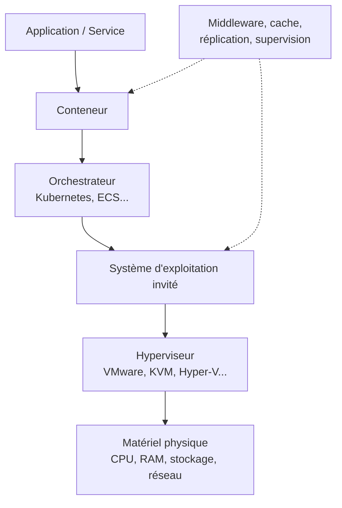

# Prise en compte des couches logicielles et de la virtualisation

import { MethodIllustration } from '@site/src/components/method-illustrations';

Le logiciel n'est pas immatériel. Sans ajouter directement de masse physique, il modifie la façon dont les ressources matérielles sont sollicitées, partagées et parfois surprovisionnées. La virtualisation, les conteneurs et les couches d'orchestration introduisent un niveau d'abstraction supplémentaire entre le service évalué et le matériel réel. La méthode doit rendre cette abstraction explicite pour que l'allocation reste traçable.

## Pourquoi cette section est nécessaire

Dans un datacenter moderne, un service ne s'exécute presque jamais directement sur le matériel. Entre le processeur physique et l'application, on trouve typiquement un hyperviseur, un système d'exploitation invité, éventuellement un moteur de conteneurs et un orchestrateur. Chaque couche consomme des ressources (CPU, mémoire, réseau) et introduit un overhead qui doit être pris en compte ou explicitement exclu de l'évaluation.

## Stack logiciel type

## Ce que cette section couvre

| Couche | Exemples | Effet sur l'impact |
|---|---|---|
| **Hyperviseur** | VMware ESXi, KVM, Hyper-V, Xen | Overhead CPU/mémoire, partage des ressources physiques |
| **Système d'exploitation** | Linux, Windows Server | Consommation de base, services système |
| **Conteneurs et orchestration** | Docker, Kubernetes, ECS | Mutualisation fine, overhead réseau et stockage |
| **Middleware** | Serveurs d'applications, caches, bases de données | Consommation additionnelle, réplication |
| **Supervision et sécurité** | Monitoring, firewall, antivirus | Overhead constant, indépendant de la charge applicative |

## Principe méthodologique

La méthode ne cherche pas à attribuer un impact matériel autonome au logiciel en tant qu'objet abstrait. Elle cherche plutôt à intégrer les effets du logiciel sur :

<dl className="model-profiles">
  

    <dt>Consommation d'énergie</dt>
    <dd>

Les couches intermédiaires consomment de l’énergie supplémentaire.

    </dd>
  

  

    <dt>Partage des ressources</dt>
    <dd>

Les impacts sont alloués entre les services co-localisés.

    </dd>
  

  

    <dt>Duplication des flux</dt>
    <dd>

La réplication, les caches et les journaux ajoutent des flux.

    </dd>
  

  

    <dt>Sollicitation de l'infrastructure support</dt>
    <dd>

Les couches logicielles sollicitent aussi le réseau interne et le stockage partagé.

    </dd>
  

</dl>

:::note[Principe directeur]
L'impact est toujours porté par le matériel physique. Les couches logicielles ne créent pas d'impact en soi ; elles déterminent comment l'impact du matériel est réparti et amplifié.
:::

## Virtualisation et mutualisation {#virtualisation-et-mutualisation}

### Approche par ressources virtuelles

Quand plusieurs services partagent un même serveur physique via la virtualisation, l'allocation repose sur les ressources virtuelles attribuées à chaque service. Les trois dimensions d'allocation sont :

| Dimension | Variable | Formule d'allocation |
|---|---|---|
| **Calcul** (CPU) | vCPU | $A^{sv}_n = \dfrac{vCPU_n}{\sum_k vCPU_k}$ [^source-5]|
| **Stockage** | Volume disque | $A^{st}_n = \dfrac{vDisk_n}{\sum_k vDisk_k}$ |
| **Réseau** | Bande passante | $A^{nw}_n = \dfrac{vNIC_n}{\sum_k vNIC_k}$ |

:::note[vCPU et cœurs physiques]
Un vCPU peut correspondre à un thread matériel dans certaines offres, mais la correspondance dépend du fournisseur, de l'architecture, du SMT et du surengagement. Huit vCPU ne prouvent pas une réservation de quatre cœurs physiques. Documenter cette correspondance avant toute conversion ; les ratios d'allocation entre VM doivent rester normalisés.
:::

<MethodIllustration kind="virtualization" lang="fr" />

### Allocation de l'infrastructure support

L'infrastructure support (refroidissement, alimentation, réseau interne) n'est pas directement attribuable à un service via les ressources virtuelles. Son allocation combine les trois dimensions :

$$
\begin{aligned}
&A^{infra}_n = A^{sv}_n \times \frac{I_{serveurs}}{I_{IT}} + A^{st}_n \times \frac{I_{stockage}}{I_{IT}} + A^{nw}_n \times \frac{I_{réseau}}{I_{IT}} \\
\text{avec} \\
&A^{infra}_n = \text{Part d'infrastructure attribuée au service } n \\
&I_{serveurs}, I_{stockage}, I_{réseau} = \text{Impacts respectifs des serveurs, stockage, réseau} \\
&I_{IT} = \text{Somme des impacts des trois familles IT utilisées pour la pondération}
\end{aligned}
$$

Les pondérations doivent sommer à 1, sur des familles non chevauchantes. Ne pas inclure l'infrastructure support au dénominateur puis l'allouer à nouveau. Si les impacts utilisés comme poids sont nuls ou négatifs, choisir une autre clé physique documentée plutôt que diviser par zéro ou produire des parts négatives. La mémoire peut être une famille distincte, ou être incluse explicitement dans la famille serveurs.

Le PUE intervient au niveau de l'impact opérationnel global pour intégrer la consommation des équipements de support :[^source-4]

$$
\begin{aligned}
&E_{total} = E_{IT} \times PUE \\
\text{avec} \\
&E_{IT} = \text{Consommation des équipements informatiques} \htmlClass{unit}{[kWh]} \\
&PUE = \text{Power Usage Effectiveness (1,58 par défaut)}
\end{aligned}
$$

### Approche par composants (quand l'inventaire physique n'est pas accessible)

Quand seules les ressources provisionnées sont connues (vCPU, RAM, stockage), l'impact opérationnel est estimé par composant[^donnees-modele][^source-6] :

$$
\begin{aligned}
&E_{components} = D_{usage} \times (P_{cpu} + P_{gpu} + P_{ram} + P_{storage}) \\
\text{avec} \\
&P_{cpu} = N_{vcpu} \times \left(P_{cpu_{min}} + \tfrac{1}{2}(P_{cpu_{max}} - P_{cpu_{min}})\right) \\
&P_{ram} = N_{ram} \times 0{,}000392 \htmlClass{unit}{[kW]} \\
&P_{storage} = \begin{cases}
1{,}2 \times 10^{-3} \times V_{storage} & \text{si SSD} \\
0{,}65 \times 10^{-3} \times V_{storage} & \text{si HDD}
\end{cases} \htmlClass{unit}{[kW]}
\end{aligned}
$$

Pour l'impact intrinsèque, les ressources provisionnées sont rapprochées des configurations de référence Base Empreinte :

| Taille VM | Configuration | Durée de vie |
|---|---|---|
| Petite | 1 vCPU, 4 Go RAM | 5 ans |
| Moyenne | 8 vCPU, 32 Go RAM | 5 ans |
| Grande | 48 vCPU, 192 Go RAM | 5 ans |

## Conteneurs et microservices

Les conteneurs ajoutent un niveau de granularité supplémentaire par rapport aux VM :

- **Avantage** : overhead plus faible (pas d'OS invité complet), allocation plus fine possible
- **Difficulté** : densité plus élevée, partage de l'OS hôte, métriques plus volatiles

La même logique s'applique, en distinguant demandes (`requests`), plafonds (`limits`) et consommation mesurée. Un plafond n'est pas une réservation ni une mesure. Retenir la clé adaptée à l'objectif, et attribuer explicitement la capacité inutilisée ainsi que les services de contrôle.

### Services managés et serverless

Pour les services managés (bases de données cloud, fonctions serverless), l'identification des ressources physiques est plus difficile. La méthode recommande :

1. **Identifier l'unité de facturation** la plus proche d'une ressource physique (vCPU.h, Go.mois, nombre d'exécutions × durée).
2. **Documenter la correspondance** entre cette unité et les ressources matérielles équivalentes.
3. **Appliquer les formules** d'allocation par composant avec les ressources estimées.
4. **Signaler l'incertitude** : le niveau de confiance est nécessairement plus faible que pour une VM dont les ressources sont explicites.

## Application concrète

**Cas : allocation d'un serveur physique entre 3 services virtualisés**

Un serveur physique (64 cœurs, 256 Go RAM, 4 To SSD) héberge 3 services via des VM :

| Service | vCPU | RAM (Go) | Stockage (To) |
|---|---|---|---|
| API web | 16 | 64 | 1,0 |
| Base de données | 32 | 128 | 2,0 |
| Batch analytics | 16 | 32 | 0,5 |
| **Total virtuel** | **64** | **224** | **3,5** |

Facteurs d'allocation :

| Service | $A^{sv}$ (CPU) | $A^{st}$ (stockage) | $A^{nw}$ (estimé = CPU) |
|---|---|---|---|
| API web | 25 % | 28,6 % | 25 % |
| Base de données | 50 % | 57,1 % | 50 % |
| Batch analytics | 25 % | 14,3 % | 25 % |

Si l'impact intrinsèque total du serveur est de 1 200 kg CO₂ eq. (GWP) sur 5 ans et que l'on utilise une pondération CPU à 60 %, stockage à 30 %, réseau à 10 % :

$$
\begin{aligned}
A^{infra}_{API} &= 0{,}25 \times 0{,}60 + 0{,}286 \times 0{,}30 + 0{,}25 \times 0{,}10 = 26{,}1\% \\
A^{infra}_{BDD} &= 0{,}50 \times 0{,}60 + 0{,}571 \times 0{,}30 + 0{,}50 \times 0{,}10 = 52{,}1\% \\
A^{infra}_{Batch} &= 0{,}25 \times 0{,}60 + 0{,}143 \times 0{,}30 + 0{,}25 \times 0{,}10 = 21{,}8\%
\end{aligned}
$$

Impact intrinsèque annuel (GWP) par service :

| Service | Part infra | Impact annuel |
|---|---|---|
| API web | 26,1 % | **62,6 kg CO₂ eq.** |
| Base de données | 52,1 % | **125,1 kg CO₂ eq.** |
| Batch analytics | 21,8 % | **52,3 kg CO₂ eq.** |

## Hypothèses et limites

**Inventaire.** Les surcoûts logiciels sont rarement mesurés en détail. L’hyperviseur, l’OS et l’orchestrateur peuvent être inclus dans la mesure hôte ou le facteur. Sinon, leur contribution complète le calcul ou reste une lacune explicite. Le matériel des services managés et serverless est moins observable, ce qui limite la confiance dans les données.

**Allocation.** La réservation attribue aussi la capacité immobilisée mais peu utilisée. Elle répond à une autre question que l’allocation par consommation, sans être automatiquement plus précise. Le traitement de la capacité inactive est documenté et les totaux sont conservés.

**Configurations.** Les anciens forfaits VM sont obsolètes pour la méthode cible. Une configuration intermédiaire est calculée par composants, puis allouée, sans interpolation de ces forfaits.

**Paramètres.** Les puissances moyennes Cloud Jewels / Cloud Carbon Footprint, notamment 0,000392 kW/Go pour la RAM et 1,2×10⁻³ kW/To pour le SSD, ne décrivent pas tous les équipements.[^source-3] Le PUE de 1,58 reste un scénario historique, pas une moyenne actuelle vérifiée.[^source-4]

[^source-3]: [Cloud Carbon Footprint -- Methodology](https://www.cloudcarbonfootprint.org/docs/methodology/) Documentation en ligne, version non figée.

[^source-4]: [Uptime Institute -- Global PUEs](https://journal.uptimeinstitute.com/global-pues-are-they-going-anywhere/)

[^source-5]: UBA, [Green Cloud Computing](https://www.umweltbundesamt.de/publikationen/green-cloud-computing), 2021. Green Cloud Computing (UBA, 2021) -- allocation par ressources virtuelles Voir le [corpus documentaire](../references/sources-et-corpus).

[^source-6]: Digital4Better, [digital4better/data](https://github.com/digital4better/data) Catalogue évolutif ; utiliser un commit pour figer les facteurs.

[^donnees-modele]: Facteurs d'impact par composant : Cloud Jewels, Cloud Carbon Footprint. Configurations de référence VM : Base Empreinte ADEME (NegaOctet). `digital4better/data` → `data/cloud/*`, `data/equipment/*`. [Digital4Better, catalogue de données, instantané 77cae4a](https://github.com/digital4better/data/tree/77cae4a58fadd5deb3b8d4e5577020da08f780d8). Références et portée : [Sources et corpus](../references/sources-et-corpus).
