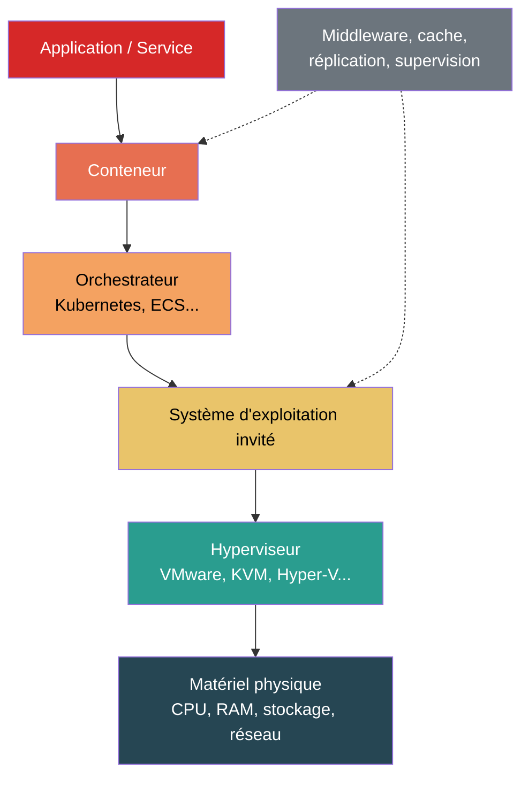

# Prise en compte des couches logicielles et de la virtualisation

## En bref

Le logiciel n'est pas immatériel. Sans ajouter directement de masse physique, il modifie la façon dont les ressources matérielles sont sollicitées, partagées et parfois surprovisionnées. La virtualisation, les conteneurs et les couches d'orchestration introduisent un niveau d'abstraction supplémentaire entre le service évalué et le matériel réel. La méthode doit rendre cette abstraction explicite pour que l'allocation reste traçable.

## Pourquoi cette section est nécessaire

Dans un datacenter moderne, un service ne s'exécute presque jamais directement sur le matériel. Entre le processeur physique et l'application, on trouve typiquement un hyperviseur, un système d'exploitation invité, éventuellement un moteur de conteneurs et un orchestrateur. Chaque couche consomme des ressources (CPU, mémoire, réseau) et introduit un overhead qui doit être pris en compte ou explicitement exclu de l'évaluation.

## Stack logiciel type

## Ce que cette section couvre

| Couche | Exemples | Effet sur l'impact |
|---|---|---|
| **Hyperviseur** | VMware ESXi, KVM, Hyper-V, Xen | Overhead CPU/mémoire, partage des ressources physiques |
| **Système d'exploitation** | Linux, Windows Server | Consommation de base, services système |
| **Conteneurs et orchestration** | Docker, Kubernetes, ECS | Mutualisation fine, overhead réseau et stockage |
| **Middleware** | Serveurs d'applications, caches, bases de données | Consommation additionnelle, réplication |
| **Supervision et sécurité** | Monitoring, firewall, antivirus | Overhead constant, indépendant de la charge applicative |

## Principe méthodologique

La méthode ne cherche pas à attribuer un impact matériel autonome au logiciel en tant qu'objet abstrait. Elle cherche plutôt à intégrer les effets du logiciel sur :

- la **consommation d'énergie** (overhead des couches intermédiaires) ;
- le **partage des ressources** (allocation entre services co-localisés) ;
- la **duplication des flux** (réplication, cache, logs) ;
- la **sollicitation de l'infrastructure support** (réseau interne, stockage partagé).

:::note[Principe directeur]
L'impact est toujours porté par le matériel physique. Les couches logicielles ne créent pas d'impact en soi ; elles déterminent comment l'impact du matériel est réparti et amplifié.
:::

## Virtualisation et mutualisation

### Approche par ressources virtuelles

Quand plusieurs services partagent un même serveur physique via la virtualisation, l'allocation repose sur les ressources virtuelles attribuées à chaque service. Les trois dimensions d'allocation sont :

| Dimension | Variable | Formule d'allocation |
|---|---|---|
| **Calcul** (CPU) | vCPU | $A^{sv}_n = \dfrac{vCPU_n}{\sum_k vCPU_k}$ |
| **Stockage** | Volume disque | $A^{st}_n = \dfrac{vDisk_n}{\sum_k vDisk_k}$ |
| **Réseau** | Bande passante | $A^{nw}_n = \dfrac{vNIC_n}{\sum_k vNIC_k}$ |

:::note[vCPU et cœurs physiques]
On considère un vCPU comme un thread d'un processeur physique. Par exemple, 8 vCPU correspondent à un processeur 4 cœurs hyperthreadés. Les ressources virtuelles totales sont généralement supérieures aux ressources physiques réelles, car la virtualisation vise à mutualiser les charges temporellement décalées.
:::

### Allocation de l'infrastructure support

L'infrastructure support (refroidissement, alimentation, réseau interne) n'est pas directement attribuable à un service via les ressources virtuelles. Son allocation combine les trois dimensions :

$$
\begin{aligned}
&A^{infra}_n = A^{sv}_n \times \frac{I_{serveurs}}{I_{dc}} + A^{st}_n \times \frac{I_{stockage}}{I_{dc}} + A^{nw}_n \times \frac{I_{réseau}}{I_{dc}} \\
\text{avec} \\
&A^{infra}_n = \text{Part d'infrastructure attribuée au service } n \\
&I_{serveurs}, I_{stockage}, I_{réseau} = \text{Impacts respectifs des serveurs, stockage, réseau} \\
&I_{dc} = \text{Impact total du datacenter}
\end{aligned}
$$

Le PUE intervient au niveau de l'impact opérationnel global pour intégrer la consommation des équipements de support :

$$
\begin{aligned}
&E_{total} = E_{IT} \times PUE \\
\text{avec} \\
&E_{IT} = \text{Consommation des équipements informatiques} \htmlClass{unit}{[kWh]} \\
&PUE = \text{Power Usage Effectiveness (1,58 par défaut)}
\end{aligned}
$$

### Approche par composants (quand l'inventaire physique n'est pas accessible)

Quand seules les ressources provisionnées sont connues (vCPU, RAM, stockage), l'impact opérationnel est estimé par composant :

$$
\begin{aligned}
&E_{components} = D_{usage} \times (P_{cpu} + P_{gpu} + P_{ram} + P_{storage}) \\
\text{avec} \\
&P_{cpu} = N_{vcpu} \times \left(P_{cpu_{min}} + \tfrac{1}{2}(P_{cpu_{max}} - P_{cpu_{min}})\right) \\
&P_{ram} = N_{ram} \times 0{,}000392 \htmlClass{unit}{[kW/Go]} \\
&P_{storage} = \begin{cases}
1{,}2 \times 10^{-3} \times V_{storage} & \text{si SSD} \\
0{,}65 \times 10^{-3} \times V_{storage} & \text{si HDD}
\end{cases} \htmlClass{unit}{[kW]}
\end{aligned}
$$

Pour l'impact intrinsèque, les ressources provisionnées sont rapprochées des configurations de référence Base Empreinte :

| Taille VM | Configuration | Durée de vie |
|---|---|---|
| Petite | 1 vCPU, 4 Go RAM | 5 ans |
| Moyenne | 8 vCPU, 32 Go RAM | 5 ans |
| Grande | 48 vCPU, 192 Go RAM | 5 ans |

## Conteneurs et microservices

Les conteneurs ajoutent un niveau de granularité supplémentaire par rapport aux VM :

- **Avantage** : overhead plus faible (pas d'OS invité complet), allocation plus fine possible
- **Difficulté** : densité plus élevée, partage de l'OS hôte, métriques plus volatiles

La même logique d'allocation par ressources virtuelles s'applique, avec les demandes de ressources (`requests`) ou les limites (`limits`) Kubernetes comme base d'allocation.

### Services managés et serverless

Pour les services managés (bases de données cloud, fonctions serverless), l'identification des ressources physiques est plus difficile. La méthode recommande :

1. **Identifier l'unité de facturation** la plus proche d'une ressource physique (vCPU.h, Go.mois, nombre d'exécutions × durée).
2. **Documenter la correspondance** entre cette unité et les ressources matérielles équivalentes.
3. **Appliquer les formules** d'allocation par composant avec les ressources estimées.
4. **Signaler l'incertitude** : le niveau de confiance est nécessairement plus faible que pour une VM dont les ressources sont explicites.

## Application concrète

**Cas : allocation d'un serveur physique entre 3 services virtualisés**

Un serveur physique (64 cœurs, 256 Go RAM, 4 To SSD) héberge 3 services via des VM :

| Service | vCPU | RAM (Go) | Stockage (To) |
|---|---|---|---|
| API web | 16 | 64 | 1,0 |
| Base de données | 32 | 128 | 2,0 |
| Batch analytics | 16 | 32 | 0,5 |
| **Total virtuel** | **64** | **224** | **3,5** |

Facteurs d'allocation :

| Service | $A^{sv}$ (CPU) | $A^{st}$ (stockage) | $A^{nw}$ (estimé = CPU) |
|---|---|---|---|
| API web | 25 % | 28,6 % | 25 % |
| Base de données | 50 % | 57,1 % | 50 % |
| Batch analytics | 25 % | 14,3 % | 25 % |

Si l'impact intrinsèque total du serveur est de 1 200 kg CO₂ eq. (GWP) sur 5 ans et que l'on utilise une pondération CPU à 60 %, stockage à 30 %, réseau à 10 % :

$$
\begin{aligned}
A^{infra}_{API} &= 0{,}25 \times 0{,}60 + 0{,}286 \times 0{,}30 + 0{,}25 \times 0{,}10 = 26{,}1\% \\
A^{infra}_{BDD} &= 0{,}50 \times 0{,}60 + 0{,}571 \times 0{,}30 + 0{,}50 \times 0{,}10 = 52{,}1\% \\
A^{infra}_{Batch} &= 0{,}25 \times 0{,}60 + 0{,}143 \times 0{,}30 + 0{,}25 \times 0{,}10 = 21{,}8\%
\end{aligned}
$$

Impact intrinsèque annuel (GWP) par service :

| Service | Part infra | Impact annuel |
|---|---|---|
| API web | 26,1 % | **62,6 kg CO₂ eq.** |
| Base de données | 52,1 % | **125,1 kg CO₂ eq.** |
| Batch analytics | 21,8 % | **52,3 kg CO₂ eq.** |

## Hypothèses et limites

- Les overheads logiciels (hyperviseur, OS, orchestrateur) sont rarement mesurés avec le même niveau de détail que les ressources physiques. La méthode suppose que l'overhead est implicitement inclus dans les ressources virtuelles allouées.
- L'allocation par ressources réservées peut surestimer l'impact d'un service sous-utilisé (surprovisionnement). Une allocation par ressources effectivement consommées serait plus précise mais plus difficile à obtenir.
- Les configurations de référence Base Empreinte (3 tailles de VM) offrent une granularité limitée. Pour des configurations intermédiaires, une interpolation documentée est acceptable.
- Les services managés et serverless restent les plus opaques du point de vue matériel. Le niveau de confiance doit être ajusté en conséquence.
- Les coefficients de puissance par composant (0,000392 kW/Go pour la RAM, 1,2×10⁻³ kW/To pour le SSD) proviennent de Cloud Jewels / Cloud Carbon Footprint et sont des valeurs moyennes.

## Données mobilisées

- Facteurs d'impact par composant : Cloud Jewels, Cloud Carbon Footprint
- Configurations de référence VM : Base Empreinte ADEME (NegaOctet)
- PUE par défaut : 1,58 (Uptime Institute, moyenne mondiale)
- `digital4better/data` → `data/cloud/*`, `data/equipment/*`

## Sources

- ISO 14040 / ISO 14044
- Référentiel ADEME / ARCEP sur les services numériques
- [Cloud Carbon Footprint -- Methodology](https://www.cloudcarbonfootprint.org/docs/methodology/)
- [Uptime Institute -- Global PUEs](https://journal.uptimeinstitute.com/global-pues-are-they-going-anywhere/)
- Green Cloud Computing (UBA, 2021) -- allocation par ressources virtuelles
- [digital4better/data](https://github.com/digital4better/data)
