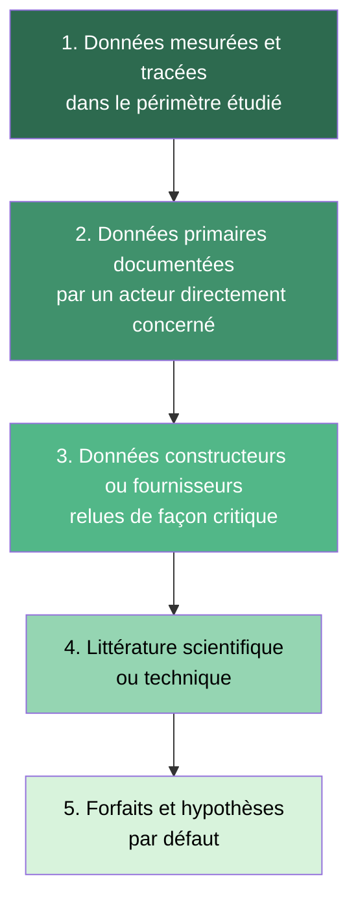
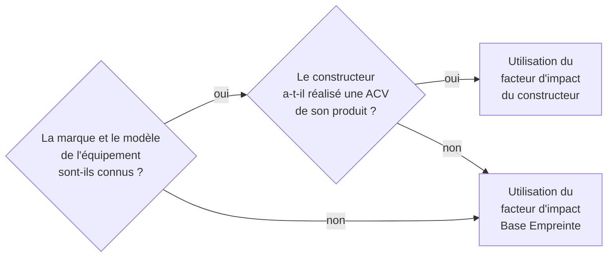

# Qualité des données et matrice de robustesse

## En bref

Toutes les données n'ont pas la même valeur. Une méthode crédible ne se contente pas d'utiliser une source ; elle indique aussi dans quelle mesure cette source permet de faire confiance au résultat. La qualité des données est un axe transversal de la méthode : elle conditionne la fiabilité des résultats, la comparabilité des évaluations et la priorisation des améliorations futures.

## Pourquoi la qualité des données est déterminante

Dans une ACV numérique, les facteurs d'impact peuvent varier d'un ordre de grandeur selon la source choisie. Un facteur constructeur, un facteur Base Empreinte et un forfait littéraire ne produisent pas le même résultat, même pour le même équipement. La qualité des données n'est donc pas un sujet de gouvernance abstraite : elle a un impact direct et mesurable sur les conclusions.

Un résultat accompagné de son niveau de confiance est toujours plus utile qu'un chiffre nu.

## Hiérarchie des données

La méthode établit un ordre de préférence pour les sources de données, du plus fiable au moins fiable :

| Niveau | Type de données | Exemple | Force | Faiblesse |
|---|---|---|---|---|
| 1 | Mesurées, tracées | Consommation électrique relevée sur le compteur du datacenter | Précision maximale | Rarement disponible pour tous les composants |
| 2 | Primaires documentées | Inventaire matériel issu du CMDB de l'organisation | Proximité avec le périmètre | Peut être incomplet ou daté |
| 3 | Constructeurs / fournisseurs | ACV produit publiée par Dell ou HP | Spécifique au modèle | Périmètre variable, non toujours certifié |
| 4 | Littérature | Facteur issu d'une étude IMEC ou UNECE | Revue par les pairs | Générique, peut être daté |
| 5 | Forfait par défaut | Facteur Base Empreinte par famille d'équipement | Toujours disponible | Faible discrimination |

:::note[Données constructeurs]
Les données constructeurs ne sont pas toujours fiables et surtout peu comparables. Les périmètres diffèrent, les résultats ne sont pas tous certifiés et les méthodologies pas toujours partagées. Toutefois, elles fournissent généralement une estimation plus proche du périmètre réel que l'application systématique de facteurs génériques. L'évolution des référentiels et un meilleur cadrage des ACV produits pourraient amener à réinterroger ce choix.
:::

## Matrice de robustesse

La robustesse d'une donnée est évaluée selon six dimensions, chacune notée de 1 (faible) à 5 (forte) :

| Dimension | 1 -- Faible | 3 -- Moyenne | 5 -- Forte |
|---|---|---|---|
| **Précision du périmètre** | Périmètre flou ou implicite | Périmètre documenté mais partiel | Périmètre complet et vérifiable |
| **Précision géographique** | Donnée mondiale ou inconnue | Donnée continentale | Donnée nationale ou régionale |
| **Précision temporelle** | Donnée > 5 ans | Donnée 2-5 ans | Donnée < 2 ans |
| **Granularité physique** | Facteur par grande famille | Facteur par type d'équipement | Facteur par modèle ou composant |
| **Traçabilité de la source** | Source non citée | Source citée, méthode inconnue | Source citée, méthode reproductible |
| **Stabilité méthodologique** | Méthode ad hoc ou non documentée | Méthode publiée | Méthode normalisée (ISO, PEF) |

### Score de robustesse

Le score de robustesse est la moyenne des six dimensions :

$$
\begin{aligned}
&S_{rob} = \frac{1}{6} \sum_{d=1}^{6} N_d \\
\text{avec} \\
&S_{rob} = \text{Score de robustesse} \in [1, 5] \\
&N_d = \text{Note de la dimension } d \in \{1, 2, 3, 4, 5\}
\end{aligned}
$$

### Interprétation

| Score | Interprétation | Action recommandée |
|---|---|---|
| $S_{rob} \geq 4$ | Donnée fiable | Utiliser en confiance |
| $3 \leq S_{rob} < 4$ | Donnée acceptable | Documenter les limites, surveiller les mises à jour |
| $2 \leq S_{rob} < 3$ | Donnée fragile | Signaler l'incertitude dans les résultats, prioriser le remplacement |
| $S_{rob} < 2$ | Donnée insuffisante | Utiliser uniquement en l'absence totale d'alternative, documenter comme lacune |

## Usage de la matrice

La matrice de robustesse sert à :

- **arbitrer entre deux sources** : à périmètre comparable, choisir la source au score le plus élevé ;
- **documenter un résultat** : accompagner les résultats d'un niveau de confiance global ;
- **prioriser les améliorations** : concentrer les efforts sur les données les plus influentes et les moins robustes.

## Application concrète

**Cas : choix du facteur d'impact pour un serveur Dell PowerEdge R750**

| Dimension | Base Empreinte (serveur générique) | ACV constructeur Dell |
|---|---|---|
| Précision du périmètre | 3 -- famille "serveur" | 5 -- modèle spécifique |
| Précision géographique | 3 -- "Asie" | 4 -- sites de fabrication documentés |
| Précision temporelle | 3 -- données NegaOctet ~2021 | 4 -- rapport 2023 |
| Granularité physique | 2 -- facteur par famille | 5 -- détail par composant |
| Traçabilité | 4 -- méthode NegaOctet publiée | 3 -- méthode partiellement documentée |
| Stabilité méthodologique | 4 -- cadre PEF | 3 -- cadre constructeur variable |
| **Score moyen** | **3,2** | **4,0** |

Conclusion : dans ce cas, le facteur constructeur Dell est préféré. Toutefois, seul le GWP est fourni par le constructeur. Pour les autres indicateurs, on utilisera le facteur Base Empreinte en documentant la limite.

:::note[Facteur unique vs multicritère]
Les données constructeurs fournissent souvent uniquement le GWP (kg CO₂ eq.), tandis que la Base Empreinte fournit les 9 indicateurs. Il est acceptable de combiner les deux sources, à condition de documenter cette combinaison et de noter que les indicateurs proviennent de sources différentes.
:::

## Arbre de décision pour le choix du facteur d'impact

:::note
Cette arborescence vaut autant pour les facteurs d'impact intrinsèques que pour les consommations électriques.
:::

## Vigilance sur la Base Empreinte

La Base Empreinte de l'ADEME est un référentiel officiel, mais son utilisation demande une attention particulière sur :

- **la quantité de référence** : certains facteurs sont exprimés pour des quantités ou des durées spécifiques ;
- **la durée de vie implicite** : elle peut différer de la durée réelle observée (voir [Temporalité et vieillissement](./temporalite-vieillissement-et-versionnement-des-donnees)) ;
- **le périmètre effectivement couvert** : certains facteurs incluent ou excluent des phases ACV ;
- **la comparabilité entre facteurs** : des facteurs de familles différentes n'ont pas toujours les mêmes conventions ;
- **les valeurs négatives** : certains indicateurs (Water Use notamment) présentent des valeurs négatives liées à une estimation majorante des impacts de fin de vie.

## Hypothèses et limites

- Une donnée plus détaillée n'est pas automatiquement meilleure si sa traçabilité est faible. La matrice de robustesse intègre cette nuance.
- Le score de robustesse est une aide à la décision, pas un résultat automatique. Le contexte de l'évaluation peut justifier de s'écarter du score le plus élevé.
- La matrice devra être enrichie et outillée dans les itérations suivantes, notamment pour formaliser les arbitrages sur les indicateurs non climatiques.

## Données mobilisées

- Toutes les données mobilisées dans les cas d'usage
- Métadonnées de source et de version
- `digital4better/data` -- documentation des facteurs et de leur origine

## Sources

- ISO 14040 / ISO 14044 (exigences de qualité des données)
- Référentiel ADEME / ARCEP -- Base Empreinte
- Pathfinder Framework (PACT) -- data quality guidelines
- IMEC NetZero -- data quality tiers
- [digital4better/data](https://github.com/digital4better/data)
