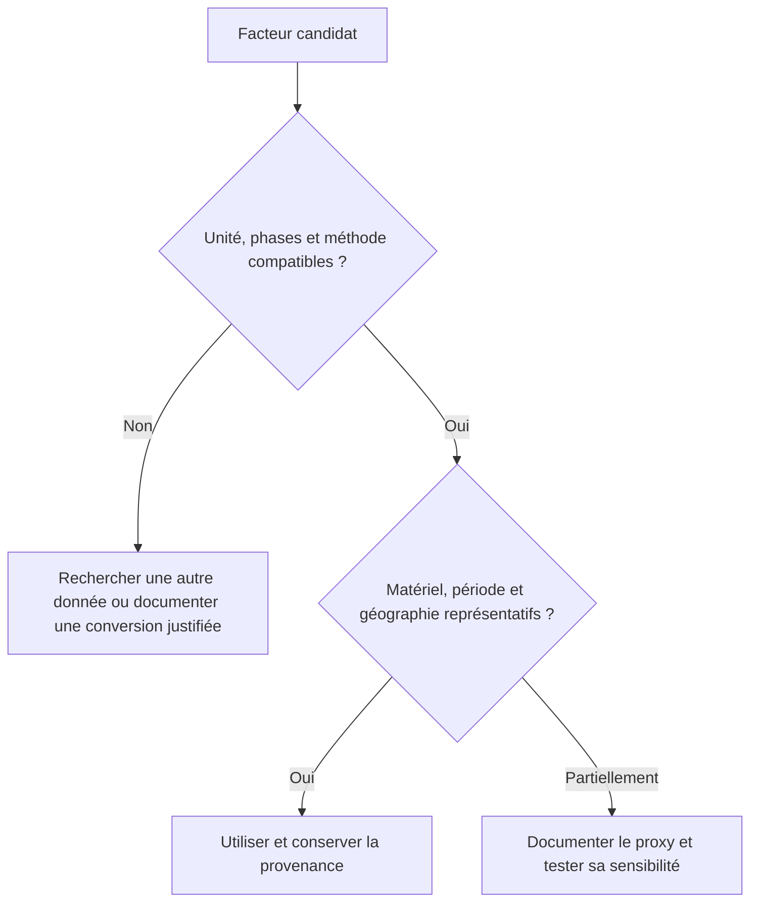

# Vérifier la qualité des données

Une donnée utile doit correspondre au matériel, à la période et au périmètre étudiés. Sa précision apparente ou le nom de son fournisseur ne suffisent pas. Sa compatibilité conditionne son utilisation ; sa représentativité et sa traçabilité en déterminent ensuite la pertinence.

## Contrôler avant de noter

Une mesure à la prise qui inclut tout le serveur ne s’additionne pas aux consommations de ses composants. Une ACV constructeur limitée au climat ne fournit pas automatiquement les autres indicateurs. Une méthode normalisée ne garantit pas que les données conviennent au produit étudié.

## Examiner six dimensions

| Dimension | Question de contrôle |
|---|---|
| Périmètre | Quelles phases, ressources et exclusions sont couvertes ? |
| Géographie | Les lieux d’usage et de fabrication sont-ils représentatifs ? |
| Temporalité | L’année décrit-elle encore la technologie et le mix étudiés ? |
| Description physique | Le modèle, la capacité et le procédé correspondent-ils ? |
| Traçabilité | Peut-on retrouver la valeur, son unité et sa version ? |
| Méthode | Les règles de calcul et de caractérisation sont-elles explicites ? |

Les [règles de recherche des sources](./hypotheses-valeurs-par-defaut-et-hierarchie-des-sources) indiquent où chercher. Elles ne classent pas automatiquement leur fiabilité.

### Grille interne de documentation, de 1 à 5

Cette grille Digital4Better est un outil de suivi, pas une certification ISO ou PEF. Chaque dimension peut recevoir une note de 1 à 5 : faible documentation, documentation partielle, puis documentation complète et adaptée. Chaque note est accompagnée de sa justification.

Les seuils historiques de temporalité sont : plus de cinq ans, deux à cinq ans, moins de deux ans. Ils demandent une interprétation par domaine : une donnée récente peut être moins représentative qu’une donnée ancienne bien adaptée.

La moyenne des six notes est un résumé de documentation. Une incompatibilité bloquante ne peut pas être compensée par les autres notes. Le profil détaillé prime sur la moyenne ; celle-ci n’est ni une probabilité de justesse ni un intervalle de confiance.

## Exemple de choix

Ex: une ACV du modèle exact fournit son GWP de fabrication, tandis qu’une base générique couvre plusieurs indicateurs pour une autre génération de matériel. La donnée spécifique peut décrire le climat si son périmètre convient. Pour les autres indicateurs, le proxy conserve une représentativité distincte, explicitée dans les résultats. L’ensemble ne devient pas une ACV homogène du modèle exact.

Lorsque deux facteurs compatibles conduisent à des conclusions différentes, leur analyse en scénarios révèle la sensibilité du résultat. Les données les plus influentes constituent alors les priorités d’amélioration. Une longue liste de sources ne compense pas l’absence de provenance du coefficient dominant.

### Lire une fiche constructeur : moyenne, incertitude et périmètre

Une [PCF](../references/glossaire#pcf) décrit une empreinte carbone avec une configuration, des phases et un scénario d’usage. Un résultat [« cradle-to-gate »](../references/glossaire#cradle-to-gate) s’arrête à la sortie de production annoncée ; un résultat sur le cycle complet inclut d’autres phases. Le remplacement de l’usage par des mesures locales suppose une ventilation explicite, sans conserver deux fois l’électricité.

IBM distingue, pour ses résultats [PAIA](../references/glossaire#paia), moyenne, écart-type et 95e percentile. Ce dernier n’est ni une moyenne ni une valeur mesurée. PAIA sert à repérer des contributions majeures et des ordres de grandeur par classe de produits ; il ne suffit pas à classer des références proches.[^corpus-pcf]

La grille D4B qualifie la documentation. Elle ne transforme pas une note de qualité en distribution statistique. La version du modèle, les hypothèses de durée de vie, le mix électrique et l’inclusion éventuelle du PUE accompagnent toute valeur reprise.

## Restituer les limites

La restitution distingue les postes mesurés, modélisés et non évalués. Une plage issue de scénarios n’a pas la même signification qu’un intervalle d’incertitude statistique. Une valeur manquante reste inconnue, y compris pour l’eau ou la fabrication du réseau.

Une variation de résultat entre hypothèses ne décrit pas nécessairement une différence réelle entre deux services. Une comparaison suppose la même fonction et des méthodes compatibles. Voir [Périmètre](../fondations/perimetre-frontieres-services-tiers-et-unite-d-analyse) et [Temporalité](./temporalite-vieillissement-et-versionnement-des-donnees).

## Utiliser la matrice dans une étude

1. La provenance décrit la source, la date, l’unité et la frontière de chaque donnée.
2. La compatibilité est déterminante : un facteur précis mais hors périmètre reste inadapté.
3. Chaque dimension reçoit une qualification distincte, avec les données manquantes explicitées.
4. L’analyse de sensibilité identifie les contributions dont les hypothèses peuvent changer la conclusion.
5. Ces contributions orientent les mesures prioritaires ; chaque remplacement de donnée est versionné.

Ex: une ACV récente d’un ordinateur ne s’applique pas automatiquement à un serveur. Une moyenne de famille compatible peut être préférable, tout en gardant une incertitude supérieure à une donnée du produit exact. Une consommation mesurée sur une semaine atypique doit aussi être replacée dans le profil annuel.

### Couverture, sensibilité et traçabilité

Présenter la part d’activité couverte est utile même si l’impact des postes absents est inconnu. Le pourcentage de ressources inventoriées diffère du pourcentage d’impact estimé : le premier ne permet pas de déduire le second.

L’analyse de sensibilité fait varier les paramètres dans des bornes motivées. Si le classement des options change, la conclusion dépend de ces hypothèses. Une moyenne de notes de qualité ne fournit ni probabilité ni intervalle de confiance sur le résultat.

Pour les bases publiques, conserver l’identifiant exact du jeu de données, sa version, la géographie, la technologie, les phases et les conditions de réutilisation. Le nom d’une base, y compris Base Empreinte, ne garantit pas que deux facteurs partagent la même frontière.

## Statut de la grille

La procédure de frontière, quantification et restitution est notamment décrite dans la spécification SCI[^ref-1], pour le carbone logiciel. La grille à six dimensions ci-dessus est une convention D4B. Les facteurs disponibles et leurs limites sont suivis dans le [registre des hypothèses](../references/registre-des-hypotheses-et-valeurs-par-defaut).

## Correspondance avec les critères RCP

La grille D4B reste une convention de lecture. Les six critères du RCP parent portent sur la représentativité géographique, temporelle et technologique, la complétude, l’incertitude et la cohérence méthodologique. Le nombre de dimensions est identique, leur contenu ne l’est pas.[^rcp-parent]

Dans les deux grilles, géographie et temporalité reposent sur les mêmes preuves. La description physique correspond à la représentativité technologique, le périmètre à la complétude, et la méthode à la cohérence. La traçabilité D4B étaye chaque contrôle mais ne remplace pas l’analyse d’incertitude. Une moyenne de notes n’est ni une certification ni une marge d’erreur statistique.

[^rcp-parent]: ADEME, [RCP services numériques, version 2, juin 2026](https://librairie.ademe.fr/societe-et-politiques-publiques/9418-methodologie-d-evaluation-environnementale-basee-sur-l-analyse-du-cycle-de-vie-acv-pour-un-service-numerique.html), p. 20–21.

[^ref-1]: [spécification SCI](https://sci.greensoftware.foundation/). Documentation en ligne, version non figée.

[^corpus-pcf]: IBM, [Assessment of carbon footprint life cycles](https://www.ibm.com/downloads/documents/us-en/107a02e95ac8f59e), 2024, sections « What does IBM provide? », « Understanding IBM’s PCF report » et « Intended uses and limitations ».
