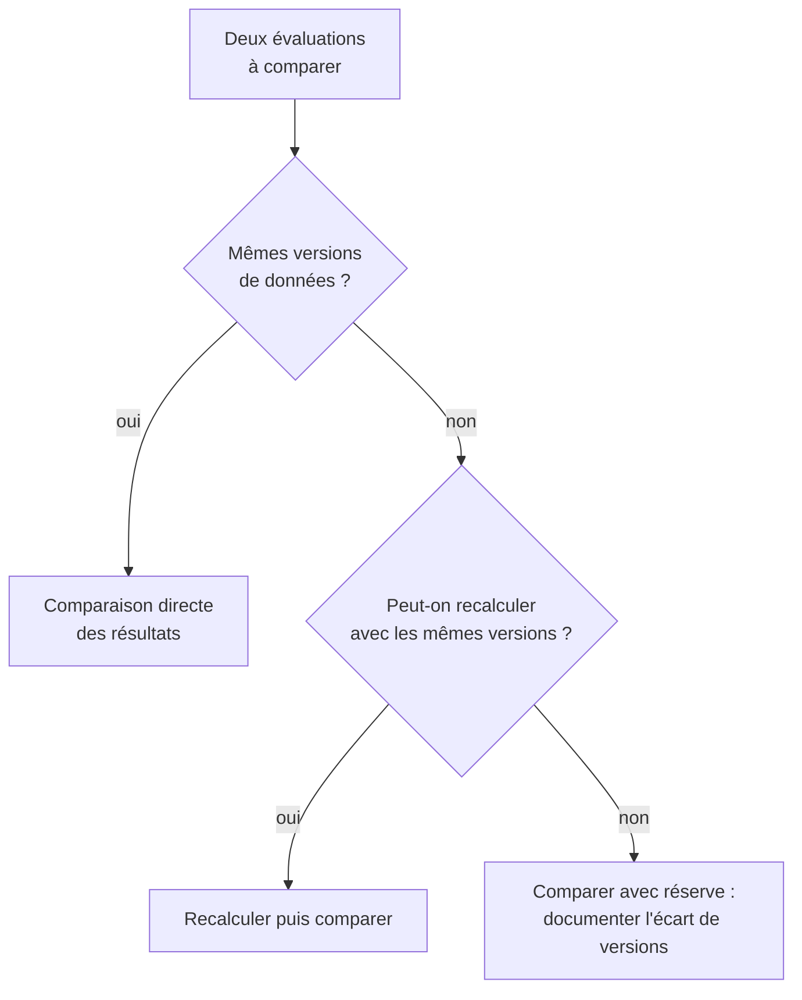

# Temporalité, vieillissement et versionnement des données

import { MethodIllustration } from '@site/src/components/method-illustrations';

Les impacts du numérique ne sont pas statiques. Les équipements vieillissent, les durées de vie observées évoluent, les mix électriques changent et les bases de données sont mises à jour. La méthode doit donc être temporellement explicite : chaque évaluation doit indiquer sur quelle période elle porte, avec quelles durées de vie et à partir de quelles versions de données.

## Pourquoi la temporalité est structurante

Une évaluation réalisée en 2024 avec des facteurs électriques de 2020 ne produit pas le même résultat que la même évaluation avec des facteurs de 2024 -- le mix électrique français ayant significativement varié sur cette période. De même, un équipement amorti sur 3 ans ou sur 5 ans ne porte pas la même fraction d'impact intrinsèque annuel. Rendre ces choix explicites est une condition de comparabilité.

## Les quatre dimensions temporelles

Toute évaluation doit distinguer quatre dimensions temporelles :

| Dimension | Question | Exemple |
|---|---|---|
| **Période d'observation** | Sur quelle durée calcule-t-on ? | Année civile 2024, trimestre Q3 2024 |
| **Durée de vie / amortissement** | Comment répartit-on l'impact intrinsèque ? | Durée nominale 4 ans, durée réelle 5,2 ans |
| **Date de validité des données** | Quand les données de fond ont-elles été produites ? | Mix électrique janvier 2024, Base Empreinte 2023 |
| **Version de la méthode** | Quelle version des formules et conventions ? | Commit de la méthode et commit du jeu de facteurs (identifiants réels) |

## Durées de vie {#durées-de-vie}

### Définitions

Le terme « durée de vie » recouvre plusieurs notions qu'il est essentiel de distinguer :

| Notion | Définition | Usage dans la méthode |
|---|---|---|
| **Âge** | Durée écoulée depuis l'entrée de l'équipement dans l'inventaire | Donnée d'entrée pour le calcul de la durée de vie réelle |
| **Durée de vie nominale** ($TL$) | Durée de vie minimum attendue, fixée par l'organisation | Utilisée pour l'amortissement quand la durée réelle n'est pas connue |
| **Durée de vie réelle** ($RL$) | Durée totale observée sur les équipements sortis ; estimation explicite pour les équipements encore en service | Indicateur privilégié, reflète les pratiques réelles |

:::note[Durée nominale et amortissement]
Un inventaire historique peut répartir une fabrication sur quatre exercices puis solder cette écriture. Une ACV de service utilise au contraire une durée de vie attendue ou observée pour attribuer une part de fabrication au service rendu. Dépasser une durée nominale ne rend pas automatiquement la fabrication nulle dans cette ACV. Ne pas mélanger les deux conventions ; lors d'une révision, conserver les anciennes versions et préciser si les résultats antérieurs sont recalculés.
:::

### Correction proportionnelle TL / RL

Lorsque la durée de vie réelle $RL$ est connue et diffère de la durée de vie théorique $TL$ fournie par le référentiel, une correction proportionnelle est appliquée au facteur d'impact intrinsèque **déjà annualisé** ; elle ne s'applique pas à nouveau au total de fabrication :

$$
\begin{aligned}
&IF_{emb_{i}} = TIF_{emb_{i}} \times \frac{TL}{RL} \\
\text{avec} \\
&IF_{emb_{i}} = \text{Facteur d'impact intrinsèque corrigé} \htmlClass{unit}{[U_i/an]} \\
&TIF_{emb_{i}} = \text{Facteur d'impact théorique du référentiel} \htmlClass{unit}{[U_i/an]} \\
&TL = \text{Durée de vie théorique du référentiel} \htmlClass{unit}{[an]} \\
&RL = \text{Durée de vie réelle observée} \htmlClass{unit}{[an]}
\end{aligned}
$$

**Interprétation** :
- Si $RL > TL$ : l'équipement dure plus longtemps que prévu → le facteur annuel diminue → impact intrinsèque annuel réduit.
- Si $RL < TL$ : l'équipement dure moins longtemps que prévu → le facteur annuel augmente → impact intrinsèque annuel accru.

### Calcul de la durée de vie réelle

La convention historique ci-dessous estime une durée d'allocation à partir de l'inventaire. Ce n'est pas une moyenne de durées de vie toutes observées : les équipements encore en service sont censurés, leur date de sortie étant inconnue. Une analyse de survie ou des cohortes complètes sont préférables pour estimer une durée statistique. On distingue quatre populations :

| Population | Profil | Durée de vie retenue |
|---|---|---|
| **A** | Équipements vivants dont l'âge dépasse la durée nominale | Âge réel |
| **B** | Équipements sortis avant la durée nominale | Âge réel |
| **C** | Équipements vivants dont l'âge est inférieur à la durée nominale | Durée nominale[^1] |
| **D** | Équipements sortis à la durée nominale ou après | Âge à la sortie |

La durée d'allocation estimée $RL$ est la moyenne des durées retenues sur toutes les populations :

$$
\begin{aligned}
&RL = \frac{\sum_{k \in A} age_k + \sum_{k \in B} age_k + \sum_{k \in C} TL + \sum_{k \in D} age_k}{|A| + |B| + |C| + |D|}
\end{aligned}
$$

### Application concrète

**Exemple : parc de 4 smartphones, durée nominale = 4 ans**

| Année d'achat | Statut | Âge (an) | Population | Durée retenue |
|---|---|---|---|---|
| 2018 | En stock | 6 | A | 6 |
| 2019 | En parc | 5 | A | 5 |
| 2021 | Cassé | 3 | B | 3 |
| 2022 | En parc | 2 | C | 4 |

Calcul :

$$
RL = \frac{6 + 5 + 3 + 4}{4} = 4{,}5 \text{ ans}
$$

La durée d'allocation estimée est de **4,5 ans**. Cette convention ne démontre ni la durée finale des équipements encore vivants ni la qualité de leur entretien. Le temps passé en stock doit être distingué du service effectivement rendu.

### Prise en compte du reconditionné

Un équipement reconditionné prolonge la durée de vie totale du matériel. La durée d'utilisation avant arrivée dans l'organisation est ajoutée à la durée de vie individuelle :

| Année d'achat | Statut | Âge dans l'orga (an) | Durée avant arrivée (an) | Population | Durée de vie totale |
|---|---|---|---|---|---|
| 2018 | Stock | 6 | 0 | A | 6 |
| 2019 | Parc | 5 | 0 | A | 5 |
| 2021 | Cassé | 3 | 0 | B | 3 |
| 2022 | Parc | 2 | 0 | C | 4 |
| 2023 | Stock | 1 | 3 | C | 7 |

L'estimation passe à **5 ans** : $(6+5+3+4+7)/5$. Les 7 ans du dernier équipement supposent 3 ans d'usage antérieur et **4 ans supplémentaires attendus** dans l'organisation ; ce n'est pas une durée totale observée. Si la durée nominale de 4 ans désigne la vie totale et non la seconde vie, cette addition serait incorrecte. Inclure séparément les impacts du reconditionnement et documenter le partage entre vies successives.

<MethodIllustration kind="second-life" lang="fr" />

:::note[Mise à jour des durées nominales]
Les durées de vie nominales peuvent être révisées par l'organisation, mais cela impacte le calcul d'empreinte. Par exemple, passer de 4 à 5 ans réduit l'empreinte intrinsèque annuelle mais prolonge la période d'amortissement. Ces révisions doivent rester ponctuelles et justifiées.
:::

## Versionnement des données

### Pourquoi versionner

Les données de fond évoluent :
- les fichiers électriques peuvent être actualisés dans `digital4better/data`, avec des périodes de référence annuelles ou mensuelles à vérifier.[^source-2]
- les facteurs Base Empreinte peuvent être révisés lors de nouvelles campagnes NegaOctet.
- les données constructeurs sont mises à jour à chaque génération de produit.
- la méthode elle-même peut évoluer.[^donnees-modele]

Une évaluation réalisée à deux dates différentes avec les mêmes usages mais des données de fond différentes produira des résultats différents. Cette variation n'est pas une erreur ; elle reflète l'évolution des connaissances. Mais elle doit être traçable.

### Règles de versionnement

| Élément | Information à tracer | Où la documenter |
|---|---|---|
| Facteurs d'impact électriques | Version `d4b/data`, mois de référence | Métadonnées de l'évaluation |
| Facteurs d'impact intrinsèques | Source (constructeur, Base Empreinte), date | Métadonnées de l'évaluation |
| Durées de vie | Nominales, réelles, date de calcul | [Registre des hypothèses](../references/registre-des-hypotheses-et-valeurs-par-defaut) |
| Méthode | Version de la documentation méthodologique | En-tête du rapport d'évaluation |

### Impact du versionnement sur la comparabilité

Pour comparer deux évaluations dans le temps :

## Hypothèses et limites

- Une évaluation comparée sur plusieurs années doit documenter les évolutions de données et pas seulement les évolutions d'usage. Un changement de mix électrique peut masquer ou amplifier un progrès réel.
- Les valeurs par défaut peuvent devenir obsolètes plus vite que la structure méthodologique elle-même.
- Le calcul de la durée de vie réelle suppose un inventaire suffisamment complet et historisé. En l'absence d'historique, la durée nominale est utilisée par défaut.
- La fréquence de maintenance ne prouve pas la fraîcheur du contenu. Tracer la période réelle de chaque facteur et ne pas extrapoler une année incomplète sans le signaler.

[Annexes techniques -- Calcul des durées de vie réelles](../references/annexes-techniques)

[^1]: On suppose que ces équipements atteindront au minimum la durée nominale, conformément à l'ambition de l'organisation.

[^source-2]: Digital4Better, [digital4better/data](https://github.com/digital4better/data) Catalogue évolutif ; utiliser un commit pour figer les facteurs.

[^donnees-modele]: `digital4better/data` (versions et historiques). [Registre des hypothèses et valeurs par défaut](../references/registre-des-hypotheses-et-valeurs-par-defaut). Inventaires matériels des organisations évaluées. [Digital4Better, catalogue de données, instantané 77cae4a](https://github.com/digital4better/data/tree/77cae4a58fadd5deb3b8d4e5577020da08f780d8).
