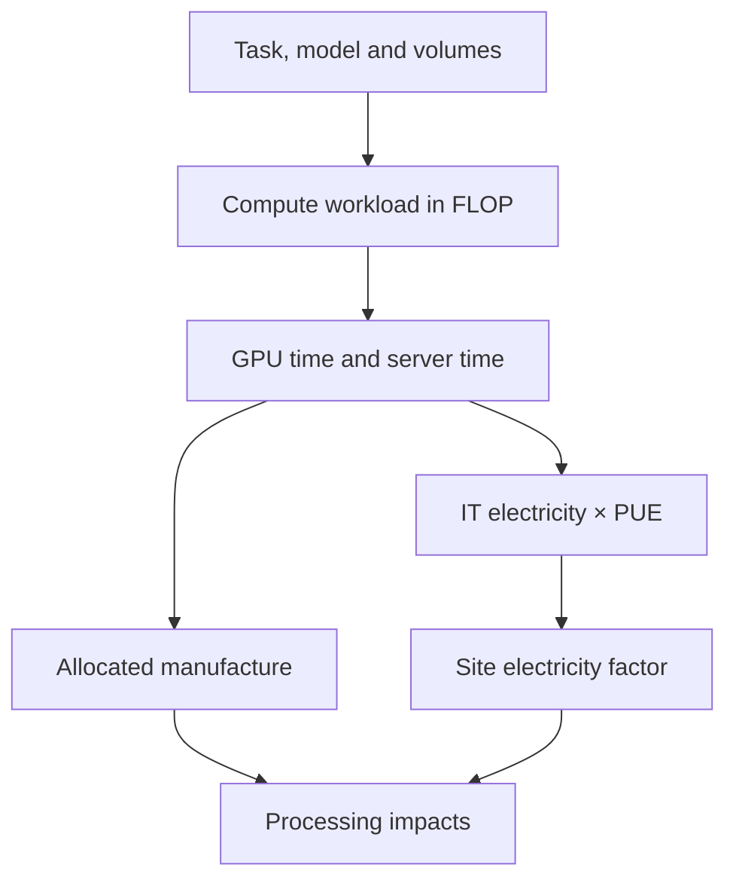

# Generative AI

import { MethodIllustration } from '@site/src/components/method-illustrations';

Assessing an AI service means linking a task to computation, then to equipment, electricity and environmental impacts. This page covers training, fine-tuning, text and media generation, image and video analysis, and audio transcription. The method connects server processing to the complete service life cycle.

## Define the service

A request is not a sufficient unit without its function: context length, output volume, expected quality, latency and number of attempts. One million tokens, one minute of video and a training run are different units.

The boundary distinguishes server processing, reserved infrastructure, the application service, model development and the hardware life cycle. Each level comprises resources and activities to inventory.

The SCI-AI specification[^source-4] distinguishes provider and consumer responsibilities. It helps define the boundary; each study retains an explicit scope.

## From service to impacts

Representative measurements form the reference for duration and energy when available. The operations model makes assumptions explicit when those data are missing. A complete API footprint already includes its components; adding them would create a double count.

### Tokens, parameters and operations

A [**token**](../../references/glossaire.md#jeton) is a tokenizer unit, not a word. Tokenization depends on model, language and content. Counts come from the API or tokenizer; a constant words-to-tokens conversion remains an approximation.

Parameters are model weights. Most participate in dense-model computation; a [**Mixture of Experts (MoE)**](../../references/glossaire.md#moe) activates only a subset per token. Computation uses active parameters, while memory must accommodate stored weights and required states. [FLOP](../../references/glossaire.md#flop) is an operation count; FLOP/s is throughput. These units are not interchangeable.

| Symbol | Definition | Unit |
|---|---|---|
| $P$, $P_p$ | Active parameters of the generative and prompt models | Count |
| $T$, $T_{in}$, $T_{out}$ | Processed, input and output tokens | Tokens |
| $Q$, $m$ | Theoretical GPU throughput and [MFU](../../references/glossaire.md#mfu) | FLOP/s; fraction |
| $n$, $H$ | GPUs per server; hardware lifetime | Count; hours |
| $W_g$, $W_s$ | One GPU's power; server power excluding GPUs | Watts |
| $M_g$, $M_s$ | One GPU's manufacture; server manufacture excluding GPUs | kg CO₂e |

### Text, training and fine-tuning

Transformer compute approximations mainly represent operations proportional to parameter count (Hoffmann et al.[^source-1]).

| Process | Approximate workload | Convention |
|---|---|---|
| Training | $F=6PT$ | Forward pass and backpropagation |
| Fine-tuning | $F=6PT$ | Full-training proxy; no assumed LoRA saving |
| Prompt processing | $F_p=2PT_{in}$ | Before prefix reuse |
| Text generation | $F_g=2PT_{out}$ | Generation with cached context states |

$T$ counts **all presentations** of the data: a 10-billion-token corpus processed three times means 30 billion processed tokens. A further multiplication by batch and steps would duplicate their contribution if already included.

**In these formulas, $P$ means active parameters per token**, including shared MoE layers. When routing varies, the count uses the average parameters involved across processed tokens. For example, Mixtral 8×7B uses about 13 billion parameters per token out of 47 billion total; using 47 billion in $2PT$ would overestimate this compute component.[^moe-actifs]

**A frozen parameter is not an inactive parameter.** Its value stays fixed during training, but it still participates in the forward pass. Backpropagation through its layer remains necessary when upstream parameters are trained. [LoRA](../../references/glossaire.md#lora) reduces updated weights and their optimizer states; compute savings depend on the operations retained.[^gel-parametres]

The $6PT$ proxy remains a full-training estimate here, without an automatic discount for frozen layers. Fine-tuning-specific computation distinguishes the forward pass, gradient propagation and weight updates. Multiplying $P$ by the trainable fraction alone is insufficient.

These approximations do not detail attention, routing, communication or memory movement. Precision, quantization and batch size affect performance without automatically reducing parameter count.

### Generate images, video or audio

Prompt and media are calculated separately. Some profiles use a separate prompt encoder: $F_p=2P_pT_{in}$. These generation paths start from a **text prompt**. Media supplied as input follows the analysis paths in the next section.

The following expressions give total workload $F$, including the prompt. For [DiT/hybrid profiles](../../references/glossaire.md#diffusion), $A(x)=2Px+4Lx^2d$ represents one step over $x$ positions: parameter-proportional computation and attention. $L$ is the layer count and $d$ the hidden width.[^media-architecture]

| Generated output | Approximate workload | Volume parameters |
|---|---|---|
| Images, DiT/hybrid | $F=F_p+kS\,A(N)$ | $k$ images, $S$ steps, $N$ positions per image |
| Video, DiT/hybrid | $F=F_p+S\,A(N_v)$ | $N_v$ spatiotemporal positions |
| Autoregressive audio | $F=F_p+2PN_aq$ | $N_a$ audio positions, $q$ codebooks |
| Diffusion audio | $F=F_p+S\,A(N_a)$ | $N_a$ audio positions, $S$ steps |

#### Image and video profile formulas {#image-and-video-profile-formulas}

For an image of width $w$ and height $h$, profiles assume spatial downsampling by 8 followed by patches of side $p$ in [latent space](../../references/glossaire.md#espace-latent):

$$
N=\left\lceil\frac{\lfloor w/8\rfloor}{p}\right\rceil
  \left\lceil\frac{\lfloor h/8\rfloor}{p}\right\rceil
$$

For video, $k$ is the frame count. A profile can pad it to a multiple of $b$ before temporal compression by factor $c$:

$$
k'=\lceil k/b\rceil b,\qquad
N_v=\left(\left\lfloor\frac{k'-1}{c}\right\rfloor+1\right)N
$$

A 5-second video at 24 frames/s therefore means **120 frames before compression**. A 1,024 × 1,024 image has four times as many spatial positions as a 512 × 512 image; the attention term grows faster.

**U-Net** profiles instead use $F=F_p+kS\,2P\lfloor w/8\rfloor\lfloor h/8\rfloor$; for video, $k$ is replaced by $k'$. This approximation does not detail convolutions or VAE decoding.

#### Audio profile formulas {#audio-profile-formulas}

For duration $t$ in seconds and sample rate $f_s$, positions total $N_a=\lceil t f_s/c_t\rceil$, where $c_t$ is the profile's temporal reduction. The $q$ [codebooks](../../references/glossaire.md#codebook) are sets of codes used to represent audio.

These proxies need calibration by architecture and engine. The $q$ multiplier alone does not describe parallel or sequential codebook execution. MusicGen and Stable Audio Open document architectures without validating these energy estimates. Codecs, decoding and output processing still need to be inventoried.[^media-audio]

### Analyze input media

Analysis adds media encoding, processing its representation with the instructions, and response generation. An API-billed “image token” is not a universal energy factor.

| Input | Approximate workload | Profile and boundary |
|---|---|---|
| Images, scanned pages | $F=F_{enc}+2P_{lang}(T_{in,eff}+T_m+T_{out})$ | Qwen2.5-VL 7B; $T_m$ visual positions |
| Video | Same formula, with $T_m=UN/4$ | Qwen2.5-VL 7B; $U$ frame pairs, excluding audio |
| Audio | $F=C(F_{conv}+F_{enc,chunk}+F_{dec,chunk})$ | Whisper base; $C=\lceil t/30\rceil$ chunks of 30 s |

#### Visual and audio input calculations {#visual-and-audio-input-calculations}

**Images and video.** Qwen2.5-VL uses 14-pixel patches, 2 × 2 spatial merging and temporal grouping in pairs. Processed dimensions $w,h$ are rounded up to multiples of 28. A still image is repeated to form a pair.[^qwen-config]

$$
N=(w/14)(h/14),\qquad T_m=UN/4
$$

$U$ counts independent images or video frame pairs, with $U=\lceil\lceil t f\rceil/2\rceil$ for duration $t$ and $f$ analyzed frames per second. $F_{enc}$ adds patch projection, linear projections, attention and merging. The encoder has 32 layers, four with global attention; the others use windows.[^qwen-report]

The language core has about 7.61 billion parameters ($P_{lang}$), separately from the encoder. $T_{in,eff}$ is the instruction after any prefix reuse. Caching removes **neither encoding nor media positions**. Long-context language attention, normalization and nonlinear operations are not detailed.

Context includes the full instruction, media positions and response. Beyond the 128,000 positions assumed for this profile, another segmentation is needed. Resolution describes an already resized image; it does not automatically reproduce actual preprocessing.

**Audio.** Whisper base has six encoder and six decoder layers of width $d=512$. Audio is resampled to 16 kHz and split into 30 s windows, padded as needed. Each chunk has $N=1\,500$ positions after convolution.[^whisper-config][^whisper-audio]

For $C>0$, the $T_{out}$ transcript tokens are distributed as $u=T_{out}/C$ tokens per chunk. With $L_e=L_d=6$ layers and vocabulary $V=51\,865$:

$$
\begin{aligned}
F_{conv}&=2(3000)(80)d(3)+2Nd^2(3)\\
F_{enc,chunk}&=L_e(24Nd^2+4N^2d)\\
F_{dec,chunk}&=L_d\bigl(4Nd^2+28ud^2\\
&\quad+2du(u+1)+4Nud\bigr)+2udV
\end{aligned}
$$

The decoder includes cross-attention projections, generation with KV caching and vocabulary projection. For $u=0$, its proxy cost is zero; zero audio duration also gives zero chunks. One multiply-add counts as two FLOP.

The limit is **448 tokens per chunk**. Beam search, retries, silence detection and adaptive segmentation are excluded. Thus, 10 and 30 seconds fill the same chunk in this scenario; these steps depend on the engine and are not energy measurements. [MFU](../../references/glossaire.md#mfu) and power still need calibration.

<MethodIllustration kind="input-media" lang="en" />

#### Combine modalities without double counting

Summarizing video with sound involves the visual track, transcription and, where needed, transcript processing. An already included response remains counted once. A scanned PDF uses the image path for its pages; a PDF with extracted text can use the text path.

<MethodIllustration kind="combined-media" lang="en" />

Image editing and native audiovisual models also need architecture-specific profiles. Joint architectures require deployment measurements or a dedicated profile. Decoding, transfers, storage and application processing complete the boundary where material.

### GPU time and server time

$$
D_{GPU,h}=\frac{F}{Qm\,3600},\qquad D_{server,h}=\frac{D_{GPU,h}}{n}
$$

[MFU](../../references/glossaire.md#mfu) is the fraction of theoretical throughput used for modeled work. The default 0.4 is an assumption, not a hardware constant. Throughput must match precision and compute units: the H100[^ref-7] value of 989 TFLOP/s refers here to dense FP16/BF16, not FP32.

At unchanged [MFU](../../references/glossaire.md#mfu), dividing by $n$ assumes speedup proportional to the GPU count. Recalibrate [MFU](../../references/glossaire.md#mfu) when the configuration changes. Modeled duration, prompt latency and throughput are not service benchmarks. Memory feasibility is assessed separately: weights, KV cache, activations and optimizer states must fit the available resources.

### [MFU](../../references/glossaire.md#mfu): why actual throughput falls below the peak {#understanding-mfu}

[**MFU (Model FLOPs Utilization)**](../../references/glossaire.md#mfu) is the ratio of useful model computation throughput to the accelerators’ theoretical throughput. An [MFU](../../references/glossaire.md#mfu) of 0.4 means that 40% of that theoretical throughput contributes to the counted work. It does not mean that the GPU is idle 60% of the time or draws 40% of its power. The definition in PaLM, section 4.1[^ref-8] excludes additional activation recomputation operations.

| Throughput constraint | Why it matters |
|---|---|
| Memory access | Weights, activations and KV cache must move between GPU memory and compute units. Memory bandwidth can limit throughput before the compute units are saturated. |
| Buses and interconnects | PCIe, NVLink and the network between servers carry data. Exchanges and synchronization between GPUs can leave some units waiting. |
| Parallelism and batch size | Small batches underuse the GPU. Spreading a model across more GPUs adds communication; a pipeline can also have idle gaps between stages. |
| Dependencies and execution | In autoregressive generation, each new token depends on earlier ones. Matrix dimensions, supporting operations and software scheduling also affect throughput. |

NVIDIA’s guides to GPU performance[^ref-9] and distributed parallelism[^ref-10] describe these constraints. Transfers can partially overlap computation: their durations should not simply be added together.

**In the operation-count model**, [MFU](../../references/glossaire.md#mfu) is an overall coefficient; buses and communication are not simulated separately. It determines duration through $D=F/(nQm)$. With the same workload and hardware, changing 0.4 to 0.2 doubles estimated duration, and therefore energy and manufacture allocated to active time in this constant-power model. This is not a general law of electricity consumption.

<MethodIllustration kind="mfu" lang="en" />

#### Choosing and calibrating [MFU](../../references/glossaire.md#mfu) {#choosing-and-calibrating-mfu}

The default **0.4 is an initial assumption**, not a universal average. For inference, it acts as an effective coefficient to calibrate: prompt processing and generation face different constraints. A training [MFU](../../references/glossaire.md#mfu) is therefore not directly transferable to an isolated request.[^source-3]

For $n$ identical GPUs, a measured processing duration $t$ in seconds gives $m=F/(nQt)$. This estimate depends on the operation-count convention for $F$, the numerical precision of $Q$, batch size, engine and hardware. A value above 1 indicates inconsistent measurement, boundaries or conventions.

Measurement on the complete configuration produces an [MFU](../../references/glossaire.md#mfu) that already includes parallelization losses; a second penalty would count them twice. Periods without requests and queueing time remain separate from this calibration. Measured duration and energy do not require an additional [MFU](../../references/glossaire.md#mfu) adjustment.

A parametric [MFU](../../references/glossaire.md#mfu) calculation is planned for an upcoming methodological revision, linking these constraints to hardware and workload. It still needs calibration and validation against measurements; it is not yet part of the calculation rules.

### Electricity and manufacture

$$
E_{site,kWh}=D_{GPU,h}\frac{W_g+W_s/n}{1000}\,PUE
$$

$$
I_{use}=E_{site,kWh}\,f_{electricity},\qquad
I_{manufacture}=\frac{D_{GPU,h}}{H}(M_g+M_s/n)
$$

The server excluding GPUs includes CPU, RAM, storage and enclosure. PUE multiplies IT electricity, **not manufacture**. Energy measured across the whole site already includes this contribution. Nominal profile powers do not replace average server-level measurements.

$H$ is hardware lifetime in hours: $H=years\times365.25\times24$.

The calculation above allocates manufacture by processing time. A server reserved for a service remains allocated to it during periods without requests. Faster processing does not remove this manufacturing share; it still needs to be distributed among the services reserving the hardware.

### Two different cache mechanisms

  <section>
    <h4>1. KV cache</h4>
    
<strong>Within a single generation</strong>

    
Keeps attention keys and values for tokens already processed so they can be reused in subsequent steps.

    
Avoids recomputing previous token states. Its use is assumed in the generation calculation.

  </section>
  <section>
    <h4>2. Prefix cache</h4>
    
<strong>Across requests</strong>

    
Reuses states for a shared prompt prefix, such as the same instructions or document.

    
Reduces shared-prefix processing without reducing response generation.

  </section>

#### Effect of prefix caching {#in-the-simulator-prefix-caching}

The reused prefix fraction $r$ reduces prompt computation:

$$
F_{p,effective}=F_p\left[(1-r)+\alpha r\right],\qquad
r=\frac{T_{cached}}{T_{in}}
$$

Residual coefficient $\alpha=0.1$ is an assumption about retained work. The correction precedes duration, energy and active-time manufacturing allocation. Generation work is unchanged. Actual reuse requires measurement; memory, eviction, retention and cache synchronization can add costs.

Example: 405.87 billion parameters, 100 input tokens and 400 output tokens give $405.87\times10^{12}$ FLOP. With full prefix reuse and 10% residual work, workload becomes $332.8134\times10^{12}$ FLOP. This is a proxy result, not measured savings.

## Complete the life cycle

Processing during the study period is distinguished from the training share allocated to the service.[^rcp-app] It is a separate contribution from inference.

Training allocation across uses relies on a documented denominator: actual service volume over a period, reserved capacity, or future-use scenarios. Allocated training intensity is $I_{train}/V_{service}$. When that volume is unknown, scenarios make the uncertainty visible. A forecast remains distinct from a measurement.

For a [RAG](../../references/glossaire.md#rag) or agent application, the inventory covers each stage: indexing, embeddings, retrieval, model calls, tools, storage and retries. Impacts are summed for a **completed task**, without duplicate server contributions from already assessed services. [Web](./service-web.md), [Cloud](../environnements/cloud.md) and [Hosting](../environnements/infrastructure-d-hebergement.md) cover complementary contributions.

Direct site water requires a defined WUE and compatible IT energy. Water associated with electricity requires a different factor. Metals, resources and toxicity need characterized inventories; they cannot be inferred from carbon through a constant ratio.

<MethodIllustration kind="rag" lang="en" />

## Measurement, uncertainty and method choice

| Approach | Required data | Appropriate use |
|---|---|---|
| Deployment measurement | Duration, server power, load, idle capacity, allocation | Calibrate an actual service; disclose measurement boundaries |
| This page's FLOP proxy | Architecture, volumes, hardware, [MFU](../../references/glossaire.md#mfu) and powers | Explore dependencies and make assumptions explicit |
| EcoLogits[^ref-12] | Model, provider and activities covered by its methods | Call assessment using its corpus, within the supported modality and version |

EcoLogits now documents LLM inference and video-generation methods. Boundaries and models differ: ranking results without aligning task, hardware, idle capacity, caching and electricity mix does not establish method accuracy.

Calibration relies on measurements across prompt and output sizes, batches and load levels. Separate analysis of duration and energy supports adjustments to [MFU](../../references/glossaire.md#mfu) or powers. An independent measurement set provides an error check. An interval produced by varying assumptions is a **sensitivity analysis**, not a statistical confidence interval.

### Recent work and what it supports

More than Carbon (2025)[^ref-13] examines the A100 life cycle across multiple impact categories. AI hardware life-cycle emissions (2025)[^ref-14] addresses hardware production and use. They support separating phases and indicators; they do not validate every hardware profile in this methodology.

The Moshi research study (2026 preprint)[^ref-15] includes experiments, failed runs and development stages. For video, Video Killed the Energy Budget (2025)[^ref-16] studies latency and power regimes of open models. These findings motivate explicit boundaries and deployment-specific calibration, not a universal factor per token or media second.

These choices rely on [boundaries](../../fondations/perimetre-frontieres-services-tiers-et-unite-d-analyse.md), [allocation](../../regles/allocation-et-partage-des-impacts.md), [data quality](../../regles/qualite-des-donnees-et-matrice-de-robustesse.md) and [double counting](../../regles/double-comptabilisation.md).

#### Relating corpus studies to D4B calculations

The ADEME GPU report allocates impacts over the card's useful activity hours. The D4B example above divides manufacturing impacts by calendar lifetime hours, then allocates them to computation time. These denominators differ when hardware is idle; a per-[GPU-hour](../../references/glossaire.md#gpu-heure) factor is not interchangeable without its allocation rule.[^corpus-gpu]

The report covers the assessed hardware. Its exclusions, including networks, user devices and buildings, do not become exclusions for a complete AI service. The factor's boundary must be known before adding the remaining server or electricity.[^corpus-gpu]

*How Hungry is AI?* estimates inference energy from API performance, inferred hardware configurations, power assumptions and batch size. Its results are not direct electricity measurements of the APIs. The model excludes idle power from unused GPUs in partially loaded nodes: this limitation remains explicit when relating it to reserved infrastructure.[^corpus-inference]

Comparison with published measurements exposes a concrete limitation: at equal total token count, the fixed-[MFU](../../references/glossaire.md#mfu) proxy does not reproduce the observed difference between long prompts and long responses. Batch size also changes energy per request. Calibration must distinguish these conditions; no universal correction is inferred.[^phase-mesures]

## Assumptions and limitations {#assumptions-and-limitations}

The operation-count model provides a **server-processing estimate**, based on operation counts and hardware profiles. A source describing model architecture does not by itself validate energy use or environmental impacts.

### Working assumptions

| Item | Initial assumption | What to adapt |
|---|---|---|
| Computation and parallelism | [MFU](../../references/glossaire.md#mfu) 0.4; theoretical throughput at the GPU profile’s precision | Duration measured for the actual model, engine, batch and hardware |
| Electricity | PUE 1.2; United States factor initially selected, 2025 snapshot | Specified location and period; national factors do not represent a site hour by hour |
| Hardware | Profile-based power and manufacture; five-year lifetime | Measurements and a documented inventory take precedence over proxies |
| Allocation | Manufacture allocated by active time; other components shared per GPU | Reserved idle capacity and server-sharing rules included |
| Model | Referenced or explicitly assumed architecture and parameters | Specified version, precision, quantization and supported modalities |
| Cache | KV cache assumed; 0% prefix reuse initially, retaining 10% of computation when reused | Measured reuse; retention, eviction and transfers are not modeled in detail |

Values used for a study are documented with their sources and may differ from these initial assumptions. For visual inputs, prefix caching reduces text only; this correction does not apply to the audio transcription profile.

### Known limitations

- **Partial boundary.** Devices, external networks, application storage, RAG, idle capacity and buildings require additional inventory. Training is not automatically allocated to inference requests.
- **Hardware feasibility unchecked.** Weights, activations and caches may exceed available memory. Input-profile context checks do not validate memory capacity. Available profiles do not represent TPUs, FPGAs or other accelerators.
- **Simplified performance.** Formulas do not detail every attention, routing, memory or communication cost. Power is constant in the calculation; the same [MFU](../../references/glossaire.md#mfu) does not guarantee equal efficiency for another workload.
- **Modality coverage.** Input video excludes its audio track; Whisper uses padded 30 s chunks. Generation profiles are exploratory. Image editing and joint multimodal models require dedicated profiles.
- **Uncertain data.** Closed-model specifications, manufacturing factors and actual activity may be poorly known. A billed unit or cached token is not a physical impact measurement.

### Interpret and substantiate the result

Displayed electricity and climate impacts are a **boundary-specific subtotal**, not a complete LCA, guaranteed latency or universal per-request factor. Water, resources and toxicity require their own data; they cannot be inferred from carbon.

Reusing a result requires a documented task, model version, hardware, location, period and exclusions. Validation relies on measurements of duration and energy; varying assumptions describes sensitivity, not a confidence interval. [Complete the life cycle](#complete-the-life-cycle) and [Measurement, uncertainty and method choice](#measurement-uncertainty-and-method-choice) explain the next steps.

## Worked example: Llama 3.1 405B

This historical example makes the arithmetic reproducible. It uses a rounded 405 billion parameters, 15 trillion tokens and an electricity factor of 0.420 kg CO₂e/kWh. The simulator uses its profile parameters and selected versioned national factor, so values may differ.

### Configuration, training and inference calculations

| Component | Power | Manufacture |
|---|---:|---:|
| 8 H100 GPUs | 8 × 700 W | 8 × 250 kg CO₂e |
| 2 CPUs | 2 × 350 W | 2 × 113 kg CO₂e |
| RAM, 2,000 GB | 2,000 × 0.392 W | 2,000 × 1.3 kg CO₂e |
| SSD, 30,000 GB | 30,000 × 0.0012 W | 30,000 × 0.16 kg CO₂e |
| Enclosure | Not separately specified | 250 kg CO₂e |
| Total excluding GPUs | 1,520 W | 7,876 kg CO₂e |

These manufacturing factors are historical assumptions, not a certified DGX LCA. With [MFU](../../references/glossaire.md#mfu) 0.4, PUE 1.2 and five-year lifetime:

| Step | Calculation | Rounded result |
|---|---|---:|
| Training workload | $6\times405\times10^9\times15\times10^{12}$ | $3.645\times10^{25}$ FLOP |
| Cumulative GPU time | $F/(989\times10^{12}\times0.4\times3600)$ | 25.59 million GPU·h |
| Site electricity | $D_{GPU,h}\times(0.700+1.520/8)\times1.2$ | 27.33 million kWh |
| Use | $E\times0.420$ | 11,480 t CO₂e |
| Allocated manufacture | $D_{GPU,h}(250+7876/8)/(5\times365.25\times24)$ | 721 t CO₂e |

The Meta model card[^ref-11] reports 30.84 million GPU hours for 405B. The roughly 17% time discrepancy does not validate the model: precision, utilization, ancillary operations and boundaries need alignment.

For **one million generated tokens**, excluding the prompt, the same scenario gives 0.569 GPU·h, 255 g CO₂e of use and 16 g of manufacture, totaling 271 g. With 400 input and 400 output tokens and no prefix caching, the proxy gives about 0.217 g CO₂e. These are not universal per-request factors.

## Interactive example {#explore-your-situation}

The interactive example applies the operation-count model described above to server processing. Its coverage remains partial: it is neither a complete service LCA nor a complete SCI-AI implementation.

| Boundary | Inventory to collect | Simulator coverage |
|---|---|---|
| Server processing | Accelerators, CPU, RAM, storage, duration, energy and allocated manufacture | Included through simplified profiles |
| Reserved infrastructure | Active and idle time, redundancy, internal network, available capacity | Active time only; PUE for site operation |
| Application service | Orchestration, RAG, vector database, tools, external APIs, devices and network | To be completed |
| Model development | Data preparation, experiments, discarded runs, evaluations and final training | One process at a time; no automatic inventory |
| Hardware life cycle | Manufacture, transport, maintenance and end of life within the selected LCA | Profile manufacture; other phases depend on coverage |

| Your task | Input → output | Simulator path |
|---|---|---|
| Create images, video, speech or music | Text → media | Generate, then select the medium |
| Describe a photo or read a scanned document | Images + instructions → text | Analyze images |
| Summarize video scenes | Sampled frames + instructions → text | Analyze video, visual track |
| Transcribe a conversation | Audio → text | Transcribe audio |

The **Generate**, **Analyze media** and **Train** paths each describe a task, model and workload. Server, country, PUE, [MFU](../../references/glossaire.md#mfu) and lifetime remain editable under assumptions. Closed models are marked when their parameters are assumed.

import { AIPlayGround } from '@site/src/components/ai-playground';

[Understand MFU](#understanding-mfu).

<AIPlayGround lang="en" methodologyHref="#assumptions-and-limitations" />

[^rcp-app]: ADEME, [RCP des applicatifs numériques, juin 2026](https://librairie.ademe.fr/economie-circulaire-et-dechets/9434-referentiel-par-categorie-de-produit-rcp-des-applicatifs-numeriques.html), p. 10, 54. The PCR covers services using generative AI, but training before the study period can fall outside its time boundary. Assessing the model life cycle answers a different question; the D4B method retains training and its explicit allocation to uses.

[^source-1]: Model computation: [Kaplan et al., Scaling Laws for Neural Language Models, 2020](https://arxiv.org/abs/2001.08361), [Hoffmann et al., Training Compute-Optimal Large Language Models, 2022](https://arxiv.org/abs/2203.15556), [Hu et al., LoRA, 2021](https://arxiv.org/abs/2106.09685), [Meta, The Llama 3 Herd of Models, 2024](https://arxiv.org/abs/2407.21783).

[^source-3]: Production measurement: [Measuring the environmental impact of delivering AI at Google Scale](https://services.google.com/fh/files/misc/measuring_the_environmental_impact_of_delivering_ai_at_google_scale.pdf). Deployment observations are not universal coefficients.

[^source-4]: Allocation framework: [SCI](https://sci.greensoftware.foundation/) and [SCI-AI](https://github.com/Green-Software-Foundation/sci-ai/blob/main/SPEC.md). Online documentation, unpinned version.

[^ref-7]: [H100](https://www.nvidia.com/en-us/data-center/h100/).

[^ref-8]: [PaLM, section 4.1](https://arxiv.org/html/2204.02311v5#S4.SS1).

[^ref-9]: [GPU performance](https://docs.nvidia.com/deeplearning/performance/dl-performance-gpu-background/index.html). Online documentation, unpinned version.

[^ref-10]: [distributed parallelism](https://docs.nvidia.com/nemo/megatron-bridge/latest/parallelisms.html). Online documentation, unpinned version.

[^ref-11]: [Meta, Llama 3.1 405B Instruct, 2024](https://huggingface.co/meta-llama/Llama-3.1-405B-Instruct).

[^ref-12]: [EcoLogits](https://ecologits.ai/latest/methodology/). Online documentation, unpinned version.

[^ref-13]: [More than Carbon (2025)](https://arxiv.org/abs/2509.00093).

[^ref-14]: [AI hardware life-cycle emissions (2025)](https://arxiv.org/abs/2502.01671).

[^ref-15]: [Moshi research study (2026 preprint)](https://arxiv.org/abs/2604.11154).

[^ref-16]: [Video Killed the Energy Budget (2025)](https://arxiv.org/abs/2509.19222).

[^corpus-gpu]: E. Lees-Perasso, D. Ekchajzer, G. Roussilhe et T. De Latour, [Analyses de cycle de vie de GPU pour l’intelligence artificielle](https://librairie.ademe.fr/economie-circulaire-et-dechets/9103-analyse-de-cycle-de-vie-de-gpu-cartes-graphiques-pour-l-intelligence-artificielle.html), ADEME, mars 2026, rapport de 93 pages, § 3.10.5–3.11.1, p. 22–23.

[^corpus-inference]: N. Jegham et al., [How Hungry is AI? Benchmarking Energy, Water, and Carbon Footprint of LLM Inference](https://arxiv.org/abs/2505.09598v6), v6, 24 novembre 2025, § 4.1–4.3, p. 3–5.

[^phase-mesures]: Caravaca, Cuevas and Cuevas, [From Prompts to Power](https://arxiv.org/html/2511.05597v1), November 2025, preprint v1, sections III-B, IV-A and IV-B. NVML GPU measurements exclude other components and PUE.

[^moe-actifs]: Jiang et al., [Mixtral of Experts](https://arxiv.org/abs/2401.04088v1), 2024, abstract, § 2.

[^gel-parametres]: Hu et al., [LoRA](https://arxiv.org/html/2106.09685v2), 2021, § 4.1 ; PyTorch, [Autograd mechanics](https://docs.pytorch.org/docs/2.14/notes/autograd.html#setting-requires-grad), version 2.14, « Setting requires_grad ».

[^media-architecture]: Peebles & Xie, [Scalable Diffusion Models with Transformers](https://arxiv.org/abs/2212.09748), 2022. Architecture source; the expressions above are D4B proxies requiring calibration.

[^media-audio]: Meta, [Simple and Controllable Music Generation](https://arxiv.org/abs/2306.05284), 2023 ; Stability AI, [Stable Audio Open](https://arxiv.org/abs/2407.14358), 2024.

[^qwen-config]: Qwen, [Qwen2.5-VL-7B-Instruct, config.json](https://huggingface.co/Qwen/Qwen2.5-VL-7B-Instruct/blob/cc594898137f460bfe9f0759e9844b3ce807cfb5/config.json), 2025, commit cc594898, vision_config / text_config.

[^qwen-report]: Qwen, [Qwen2.5-VL Technical Report](https://arxiv.org/abs/2502.13923), 2025, § 2.

[^whisper-config]: OpenAI, [Whisper base, config.json](https://huggingface.co/openai/whisper-base/blob/e37978b90ca9030d5170a5c07aadb050351a65bb/config.json), commit e37978b, encoder_layers, decoder_layers, d_model, max_source_positions, max_target_positions.

[^whisper-audio]: OpenAI, [Whisper audio preprocessing](https://github.com/openai/whisper/blob/main/whisper/audio.py), SAMPLE_RATE, CHUNK_LENGTH, N_FRAMES. Online code, unpinned version.
