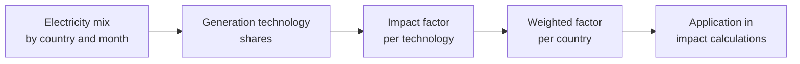

# Impacts of energy consumption

For any study object, operational impacts are derived from electricity consumption. This page explains the conversion into environmental impacts and how reference electricity factors are constructed. Their variation by country, season and generation mix is a major driver of results.

## Convert electricity consumption into operational impact {#conversion-consommation-electricite-impact-operationnel}

The conversion follows:

$$
\begin{aligned}
&I_{operational,i,p} = E_{elec,p} \times IF_{i,p} \quad [U_i]\\
&I_{operational,i,p} = \text{Operational impact for indicator } i \text{ in country } p\\
&E_{elec,p} = \text{Electricity consumed in country } p \quad [kWh]\\
&IF_{i,p} = \text{Electricity impact factor for indicator } i \text{ in country } p \quad [U_i/kWh]
\end{aligned}
$$

:::note[Applicable indicators]
The equation is generic. Index $i$ identifies an environmental indicator for which a compatible factor is available. Adapt $U_i$ accordingly: kg CO₂ eq. for GWP, characterized m³ eq. for WU, and so on.
:::

## Factor construction

## Country electricity factors

The methodology, resources and results are available in the open-source `digital4better/data` repository.[^source-1]

The dedicated database aims to:

- cover countries and selected state or regional subdivisions.
- provide **annual or monthly factors according to available coverage**.
- include all nine environmental indicators.
- use scientific and technical references that can improve on older datasets.

### Calculation method {#calculation-method}

Factors represent electricity **consumed** within a geographical region. They account for imports and exports, unlike a production-only approach.

For provinces or states, national imports and exports are distributed across subdivisions in proportion to their electricity generation.

#### Equation

$$
\begin{aligned}
&IF_{i,p} = \frac{\sum_t I_{i,t} \times E_{elec,t,p}}{\sum_t E_{elec,t,p}} \quad [U_i/kWh]\\
&IF_{i,p} = \text{Impact factor for indicator } i \text{ in country } p\\
&E_{elec,t,p} = \text{Electricity consumption from technology } t \text{ in country } p \quad [kWh]\\
&I_{i,t} = \text{Impact per kWh from technology } t \quad [U_i/kWh]
\end{aligned}
$$

#### Generation technologies

The calculation uses nine technology categories:

| Family | Technologies | Main characteristic |
|---|---|---|
| **Fossil** | Coal, gas, other fossil | High GWP and acidification contributions |
| **Low-carbon grouping** | Wind, solar, bioenergy, hydro, other renewable, nuclear | GWP and other impacts vary by technology and inventory; interpretation depends on the factor used |

#### Two factors per country

Two factors are available to investigate renewable-electricity scenarios:

<dl className="model-profiles">
  

    <dt>Standard factor</dt>
    <dd>

Covering the complete national mix.

    </dd>
  

  

    <dt>Renewable factor</dt>
    <dd>

Covering only generation classified as renewable.

    </dd>
  

</dl>

The reference calculation retains the complete average mix. The renewable factor supports a separate sensitivity analysis: contractual REF alone does not reconstruct physical supply or reduce an SCI score. See [Software layers and virtualization](../regles/prise-en-compte-des-couches-logicielles-et-de-la-virtualisation) and [Datacenter](../materiel/reseau-et-infrastructure/datacenter).

## Geographical and temporal variability

The same electricity consumption can produce different impacts depending on geography, period and generation mix.

### Geographical example: GWP

| Country | Year | GWP factor, g CO₂e/kWh |
|---|---:|---:|
| France | 2025 | 31.93 |
| Sweden | 2025 | 12.82 |
| Germany | 2025 | 329.63 |
| Poland | 2025 | 644.15 |
| China | 2025 | 589.30 |
| United States | 2025 | 354.80 |

Values come from the versioned D4B dataset[^ref-1], accessed on 16 October 2026 and also used by the simulators. Ex: 1,000 kWh corresponds to 31.93 kg CO₂e in France and 644.15 kg in Poland, with identical consumption and electricity boundaries. These are not complete server footprints.

### Temporal variability

The default conventions are:

<dl className="model-profiles">
  

    <dt>Annual factors</dt>
    <dd>

For scoping assessments.

    </dd>
  

  

    <dt>Monthly factors</dt>
    <dd>

When seasonality materially changes the result, such as seasonal hydropower or summer solar generation.

    </dd>
  

</dl>

#### Temporal example: GWP

Within the same country, the factor also varies from month to month. Values below are in **g CO₂e/kWh**, from the same D4B snapshot as the geographical examples.[^monthly-factors]

| Country | January 2025 | July 2025 |
|---|---:|---:|
| France | 42.66 | 26.36 |
| Germany | 372.63 | 317.31 |
| Brazil | 53.46 | 83.13 |

For **1,000 kWh**, electricity impacts in France are **42.66 kg CO₂e in January versus 26.36 kg in July**. In Brazil, they rise from **53.46 to 83.13 kg CO₂e**. These two months illustrate observed variation, not a seasonal rule that holds every year.

A monthly assessment applies each month’s factor to its corresponding consumption, then sums the impacts. When consumption varies, the average factor is weighted by each month’s kWh. Monthly averages do not describe hourly variations.

Freshness depends on the latest period actually present in the file. An intended monthly update frequency does not prove freshness or completeness. Simulators here use a complete year, 2025, rather than extrapolating available months of 2026.

## Interpreting electricity contracts

The **ADEME Product Category Rules (PCR) for digital services, version 2 of June 2026**, use the geographical consumption mix, including imports. Guarantees of origin and offsets do not reduce that result. They provide specific treatment for on-site generation, with its full lifecycle and conditions on certificates; an off-site renewable contract does not replace the local mix.[^rcp-parent]

D4B retains the country consumption factor for geographical reporting. The renewable factor supports a separate sensitivity analysis. Its use for the cloud REF share is described in the [cloud convention](../cas-d-usage/environnements/cloud.md#electricite-cloud), with its specific data and limitations.

## Resources

Electricity technology impacts are primarily based on:

- coal, gas, wind, solar, hydro and nuclear: Life cycle assessment of electricity generation options[^source-3], UNECE.
- other fossil, bioenergy and other renewable: New approach for assessing and optimising the environmental performance of multinational electricity sectors: A European case study[^source-4], September 2022.

:::note[European extrapolation]
These technology inventories describe Europe. Applying them worldwide where more representative data are unavailable introduces a geographical limitation that must remain visible.
:::

National mixes draw notably on Ember[^source-2], with monthly data for covered countries and annual data for broader coverage. Additional sources cover subdivisions, including Canada[^ref-2] and the United States[^ref-3].

## Assumptions and limitations

- Average and marginal electricity mixes answer different questions. This methodology uses average mixes by default, consistent with its attributional perspective.
- European technology inventories may require extrapolation to other regions.
- Every assessment must identify the version of its D4B factors; see [Time and versioning](../regles/temporalite-vieillissement-et-versionnement-des-donnees).
- Renewable factors must not be used without reviewing the contractual and physical supply conditions.

[^rcp-parent]: ADEME, [RCP services numériques, version 2, juin 2026](https://librairie.ademe.fr/societe-et-politiques-publiques/9418-methodologie-d-evaluation-environnementale-basee-sur-l-analyse-du-cycle-de-vie-acv-pour-un-service-numerique.html), p. 22.

[^source-1]: Digital4Better, [digital4better/data](https://github.com/digital4better/data)Evolving catalogue; pin a commit for reproducible factors. Directories: `data/factor/*`, `data/energy/*`, `data/mix/*`.

[^source-2]: [Ember](https://ember-climate.org/) Online documentation, unpinned version.

[^source-3]: [UNECE electricity generation LCA](https://unece.org/sites/default/files/2022-04/LCA_3_FINAL%20March%202022.pdf)

[^source-4]: [Energy Conversion and Management, 2022](https://www.sciencedirect.com/science/article/pii/S0196890422008159#b0530)

[^ref-1]: Digital4Better, [versioned D4B dataset](https://raw.githubusercontent.com/digital4better/data/77cae4a58fadd5deb3b8d4e5577020da08f780d8/data/factor/country-yearly.csv). Snapshot 77cae4a, 2025 data; reviewed 16 October 2026.

[^ref-2]: [Canada](https://www150.statcan.gc.ca/t1/tbl1/en/tv.action?pid=2510001501).

[^ref-3]: [United States](https://www.eia.gov/electricity/data/eia923/).

[^monthly-factors]: Digital4Better, [monthly country electricity factors](https://raw.githubusercontent.com/digital4better/data/77cae4a58fadd5deb3b8d4e5577020da08f780d8/data/factor/country-monthly.csv), snapshot 77cae4a; FR, DE and BR rows for 2025-01 and 2025-07, `gwp` column in kg CO₂e/kWh, converted here to g CO₂e/kWh. Accessed 19 October 2026.
