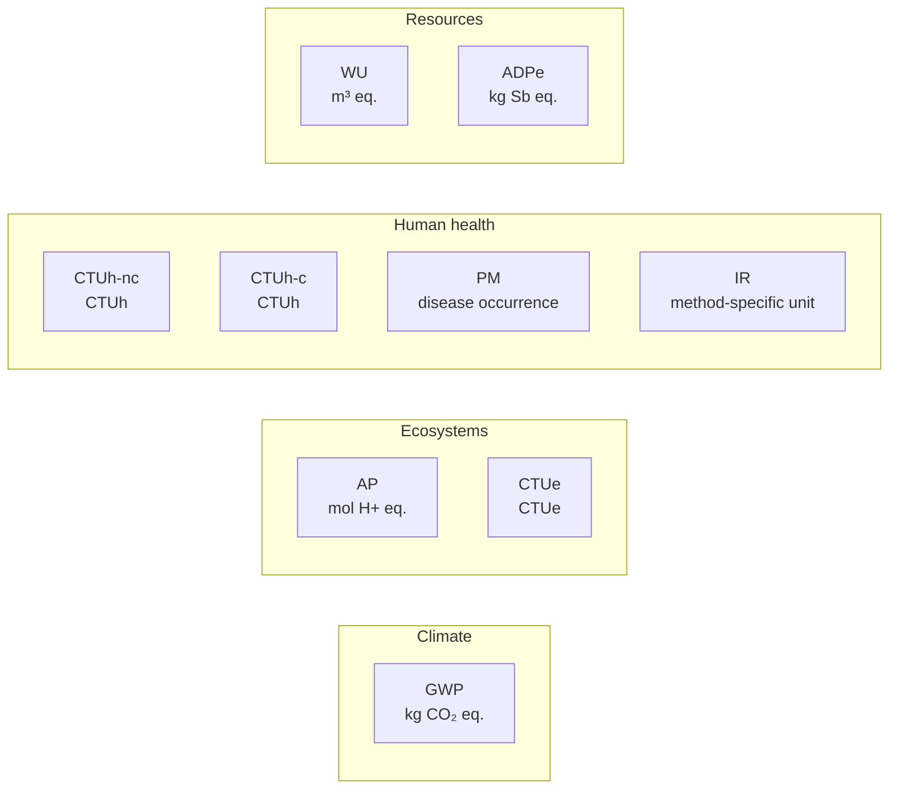

# Environmental indicators

import { MethodIllustration } from '@site/src/components/method-illustrations';

The methodology uses multiple environmental indicators. Greenhouse gas emissions matter, but cannot describe every digital impact. Mineral extraction, water use, manufacturing toxicity and abiotic resource depletion are dimensions that carbon alone does not capture.

## Indicators used in the assessment {#indicateurs-pris-en-compte-dans-l-evaluation}

Whatever the study object, results use environmental indicators. The nine-indicator selection is the D4B convention retained in this version.

The nine [midpoint](../references/glossaire.md#approche-mid-point) indicators are organized into four reading groups. These editorial groups are **not an [endpoint](../references/glossaire.md#approche-end-point) damage calculation**:

An additional inventory flow supports interpretation: **electricity consumption**, in kWh.

### Indicator table

| Midpoint indicator | Acronym | Unit | Reading group | Definition |
|---|---|---|---|---|
| Total climate change | GWP | kg CO₂ eq. | Climate | Climate-change potential from greenhouse gas emissions. These gases absorb infrared radiation emitted by the Earth's surface; increasing concentrations contribute to warming. |
| Acidification | AP | mol H+ eq. | Ecosystems | Potential acidification of soil and surface water due to emissions such as nitrogen oxides, sulfur oxides, ammonia and hydrogen chloride. |
| Freshwater ecotoxicity | CTUe | CTUe | Ecosystems | Potential toxicity of emitted substances to freshwater ecosystems. |
| Human toxicity, non-cancer | CTUh-nc | CTUh | Human health | Potential non-carcinogenic harm from emitted toxic substances. |
| Human toxicity, cancer | CTUh-c | CTUh | Human health | Potential chronic carcinogenic effects from emitted substances. |
| Particulate matter | PM | Disease occurrence | Human health | Health effects associated with particulate emissions and exposure, including respiratory and cardiovascular harm. |
| Ionizing radiation | IR | kBq U235 eq. for EF; dataset-specific unit | Human health | Potential health effects of radioactive emissions. |
| Water use | WU | m³ eq. | Resources | Potential water deprivation after characterization, according to the factor's method. Distinct from physical consumption or withdrawal in unweighted m³. |
| Mineral resource depletion | ADPe | kg Sb eq. | Resources | Potential depletion associated with mineral and metal extraction, expressed in antimony equivalents. |

:::note[Equation compatibility]
Aggregation equations apply where compatible factors are available. Missing values are not zero. Index $i$ identifies the selected indicator; its unit $U_i$ must match throughout the calculation.
:::

### Check units and characterization methods

A common label does not establish compatibility. Each factor retains its characterization method and version. Physical water volume cannot be added to a characterized scarcity indicator. Likewise, an older component model's ADP is not automatically equivalent to another framework's ADPe.[^model-data][^source-4]

EF expresses ionizing radiation in **kBq U235 eq.**: equivalent activity, not mass.[^rcp-parent] Some historical D4B labels use kg. These factors are not aggregated until their inventory and unit have been verified.

Electricity consumption in kWh differs from primary energy in MJ. Converting units (1 kWh = 3.6 MJ) does not transform final electricity consumption into primary energy demand.

## Why carbon alone is insufficient

### Limitations of one indicator

Digital technology involves issues beyond climate change:

| Life cycle stage | Issue | Relevant indicators |
|---|---|---|
| Raw-material extraction | Mineral and metal depletion | **ADPe** |
| Semiconductor manufacturing | Water and chemical use | **WU**, **CTUe** |
| Intercontinental transport | Air pollutant emissions | **AP**, **PM** |
| Use | Electricity consumption and its generation mix | **GWP**, **IR**, among others |
| End of life | Electronic-waste toxicity | **CTUh-nc**, **CTUh-c** |

### Illustration

A smartphone manufactured in Southeast Asia and used in France could have:

- **GWP** dominated by manufacturing and its electricity supply.
- **ADPe** dominated by mineral extraction.
- **WU** dominated by chip manufacturing.
- **IR** dominated by use-phase electricity.

These are possibilities to test with an LCA, not universal distributions. Extending a device's life does not alter past extraction, but may avoid new manufacturing for an equivalent service. Comparisons must therefore state the replacement scenario, duration and transfers between indicators.

:::note[No automatic indicator hierarchy]
The methodology does not rank indicators by importance. GWP is not inherently more important than ADPe. Each illuminates a different issue; joint interpretation supports informed analysis.
:::

## From midpoints to a single score {#from-midpoints-to-a-single-score}

### Midpoint and endpoint approaches

[**Midpoint**](../references/glossaire.md#approche-mid-point) indicators describe an environmental problem, such as climate change in kg CO₂ eq. [**Endpoint**](../references/glossaire.md#approche-end-point) indicators estimate associated damages, such as healthy life years lost.[^mid-end]

The methodology retains midpoints as its reference to limit additional damage-model assumptions.

### Single score

The following score is a **historical proposal, not validated for this version**. Coefficients, reference year and compatibility with impact factors must be established before use. No aggregate score is calculated in the illustrations. These groupings are neither a complete PEF score nor endpoint damage models.[^source-3]

| Subscore | Indicators | Area of protection |
|---|---|---|
| **Climate change** | GWP | Climate |
| **Biodiversity** | AP, CTUe | Ecosystem quality |
| **Environmental health** | CTUh-nc, CTUh-c, PM, IR | Human health |
| **Resources** | WU, ADPe | Natural resources |

Normalization and weighting coefficients are described in the [Technical appendices](../references/annexes-techniques).

:::note[Using a single score]
Reference reporting presents individual indicators, coverage and limitations. The historical biodiversity grouping does not directly measure biodiversity loss.
:::

## Indicators under review

Additional indicators may be discussed when their environmental relevance is high but available data are not sufficiently consistent, or when reference methods do not yet support stable integration across use cases.

Biodiversity footprint and land use are topics under review, without being calculated systematically.

[**AWARE**](../references/glossaire.md#aware), short for *Available WAter REmaining*, is a water characterization method. It weights consumed volumes by the water remaining after human and ecosystem needs. The same m³ consumed can therefore have a different potential impact depending on the watershed and period.[^aware]

AWARE can be used to calculate **WU**. If an existing factor uses another method, its results are not directly added to AWARE results. The method and version remain explicit.

## Calculation coverage {#calculation-coverage}

The nine indicators define the framework. Inclusion in the framework does not guarantee a usable factor for every item.

| Item or result | Current illustration coverage | Interpretation of the result |
|---|---|---|
| Parametric equipment manufacture | Partial GWP; other categories unassessed at assembly level | Partial climate result, with no conclusion about other indicators |
| CPU component | GWP and historical ADPe in the dedicated example | Component result only, not the complete equipment |
| Electricity | Factors depend on indicator, country and year | Addition only with compatible methods and units |
| Network or third-party service without a suitable factor | Known activity, unassessed impact | Partial result while this impact remains missing |
| Direct water | Separate physical volume | Physical volume, distinct from scarcity impact |

Zero means a justified zero. Unassessed means data or a model are missing. A complete total requires coverage of the retained items for each indicator.

<MethodIllustration kind="missing-data" lang="en" />

## Mapping to the 2026 PCR

D4B retains its nine indicators and reporting conventions. The June 2026 parent PCR presents sixteen EF categories. These are therefore not identical lists; available results must state covered categories and any exclusions.[^rcp-parent]

The seven additional categories are fossil resources, freshwater, marine and terrestrial eutrophication, photochemical ozone formation, ozone depletion and land use. Their absence from a D4B result does not mean zero impact.

An extension requires compatible inventories and factors, not a conversion from carbon. It would be a separate methodological change. The historical aggregate score remains unvalidated for this version and is not a complete EF score.

## Assumptions and limitations

- Coverage differs between use cases. Some public factors are stronger for GWP than for other categories.
- Electricity technology factors are largely European and may be extrapolated; see [Energy consumption](./impacts-de-la-consommation-d-energie).
- Some Base Empreinte equipment indicators, including WU, may be negative because of end-of-life modeling. Aggregation depends on the source conventions.
- A single score must not hide transfers between categories.

[^rcp-parent]: ADEME, [RCP services numériques, version 2, juin 2026](https://librairie.ademe.fr/societe-et-politiques-publiques/9418-methodologie-d-evaluation-environnementale-basee-sur-l-analyse-du-cycle-de-vie-acv-pour-un-service-numerique.html), p. 23–25.

[^source-3]: European Commission Product Environmental Footprint methodology See the [documentary corpus](../references/sources-et-corpus).

[^source-4]: Digital4Better, [digital4better/data](https://github.com/digital4better/data)Evolving catalogue; pin a commit for reproducible factors.

[^model-data]: `digital4better/data`: `data/energy/*`, `data/factor/*`, `data/equipment/*`. ADEME Base Empreinte multicriteria factors. [Digital4Better data catalogue, snapshot 77cae4a](https://github.com/digital4better/data/tree/77cae4a58fadd5deb3b8d4e5577020da08f780d8). References and scope: [Sources and corpus](../references/sources-et-corpus).

[^aware]: WULCA, [What is AWARE?](https://wulca-waterlca.org/what-is-aware/) and [FAQ](https://wulca-waterlca.org/what-is-aware/faq/). Boulay et al., 2018, AWARE model. Documentation accessed 20 October 2026.

[^mid-end]: RIVM, [LCIA: the ReCiPe model](https://www.rivm.nl/en/life-cycle-assessment-lca/recipe), overview of midpoint and endpoint levels, updated 29 October 2024.
