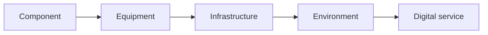
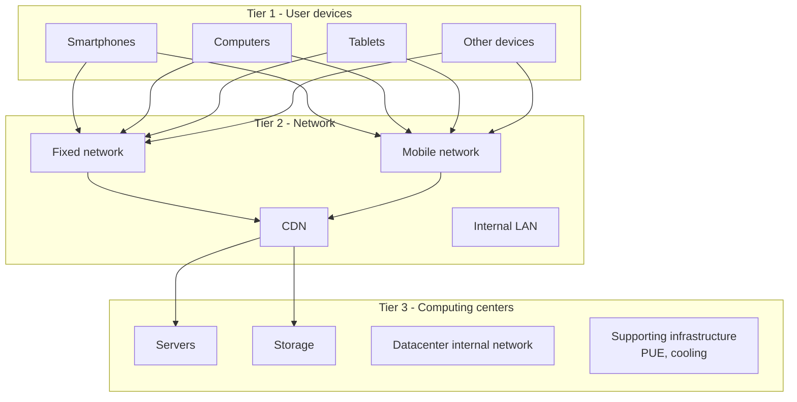
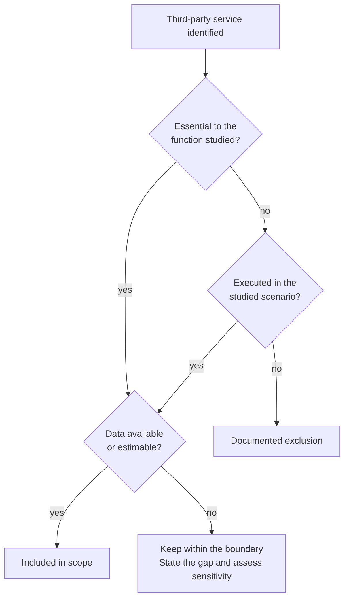

# Scope, boundaries, third-party services and unit of analysis

import { MethodIllustration } from '@site/src/components/method-illustrations';

Assessment quality starts with the definition of the study object. This page establishes how to identify inclusions, exclusions and the unit to which results are related. A poorly defined boundary makes results unusable, regardless of numerical precision.[^source-3]

## From a unit calculation to the whole application

A page view, session or request describes part of the activity. An application assessment covers its **functions, users and usage contexts over a defined period**.[^rcp-app]

<MethodIllustration kind="application-scope" lang="en" />

The **version, period and exclusions** accompany the result. If some contributions remain unassessed, the result remains partial even when reported at application level.

## Define the study object

The assessment can operate at several levels:

| Level | Examples | Typical unit of analysis |
|---|---|---|
| **Component** | Processor, RAM, SSD | Per component over a lifetime |
| **Equipment** | Smartphone, laptop, server | Per device over a period |
| **Infrastructure** | Datacenter, server room, LAN | Per infrastructure over a year |
| **Environment** | IT fleet, cloud, hosting | Per environment over a year |
| **Digital service** | Website, email, generative AI | Per page view, request, user or volume |

Each level requires appropriate units and boundaries.

## System boundaries

### Three tiers

Following the ADEME/ARCEP digital services framework, the methodology organizes scope around three tiers:

### Boundary rules

The scope must state[^model-data]:

1. **Equipment directly involved**: identified user devices, servers and network equipment.
2. **Infrastructure included**: datacenter, WAN/LAN and CDN.
3. **Third-party services** required to deliver the service.
4. **Exclusions** and their justification.

:::note[Boundary principle]
An excessively narrow boundary produces artificially low results. An excessively broad one makes interpretation difficult. Each assessment needs an explicit, justified compromise.
:::

### Equipment and system approaches

The digital services framework distinguishes complementary approaches:

| Approach | Principle | When to use | Precision |
|---|---|---|---|
| **Equipment** | Device-by-device inventory and characterization | Organization-controlled scope | Depends on measurement and factor representativeness |
| **System** | Equipment represented as a closed system with aggregate factors | Uncontrolled scope, such as operator networks or external cloud | Depends on aggregate-factor representativeness |

The methodology favors equipment modeling for controlled scopes and system modeling for uncontrolled scopes, following the reference framework.

## Third-party services and APIs

### When to include a third-party service

A third-party service is included when **required for the function or executed in the scenario**, even if outsourced. An assessment using a compatible unit is preferred; otherwise estimates and missing data remain explicit.

<MethodIllustration kind="third-party-scope" lang="en" />

### When a third-party service may be excluded

Three situations need to be distinguished:

<dl className="model-profiles">
  

    <dt>Outside the boundary with no contribution to the scenario</dt>
    <dd>

The service may be excluded, with justification.

    </dd>
  

  

    <dt>Impact cannot be quantified</dt>
    <dd>

The service is listed in the study as **“impact not assessed”**. The result is incomplete; this impact is not treated as zero.

    </dd>
  

  

    <dt>Already counted in another contribution</dt>
    <dd>

Its impact is not added again. See [Double counting](../regles/double-comptabilisation.md).

    </dd>
  

</dl>

:::note[Explicit exclusions]
**Every exclusion is justified** in the assumptions and limitations. An unassessed contribution is also identified there, with its estimated importance: negligible, significant or unknown.
:::

### Third-party decision tree

## Unit of analysis

The unit must be:

- **understandable** to a non-specialist reviewer.
- **stable** over time for comparison.
- **related to the function delivered** by the service or equipment.
- **compatible** with available data.

**Device usage time**, **server time** and **unique user count** describe different quantities. They cannot be substituted for one another.

### Examples by use case

| Use case | Possible units | Recommended unit |
|---|---|---|
| [**IT fleet**](../cas-d-usage/environnements/parc-informatique.md) | Per device, employee or year | Whole fleet over one year |
| [**Hosting infrastructure**](../cas-d-usage/environnements/infrastructure-d-hebergement.md) | Per server, rack or datacenter | Infrastructure over one year |
| [**Web service**](../cas-d-usage/services/service-web.md) | Per page view, session, visit or service | Per page view, aggregated to the service |
| [**Email**](../cas-d-usage/services/mail.md) | Per sent/received message, mailbox or year | Per message, aggregated to the service |
| [**Native applications**](../cas-d-usage/services/mobile.md) | Per screen, session or download | Per screen, aggregated to the service |
| [**Generative AI**](../cas-d-usage/services/ia-generative.md) | Per training run, inference or token | Per inference request or training run |
| [**Cloud**](../cas-d-usage/environnements/cloud.md) | Per vCPU·h, GB·month or service | Per billed cloud unit |

There is no single unit for every chapter. Each assessment must **state its chosen unit** and verify consistency with [Allocation and sharing](../regles/allocation-et-partage-des-impacts).

## Worked example

**Case: define an e-commerce web service boundary.**

| Element | Included? | Justification |
|---|---|---|
| User devices | Yes | Website consultation |
| WAN | Yes | Transport of pages and requests |
| CDN | Yes | Static-content distribution |
| Cloud hosting servers | Yes | Request processing and storage |
| Payment API, such as Stripe | Yes | Required for purchasing |
| Analytics, such as Google Analytics | If executed | Scripts, requests and processing in the actual journey; measurements or an explicit gap |
| Datacenter internal network | Yes | Included through a datacenter factor where its scope confirms coverage |
| ERP back office | No | Outside the defined front-end service scope |

**Selected unit**: a page view, aggregated to the service over one observation year.

## Assumptions and limitations

- Third-party services are often opaque and require estimates or generic factors.
- Assessments with different scopes are not directly comparable without reviewing boundaries.
- System modeling can be more practical for uncontrolled scopes and less detailed. Quality depends on factor representativeness, not granularity alone.
- Unit selection affects interpretation. A heavy page has a high unit impact; an annual service total aggregates variations.

[^rcp-app]: ADEME, [RCP des applicatifs numériques, juin 2026](https://librairie.ademe.fr/economie-circulaire-et-dechets/9434-referentiel-par-categorie-de-produit-rcp-des-applicatifs-numeriques.html), p. 13–16, 19–21, 38–40. The PCR specifies one year by default and an application boundary including development activities. Aggregating journeys alone does not establish complete coverage.

[^source-3]: [SCI ; Software Carbon Intensity](https://sci.greensoftware.foundation/) Online documentation, unpinned version.

[^model-data]: `digital4better/data`: `data/cloud/*`, `data/factor/*`, `data/equipment/*`. Scope metadata for each use case. [Digital4Better data catalogue, snapshot 77cae4a](https://github.com/digital4better/data/tree/77cae4a58fadd5deb3b8d4e5577020da08f780d8).
