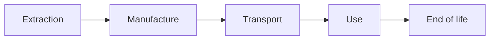

# Life-cycle assessment for digital services

Life-cycle assessment (LCA) studies product or service impacts from material extraction to end of life. For digital services, it connects the delivered function to the devices, networks and data centres needed to operate it.

This methodology uses that framework to construct traceable assessments. Beta simulators cover narrower boundaries, displayed with each result; they are not automatically complete LCAs.

## Consider the life cycle

| Contribution | Required data | Check |
|---|---|---|
| Manufacture and other non-use phases | Product inventory or documented factors | Whether transport and end of life are included |
| Operation | Energy, duration, consumables and water as applicable | Relevant flows beyond electricity included |

“Embodied impact” here means the non-use phases covered by the factor. A manufacturing-only factor is not a complete life-cycle inventory. [Environmental indicators](./indicateurs-environnementaux) describe climate, resources, water or toxicity without conflating them.

## Attribute impacts

The main approach is **attributional**: it distributes impacts between equipment, organizations or services. It asks “what share should be attributed to this activity?”.

Ex: spreading 200 kg CO₂e of computer manufacture over five years attributes 40 kg per year. This does not establish that extending lifetime by a year immediately avoids 40 kg of emissions. A decision's physical effect depends on replacement, use and what would otherwise have happened.

Assessing the consequences of a decision requires additional assumptions. Comparisons here primarily concern consistent allocation scenarios.

## Connect services to hardware {#approche-multi-composants}

The ADEME digital services reference framework[^ref-1] organizes resources into three tiers: devices, networks and data centres. Software orchestrates those resources; it is not a separate material layer to add.

[Hardware](../materiel/vue-d-ensemble-du-materiel) describes components and equipment. [Service modelling](../modelisation/modelisation-d-un-service) explains how to assemble them without counting physical resources multiple times.

## Cover service phases

A service also has a history: design, development, deployment, operation and retirement. Each phase uses hardware with its own life cycle.

| Service phase | Activities to inventory |
|---|---|
| Design and development | Team devices, tools, tests and build environments |
| Deployment | CI/CD, registries, installations and updates |
| Operation | User devices, network, servers and third-party services |
| Retirement or migration | Transfers, archiving, erasure and resource reassignment |

A phase cannot be considered negligible without supporting evidence. Simulators mainly cover operation; Native applications also includes distribution downloads. Additional activities can be assessed with the same models, then allocated to the studied function.

## Construct a comparison

A comparison requires the same delivered function, comparable service quality and a consistent period. It relies on the same characterization methods and explicit boundary differences. A climate reduction can accompany an increase in another indicator.

Continue with [Boundary and functional unit](./perimetre-frontieres-services-tiers-et-unite-d-analyse), then [Allocation](../regles/allocation-et-partage-des-impacts). [Positioning](../introduction/positionnement-par-rapport-aux-referentiels-existants) distinguishes ISO 14040/14044, sector references and D4B conventions.

## Cross the two life cycles

Service and equipment life cycles are intertwined. One development year uses a share of workstation and server manufacture and operation; it does not create a new complete manufacturing footprint for those devices.

import { ServiceLifecycle } from '@site/src/components/service-lifecycle';

<ServiceLifecycle lang="en" />

### Activity examples by phase

| Service stage | Allocated manufacture | Operation to inventory |
|---|---|---|
| Development | Workstation, server and test-platform shares | Team activity, compilation, tests and datasets |
| Deployment | Distribution infrastructure shares | Image builds, transfer and installation |
| Operation | Device, network and infrastructure shares | User journeys, processing, idle time and storage |
| Retirement | Migration and archive resource shares | Transfers, retention and erasure |

Design impacts per service unit depend on a reference volume and period. Sensitivity to that denominator matters when future operating life is uncertain. Adoption assumptions are not observed data.

The inventory is organized by equipment, then component when data justify it. Impact calculation applies characterized factors to compatible flows. A characterized product result and its detailed components cannot both contribute to the same total. Multi-impact interpretation checks burden shifts across phases and categories.

[^ref-1]: [ADEME digital services reference framework](https://librairie.ademe.fr/produire-autrement/6022-referentiel-methodologique-d-evaluation-environnementale-des-services-numeriques.html).
