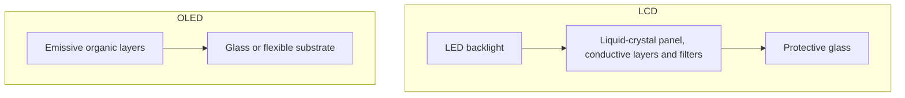

# Displays

A display can materially contribute to device manufacturing and electricity consumption. Its share depends on configuration and use. Relevant parameters include area, technology and materials. Area grows with the square of diagonal length when aspect ratio is constant.

## Physical structure

| Element | LCD | OLED | Relevant contribution |
|---|---|---|---|
| Substrate | Glass layers | Glass or plastic | Material production and process energy |
| ITO conductive layer | Present in common designs | Present in common designs | Indium-containing material inventory |
| Backlight | LEDs | Self-emissive pixels instead | Operational electricity |
| Organic emissive layer | No | Yes | Chemical processing |
| Filters / polarisers | Design-dependent | Design-dependent | Materials and manufacturing |

## Parametric model

:::caution[Scenario requiring calibration]
The technology coefficients below are D4B educational assumptions for size-sensitivity exploration. Their derivation from a specified product report and panel boundary has not been established. They are not validated ADEME or Boavizta factors. Reporting requires a traceable product or display inventory.
:::

### Embodied formula

$$
I_{emb}=S_{display}C_{technology}+C_{base}
$$

For a 16:9 screen with diagonal $d$ in inches:

$$
S_{display}=d^2\times2.54^2\times\frac{16\times9}{16^2+9^2}\approx d^2\times2.7569\quad[\mathrm{cm}^2]
$$

$C_{technology}$ is impact per cm², while $C_{base}$ represents an assumed fixed contribution such as drivers, connectors and frame. These elements may already occur in another equipment residual.

:::note[Area versus diagonal]
A 27-inch 16:9 display has 17.25 times the area of a 6.5-inch 16:9 display. The model's variable part follows that ratio; the fixed base does not. Other aspect ratios require different geometry.
:::

### Scenario coefficients

| Technology | GWP coefficient, kg CO₂ eq./cm² | Base, kg CO₂ eq. | Assumed power, W/cm² | Status |
|---|---|---|---|---|
| LCD / IPS | 0.07 | 3.0 | 0.003 | D4B assumption; calibration needed |
| OLED / AMOLED | 0.12 | 2.5 | 0.002 | D4B assumption; content-dependent power |
| E-ink | 0.03 | 1.5 | Approximately zero for static image retention | Excludes electronics, refreshes and any lighting |

The contextual corpus contains manufacturer-report decompositions but does not substantiate these specific technology coefficients. Manufacturing and operational differences depend on panel design, yields, brightness and displayed content. Dark OLED pixels reduce emission-related power without making the whole panel or device consume zero electricity.

### Arithmetic examples

All rows use the LCD scenario and 16:9 geometry:

| Example | Diagonal | Area | Manufacturing GWP | Modelled LCD power |
|---|---|---|---|---|
| Smartphone-sized display | 6.5 in | 116 cm² | About 11 kg CO₂ eq. | 0.35 W |
| Tablet-sized display | 11 in | 334 cm² | About 26 kg CO₂ eq. | 1.00 W |
| Laptop-sized display | 14 in | 540 cm² | About 41 kg CO₂ eq. | 1.62 W |
| Desktop display | 27 in | 2,010 cm² | About 144 kg CO₂ eq. | 6.03 W |

The last result is not a complete monitor LCA or proof of equivalence with a laptop. Surface-power assumptions may omit electronics and conversion losses; they are not wall-power measurements.

## Operational impact

$$
P_{display}=S_{display}p_{technology}
$$

The illustrative coefficients are $p_{LCD}=0.003$ and $p_{OLED}=0.002$ W/cm². E-ink static image retention does not imply zero energy for refresh, control electronics or lighting.

OLED consumption depends on brightness and content. Dark-mode savings are not uniform and cannot be applied to the whole device without measurement. LCD backlighting is a distinct power contribution.

## Indicator coverage

| Indicator | Treatment |
|---|---|
| GWP | Exploratory area model, not calibrated |
| ADPe | Materials such as indium can matter; no validated display-specific factor here |
| WU | Cleaning and manufacturing require compatible inventories |
| AP, PM | Process contributions require compatible inventories |
| IR | Manufacturing and use require the correct LCIA unit; missing data do not imply a small contribution |
| CTUe, CTUh | Solvents and other processes may contribute; no isolated panel inventory established here |

Whole-equipment factors may include these impacts without allowing a display-specific split. They must not be added to a separately modelled display when that duplicates the same boundary.[^model-data][^ref-1]

## Assumptions and limitations

Area alone omits resolution, pixel density, backlight design and manufacturing yield. OLED coefficients and area-based power are assumptions. The model does not isolate indium's ADPe contribution. Actual dimensions and representative measurements replace generic geometry and power when available.

These references do not by themselves validate the scenario table.

## Interactive example {#simulator}

import { DisplayPlayGround } from '@site/src/components/display-playground';

<DisplayPlayGround lang="en" />

[^ref-1]: [Boavizta documentation](https://doc.api.boavizta.org/). Online documentation, unpinned version.

[^model-data]: Compatible D4B equipment factors and identified product environmental reports can support equipment-level assessment. Contextual material includes ADEME Base Empreinte, *Les impacts environnementaux des équipements informatiques*, manufacturer reports, Boavizta documentation and Digital4Better data. [Digital4Better data catalogue, snapshot 77cae4a](https://github.com/digital4better/data/tree/77cae4a58fadd5deb3b8d4e5577020da08f780d8). References and scope: [Sources and corpus](../../references/sources-et-corpus).
