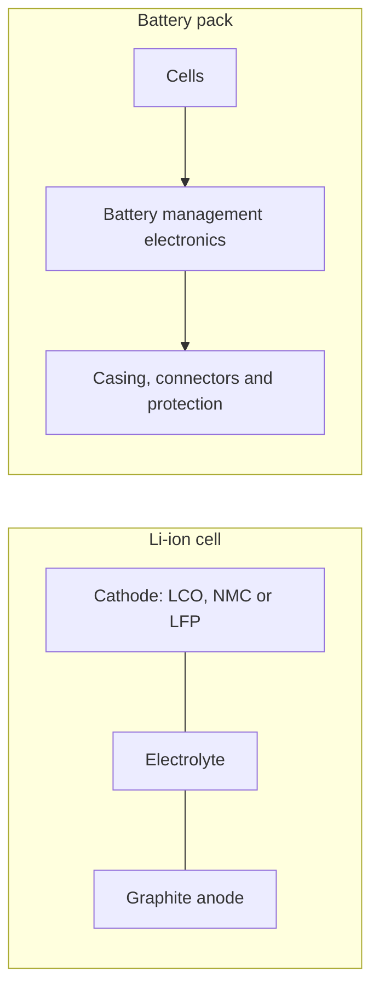

# Power supplies and batteries

Batteries use lithium, graphite and, depending on chemistry, cobalt or nickel. Impacts depend on capacity, chemistry, process, manufacturing geography and the cell/pack boundary. An automotive battery LCA cannot automatically be transferred to a smartphone battery.[^ref-1][^ref-2][^ref-3][^ref-4]

## Physical structure

| Part | Materials / processes | Relevant impacts |
|---|---|---|
| Cathode | Cobalt for LCO; nickel/manganese/cobalt for NMC; iron/phosphate for LFP | Extraction, refining, manufacturing |
| Anode | Natural or synthetic graphite | Process energy and other inventory flows |
| Electrolyte | Lithium salts such as LiPF₆ | Chemical production; water quantities require precise definitions |
| Current collectors | Copper and aluminium | Material production |
| BMS and casing | Electronics, plastics and metals | Manufacturing and processing |

These are qualitative pathways, not proof that one indicator universally dominates each part.

## Parametric model

### Embodied impact

$$
I_{emb}=\frac{C_{battery}}{1000}F_{chemistry}
$$

$C_{battery}$ is capacity in Wh; $F_{chemistry}$ is impact per kWh of capacity. Capacity is not energy consumed over the battery's lifetime.

### Simulator scenarios

| Chemistry | Exploratory GWP, kg CO₂ eq./kWh capacity | Status |
|---|---|---|
| LCO | 75 | D4B educational assumption |
| NMC 622 | 65 | D4B educational assumption |
| NMC 811 | 60 | D4B educational assumption |
| LFP | 50 | D4B educational assumption |

These are **neither established meta-analysis medians nor factors validated by the papers cited below**. They illustrate capacity scaling. A publishable assessment requires a factor identifying chemistry, factory, year, yield and cell/pack boundary. Earlier insufficiently traceable ADPe and water coefficients were removed from results and retained in the refactoring archive.

### Illustrative material composition

| Chemistry | Cobalt, g/kWh | Lithium, g/kWh | Nickel, g/kWh | Status |
|---|---|---|---|---|
| LCO | About 600 | About 110 | 0 | D4B composition assumption |
| NMC 622 | About 200 | About 90 | About 350 | D4B composition assumption |
| NMC 811 | About 60 | About 80 | About 470 | D4B composition assumption |
| LFP | 0 | About 80 | 0 | Lithium assumption; cathode chemistry has no cobalt or nickel |

These masses are inventory quantities, not environmental impact scores. Material criticality also includes supply risks and context; it is not synonymous with ADPe. Changes in chemistry can shift several impacts and performance properties simultaneously.

### Reproducible example

Ex: a 20 Wh battery with the LCO scenario gives `20 / 1000 × 75 = 1.5 kg CO₂ eq.` of modelled manufacturing GWP. Its share of a complete phone cannot be inferred without the phone inventory.

A replacement adds another battery inventory unless the equipment factor already includes that repair. It contributes only once.

## Power supply / charger

Power supplies have their own manufacturing impacts and affect operational electricity through conversion efficiency. Their contribution relative to a battery depends on the system.

$$
E_{input}=\frac{E_{useful}}{\eta}
$$

| Assumed efficiency | Input energy for 100 Wh useful output | Extra energy relative to useful output |
|---|---|---|
| 80% | 125 Wh | 25% |
| 90% | 111.11 Wh | 11.11% |
| 95% | 105.26 Wh | 5.26% |

:::note[Measurement boundary]
Efficiency applies only to energy measured or estimated at the supply's **output**. A wall measurement already includes conversion losses. In a datacentre, IT energy measured at equipment AC input already includes those supply losses before PUE. Site electrical-infrastructure losses are already within PUE.
:::

## Indicator coverage

| Indicator | Treatment |
|---|---|
| GWP | Educational scenario; an assessment requires a compatible inventory |
| ADPe, AP, PM, CTUe, CTUh | Relevant extraction/refining/manufacturing contributions; no isolated validated factor in this simulator |
| WU | Withdrawal, freshwater consumption, brine and scarcity impact are distinct, non-additive quantities |
| IR | Manufacturing and charging electricity can contribute; interpretation depends on method and unit |

A complete equipment factor may include the battery without providing a separate contribution. Adding that whole factor to the battery model would duplicate the battery contribution.[^model-data]

## Assumptions and limitations

- Coefficients and material masses are exploratory; no statistical confidence interval is assigned.
- The simulator does not establish full pack coverage, including BMS, casing or cooling. The chosen factor must define its boundary.
- ADPe and WU factors are not established for these scenarios. Comparing indicator quality requires reviewing actual inventories and methods.
- Efficiency depends on operating load; suitable measurements can replace assumptions.
- Battery replacement is an explicit lifetime assumption, not an automatic addition to every equipment inventory.

D4B scenarios are separate from the cited contextual publications.

## Interactive example {#simulator}

import { BatteryPlayGround } from '@site/src/components/battery-playground';

<BatteryPlayGround lang="en" />

[Critical materials](../materiaux/materiaux-critiques) for the broader resource context.

[^ref-1]: Kelly et al., 2021, Energy, greenhouse gas, and water life cycle analysis of lithium carbonate and lithium hydroxide monohydrate, *Resources, Conservation and Recycling*, 174, 105762. Lithium-process study, not validation of the four simulator factors. [Energy, greenhouse gas, and water life cycle analysis of lithium carbonate and lithium hydroxide monohydrate](https://doi.org/10.1016/j.resconrec.2021.105762).

[^ref-2]: Ellingsen et al., 2014, LCA of a Li-Ion Battery Vehicle Pack. [LCA of a Li-Ion Battery Vehicle Pack](https://doi.org/10.1111/jiec.12072).

[^ref-3]: Peters et al., 2017, Environmental impact of Li-Ion batteries. [Environmental impact of Li-Ion batteries](https://doi.org/10.1016/j.rser.2016.08.039).

[^ref-4]: Olivetti et al., 2017, Li-Ion Battery Supply Chain. [Li-Ion Battery Supply Chain](https://doi.org/10.1016/j.joule.2017.08.019).

[^model-data]: Equipment records and identified manufacturer reports may supply compatible product-specific evidence. References and scope: [Sources and corpus](../../references/sources-et-corpus).
