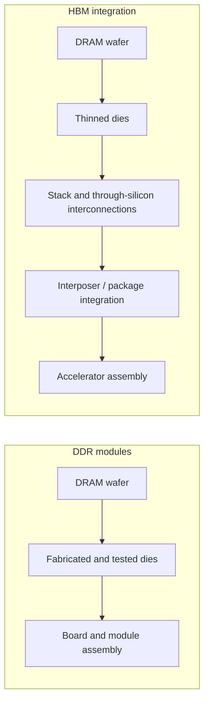

# Random-access memory

Memory manufacturing depends partly on the silicon area required for the installed capacity. With the historical model and an assumed density of 0.625 GB/cm², a 32 GB module gives **117.86 kg CO₂ eq.**; 5.22 kg is only the fixed term. HBM packaging multipliers used in the simulator are exploratory assumptions, not validated universal ratios.

## Manufacturing contributions

DRAM fabrication involves cleanrooms, lithography, etching and metallisation; see [Semiconductors](../materiaux/semi-conducteurs). Capacity depends on cell density, die area, die count and module organisation. HBM stacks DRAM dies with through-silicon interconnections; this differs from the memory-cell layers of 3D NAND.

These additional processes require their own inventories. Their existence alone does not establish a numerical impact multiplier.

## Parametric model

### Embodied formula

$$
I_{emb}=\left(\frac{C}{D}C_{die}+C_{base}\right)F_{pkg}N_{modules}
$$

$C$ is capacity **per module** in GB; $D$ is density in GB/cm²; $C_{die}$ is impact per cm²; $C_{base}$ is the fixed module contribution; $F_{pkg}$ is an assumed packaging multiplier; $N_{modules}$ is module count.

### Historical coefficients

| Indicator | Die coefficient per cm² | Base per module | Impact unit |
|---|---|---|---|
| GWP | 2.20 | 5.22 | kg CO₂ eq. |
| ADP | 6.30E-05 | 1.69E-03 | kg Sb eq. |
| Primary energy | 27.30 | 74.00 | MJ |

The historical model is documented in Boavizta's RAM methodology, based on Green Cloud Computing. Combining ADP with another dataset's ADPe requires compatible characterisation methods.[^ref-1][^model-data]

### Memory families

| Family | Application | Configuration considerations |
|---|---|---|
| DDR4 / LPDDR4 | System or mobile memory | Packaging and module organisation differ; LPDDR devices are not necessarily DIMMs |
| DDR5 / LPDDR5 | System or mobile memory | Density, generation and power management require specific data |
| GDDR6 / GDDR6X | Graphics memory | Board-mounted memory and bandwidth-oriented design |
| HBM2e | Some datacentre accelerators, including A100 variants | Stacked dies and package integration |
| HBM3 / HBM3e | H100 uses HBM3; H200/B200 use HBM3e | Capacity and stack configuration depend on the exact product |

### Density and packaging scenarios

These are **D4B exploratory hypotheses**, not guaranteed generation densities or validated packaging factors. Their applicability depends on die count, surface, counted capacity and the boundary between memory, interposer and accelerator.

| Type | Assumed density, GB/cm² | Assumed packaging multiplier |
|---|---|---|
| DDR4 / LPDDR4 | 0.625 | 1.0 |
| DDR5 / LPDDR5 | 1.0 | 1.1 |
| GDDR6 | 0.8 | 1.3 |
| HBM2e | 0.5 | 3.0 |
| HBM3 | 0.8 | 3.5 |

GDDR's integration and bandwidth requirements do not alone establish a higher impact per GB than DDR. A comparison needs compatible inventories.

### Reproducible scenarios

| Configuration | Modelled embodied GWP | Historical ADP result | Interpretation |
|---|---|---|---|
| One 32 GB DDR4 module | 117.86 kg CO₂ eq. | 4.92E-03 kg Sb eq. | Historical base model with assumed density |
| Sixteen 32 GB DDR5 modules | 1,330.91 kg CO₂ eq. | 6.52E-02 kg Sb eq. | Includes the hypothetical 1.1 multiplier |
| Six 16 GB HBM2e units | 1,361.16 kg CO₂ eq. | Not reported | Hypothetical configuration, not an H100 inventory |

The latter calculations are $(32/1\times2.2+5.22)\times1.1\times16$ and $(16/0.5\times2.2+5.22)\times3\times6$. Arithmetic consistency does not validate the multipliers or a universal RAM share in server manufacturing.

## Operational model

A simplified constant-capacity model is:

$$
P_{ram}=C_{total}\times p
$$

Historical examples use $p=0.392$ W/GB in Cloud Carbon Footprint or $p=0.284$ W/GB in the Boavizta/UBA model.[^ref-2]

| Capacity | At 0.392 W/GB | At 0.284 W/GB |
|---|---|---|
| 16 GB | 6.3 W | 4.5 W |
| 128 GB | 50 W | 36 W |
| 512 GB | 201 W | 145 W |
| 2,048 GB | 803 W | 582 W |

Refresh and data retention consume energy, but accesses, frequency and power states also matter. A constant W/GB coefficient is not a measured load-response curve or a universal law across DDR, LPDDR and HBM.

## Indicator coverage

| Indicator | Treatment |
|---|---|
| GWP | Historical area model plus explicit scenario assumptions |
| ADP / ADPe | Historical coefficients; method compatibility required |
| Primary energy | Historical coefficients, distinct from electrical kWh |
| WU | No validated characterised factor here; removed from simulator results |
| AP, PM, toxicity | Whole-equipment factors may include them without isolating memory |
| IR | Compatible manufacturing/use inventories and LCIA units required |

A physical water quantity per die area cannot be added directly to characterised electricity-related water. Missing component results do not imply zero impact. The current interactive output focuses on GWP and electricity rather than claiming all these indicators are calculated.

## Assumptions and limitations

Capacity alone is insufficient to establish a modern memory inventory. HBM multipliers require calibration; integrated memory and system RAM must have distinct boundaries. Power coefficients vary in suitability by technology and workload. A complete accelerator inventory that includes HBM already covers that contribution.

## Interactive example {#simulator}

import { RamPlayGround } from '@site/src/components/ram-playground';

<RamPlayGround lang="en" />

[^ref-1]: Green Cloud Computing, UBA, 2021 ; coefficients par cm² de die DRAM. Implémentés dans [Boavizta RAM methodology](https://doc.api.boavizta.org/Explanations/components/ram/).

[^ref-2]: Cloud Carbon Footprint methodology. [Cloud Carbon Footprint methodology](https://www.cloudcarbonfootprint.org/docs/methodology/). Online documentation, unpinned version.

[^model-data]: Versioned cloud CPU/accelerator records, identified memory configurations and historical Boavizta component models. [Digital4Better data catalogue, snapshot 77cae4a](https://github.com/digital4better/data/tree/77cae4a58fadd5deb3b8d4e5577020da08f780d8). References and scope: [Sources and corpus](../../references/sources-et-corpus).
