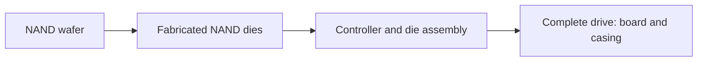

# Storage

Storage technologies have different manufacturing and operating profiles. The historical Boavizta model gives **51.70 kg CO₂ eq. for a 1 TB SSD** at an assumed density of 48.5 GB/cm², compared with a 31.11 kg fixed HDD estimate. These are different models from literature averages per GB. A comparison covers performance, lifetime and measured operating behaviour as well as capacity.

## Physical contributions

### SSD

An SSD contains NAND flash, control electronics and a board or other assembly. Fabrication includes semiconductor processes; layer counts and die organisation depend on generation.

### HDD

An HDD combines magnetic platters, motors, heads, electronics and mechanical assembly. A fixed impact per drive is a historical simplification, not evidence that real manufacturing is independent of capacity, platter count or electronics.

## Parametric models

### SSD die-area model

$$
I_{emb}^{SSD}=\left(\frac{C}{D_{NAND}}C_{die}+C_{base}\right)N_{drives}
$$

$C$ is capacity **per drive** in GB, $D_{NAND}$ is GB/cm², and $N_{drives}$ is drive count. The base covers the model's fixed assembly contribution; inspect its boundary before adding other parts.

| Indicator | Die coefficient per cm² | Base per drive | Unit |
|---|---|---|---|
| GWP | 2.20 | 6.34 | kg CO₂ eq. |
| ADP | 6.30E-05 | 5.63E-04 | kg Sb eq. |
| Primary energy | 27.30 | 73.98 | MJ |

See Boavizta SSD documentation[^ref-1]. The 48.5 GB/cm² density is a historical model assumption, not a demonstrated average for every NAND generation. Density alone does not capture changing process complexity, yields and packaging.[^model-data]

### HDD fixed estimate

| Indicator | Per-drive value | Unit |
|---|---|---|
| GWP | 31.11 | kg CO₂ eq. |
| ADP | 2.50E-04 | kg Sb eq. |
| Primary energy | 276.00 | MJ |

Source: the historical Boavizta HDD model[^ref-2], based on Green Cloud Computing. Combining ADP with another source's ADPe requires method compatibility. Unsupported reconstructed AP/PM coefficients are not retained as validated factors.

### Storage Embodied Factor

Tannu and Nair's 2023 paper[^ref-3] analyses 94 SSD and 24 HDD reports. Its capacity-based examples use 0.16 and approximately 0.02 kg CO₂ eq./GB respectively. These dataset averages do not establish universal technology ratios.

### Five-year comparison and source inconsistency

The paper's table reports 56.9/183.9 kWh and 24.6/79.6 kg operational emissions for SSD/HDD. Those emissions imply about **0.433 kg/kWh**, inconsistent with the text's stated **0.7 kg/kWh**. Using the latter explicitly gives:

| Scenario | SSD, 1 TB | HDD, 1 TB |
|---|---|---|
| Embodied assumption | 160 kg CO₂ eq. | 20 kg CO₂ eq. |
| Five-year electricity | 56.9 kWh | 183.9 kWh |
| Recalculated operation at 0.7 kg/kWh | 39.83 kg CO₂ eq. | 128.73 kg CO₂ eq. |
| **Recalculated total** | **199.83 kg CO₂ eq.** | **148.73 kg CO₂ eq.** |

The ratio is 1.34, not 1.8. This does not prove HDD superiority for equivalent delivered performance. The per-TB power model below is separate and must not be mixed with this scenario's operating assumptions.[^ref-4]

## Operational model

$$
P_{storage}=\begin{cases}1.2\times10^{-3}V_{storage}&\text{SSD}\\0.65\times10^{-3}V_{storage}&\text{HDD}\end{cases}\quad[\mathrm{kW}]
$$

$V_{storage}$ is physical storage in decimal TB. These are historical Cloud Carbon Footprint/Cloud Jewels estimates.

| Capacity | SSD power | HDD power |
|---|---|---|
| 1 TB | 1.2 W | 0.65 W |
| 4 TB | 4.8 W | 2.6 W |
| 16 TB | 19.2 W | 10.4 W |

### Capacity and overhead

- **RAID:** mirroring needs two physical copies for a given usable capacity. With $N$ equal drives in RAID-5, parity occupies $1/N$ of raw capacity, while overhead relative to usable capacity is $1/(N-1)$ and raw/usable capacity is $N/(N-1)$.
- **Replication:** three copies can triple physical capacity when the input is logical. The result depends on compression, deduplication, erasure coding and the supplier factor's existing boundary.
- **PUE:** apply site overhead to IT electricity only when not already included.

An inventory that already counts physical drives already includes redundancy.

## Indicator coverage

| Indicator | Treatment |
|---|---|
| GWP | Historical SSD and HDD models, with configuration limitations |
| ADP / ADPe | Historical coefficients; LCIA compatibility required |
| Primary energy | Historical coefficients, distinct from electrical consumption |
| WU | Compatible characterised inventory needed; no universal water-per-area factor |
| AP, PM, toxicity | Aggregate inventories may include these without isolating the drive |
| IR | Manufacturing and use require compatible inventories and verified units |

The current interactive output presents GWP and electricity, not a complete multicriteria LCA.

## Assumptions and limitations

The historical SSD model shares die coefficients with the RAM model. Density does not capture all process or packaging differences. A fixed HDD factor ignores differences such as platter count. Redundancy must be explicit. Capacity, endurance, throughput and latency must be compatible when comparing alternative storage services.

## Interactive example {#simulator}

import { StoragePlayGround } from '@site/src/components/storage-playground';

<StoragePlayGround lang="en" />

[^ref-1]: [Boavizta SSD documentation](https://doc.api.boavizta.org/Explanations/components/ssd/). Online documentation, unpinned version.

[^ref-2]: [Boavizta HDD model](https://doc.api.boavizta.org/Explanations/components/hdd/). Online documentation, unpinned version.

[^ref-3]: [2023 paper](https://arxiv.org/html/2207.10793v2).

[^ref-4]: [Cloud Carbon Footprint methodology](https://www.cloudcarbonfootprint.org/docs/methodology/). Online documentation, unpinned version.

[^model-data]: Historical Boavizta component models, compatible D4B equipment records, Green Cloud Computing (UBA, 2021), the Tannu and Nair paper cited above, and Cloud Carbon Footprint methodology. See also Digital4Better data. [Digital4Better data catalogue, snapshot 77cae4a](https://github.com/digital4better/data/tree/77cae4a58fadd5deb3b8d4e5577020da08f780d8). References and scope: [Sources and corpus](../../references/sources-et-corpus).
