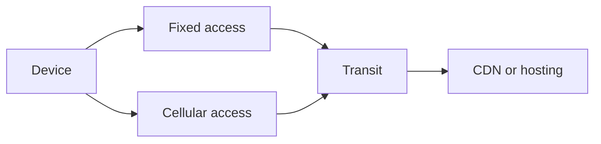

# Network

import { MethodIllustration } from '@site/src/components/method-illustrations';

Networks carry data between devices, data centres and third-party services. Impact depends on equipment and operations. Transferred volume can allocate that impact; it does not, by itself, describe marginal electricity consumption.

## Define segments

Fixed and cellular access are alternative paths. A local network, inter-datacentre transit and mobile access have different boundaries. The flow inventory determines factor selection.

| Situation | Input | Check |
|---|---|---|
| Controlled network | Equipment inventory and consumption | Allocation to the period and service |
| Opaque network | Compatible system factor | Technology, geography, year and covered phases |
| CDN | User traffic, origin traffic and cache resources | The user path remains on a cache hit |

## Why account for distance?

The D4B approach assumes that, with comparable technology, **the farther data travels, the more network equipment its delivery involves**: transmission equipment and intermediate relays. This equipment consumes electricity and carries manufacturing impacts. Distance represents this infrastructure when a detailed inventory is unavailable.[^distance-model]

A per-GB·km factor therefore combines transferred volume with estimated path length. It distinguishes local from long-distance transfers. Proportionality is an average approximation: equally long paths can involve different equipment, capacities and utilisation levels. It does not mean that each additional byte triggers a proportional increase in electricity consumption.

## Apply the factor's unit

The Digital4Better network model uses factors per volume and distance. This convention remains in use. For each segment $s$, manufacture and use-phase electricity are calculated separately:[^distance-model]

$$
I_{emb,i}=\sum_s V_s L_s F_{emb,i,s}
\qquad
E=\sum_s V_s L_s F_{elec,s}
$$

$V_s$ is volume in GB, $L_s$ distance in km, $F_{emb,i,s}$ a factor in impact units/(GB·km), and $F_{elec,s}$ a factor in kWh/(GB·km). Electricity is then converted into impacts using the mix selected for each segment. Per-byte·km data are multiplied by $10^9$ to obtain per-decimal-GB·km factors.

| Model segment | Selected distance | Use-phase electricity |
|---|---|---|
| User country | Estimated internal country distance | User-country factor |
| Between countries | Estimated distance between departure and destination countries | Continental or world factor, depending on the route |
| Hosting country | Estimated internal destination-country distance | Hosting-country factor |

This segmentation is a calculation convention, not an observed route. The hosting segment is not added again when departure and destination are in the same country. Browser caching reduces volumes upstream; the CDN reduces origin transfers on the inter-country and hosting segments while retaining the user segment.[^distance-model]

The Web, Email and Native applications examples use $I=V F_{route}$ with a factor in kg CO₂e/GB that already includes distance. This derived factor does not replace the D4B per-GB·km model; it represents a defined route and boundary.

<MethodIllustration kind="network-factor" lang="en" />

import { NetworkDistanceFigure, CdnTrafficFigure } from '@site/src/components/network-illustrations';

The distance between countries is the great-circle distance, the shortest path on a sphere, between their reference points, called [barycentres](../../references/glossaire#barycentre) in this method. Internal distance is estimated by the [equivalent radius](../../references/glossaire#rayon-equivalent) $r=\sqrt{S/\pi}$, where $S$ is the country's area in km².[^map-distances]

For Spain → Germany, the rounded values are 401 km, 1,615 km and 337 km. France, crossed in the illustration, does not add a step to the calculation. The circles show equivalent radii, not borders or network coverage.[^map-distances]

<NetworkDistanceFigure lang="en" />

### Origin and limitations of per-GB·km factors {#status-of-historical-factors}

D4B normalisation divides reference network factors by a conventional distance to obtain coefficients per volume·km. This is a D4B methodological transformation, not factors published directly per kilometre by ADEME. Provenance, data versions and the representativeness of this normalisation still require documentation; this qualification work does not mean that the model has been abandoned.[^distance-model]

The CCF coefficient of 0.001 kWh/GB concerns an inter-datacentre boundary. It is not a complete local-network or user-access factor. The CCF methodology[^ref-1] documents conversion assumptions.

Historical IR factor units require reconciliation. A sufficiently established system factor for LAN manufacture is unavailable here. These gaps remain visible in the [register](../../references/registre-des-hypotheses-et-valeurs-par-defaut).

## Handle access types and cache

Fixed and cellular volumes each receive their respective factor. Traffic measurements that already account for caching require no further hit-ratio subtraction. A cache may reduce origin traffic while retaining the user path and its own storage and computation costs.

Changing traffic does not establish a proportional energy change in a shared network. The result remains an allocation using the chosen factor.

<CdnTrafficFigure lang="en" />

## Apply to a service

[Web](../../cas-d-usage/services/service-web), [Email](../../cas-d-usage/services/mail) and [Native applications](../../cas-d-usage/services/mobile) simulators calculate transfers. Network factors must be supplied: a blank field means unassessed. A known network can rely on the [Fleet](../../cas-d-usage/environnements/parc-informatique) or [Hosting](../../cas-d-usage/environnements/infrastructure-d-hebergement) inventory, followed by a documented [allocation](../../regles/allocation-et-partage-des-impacts).

Each factor retains its source, version, unit and covered segments. Equipment already included in a system factor cannot contribute again.

## Detail the path segments

| Segment | Equipment and activity | Data to seek |
|---|---|---|
| LAN | Wi-Fi, switches, cables, internal site network | Inventory, energy, ports and usage time |
| Fixed access | Router, optical termination, operator network | Factor boundary, technology and period |
| Cellular access | Antennas, radio and core network | Generation, coverage, load and sharing |
| WAN transit | Routing, transport and interconnection | Included segments, volumes and allocation |
| CDN | Cache, storage, servers and client delivery | Cache-hit rate and resource location |

A path can cross several segments. An aggregate factor already covering access and transit replaces those contributions; it does not add to them. Active and passive equipment manufacture may be included or absent depending on the source.

### Local-network allocation and distance interpretation

For an inventoried LAN, distribute energy and manufacture using documented keys: reserved capacity, port time, traffic or an appropriate combination. Traffic-based allocation distributes an inventory; it does not prove energy scales linearly with each byte.

Geographical distance does not describe physical paths, relays or actual equipment. In the D4B per-GB·km model, it is a conventional estimate explicitly used in the calculation. The electricity country of a distributed network does not automatically match the device country.

A CDN may reduce origin traffic while retaining delivery to readers. An overall reduction depends on storage, requests and remaining transfers.

## Difference from PCR network allocation

The D4B model retains volume–distance allocation; the illustrations use a per-GB route factor. The Internet access PCR separates a traffic-dependent contribution from a fixed subscription contribution. The application PCR then allocates the fixed part between uses: reducing bytes does not reduce every allocated contribution proportionally.[^rcp-fai][^rcp-app]

### Understand the fixed contribution without mixing models

The application PCR combines a per-GB contribution with an annual per-subscription contribution, adjusted by subscriptions per user and the share of network usage time. Its annexed coefficients describe France. A whole annual subscription must not be added to every session.

This difference is documented without substituting PCR conventions for the D4B per-GB·km model. An additional fixed contribution depends on what that factor already covers. An unassessed fixed share remains an explicit limitation. The application PCR allows its exclusion when it is demonstrated to contribute less than 5% of the application's total impact, not by default.

The application PCR uses differing descriptions for users and sessions on pp. 26–27. Implementation requires distinct definitions of unique users, sessions, total traffic and traffic per user. LAN allocation uses user counts, separately from the Internet model. A smartphone on Wi-Fi is not a cellular access connection.

[^rcp-fai]: ADEME, [RCP de la fourniture d’accès Internet, rapport de 71 pages diffusé par l’ADEME (fiche publiée en 2023)](https://librairie.ademe.fr/industrie-et-production-durable/6008-referentiel-par-categorie-de-produit-rcp-de-la-fourniture-d-acces-internet-fai.html), p. 7, 17, 31–32.

[^rcp-app]: ADEME, [RCP des applicatifs numériques, juin 2026](https://librairie.ademe.fr/economie-circulaire-et-dechets/9434-referentiel-par-categorie-de-produit-rcp-des-applicatifs-numeriques.html), p. 24–27, 58.

[^ref-1]: [CCF methodology](https://www.cloudcarbonfootprint.org/docs/methodology/). Online documentation, unpinned version.

The local network (LAN) also comprises switches, access points, cabling and supporting equipment, with availability and redundancy requirements. The LAN PCR provides an inventory framework and telephony boundaries, not a universal per-GB factor. A missing aggregate LAN factor does not justify excluding an available local inventory.[^rcp-lan]

[^rcp-lan]: ADEME, [RCP réseau LAN et services de téléphonie d’entreprise](https://librairie.ademe.fr/economie-circulaire-et-dechets/6020-referentiel-par-categorie-de-produit-rcp-d-un-reseau-lan-et-des-services-de-telephonie-d-entreprise.html), 2023, p. 9–15, sections 2.1 (unités fonctionnelles) et 3 (frontières).

[^distance-model]: Digital4Better, [network modelling](https://github.com/digital4better/methodology/blob/4e40ae8e5e792b676c55d5586f59e6fb3c7181b4/docs/general.md), revision `4e40ae8`, external WAN modelling and per-byte/km factors; [Web application](https://github.com/digital4better/methodology/blob/4e40ae8e5e792b676c55d5586f59e6fb3c7181b4/docs/methodology/web.md), network impact section. D4B convention still in use, with estimated distances and coefficients requiring representativeness assessment.

[^map-distances]: Digital4Better Open Data, revision `77cae4a`: [country coordinates and areas](https://github.com/digital4better/data/blob/77cae4a58fadd5deb3b8d4e5577020da08f780d8/data/country/regions.json), [ESDE distance of 1,615.380 km](https://github.com/digital4better/data/blob/77cae4a58fadd5deb3b8d4e5577020da08f780d8/data/country/region-to-region-distances.json) and [internal distances ES = 401.311 km and DE = 337.254 km](https://github.com/digital4better/data/blob/77cae4a58fadd5deb3b8d4e5577020da08f780d8/data/country/user-to-datacenter-distances.json). [Calculation](https://github.com/digital4better/data/blob/77cae4a58fadd5deb3b8d4e5577020da08f780d8/index.ts), functions `computeDistance` (Earth radius of 6,371 km) and `generateCountries`. Basemap: Natural Earth, country boundaries at 1:110 million, [public domain](https://www.naturalearthdata.com/about/terms-of-use/). The network path is illustrative, not measured.
