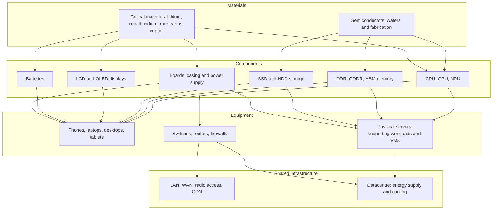

# Hardware overview

This section describes the materials, components and equipment used in calculations. Equipment and use cases provide entry points; materials explain how composition or production processes affect the result.

## Component modelling

A component model makes configuration assumptions visible[^model-data][^context][^ref-1]:

$$
I_{equipment}=I_{cpu}+I_{ram}+I_{storage}+I_{display}+I_{battery}+I_{structure}
$$

This approach is parametric and modular, but does not automatically outperform a representative product LCA. Aggregate factors remain appropriate when their boundaries and evidence better match the assessment. See [Equipment modelling](../modelisation/modelisation-d-un-equipement).

## From materials to services

## From components to services {#historical-equipment-archetypes}

Old Open Data equipment and VM flat factors are obsolete for the target method. Illustrative magnitudes now come from explicit configurations evaluated with component models.

| Level | Role in the calculation |
|---|---|
| Component | Characteristics and impact model with units, boundary and provenance |
| Equipment | Component assembly plus a non-overlapping structural residual |
| Virtual resource | Allocated share of physical equipment and shared resources |
| Service | Sum of allocated contributions for the functional unit |

The [terminal](equipements/terminaux) and [server](equipements/serveurs) examples follow this chain. Detailed calculations do not establish coefficient quality: exploratory assumptions remain identified in the [register](../references/registre-des-hypotheses-et-valeurs-par-defaut).

:::note[Embodied versus operational impacts]
Manufacturing can dominate for low-power devices, depending on lifetime, usage and electricity mix. No universal percentage is assumed. Operational impacts can dominate for continuously running servers, particularly on higher-impact electricity. See [Electricity impacts](../fondations/impacts-de-la-consommation-d-energie).
:::

## Section structure

| Layer | Chapters | Purpose |
|---|---|---|
| [Materials](materiaux/semi-conducteurs) | Semiconductors; critical materials | Processes, supply chains and origins of impacts |
| [Components](composants/processeurs-et-accelerateurs) | CPU/GPU, RAM, storage, display, batteries, structures | Parametric models and their evidence |
| [Equipment](equipements/terminaux) | Terminals, servers, network equipment | Assembly, allocation and interactive scenarios |
| [Network and infrastructure](reseau-et-infrastructure/reseau) | Network segments; datacentres | Shared-system modelling |

## Parametric models

These models have different evidence levels. Node multipliers and display/battery factors include D4B assumptions; contextual publications do not validate those coefficients.

| Object | Main parameters | GWP model / allocation | Evidence |
|---|---|---|---|
| CPU die | Die area in mm², node scenario | $(die\times0.0197+9.14)F_{node}$ | Historical UBA/Boavizta base; multiplier is a hypothesis |
| RAM | GB capacity, physical density | $(capacity/density)\times2.20+5.22$ per module | Historical model; density and technology need justification |
| SSD | GB capacity, NAND density | $(capacity/density_{NAND})\times2.20+6.34$ per drive | Historical model, not a universal modern-drive factor |
| HDD | Drive count | 31.11 kg CO₂ eq. per drive | Historical fixed estimate |
| Display | Area, technology | $area\times C_{technology}+base$ | D4B scenario |
| Battery | Wh capacity, chemistry | $capacity_{Wh}/1000\times F_{chemistry}$ | D4B scenario |
| Network | Traffic and compatible distance | $V\times L\times CF$ when the factor is per distance | Historical system convention; reuse depends on current units and boundary |

## Indicator coverage

| Indicator | Component-level evidence | Relevant processes | Current status |
|---|---|---|---|
| GWP | Historical models and scenarios | Manufacturing and operational energy | Available with explicit assumptions |
| ADPe | Partial | Historical CPU, RAM and SSD factors | LCIA compatibility required; battery not quantified |
| WU | Insufficient for current component models | Process water and electricity | Physical and characterised water cannot be mixed; removed from CPU/RAM simulators |
| AP, PM | Aggregate inventories exist | Manufacturing and use | No demonstrated component split |
| PE | Partial historical models | Primary energy | Additional information, not electricity consumption |
| IR | Unresolved historical unit | Lifecycle electricity and processes | Equipment result withheld pending kg/kBq reconciliation |
| CTUe, CTUh-nc, CTUh-c | Aggregate data with variable quality | Processing and extraction | Compatible inventories and characterisation methods required |

:::note[Actual coverage]
The methodology's nine selected indicators are not all calculated by every simulator. Missing results are data gaps, not zero impacts. Primary energy is additional information outside that set. Editorial indicator groups are not endpoint damage models.
:::

## Assumptions and limitations

- Materials currently provide interpretation rather than an autonomous calculation model for every substance.
- Component coefficients and D4B hypotheses require refinement as better inventories become available.
- GWP and some historical ADPe factors are available; each chapter specifies their limits. Aggregated toxicity and particulate factors do not validate a component-level breakdown.
- Networks remain heavily shared and are often represented through system factors.

[^ref-1]: Digital4Better, [Digital4Better data](https://github.com/digital4better/data).Evolving catalogue; pin a commit for reproducible factors.

[^context]: Digital4Better, Green Cloud Computing, UBA, 2021; ADEME Base Empreinte; Tannu & Nair on SSD embodied carbon; Kelly et al. and Ellingsen et al. for battery context; Wang et al. and Kuo et al. for semiconductor environmental inventories; Digital4Better data ([Digital4Better data](https://github.com/digital4better/data).). Consult specialised chapters for source scope and factor validity.Evolving catalogue; pin a commit for reproducible factors.

[^model-data]: Versioned equipment, cloud, country and electricity records in `digital4better/data`. [Digital4Better data catalogue, snapshot 77cae4a](https://github.com/digital4better/data/tree/77cae4a58fadd5deb3b8d4e5577020da08f780d8).
