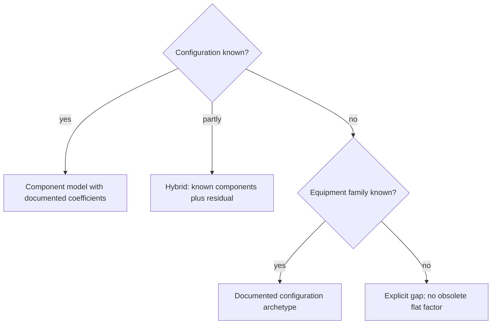
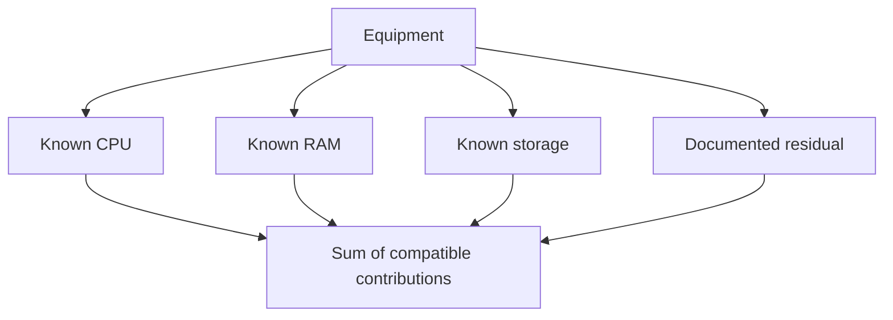
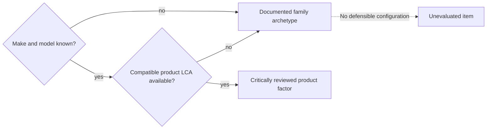

# Equipment modelling

import { MethodIllustration } from '@site/src/components/method-illustrations';

The target method reconstructs equipment from components, then allocates impacts to uses. Old Open Data equipment factors are obsolete for this calculation. A representative product LCA remains useful for calibration, validation or as a compatible specific inventory.

Reference models provide context; their reuse depends on boundary compatibility.[^source-1]

## Component-based principle

Digital equipment combines processors, memory, storage, displays, batteries and structural elements:[^source-4][^source-5]

$$
I_{equipment_i}=I_{cpu_i}+I_{ram_i}+I_{storage_i}+I_{display_i}+I_{battery_i}+I_{structure_i}
$$

<dl className="model-profiles">
  

    <dt>Transparent</dt>
    <dd>

Each component can be traced to its source.

    </dd>
  

  

    <dt>Parametric</dt>
    <dd>

The impact varies with the equipment’s characteristics.

    </dd>
  

  

    <dt>Modular</dt>
    <dd>

A component can be refined independently within the model.

    </dd>
  

  

    <dt>Comparable under conditions</dt>
    <dd>

Boundaries, units, characterisation methods and data quality must be harmonised before comparison.

    </dd>
  

</dl>

Unknown components must remain explicit gaps or documented residuals.

### Choosing the representation

| Approach | Application | Description | Traceability |
|---|---|---|---|
| Component model | Known/reconstructable configuration | Detailed, without automatic accuracy guarantee | Source for each component |
| Hybrid | Partial configuration | Components plus residual | Both parts documented |
| Parametric archetype | Family known, exact configuration unknown | Representative configuration | Explicit assumptions |
| Aggregate factor | Compatible equipment-level inventory | Aggregated | Source and covered boundary |

### Component reference catalogue {#component-catalogue}

The target `equipment` catalogue groups CPUs, accelerators, memory, storage, displays, batteries and structures. CPUs and accelerators are still published under `cloud` in the current snapshot; moving them is a future migration, not an already available path.[^component-catalogue]

Characteristics describe hardware. Factors and models describe its impacts with units, phases, sources and versions. Configurations assemble these elements. The cloud catalogue retains provider offerings and mappings to hardware.

An accelerator card separates die, memory and auxiliary elements. A complete-card inventory replaces the elements it covers; it is not added to them. The die proxy used in some illustrations remains a subtotal.

<MethodIllustration kind="accelerator" lang="en" />

[^component-catalogue]: Digital4Better, [data catalogue, snapshot 77cae4a](https://github.com/digital4better/data/tree/77cae4a58fadd5deb3b8d4e5577020da08f780d8), current paths `data/cloud/cpus.*` and `data/cloud/accelerators.*`. The target organisation is a D4B convention.

## Assessing impacts {#impacts-equipement}

### Component models {#component-models}

Evidence differs between models. Historical CPU, RAM and SSD coefficients are documented by Boavizta. Node, display, chemistry and residual coefficients used in the exploratory simulator include D4B scenarios. A contextual publication does not validate an individual coefficient.[^source-2][^source-3][^model-data][^source-6]

| Component | GWP model, kg CO₂ eq. | Inputs | Status / provenance |
|---|---|---|---|
| CPU die | $(die_{mm^2}\times0.0197+9.14)F_{node}F_{pkg}$ | Die area, node, packaging | Historical Boavizta base; node/package multipliers are hypotheses |
| RAM | $((capacity_{GB}/density)\times2.20+5.22)F_{pkg}$ per module | Capacity and documented physical density | Historical Boavizta model; technology compatibility required |
| SSD | $(capacity_{GB}/density_{NAND})\times2.20+6.34$ per drive | Capacity, NAND density | Historical Boavizta model |
| HDD | 31.11 per drive | Drive count | Historical fixed estimate; suitability depends on the equipment |
| Display | $area_{cm^2}C_{technology}+base$ | Diagonal, technology | D4B scenario, not calibrated here against a product LCA |
| Battery | $capacity_{kWh}F_{chemistry}$ | Capacity and chemistry | D4B scenario; contextual battery studies do not validate the chemistry table |
| Structural elements | Equipment-type residual | Device type | Supplier reports and explicit estimates where available |

A complete graphics card includes more than a CPU-style die estimate: memory, board, cooling, casing and other processes may be material. See the specialised [component chapters](../materiel/composants/processeurs-et-accelerateurs).

## Embodied impact {#impact-intrinseque-d-un-equipement}

### Annual allocation

$$
I_{emb_i}=\frac{\sum_c I_{c,emb_i}+I_{structure_i}}{RL}
$$

Component and structural inventories are total embodied impacts in $U_i$; $RL$ is the retained lifetime in years. The result is $U_i/\text{year}$. The component sum excludes the structural residual when that residual is added separately.

### Manufacturing geography

Manufacturing depends on processes and their energy supply. Wafers, assembly, memory, boards, displays and batteries may involve different countries. Market shares do not identify a particular product's supply chain.

Geography is specified by stage when known. Otherwise, the assessment retains the selected inventory's geography and identifies the gap. Prefilled exploratory countries are not observed production locations. The electricity factor of the usage country cannot replace total manufacturing impact.

:::note[Manufacturing versus use]
Usage country determines operational electricity factors. Changing it does not relocate manufacturing. Geographic adaptation of manufacturing requires the underlying process and electricity inventory.
:::

### Lifetime correction

The $TL/RL$ correction applies only to a factor already normalised per time unit, not again to total manufacturing. See [Time and ageing](../regles/temporalite-vieillissement-et-versionnement-des-donnees).

## Operational impact {#impact-operationnel-d-un-equipement}

$$
\begin{aligned}
P_{total}&=P_{cpu}+P_{ram}+P_{storage}+P_{display}+P_{other}\\
E_{elec}&=P_{total}D_{usage}
\end{aligned}
$$

Power in kW multiplied by duration in hours gives kWh. Supply losses and missing components contribute separately only when absent from the power boundary. A complete wall-power measurement already includes its component consumption.

Convert electricity using the relevant [electricity impact factors](../fondations/impacts-de-la-consommation-d-energie#conversion-consommation-electricite-impact-operationnel).

## Worked laptop reconstruction

**Fictitious scenario:** 14-inch laptop, 150 mm² CPU with a 7 nm scenario multiplier, 16 GB RAM, 512 GB SSD, LCD and 56 Wh NMC battery.

| Component | Applied scenario | Manufacturing GWP, kg CO₂ eq. | Approximate share |
|---|---|---|---|
| CPU | $(150\times0.0197+9.14)\times1.8$ | 21.8 | 14.7% |
| RAM | $((16/1.0)\times2.20+5.22)\times1.1$ | 44.5 | 30.0% |
| SSD | $(512/48.5)\times2.20+6.34$ | 29.6 | 19.9% |
| LCD | $540.36\times0.07+3.0$ | 40.8 | 27.5% |
| Battery | $0.056\times65$ | 3.6 | 2.5% |
| Structure | Laptop residual assumption | 8.0 | 5.4% |
| **Total** | Unrounded sum | **148.3** | **100%** |
| **Annual allocation over five years** | | **29.7 kg CO₂ eq./year** | |

:::note[Interpretation]
The 16:9 screen area is $14^2\times2.54^2\times144/337\approx540.36$ cm². Values are rounded. The CPU multiplier 1.8, RAM density 1 GB/cm² and DDR5 packaging 1.1, display/battery factors and structural residual are scenario assumptions. Their contribution shares do not establish universal priorities or the footprint of a commercial laptop.
:::

## Cross-validation against equipment factors

A valid comparison needs the same configuration, lifetime, lifecycle stages, LCIA method and unit. A difference from a family average neither validates the component model nor proves that hardware generation explains the gap.

The comparison identifies the exact product LCA, version, configuration, boundaries and unresolved differences. Earlier non-reproducible numerical comparisons are retained in the refactoring archive rather than used as validation evidence. An independent calibration campaign remains necessary.

### Hybrid model {#hybrid-model}

The residual covers unmodelled board, casing, power supply, cables and assembly. An explicit description of its contents prevents overlap; see [Structural elements](../materiel/composants/elements-structurels).

## When a component model is unsuitable

## Missing data

Absent information remains identified as missing. A comparable reference can supply an estimate, with its source and justification. This substitution is a modelling choice, not automatic hardware detection. Known data take precedence.

A documented representative configuration, called an [archetype](../references/glossaire#archetype), can fill missing characteristics or represent the whole device when detail is insufficient.

| Situation | Response |
|---|---|
| Component model unknown, type known | Documented same-type archetype |
| Component and type unknown | Explicit residual where justified; otherwise gap |
| Power unknown | Representative family estimate, with operating assumptions |
| Lifetime unknown | Documented nominal or expected lifetime |
| No detailed equipment data | Compatible aggregate equipment factor |

## Assumptions and limitations

- Component decomposition is useful only when its inputs are supportable.
- Historical coefficients require technology and unit checks; CPU die area is in mm², whereas some memory models use cm².
- No statistical validation of D4B scenarios is claimed. Missing non-climate inventories are not zero impacts.
- Structural residuals remain an area for improvement.

[^source-1]: UBA, [Green Cloud Computing](https://www.umweltbundesamt.de/publikationen/green-cloud-computing), 2021; verify component-specific units. See the [documentary corpus](../references/sources-et-corpus).

[^source-2]: [Boavizta documentation](https://doc.api.boavizta.org/). Online documentation, unpinned version.

[^source-3]: Tannu & Nair, 2023. [The Dirty Secret of SSDs: Embodied Carbon](https://arxiv.org/abs/2207.10793)

[^source-4]: Kelly et al., 2021, lithium carbonate/hydroxide LCA: battery context, not validation of simulator chemistry factors. See the [documentary corpus](../references/sources-et-corpus).

[^source-5]: Ellingsen et al., 2014, [LCA of a Li-Ion Battery Vehicle Pack](https://doi.org/10.1111/jiec.12072).

[^source-6]: Digital4Better, ADEME Base Empreinte and [Digital4Better data](https://github.com/digital4better/data).Evolving catalogue; pin a commit for reproducible factors.

[^model-data]: Historical component models, documented hardware configurations, versioned `digital4better/data` cloud CPU/accelerator records and product LCA reports where a compatible comparison is possible. [Digital4Better data catalogue, snapshot 77cae4a](https://github.com/digital4better/data/tree/77cae4a58fadd5deb3b8d4e5577020da08f780d8).
