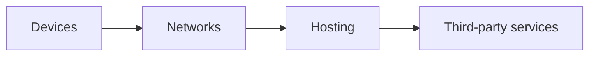

# Model a service

A service relies on devices, networks, hosting and sometimes third-party services. The model connects observed activities to those resources, then adds impacts in a common unit.

The delivered function defines the assessment: checking an account, sending a message or generating an image. A technical request can be a calculation unit, but does not by itself establish equivalence between services.

## Cover the software lifecycle

The device, network, hosting and third-party breakdown also applies to resources used to design, test, deploy, maintain and retire the service. The application PCR describes these stages; the parent PCR calls for service-specific development activities, including model training, to be considered.[^rcp-app][^rcp-parent]

| Activity | Resources to identify | Check |
|---|---|---|
| Design, development and testing | Workstations, CI, test environments, datasets | Shared-resource allocation between projects |
| Operation and maintenance | Production, monitoring, backups, technical support | Background tasks and reserved capacity included |
| Service retirement | Migration, archiving, deletion | Software retirement distinct from equipment end of life |

These activities extend the inventory within the same four contributions; they do not create a fifth contribution when those resources are already counted. The application PCR recommends including human resources with an explicit boundary. Interactive examples remain focused on the usage described and do not automatically inventory these stages.

## Decompose the boundary

| Layer | Activity data | Choice to document |
|---|---|---|
| Device | Active time and hardware profile | Allocation between simultaneous uses |
| Network | Actual transferred bytes | Segments and factor boundary |
| Hosting | Reserved resources, energy | Sharing, idle capacity and PUE |
| Third-party services | Activity or allocated contribution | Inclusion in existing measurements |

A service may use several networks or sites. The diagram describes contributions, not a mandatory physical path.

## Assemble contributions

For each indicator, the total combines compatible contributions:

$$
I_{service}=I_{device}+I_{network}+I_{hosting}+I_{third\ parties}
$$

Each term may include allocated manufacture and operation. Their addition requires compatible phase coverage. A complete service factor would duplicate the same equipment already inventoried.

A network factor in kg CO₂e/GB multiplies a volume in GB. The D4B network model uses per-GB·km factors multiplied by estimated segment distances. A per-GB route factor does not receive that distance multiplier again. Missing data remains an unassessed contribution.

## Reproducible example

This example uses the “Custom parameters” device mode in [Web service](../cas-d-usage/services/service-web): 100,000 views of 60 seconds, a 40 W device, 200 kg CO₂e manufacture over five years, 100 allocated IT kWh, PUE 1.2 and 20 kg already allocated hosting manufacture. Device and hosting countries are France.

| Contribution | Calculation | Result |
|---|---|---:|
| Device time | 100,000 × 60 / 3,600 | 1,666.67 h |
| Device manufacture | 200 × (100,000 × 60 / 3,600) / (5 × 8,760) | 7.61035 kg CO₂e |
| Device energy | (100,000 × 60 / 3,600) × 40 / 1,000 | 66.6667 kWh |
| Hosting energy | 100 × 1.2 | 120 kWh |
| Electricity emissions | (66.6667 + 120) × 0.0319271 | 5.95973 kg CO₂e |
| Hosting manufacture | Allocated input | 20 kg CO₂e |
| **Subtotal** | Using unrounded values | **33.57008 kg CO₂e** |

Hardware parameters are exercise assumptions. Electricity uses the D4B France 2025 snapshot[^ref-1]. Network and third parties remain unassessed: this subtotal is not the complete service footprint.

## Apply the relevant rules

1. Set the [boundary and unit](../fondations/perimetre-frontieres-services-tiers-et-unite-d-analyse).
2. The [strategy](./strategies-de-modelisation) depends on available data.
3. [Allocation](../regles/allocation-et-partage-des-impacts) describes how shared resources contribute to the service.
4. [Double counting](../regles/double-comptabilisation) and [data quality](../regles/qualite-des-donnees-et-matrice-de-robustesse) determine whether the result is consistent and interpretable.

[Email](../cas-d-usage/services/mail), [Native applications](../cas-d-usage/services/mobile) and [AI](../cas-d-usage/services/ia-generative) adapt this sequence to their activities. [Cloud](../cas-d-usage/environnements/cloud) and [Hosting](../cas-d-usage/environnements/infrastructure-d-hebergement) detail the server layer. [Fleet](../cas-d-usage/environnements/parc-informatique) assesses physical inventory; adding it directly to services using that same fleet would duplicate contributions.

[^rcp-app]: ADEME, [RCP des applicatifs numériques, juin 2026](https://librairie.ademe.fr/economie-circulaire-et-dechets/9434-referentiel-par-categorie-de-produit-rcp-des-applicatifs-numeriques.html), p. 14–15, 38–40.

[^rcp-parent]: ADEME, [RCP services numériques, version 2, juin 2026](https://librairie.ademe.fr/societe-et-politiques-publiques/9418-methodologie-d-evaluation-environnementale-basee-sur-l-analyse-du-cycle-de-vie-acv-pour-un-service-numerique.html), p. 13–15.

[^ref-1]: Digital4Better, [D4B France 2025 snapshot](https://github.com/digital4better/data/blob/77cae4a58fadd5deb3b8d4e5577020da08f780d8/data/factor/country-yearly.csv). Snapshot 77cae4a, 2025 data; reviewed 16 October 2026.
